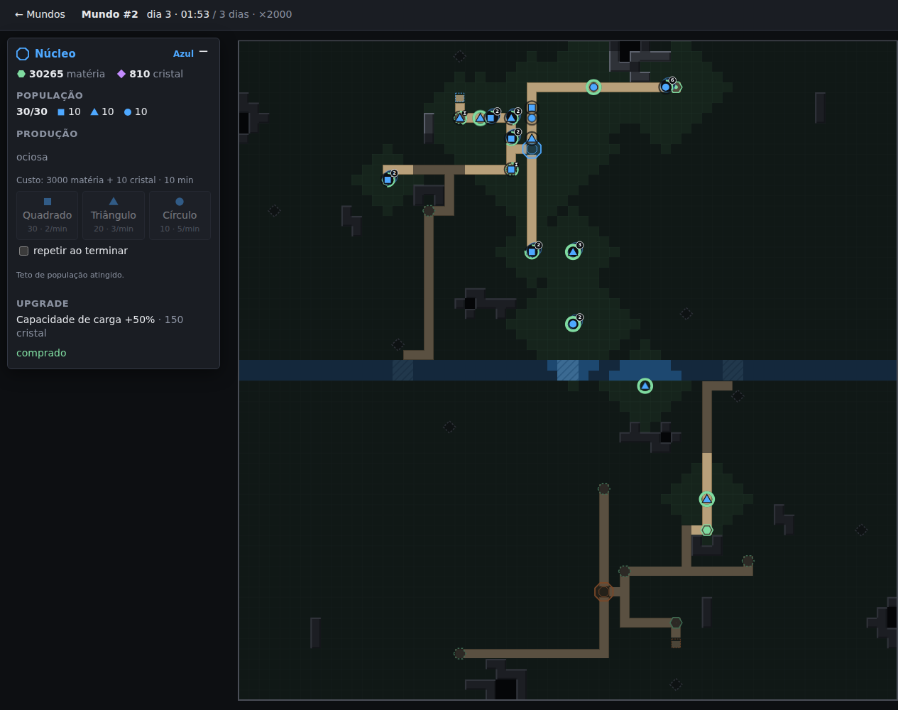
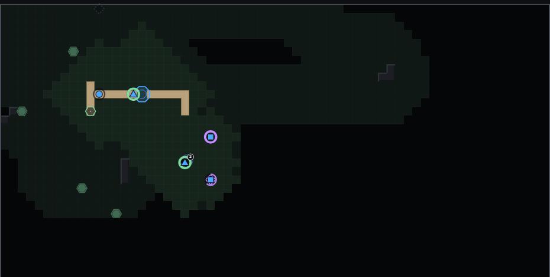

# geometrix

**A persistent multiplayer strategy game for the browser, drawn only with geometry.** Your creeps haul wealth across
a fogged jungle for days, even while you sleep. On the way, someone may stop them and ask for a toll, and the fight
that follows is played in real time.

[Overview](docs/OVERVIEW.md) ([pt-br](docs/OVERVIEW.pt-br.md)) · [Current status](docs/dashboard/current-status.md) ·
[Roadmap](docs/ROADMAP.md)



> **Pre-alpha.** The world, the economy, the autopilot, the fog of war and roadside encounters are playable locally,
> against bots or with friends on the same machine. Real-time battles are playable in a separate battle lab. Joining
> the two is the milestone being built now; after it comes the first playtest with friends over the internet.

## Why it might be your kind of game

- **The world keeps going without you.** A match lasts days (three, for now). When you log off, your creeps keep
  working by the rules you left them: an ordered list of `condition → action`, like the gambits of Final Fantasy XII.
  "Deliver when full; gather cristal; explore while you know no cristal; otherwise go home."
- **Wealth is physical.** Matéria and cristal sit somewhere on the map and must be carried home, one bag at a time. A
  loaded creep is slower, and it is a target. Roads are built cell by cell, and they are neutral: the enemy walks on
  yours too.
- **Ambush, extortion, flight.** An enemy creep can approach yours and attack, or demand a toll. Pay and walk away with
  a safe-conduct, refuse and fight, or drop the bag and run. Your autopilot rules decide when nobody is watching.
- **Battles you can play.** A fight opens a small grid arena: four facing directions, a square that blocks the way and
  hits the cell in front, triangles and circles that shoot projectiles you can dodge, and an escape through the border.
  With no human around, the same simulation runs headless, decided by the gambits AI.
- **Stories, not spreadsheets.** Creeps have names and die for good. A chronicle narrates what happened: the toll paid
  at the ford, the scout that never came back.
- **Any creep can be the hero.** There is no fixed hero: take direct control of any creep on your team, play it, then
  release it back to its autopilot.
- **Fog of war, enforced by the server.** Each team only ever receives what it sees and remembers.
- **Shape is meaning.** A square is a slow, sturdy hauler; a circle is a fast, far-sighted scout; a triangle sits in
  between. No art pipeline, just geometry.



## What you can play today

- A procedurally generated map, mirrored for both teams, with a river, a few fords and rocks that block sight.
- Gathering, hauling and delivering matéria and cristal; building roads; producing creeps; a cargo upgrade.
- An autopilot editor with presets (gatherer, scout, road builder, raider), and direct control of one creep at a time.
- Fog of war in three states (never seen, remembered, in sight), with the team's memory of what it has seen.
- Encounters between creeps (attack, extort, pay, refuse, flee), HP, death, spoils and a chronicle. The fight in the
  world is still a throwaway roll.
- **The battle lab** (`npm run lab`): set up a battle of 2 to 4 sides, dominate a creep against the AI, and feel the
  combat under simulated latency.
- Bots that play a whole match by the same rules, and an in-browser replay of any finished world.

## What comes next

| Milestone | Question it answers | Status |
|---|---|---|
| **M1 · The wealth cycle** | Is gathering, hauling and investing interesting on its own? | ✅ Done |
| **M1.5 · The fog** | Does hiding information create decisions without making the map unreadable? | ✅ Done |
| **M2 · The ambush** | Can a fight change the course of the world without dominating the game? | 🟡 The encounter ✅ and the battle lab ✅; next, the junction (the encounter opens a real-time battle), then a playtest with friends |

## Under the hood

The interesting engineering is not the graphics but a world that runs for days and can be replayed exactly:

- **Two deterministic simulations** (`packages/sim` for the world, `packages/battle` for combat; TypeScript, no
  runtime dependencies) run on the server, in a headless CLI and in the browser. Integer math only: positions in
  cells, speeds in per-mille, no `Math.random`, no floating-point literals. The linter enforces it.
- **Replay = seed + command log.** A three-day bot-vs-bot world logs about 90 commands. Replays give the same state
  hash in V8 (Chromium) and JavaScriptCore (WebKit).
- **Server-authoritative, per-team view deltas** over WebSocket: about 200 bytes per second per client at real speed,
  numbered, checked by hash and resumable after a drop.
- **SQLite with snapshots and a command log.** A soak test kills the server with `kill -9` five times during a whole
  world and checks that every client ends with the server's exact view.
- **A headless harness** runs three days of world in about 13 seconds, and 9,200 AI battles in under a minute, so
  balance is tuned with data from many seeds before anyone plays.
- **Stack:** Node 26, TypeScript, Preact + signals with SVG, Vite, `ws`, `better-sqlite3`, zod, Vitest. About 2,700
  tests.

## Quick start

```bash
nvm use                                  # Node 26
npm install
npm run dev:multi -- --clients 2         # builds, starts a server and opens one tab per player
npm run lab                              # the battle lab
npm run geo -- sim --seed 42 --days 3    # a whole bot-vs-bot world, with a report in runs/
npm run check                            # typecheck, lint, format and tests (what CI runs)
```

More commands (server, replay, network, battle and soak tests) are listed in [CLAUDE.md](CLAUDE.md).

## How it is built

Design and code move through explicit gates: pillars and a game design document, then a spec, a plan and tasks for
each slice, with the owner approving every step, architecture decisions recorded as ADRs, and small phases merged one
at a time. Development is done with [Claude Code](https://claude.com/claude-code): the owner decides the design and
approves each gate, and the workflow lives in [`CLAUDE.md`](CLAUDE.md) and `.claude/skills/`. To work on it with
AI agents (Claude Code, opencode, Kilo), see the [harness guide](docs/HARNESS.md).

| To… | Read |
|---|---|
| Get the big picture, with no prior knowledge | [Overview](docs/OVERVIEW.md) ([pt-br](docs/OVERVIEW.pt-br.md)) |
| Understand the game | [Pillars](docs/PILLARS.md) → [GDD](docs/gdd/README.md) → [Glossary](docs/GLOSSARY.md) |
| See where the project is | [Status dashboard](docs/dashboard/current-status.md) |
| Understand the technical decisions | [ADRs](docs/adr/README.md) |
| See how a slice is specified | [Specs](docs/specs/README.md) |
| Run a playtest | [PLAYTEST.md](docs/PLAYTEST.md) |

The game's interface text is in Portuguese for now; everything else in the repository is in English.

## Contributing

The project is early and the design moves fast. Issues and discussions are welcome: ideas, playtest impressions and
questions about the architecture are the most useful right now.

## License

[GNU Affero General Public License v3.0](LICENSE). You can play, study, modify and host the game; if you run a
modified version for others over a network, you must offer them its source code.
