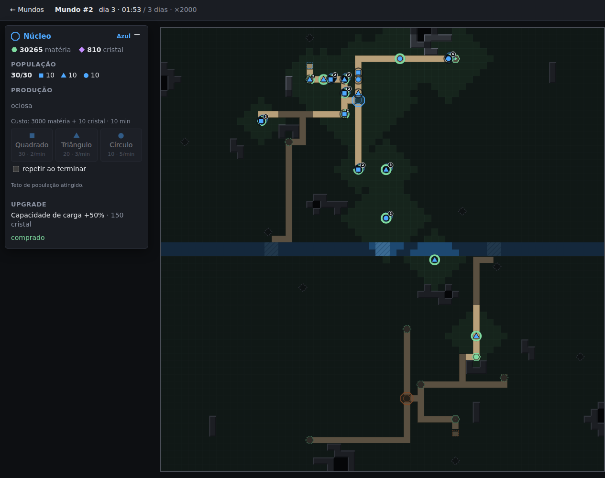
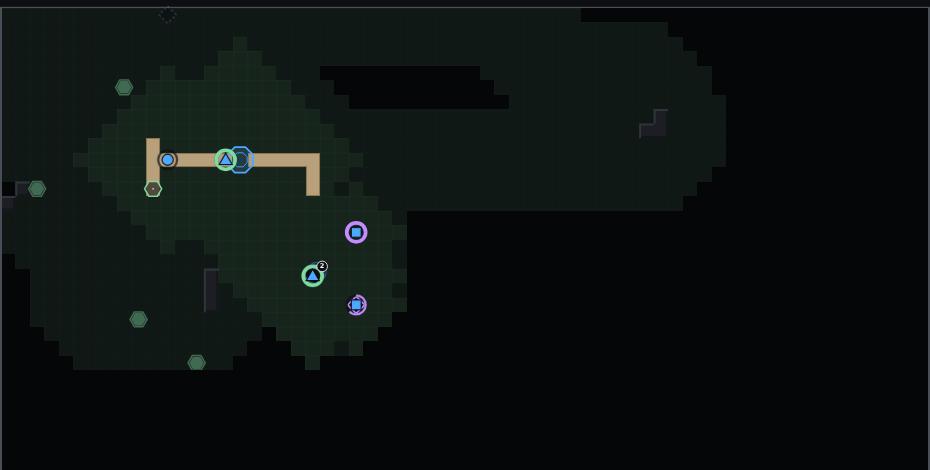

# geometrix

**Um jogo de estratégia multiplayer persistente no navegador, desenhado só com geometria.** Seus creeps carregam
riqueza por uma jungle coberta de névoa durante dias, mesmo enquanto você dorme. No caminho, alguém pode pará-los e
cobrar pedágio.

[Read in English](README.md) · [Visão geral do projeto](docs/OVERVIEW.md) ·
[Como é uma partida](docs/GAMEPLAY.md) · [Status atual](docs/dashboard/current-status.md)



> **Pré-alfa.** O mundo, a economia, o piloto automático, o fog of war e os encontros na estrada já se jogam
> localmente, contra bots ou com amigos na mesma máquina; as batalhas em tempo real se jogam num laboratório de
> batalha local. Ainda não há servidor público. Juntar as batalhas ao mundo é o próximo passo.

## Por que pode ser o seu tipo de jogo

- **O mundo continua sem você.** Uma partida dura dias (três, por enquanto). Quando você sai, seus creeps seguem
  trabalhando pelas regras que você deixou: uma lista ordenada de `condição → ação`, como os gambits de Final
  Fantasy XII. "Entregue quando cheio; colete cristal; explore enquanto não conhecer cristal; senão, volte para
  casa."
- **Riqueza é física.** Matéria e cristal estão em algum lugar do mapa e precisam ser carregados até a base, uma
  bolsa por vez. O creep carregado anda mais devagar e vira alvo. Estradas são construídas célula a célula e são
  neutras: o inimigo também anda nas suas.
- **Emboscada, extorsão, fuga.** Um creep inimigo pode abordar o seu e atacar, ou cobrar pedágio. Pague e siga com
  um salvo-conduto, recuse e lute, ou largue a bolsa e corra. Escapar depende da velocidade, da carga e do terreno:
  boa sorte atravessando um vau com um quadrado carregado até o talo. Os encontros de estrada do Mount & Blade,
  decididos pelas regras do piloto automático quando ninguém está olhando.
- **Batalhas curtas em tempo real, numa grade** *(no laboratório hoje; no mundo em seguida)*. Ataque direcional,
  projéteis que dá para desviar, quadrados que bloqueiam a passagem, uma contagem de três segundos e a fuga pela
  borda da arena, com ou sem a bolsa. Os creeps que você não controla lutam pelos gambits, e uma batalha sem humanos
  se resolve sozinha, pela mesma simulação.
- **Histórias, não planilhas.** Creeps têm nome e morrem de vez. Uma crônica narra o que aconteceu, o pedágio pago
  no vau, o batedor que nunca voltou, no espírito de RimWorld e Dwarf Fortress.
- **Qualquer creep pode ser o herói.** Não há herói fixo: assuma o controle direto de qualquer creep do seu time,
  jogue com ele e depois devolva-o ao piloto automático.
- **Monte o seu próprio bot.** Tudo o que muda o mundo é um comando, e os bots da casa usam os mesmos comandos
  validados de um jogador. Planejado: uma linha de comando no chat, com verbos no estilo do BYOND, macros no
  cliente e, mais tarde, scripts em sandbox no servidor, para programar os creeps além dos presets de fábrica.
- **Fog of war garantido pelo servidor.** Cada time só recebe o que vê e o que lembra. O terreno chega conforme se
  explora, e um comando sobre algo que o time nunca viu recebe a mesma recusa de um id inexistente.
- **Forma é significado.** O quadrado é o carregador lento e resistente; o círculo, o batedor rápido que enxerga
  longe; o triângulo fica no meio. Sem pipeline de arte, só geometria.



## O que já dá para jogar

- Um mapa gerado por seed, espelhado para os dois times, com um rio, poucos vaus e pedras que bloqueiam a visão.
- Coletar, transportar e entregar matéria e cristal; construir estradas; produzir creeps; um upgrade de carga.
- Um editor de piloto automático com presets (coletor, batedor, construtor de estrada) e o controle direto de um
  creep por vez.
- Fog of war em três estados (nunca visto, lembrado, à vista), com a memória do que o time já viu.
- Encontros na estrada: abordar, extorquir, pagar, recusar ou fugir; HP que persiste, morte permanente, despojo no
  chão e uma crônica do que aconteceu. No mundo, a luta em si ainda se resolve por um sorteio provisório.
- Um laboratório de batalha (`npm run lab`): batalhas na grade contra a IA, com até quatro lados, gambits editáveis,
  três arenas e latência simulada.
- Bots que jogam uma partida inteira pelas mesmas regras, e o replay no navegador de qualquer mundo encerrado.

## O que vem depois

| Marco | Pergunta que ele responde | Status |
|---|---|---|
| **M1 · O ciclo da riqueza** | Coletar, transportar e investir já é interessante sozinho? | ✅ Concluído |
| **M1.5 · A névoa** | Esconder informação cria decisões sem tornar o mapa ilegível? | ✅ Concluído |
| **M2 · A emboscada** | A luta muda o rumo do mundo sem dominar o jogo? | 🟡 Em construção: o encontro ✅ e o laboratório de batalha ✅; a seguir, as batalhas juntas ao mundo, depois cerco e reparo |
| **Os itens** | Um item que se ganha e se perde dá motivo para lutar e para voltar ao jogo? | Próximo marco (candidato) |
| **Banco de ideias** | Creeps com traits e títulos, os jogadores como deuses na crônica, ligas lideradas por um creep, o arco secreto do mundo e o seu mestre, tribos vivas, a governança do time, lendas que invadem outros mundos | Ideias, ainda sem número |

Cada marco é uma hipótese testada em playtest antes do próximo começar; as outras ideias esperam num banco por tema
até o dono escolher o próximo marco ([roadmap](docs/ROADMAP.md) e o [guia ilustrado da partida](docs/GAMEPLAY.md)).

## Por dentro

A engenharia interessante não está nos gráficos, mas num mundo que roda por dias e pode ser reproduzido exatamente:

- **Uma simulação determinística** (`packages/sim`, TypeScript, sem dependências) roda no servidor, numa CLI sem
  interface e no navegador. Só matemática inteira: posições em células, velocidades em ‰, nada de `Math.random` nem
  de literais de ponto flutuante. O linter garante.
- **Replay = seed + log de comandos.** Um mundo bot × bot de três dias registra uns 140 comandos. Os replays dão o
  mesmo hash de estado no V8 (Chromium) e no JavaScriptCore (WebKit).
- **Servidor autoritativo, com deltas da visão de cada time** por WebSocket: uns 200 bytes por segundo por cliente
  na velocidade real, numerados, conferidos por hash e retomáveis depois de uma queda.
- **SQLite com snapshots e log de comandos.** Um teste de resistência derruba o servidor com `kill -9` cinco vezes
  durante um mundo inteiro e confere que cada cliente termina com a visão exata do servidor.
- **Uma simulação de batalha à parte** (`packages/battle`), tão determinística quanto, a 20 ticks por segundo. Uma
  batalha 3 × 3 inteira resolvida pela IA leva uns 40 ms, e uma varredura roda milhares de batalhas em menos de um
  minuto.
- **Um harness sem interface** roda três dias de mundo em uns 13 segundos, e o balanceamento é ajustado com dados de
  dezenas de seeds antes de alguém jogar.
- **Stack:** Node 26, TypeScript, Preact + signals com SVG, Vite, `ws`, `better-sqlite3`, zod, Vitest. Cerca de
  2 700 testes.

A [visão geral](docs/OVERVIEW.md) explica as decisões, os custos e os trade-offs, incluindo por que o jogo não usa
Unity nem Godot.

## Para rodar

```bash
nvm use                                  # Node 26
npm install
npm run dev:multi -- --clients 2         # build, sobe um servidor e abre uma aba por jogador
npm run geo -- sim --seed 42 --days 3    # um mundo bot × bot inteiro, com relatório em runs/
npm run check                            # typecheck, lint, format e testes (o que o CI roda)
```

Os outros comandos (servidor, replay, testes de rede e de resistência) estão no [CLAUDE.md](CLAUDE.md).

## Como é construído

Design e código passam por portões explícitos: pilares e um GDD; depois spec, plan e tasks para cada fatia, com o
dono aprovando cada etapa; decisões de arquitetura registradas em ADRs; e fases pequenas, com merge uma de cada vez.
O desenvolvimento é feito com o [Claude Code](https://claude.com/claude-code): o dono decide o design e aprova cada
portão, e o fluxo de trabalho mora no [`CLAUDE.md`](CLAUDE.md) e em `.claude/skills/`.

**Idioma:** código, identificadores e mensagens de commit em inglês. Os documentos de design (pilares, GDD, specs,
ADRs, roadmap) em português.

| Para… | Leia |
|---|---|
| Entender o jogo | [Guia da partida](docs/GAMEPLAY.md) → [Pilares](docs/PILLARS.md) → [GDD](docs/gdd/README.md) → [Glossário](docs/GLOSSARY.md) |
| Saber onde o projeto está | [Dashboard de status](docs/dashboard/current-status.md) |
| Entender as decisões técnicas | [ADRs](docs/adr/README.md) |
| Ver como uma fatia é especificada | [Specs](docs/specs/README.md) |
| Fazer um playtest | [PLAYTEST.md](docs/PLAYTEST.md) |

## Contribuindo

O projeto está no começo e o design muda rápido. Issues e discussões são bem-vindas, em português ou em inglês:
ideias, impressões de playtest e perguntas sobre a arquitetura são o que mais ajuda agora.

## Licença

[GNU Affero General Public License v3.0](LICENSE). Você pode jogar, estudar, modificar e hospedar o jogo; se rodar
uma versão modificada para outras pessoas pela rede, precisa oferecer a elas o código-fonte.
