# geometrix: a partida, passo a passo

> **Um guia ilustrado do jogo que estamos construindo:** como uma partida deve correr, do primeiro minuto ao fim do
> mundo, juntando o que já se joga, o que o dono já decidiu e o que ainda é ideia. Não é fonte de verdade: o
> [GDD](gdd/README.md) é, e cada seção aponta para ele. Os números são provisórios, e os exemplos (nomes, frases da
> crônica, fichas) são ilustrações, não texto do jogo.
>
> **Retrato de 2026-11-20**, depois da fatia B do M2 e das quatro rodadas do
> [consolidado depois do M2](brainstorm/2026-11-20-consolidado-depois-do-m2.md). Para a arquitetura, os custos e
> as decisões técnicas, veja a [visão geral](OVERVIEW.md).

**Legenda** (aparece em cada mecânica):

| Marca | Quer dizer |
|---|---|
| ✅ **Já se joga** | Está no código e roda hoje (no mundo ou no laboratório de batalha) |
| 🟢 **Decidido** | O dono aprovou a direção; ainda não foi construído. Os detalhes saem da spec do tema |
| 🟡 **Proposta** | Sugestão registrada no GDD ou num brainstorm, sem a aprovação do dono |
| 🔮 **Em análise** | O dono pediu para estudar antes de decidir |

**As imagens** são de dois tipos, e a legenda de cada uma diz qual: **📷 captura**, o jogo de hoje rodando
(um mundo bot × bot visto pelo Azul, ou o laboratório de batalha), e **🎨 maquete**, um desenho em HTML e CSS do
que ainda não existe, com o carimbo "maquete" na própria imagem. As maquetes ilustram propostas e decisões ainda
sem forma: a tela de verdade pode sair diferente.

O jogador ainda não tem nome na história. Este guia diz **"você"** e, quando fala do papel dele na crônica,
**"deus"**, o nome provisório ([§6](#6-a-moldura-da-saga-em-análise) explica por quê).

## Sumário

1. [A partida numa imagem](#1-a-partida-numa-imagem)
2. [Quem está na mesa](#2-quem-está-na-mesa)
3. [Uma partida contada](#3-uma-partida-contada)
4. [Como os ciclos se alimentam](#4-como-os-ciclos-se-alimentam)
5. [Dois jeitos de jogar o mesmo mundo](#5-dois-jeitos-de-jogar-o-mesmo-mundo)
6. [A moldura da saga (em análise)](#6-a-moldura-da-saga-em-análise)
7. [No banco, sem marco](#7-no-banco-sem-marco)
8. [Ver com os próprios olhos](#8-ver-com-os-próprios-olhos)

---

## 1. A partida numa imagem

Uma partida é **um mundo que dura dias** (a hipótese é 3), e corre mesmo com todo mundo offline. Dois times começam
cada um com um Núcleo, numa jungle coberta de névoa, e terminam quando um Núcleo cai, quando o relógio acaba ou quando
o mundo acaba antes.

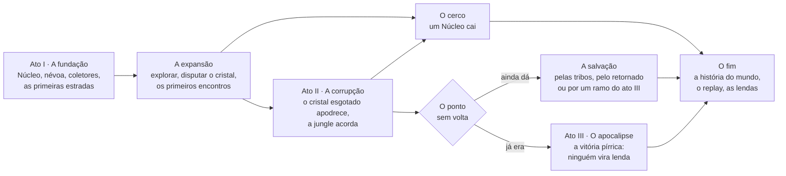

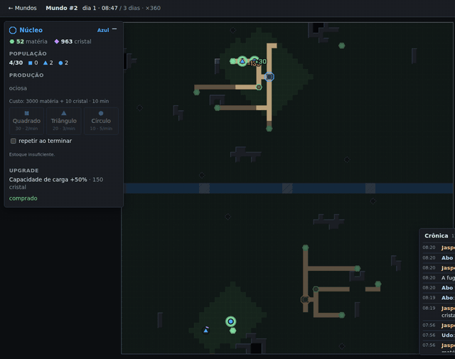

*📷 Captura: um mundo de três dias em 25 quadros (seed 42, ×360, um bot em cada time, visto pelo Azul). As estradas
saem dos dois Núcleos, descem e se encontram no vau; a névoa abre por onde os creeps passam.*

Hoje se joga a fundação, a expansão e os encontros (✅). O cerco e o fim mínimo são a fatia E do M2 (🟢). Os atos,
a corrupção e os finais são o tema "O arco do mundo" (🟢 a direção, sem marco ainda).

**Três escalas de tempo**, cada uma com o seu relógio:

| Escala | Quanto dura | Ritmo | Quem decide |
|---|---|---|---|
| **O mundo** | Dias | 1 tick por segundo de mundo; um creep anda 2 a 5 células por minuto | Você, quando entra; as regras dos creeps, sempre |
| **O encontro** | Segundos de mundo | A conversa na estrada: abordar, pagar, recusar, fugir | O piloto do creep na hora; você, se dominar o creep, numa janela de 60 s |
| **A batalha** | Lutas curtas, até um lado sobrar | 20 ticks por segundo, em tempo real | Você, no creep que domina; os gambits, nos outros |

## 2. Quem está na mesa

| Peça | O que é | Estado |
|---|---|---|
| **Você** | Um jogador de um time. Domina **um creep por vez** e deixa regras para todos os outros | ✅ |
| **Os creeps** | As unidades do time. Cada um tem nome, forma (o DNA), HP, carga e uma lista de regras. Morrem de vez | ✅ |
| **O Núcleo** | O coração do time: recebe as entregas, produz creeps, guarda o estoque. Derrubá-lo vence a guerra | ✅ (o HP e o cerco: 🟢 fatia E) |
| **As estradas** | Construídas célula a célula; deixam a viagem 2× mais rápida e são neutras: o inimigo também anda nelas | ✅ |
| **Os errantes** | Monstros que vagam rápido e voltam cada vez mais; entram nas lutas por perto | 🟢 fatia D |
| **Os chefões** | Lentos, num ponto do mapa; dão um buff ou um item raro a quem dá o último golpe | 🟢 tema "A jungle hostil" |
| **As tribos** | Facções neutras que viram aliadas, rivais ou convertidas | 🟢 tema "O mundo vivo" |
| **O mestre da mesa** | Um papel neutro que mantém a partida viva e conduz o arco. Um bot sempre; a cadeira, aberta a um humano | 🟢 tema "O arco do mundo" |
| **A crônica** | O narrador do mundo: conta o que aconteceu, em frases, a partir dos eventos | ✅ |

**A forma é o papel** (pilar 6). Os três DNAs se equivalem na economia (carga × velocidade dá quase a mesma vazão); a
diferença aparece na visão e na batalha:

| DNA | Na economia | Na visão | Na batalha | HP |
|---|---|---|---|---|
| ■ **Quadrado** | Carrega 30, anda 2 | Raio 3: o mais cego | Bate na célula da frente e bloqueia a passagem | 300 |
| ▲ **Triângulo** | Carrega 20, anda 3 | Raio 4 | Projétil de alcance médio | 200 |
| ● **Círculo** | Carrega 10, anda 5 | Raio 6: o batedor natural | Projétil de longe; frágil | 120 |

## 3. Uma partida contada

Siga um time, o **Azul**, contra o **Laranja**. No Azul, três creeps vão aparecer muito: **Taro** (■), **Soma** (●) e
**Rila** (▲).

### 3.1 O primeiro minuto: a fundação ✅

Você abre o mundo e vê o Núcleo azul no meio do negro. Fora do raio dele (8 células), não se conhece nada: nem o
terreno, nem os depósitos, nem onde está o inimigo.

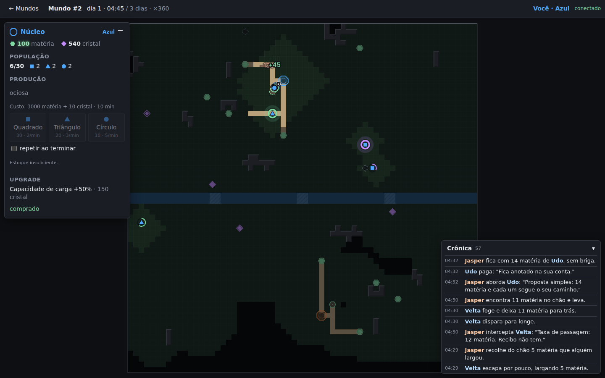

*📷 Captura: o dia 1, 04:45. À esquerda, o painel do Núcleo (estoque, população, produção, upgrade); no centro, o mapa
com o nunca visto em negro e o lembrado sob um véu; embaixo à direita, a crônica.*

Os primeiros creeps nascem coletores. Cada um segue uma **lista de regras**, de cima para baixo, e a primeira que vale
vira a ordem, como os *gambits* do Final Fantasy XII:

```text
1. carga cheia              → entregar no Núcleo
2. conhece cristal          → coletar cristal
3. não conhece cristal      → explorar
4. senão                    → voltar para casa
```

A economia do M1 é um ciclo físico: tudo o que se ganha precisa ser **carregado** (pilar 2).

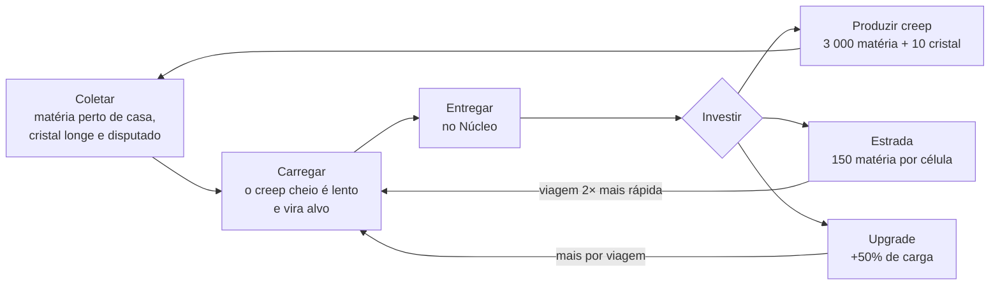

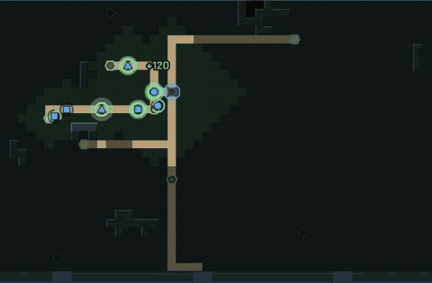

*📷 Captura: o vaivém em volta do Núcleo azul, no dia 1. Os creeps cheios voltam pela estrada, e cada entrega sobe como
um número verde.*

### 3.2 Explorar e lembrar ✅

Você troca as regras de Soma para o **preset batedor**: o ● enxerga longe e anda rápido. Por onde ele passa, a névoa
abre, e o time **lembra**: o depósito fica no mapa com o último valor visto, a estrada inimiga vista continua
desenhada. Os creeps inimigos, não: somem quando saem da vista.

A tela tem três estados: o **nunca visto** (negro), o **lembrado** (sob um véu) e o **visível agora**. As pedras
bloqueiam a visão, e um ● atrás de uma pedra não vê o que vem pela trilha. Tudo isso vale no servidor: o cliente do
Laranja nunca recebe o que o Laranja não vê.

### 3.3 O encontro na estrada ✅

No fim da tarde do primeiro dia, Taro volta do vau com a bolsa cheia de cristal. Um ▲ laranja, Ruvo, aparece na
trilha e **aborda**. A abordagem sempre abre com uma conversa, na escala do mundo, antes de qualquer golpe:

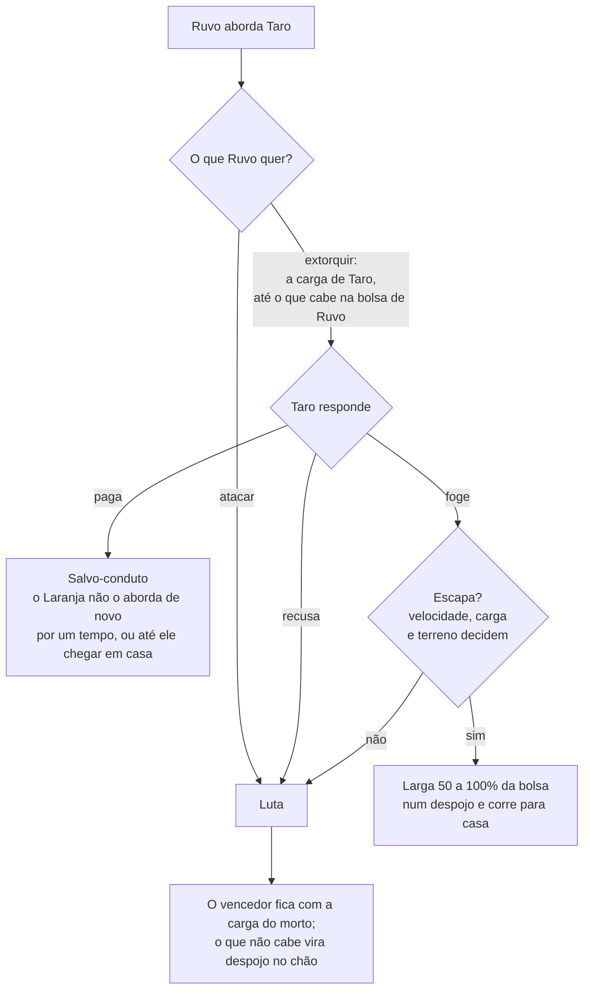

Se ninguém está olhando (o normal num mundo de dias), **Taro responde pelas regras dele**: "pago até tanto; se me
atacarem, fujo". Se você domina Taro, tem 60 s de mundo para escolher. Um ■ carregado até o talo, sozinho, cruzando o
vau, quase nunca escapa: é a graça de escolher a rota.

Na manhã seguinte, a crônica conta (exemplo):

> *No vau do norte, Taro pagou oito cristais a Ruvo e seguiu para casa de bolsa leve.*

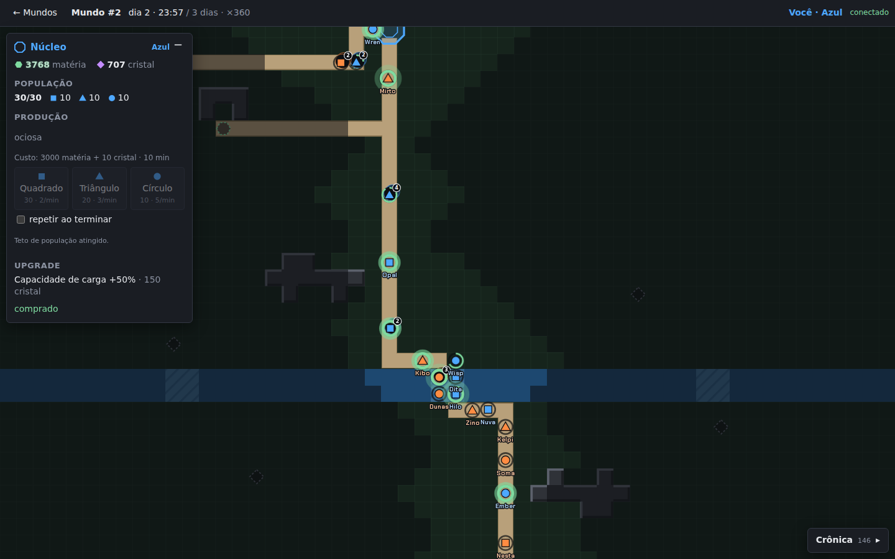

*📷 Captura: o vau no fim do dia 2, com zoom. A estrada do Azul desce, a do Laranja sobe, e os dois times se cruzam
sobre o rio, cada creep com o nome embaixo. É aqui que os encontros acontecem. Na crônica do dia 1 (a primeira captura
do §3.1), Jasper intercepta Velta: "Taxa de passagem: 12 matéria. Recibo não tem."*

**Hoje, a luta no mundo ainda é um sorteio descartável**, pelo HP e pela forma. A batalha de verdade já existe no
laboratório e entra no mundo na fatia D.

### 3.4 A batalha ✅ no laboratório · 🟢 no mundo (fatia D)

Quando a conversa vira luta, o mundo **congela** os creeps envolvidos e abre uma **instância de batalha**: uma
arena própria, em tempo real, separada do mundo. Ela devolve ao mundo só o que importa (quem morreu, quem fugiu, o
que ficou no chão).

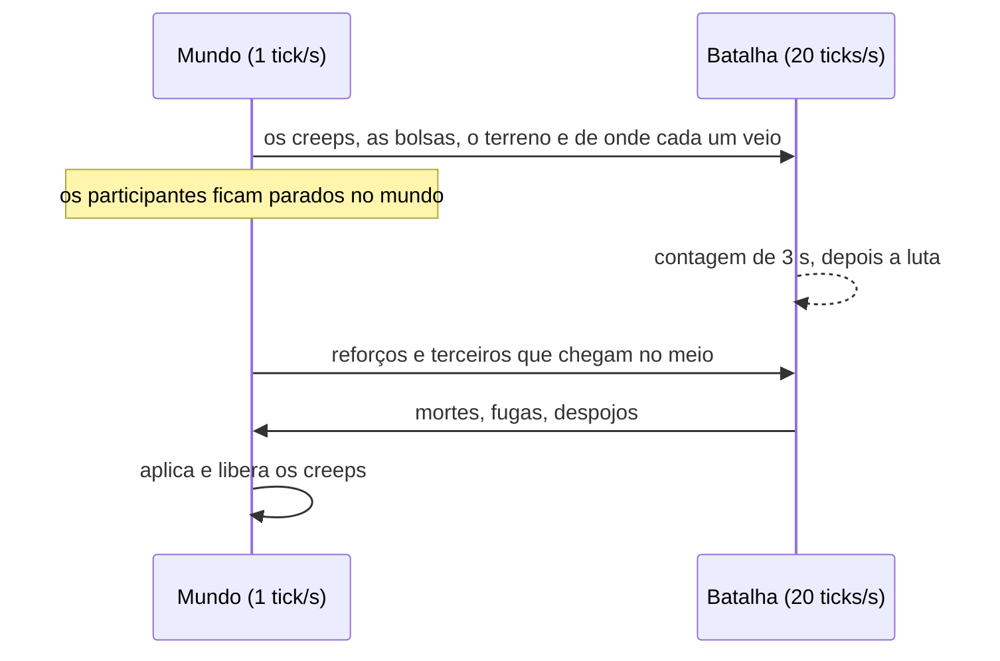

**A arena vem do lugar** (🟢 fatia D): perto de um vau, o **corredor**; perto de pedras, as **pedras**; senão, a
**aberta**. Cada lado nasce na borda **da direção de onde vinha** no mundo, quem chega no meio entra pela borda de
onde vem, e quem foge pela borda volta ao mundo do lado correspondente.

**A regra de combate é a grade** (✅ no laboratório; o dono a achou divertida):

- tudo anda célula a célula, e cada creep olha para uma de quatro direções;
- o ■ bate na célula da frente e **bloqueia a passagem**; o ● e o ▲ disparam um **projétil** que anda célula a
  célula, e **dá para desviar**;
- a batalha começa com uma **contagem de 3 s**: todos parados, só dá para virar. No fim, vale o que está apertado;
- **fugir é sair pela borda** e ficar lá um instante sem levar golpe. A carga freia; dá para **largar a bolsa**
  numa pilha, e qualquer um cata;
- **sem relógio de duração**: se ninguém der nem levar dano por 15 s, todos fogem ao mesmo tempo, sem vencedor. A
  luta acaba quando sobra no máximo um lado;
- **de 2 a 4 lados**, hostis entre si (times, errantes, tribos), e dá para **entrar no meio** de uma luta.

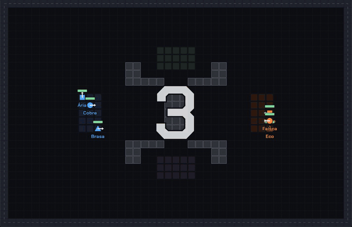

*📷 Captura: o laboratório, 3 × 3 na arena de **pedras** (seed 7), só com a IA. Os ■ seguram a frente, os ● e os ▲
atiram projéteis que andam célula a célula.*

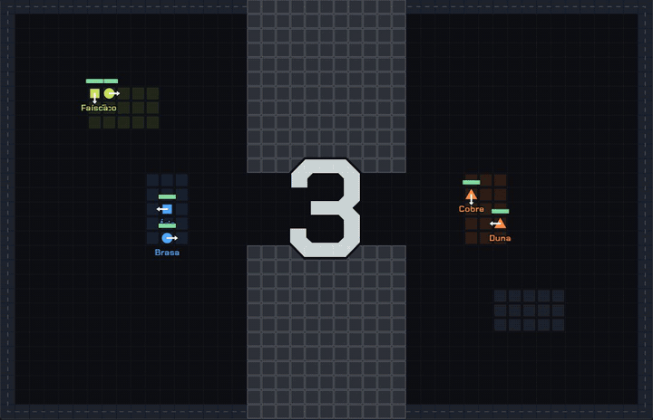

*📷 Captura: três lados de dois creeps no **corredor** (seed 11), hostis entre si.*

Quem você não domina luta pelos **gambits**: condição → ação, com presets por papel (linha de frente, atirador,
escaramuçador, portador). **Sem nenhum humano, a batalha inteira roda sozinha, pela mesma simulação** (o
auto-resolve), em uma fração de segundo.

### 3.5 Voltar ferido ✅

Rila sobrevive à luta com 40 de HP. O HP **persiste no mundo**: ela volta ferida, regenera devagar no mapa e bem mais
rápido perto do Núcleo. Até lá, quem a vê na trilha vê o HP dela, e ferida ela vira alvo. Se morrer, **morre de
vez**: o nome some do time e fica na crônica. O vencedor leva da bolsa dela o que couber na dele, e o resto vira
**despojo** no chão, que qualquer um cata (e fica na memória do time, como um depósito).

### 3.6 O cerco e o fim mínimo 🟢 (fatia E)

O Núcleo, as estradas prontas e as obras ganham HP e podem ser atacados; o reparo custa recurso. **Derrubar o Núcleo
inimigo vence a guerra.** Se o relógio acaba sem Núcleo derrubado, é empate (regra provisória, até o arco do mundo).
O fim ganha uma tela com o resultado e o resumo da crônica, e o replay ganha marcadores dos eventos principais. Como o
cerco funciona (leva horas? avisa o atacado?) pede uma rodada de design própria.

**Com o arco do mundo** (🟢), a queda do Núcleo deixa de encerrar a partida para quem sobrevive: os creeps do time
derrotado seguem jogando até o fim do mundo, enquanto houver esperança de salvação, e viram lendas se chegarem vivos
ao fim. Na fatia E, o Núcleo continua encerrando o mundo.

### 3.7 Os itens 🟢 (o próximo marco candidato)

No segundo dia, o cristal deixa de ser só preço de creep: ele vira **ingrediente**.

- **A skill vem do item, num modelo híbrido:** o DNA dá a cada creep **uma skill natural**; os itens dão as outras.
  O level do creep continua, com peso menor.
- **O mesmo item faz o mesmo efeito para todos os DNAs**, e alguns têm **simbiose** com uma forma (o escudo que rende
  mais num ■, por exemplo).
- **O Núcleo é a forja e o cofre:** os itens se fazem e evoluem lá, com material carregado até lá, e o item guardado
  no Núcleo não se perde quando o creep morre.
- **O item no creep corre risco:** tem durabilidade, cai no despojo quando o portador morre e pode ser roubado.
- Os bots têm **presets de itens**, que viram a dica da interface para quem não quer pensar nisso.

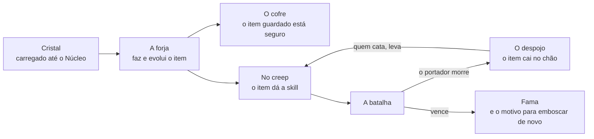

A pergunta do marco: **um item que se ganha e se perde dá motivo para lutar e para voltar ao jogo?**

### 3.8 Os personagens 🟢 simbólicos primeiro · 🟡 os detalhes

Com o tempo, alguns creeps deixam de ser "um ●" e viram **alguém**:

- **traits** (🟡): um traço sorteado no nascimento (ganancioso, bravo, cauteloso…) que dá a postura padrão no
  encontro, a voz na crônica e um **kit de crônica** (a origem e a side-quest pessoal dele);
- **fama** (🟢): cresce com os feitos e abre o recrutamento das ligas (🟡 a proposta: cai com as derrotas);
- **títulos** (🟢), **conquistados** (permanentes, por um feito único) e **disputados** (do melhor do mundo num feito
  agora, e passam para quem superar). De início, só na crônica: *"O Rei Batedor, Soma"*;
- **laços** (🟢 simbólicos): a camaradagem entre dois creeps aparece na ficha e na crônica. Buffs e luto só quando o
  playtest mostrar que você se importa.

**A ficha** (🟡; a fatia paralela "As fichas" do ROADMAP): uma página por creep, aberta sob demanda, com poucos números
no topo e a crônica embaixo. **Ela é velada, em camadas** (🟢), como a "tela do sistema" dos manhwas: o
**operacional** (forma, HP, carga, regras, estado) fica sempre aberto ao time, e o **pessoal** (trait, origem, laços,
side-quest, stats finos) só aparece conforme a **fidelidade** do creep a você (§3.10). Pedir para ver é uma ação, e
quem mal te conhece pode se incomodar. **Os únicos** (o retornado e outros personagens dos ramos da história) podem
ter a ficha **mentindo** (🟢), para se disfarçar entre os creeps comuns de uma tribo, mas o comportamento e a crônica
deixam pistas. Um exemplo de ficha de quem já é fiel a você:

| Soma ● | |
|---|---|
| **Título** | O Rei Batedor (disputado) |
| **Trait** | Cauteloso |
| **Fama** | Alta |
| **Laço** | Camarada de Rila |
| **HP** | 120 / 120 |
| **Da crônica** | *Primeiro a ver o Núcleo laranja. Fugiu de três emboscadas no vau sem largar a bolsa.* |

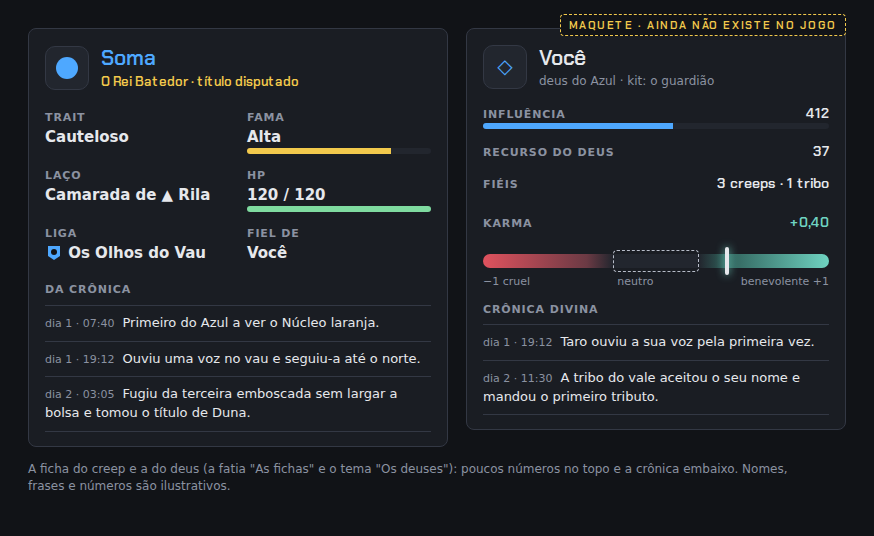

*🎨 Maquete: a ficha de Soma ao lado da sua, de deus (§3.10). Poucos números no topo, a crônica embaixo. A liga, o
símbolo e os números são ilustrativos.*

### 3.9 As ligas 🟢 a direção · 🟡 os detalhes

No terceiro dia, Soma tem fama bastante para **liderar**. A liga é **de um creep líder**, não sua:

1. você **domina** Soma para formá-la;
2. **recruta por diálogo**: a maioria aceita pela fama do líder ou pelo laço, alguns pedem algo simples, e os de
   trait raro pedem uma side-quest;
3. a liga ganha um **símbolo**, reconhecível até pelo inimigo e pelas tribos;
4. **solto, Soma continua liderando pelos gambits**. Você pode formar outras ligas ao longo da partida.

Na batalha, vale o **piloto de grupo**: você controla o líder, e os seguidores ficam na **formação pelo DNA** (os ■ na
frente) e lutam pelos gambits, com até **três ordens de liga** (🟡 a proposta: "comigo", "segurem", "no meu alvo"). O
tamanho da liga cresce com o level do líder (🟡), e o horizonte do dono são lutas de até 10 × 10 × 10 (🟡).

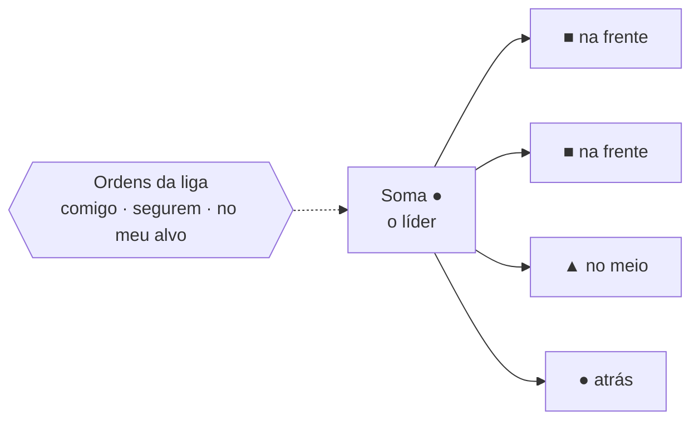

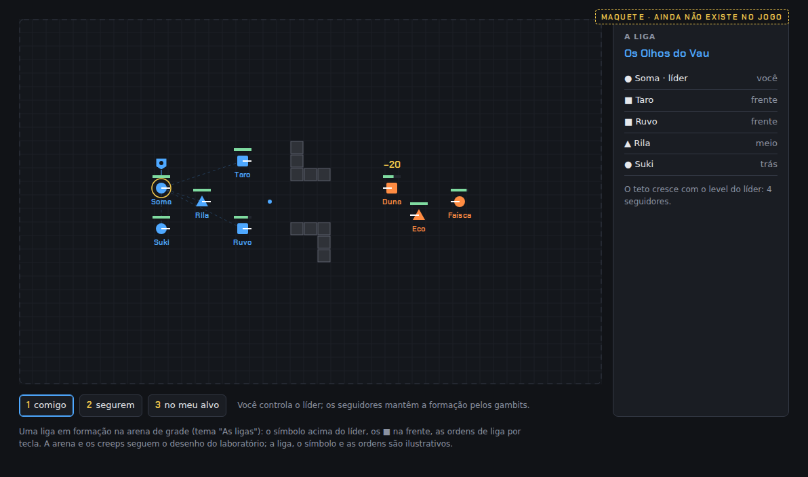

*🎨 Maquete: a liga de Soma na arena de grade do laboratório. O símbolo sobre o líder, os ■ na frente, Rila no meio,
Suki atrás, e as três ordens (🟡) nas teclas 1, 2 e 3.*

### 3.10 Você na crônica: os deuses 🟢 a direção · 🟡 o como

Até aqui, você foi a mão que domina creeps. Na crônica, você também é **alguém**: o "deus" do time (nome provisório).
Três coisas suas, diferentes da riqueza do time:

| | O que é | Como se ganha | Para que serve |
|---|---|---|---|
| **Influência** (🟢) | Um peso, a sua reputação | A fama dos creeps que você dominou e os feitos deles; as tribos que você converteu | **Abre portas:** dominar um creep famoso pede influência. O domínio comum não muda |
| **Conduta** (🟢) | O karma, numa escala de −1 (cruel) a +1 (benevolente) | Nasce das suas ações; ninguém escolhe numa lista | Decide quais portas se abrem e quais se fecham, e dá o sabor dos poderes |
| **O recurso do deus** (🟢) | Um recurso seu, que se acumula e se gasta | Dos **feitos dos fiéis** (as quests que você deu, cumpridas), acelerado por **oferendas e rituais**, que tomam o tempo dos creeps e têm risco | **Sussurros** (o resultado depende da abordagem), **poderes no mundo** e **investir** em creeps promissores |

**O que pesa contra a influência:** ficar inativo dominando um creep, e fugir de uma batalha **abandonando aliados que
ainda lutam**. Recuar sozinho ou com o grupo é legítimo.

**Cruel × benevolente:** o deus cruel **ganha recursos rápido e fecha portas** (as tribos ficam hostis, e o caminho
do final feliz se fecha). O equilíbrio vem das regras, medidas com bots, não do julgamento de ninguém.

**O karma não é binário** (🟢): perto de zero (entre −0,25 e +0,25, provisório) fica a **neutralidade kármica**, com
benefícios e trade-offs próprios. Os três pontos absolutos (o neutro absoluto, 0; o cruel extremo, −1; o benevolente
extremo, +1) **dão um buff enquanto se mantiverem**: ficar lá é difícil de propósito.

**Os kits divinos** (🟢 a direção · 🟡 o esboço): você escolhe uma especialização **pelo seu jeito de jogar**, e a
conduta dá a cada poder a sua versão.

| Kit (🟡 nomes de exemplo) | Para quem | O que favorece | Benevolente | Cruel |
|---|---|---|---|---|
| **O campeão** | Quem joga ativamente | Dominar os famosos, sussurros de batalha, títulos disputados, uma liga maior | Inspira os aliados perto do dominado | Aterroriza os inimigos; as tribos desconfiam |
| **O aprendiz** | Quem está aprendendo | Presets claros, poderes simples, dicas da crônica, menos micro | — | — |
| **O guardião** | Quem tem 15 minutos por dia | Quests longas, bênçãos passivas para coletores e construtores, rituais que correm offline, o resumo "enquanto você esteve fora" | A bênção da colheita | O chicote: rende mais, e os creeps e as tribos ressentem |

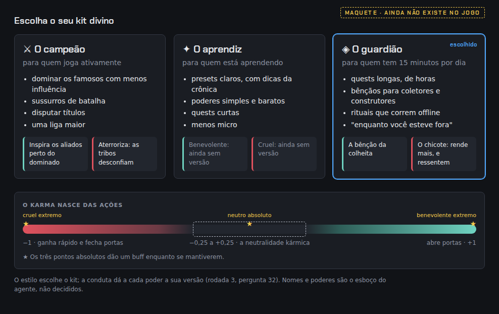

*🎨 Maquete: a escolha do kit e a escala do karma, com a faixa neutra tracejada e os três pontos absolutos (★). Os
nomes e os poderes são o esboço da tabela acima.*

**Os fiéis** (🟢): um fiel é um creep, do seu time ou neutro, que **reconhece o deus**. No começo, os creeps não
sabem dos deuses; o primeiro fiel nasce da primeira quest sua que alguém cumpre (*"Taro ouve uma voz"*). A tribo
convertida é a escala de cima.

**A quest do deus para o creep** (🟡): em vez de editar a lista de regras, você diz **o quê** ("traga 20 cristais",
"explore o norte"), e as regras do creep cuidam do **como**. Pode ser o jeito casual de comandar. A proposta é que a
quest seja uma regra temporária no topo da lista, para não haver dois jeitos de mandar. Os times sem jogador têm um
**deus-bot** (🟡).

**A fidelidade** (🟢): cada creep tem uma fidelidade **por deus**, inclusive os do seu time. Ela abre as camadas da
ficha, decide as quests que ele aceita e o preço dos sussurros (baratos com os creeps confusos do começo, caros com
os famosos e os únicos), mas **não muda o time dele**: só os neutros e os únicos mudam de lado.

**O incômodo** (🟢): sussurrar, pedir para ver a ficha ou dar uma quest fraca a quem tem **pouca fidelidade** (ou a
um creep acima da sua influência, ou a um único) custa influência, cada vez mais com a repetição e com os atos. Os
fiéis não se incomodam com o básico.

**A relação é a crônica** (🟢): o que um creep ou uma tribo pensa de você é a soma do que viveu ou testemunhou (a
quest paga, o milagre que o salvou, a maldição que viu cair num aliado). O seu karma é só o primeiro contato. Uma
tribo de karma incompatível pode te tratar como neutro porque um fiel seu ajudou um dos dela.

**O demônio e a ambição** (🟢): enquanto o karma está do lado cruel, você é um **demônio**, o que é pele, não
objetivo: deuses e demônios estão se entretendo. Cada um tem uma **ambição** própria, pelo kit, pela conduta e pela
crônica, que evolui com as ações e conta na história do fim e na influência, **sem decidir a guerra**.

Tudo isso é **simbólico primeiro** (🟢): a influência e a conduta aparecem na ficha, na crônica e na história do fim
antes de mudar qualquer número.

### 3.11 O mundo vivo: as tribos 🟢

A jungle tem tribos neutras com uma **relação** com cada time. Converter uma tribo é uma **ação de diálogo**; a tribo
convertida manda **tributo** ao tesouro do time, numa **caravana física** (que pode ser emboscada, pilar 2), e o deus
que converteu ganha influência.

As **quests** das tribos são **batalhas com objetivo** (🟢, tema "Cenários de quest"): escoltar, segurar uma área,
recuperar um item, sobreviver a ondas, na mesma batalha de grade. E elas são um dos caminhos do **final feliz
secreto**, que detém a corrupção e **salva o mundo inteiro, inclusive o inimigo** (os outros caminhos estão na §3.13).

**Comprar informação** (🟢, com as tribos): no diálogo com um neutro ou um aliado, o informante oferece dicas
incompletas com o preço (*"o Rei Batedor foi visto perto do vau; quer saber quando?"*). Comprada, a informação
**aparece no seu mapa como um lembrado, com a idade** ("visto há 3 h"): é a mesma névoa de sempre, alimentada pelo
que o lado do informante lembra. Dá para tentar arrancar à força (e estragar a diplomacia) ou persuadir gastando o
seu recurso.

### 3.12 O time 🟢 a direção (pede humanos)

Num time de 3 humanos, as decisões coletivas têm regras (pilar 5): impostos votados, o tesouro, a votação com níveis
de autoridade (bots podem decidir / só humanos / unanimidade). Cada time escolhe o **regime**: a **democracia**
(customizável, mais burocrática, com representante) ou a **meritocracia** (hierarquia **pela influência dos deuses**,
menos burocrática, mais autoritária). Um **comandante** que dá a tática sobre as ligas é proposta (🟡). É o tema que o
dono não testa sozinho: espera o deploy e olhos novos.

### 3.13 O arco do mundo e o mestre 🟢

Por trás de tudo corre uma **história principal secreta**: o arco do mundo.

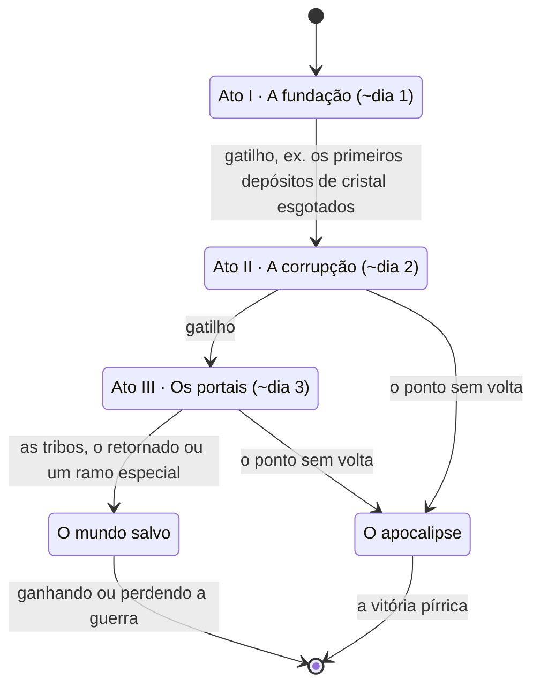

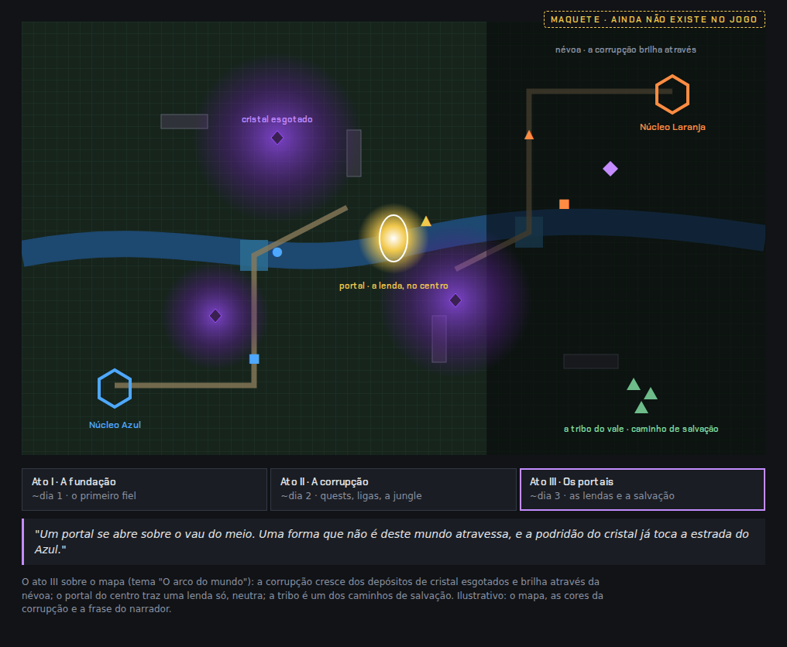

*🎨 Maquete: o mapa no ato III. A corrupção cresce dos depósitos de cristal esgotados e brilha através da névoa, o
portal do centro traz uma lenda, e a tribo do vale é um caminho de salvação. O narrador fala embaixo.*

**A guerra corre por cima** dos atos: um Núcleo pode cair em qualquer um deles. Na fatia E, isso encerra o mundo; com
o arco, os sobreviventes do time derrotado seguem até o fim (§3.6).

- **A corrupção** nasce de cada depósito de cristal esgotado: envenena quem está perto e cresce até cobrir o mapa.
  Ninguém a limpa, nem gastando recurso. Ela **brilha**: o time vê a borda mesmo fora da visão, para o fim nunca
  pegar ninguém de surpresa (pilar 4).
- **O ponto sem volta:** depois de tantos depósitos esgotados, o fim já é inevitável. A partir daí, derrubar o Núcleo
  inimigo vence a guerra, mas não salva ninguém: **nenhum creep sobrevive para virar lenda**.
- **Os ramos:** o apocalipse é um só, mas tem **ramos dentro da corrupção** (presets) que respondem à conduta dos
  deuses. A jungle acorda por cima: ondas de errantes, chefões despertos.
- **O ritmo esperado** (🟢, medido com bots de perfil): no fim do ato I, você converteu pelo menos 1 fiel e gerou
  pelo menos 1 crônica divina; no ato II, progride com quests, forma uma liga ou entra numa e luta na jungle; no ato
  III, abrem-se os portais e os caminhos de salvação. Cada ato dura cerca de um dia a ×1.
- **O portal** (🟢) se abre **no centro do mapa** no ato III e traz **uma lenda só**: de início, gerada pela seed;
  mais adiante, as lendas reais de outros mundos. Ela é experiente e neutra: **na luta, ataca todos**, e os neutros
  comuns fogem dela. O primeiro creep que a aborda pode dialogar; **ela se converte no primeiro diálogo** (ou depois
  de aniquilar quem a hostilizou) ou fica hostil a um creep ou a um time inteiro. Convertida, vira dominável, com um
  **kit de lenda** único e um **kit de quest** que é um dos ramos especiais do ato III.
- **A escolta do xamã** (🟢) é a forma do final feliz das tribos: levar o xamã da tribo a cada depósito corrompido
  para o ritual, numa **instância de sobreviver e proteger** com ondas do ato III. Vale no ramo natural e no ramo do
  **retornado**, que apressa os atos em segredo para disparar a quest e não dá conta dela sozinho (🟡 a história
  dele).
- **Três caminhos de salvação** (🟢), como ramos do arco: **as tribos**, **o retornado** e **os ramos especiais do
  ato III**. Ninguém limpa a corrupção gastando recurso, e salvar salva o mundo inteiro, **ganhando ou perdendo a
  guerra**.
- **O mestre da mesa** escolhe o ramo de cada ato antes de ele começar e **ajusta os gatilhos dentro de limites**.
  Ele é **neutro**: cria perigo e oportunidade para quem está ativo, sem socorrer quem está perdendo. Cada ajuste é
  um comando no log, e **tudo é revelado no fim**.
- **O segredo mora na instância.** O repositório é aberto, e o conteúdo dos ramos pode estar nele; a surpresa é
  **qual ramo, onde, quando e quem**. E quem joga às cegas, sem ler nada daqui, **tem de entender a história** pelo
  que o jogo mostra: a crônica, o narrador, o brilho da corrupção.

### 3.14 O fim e as lendas 🟢

O mundo termina numa **história**: a crônica do fim conta o arco, as escolhas do mestre e os deuses pelo nome, com a
influência e a conduta de cada um. **Qualquer creep vivo no fim vira lenda**, inclusive do time derrotado e os
sem-Núcleo que aguentaram até lá. Mais
adiante, as lendas **invadem outros mundos** no fim deles (🟢 tema "As lendas"); a proposta é que a morte permanente
valha também ali, e invadir arrisque perder a lenda (🟡).

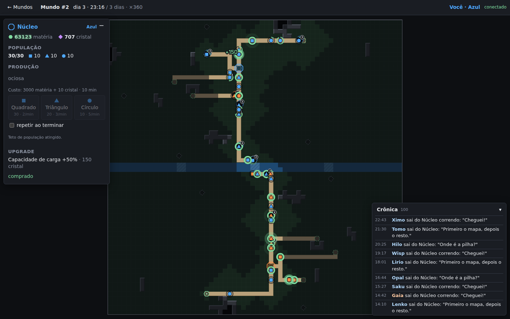

*📷 Captura: como um mundo termina hoje, no dia 3, 23:16. As duas redes de estradas cobrem a trilha central, o Azul
está no teto de 30 creeps, e a crônica ainda é a de cada creep. A história do fim, o arco e as lendas são o que
falta.*

## 4. Como os ciclos se alimentam

Os sistemas não são camadas soltas: cada um alimenta o outro, e todos passam pela riqueza física.

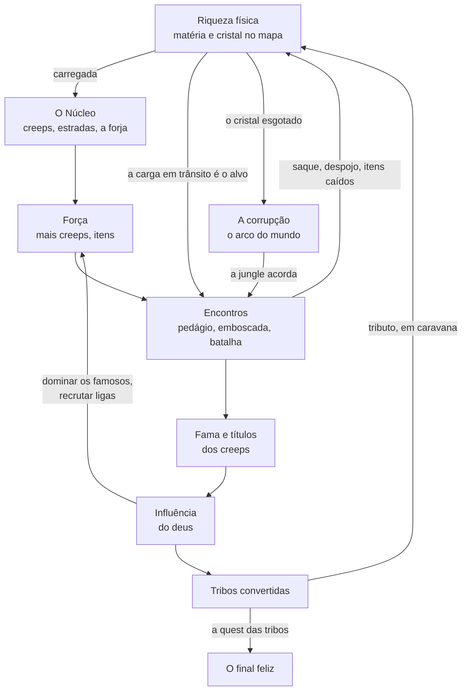

O pilar 1 continua de guarda: **a batalha ganha confrontos, a economia ganha a guerra**. Um time que nunca entra numa
luta ainda decide a partida pelas rotas, pelas estradas e pelas regras dos creeps.

## 5. Dois jeitos de jogar o mesmo mundo

O mundo não espera ninguém (pilar 4), então o jogo tem de funcionar para quem entra 15 minutos por dia e para quem
fica horas.

| | Quem entra pouco | Quem fica horas |
|---|---|---|
| **O que faz** | Escolhe presets (coletor, batedor, salteador), ajusta "pago até tanto", lê a crônica do que aconteceu | Domina creeps nos encontros e nas batalhas, lidera ligas, edita as regras à mão |
| **Os itens** | Segue a dica do preset | Monta a própria combinação, caça os itens raros |
| **Como deus** | Dá quests simples e colhe o que os fiéis fizerem (🟡) | Sussurra, investe em creeps promissores, disputa títulos |
| **Mais adiante** | — | Console no chat, macros, um script próprio para os creeps (tema "Comunicação e automação") |

Os dois jogam **as mesmas regras**: o bot da casa, o script e o humano mandam os mesmos comandos, validados do mesmo
jeito.

**Os kits divinos** (🟢, §3.10) dão a cada um desses jeitos a sua especialização: **o campeão** para quem fica
horas, **o guardião** para quem entra 15 minutos, **o aprendiz** para quem está começando. Um time com um guardião
não pode perder por isso nem ganhar sem jogar: o equilíbrio se mede com bots de perfil.

## 6. A moldura da saga (em análise)

🔮 **Nada aqui está decidido.** O dono trouxe receitas de manhwa, manhua e mangá (a torre dos deuses, a convocação de
outros mundos, os deuses que sussurram, o *returnee*) e pediu para analisá-las com calma
([consolidado](brainstorm/2026-11-20-consolidado-depois-do-m2.md) §11).

A distinção que ajuda: **a pele e a estrutura.**

- **A pele** é quem você é na história, por que os creeps estão ali, os nomes. Mora no texto (crônica, narrador,
  ficha) e **muda tarde e barato**.
- **A estrutura** é o que este guia descreveu: dois times com Núcleos, a economia, o domínio, as batalhas. **Custa
  caro mudar.**

| Leitura | Você é | Os creeps | Mexe na estrutura? |
|---|---|---|---|
| **A. Os deuses** | O deus do time, dentro da crônica | Nascem no mundo | Não |
| **B. A torre** | Um deus que patrocina os creeps | **Convocados** de outros mundos; o Núcleo é o portal | Pouco (produzir vira convocar, só no texto) |
| **C. Os anfitriões** | Quem monta o espetáculo para uma plateia | Atores | Pouco, mas muda o seu papel |
| **D. Sem time no começo** | Quem escolhe quem patrocinar | Grupos teletransportados, confusos; os times nascem do jogo | **Muito** |

Um jeito de comparar é imaginar **os primeiros minutos de quem nunca leu o repositório** em cada leitura. Na B, por
exemplo: *"O andar 7 se abre. Vinte formas caem do céu, sem lembrar de onde vieram."* Os creeps começam
desorientados, o Núcleo brilha como um portal, e a administradora do andar anuncia: *"Sobrevivam ao fim deste mundo.
Ou salvem-no."*

Por isso este guia diz "deus" e "mestre da mesa": são os nomes provisórios, e trocar a pele não muda nada das
seções 1 a 5. Junto da moldura está **o retornado** (🔮): um creep que já viveu um fim, evolui em segredo, só aceita
ser dominado se você aceitar a quest dele, e tenta adiantar o apocalipse com uma pequena liga independente. Decidido já está que **a relação com ele é um dos
caminhos de salvação** (🟢).

**"Seu time" e a saga** (🔮, [consolidado](brainstorm/2026-11-20-consolidado-depois-do-m2.md) §13.8): o dono
questionou se os times devem começar definidos. Sem times, as tribos e os creeps começariam neutros e cada deus
escolheria onde gastar a pouca fé, o que conta melhor a saga dos deuses brincando com creeps descartáveis, mas pode
dar um começo injusto (a primeira geração vem da seed). Por trás de tudo, uma pergunta: **"no universo geometrix, a
simetria, que era verdade absoluta, começou a ser questionada."** Os deuses aceleram a seleção dos guerreiros rumo ao
Capítulo Finale porque sentem o perigo. Num mapa espelhado, a corrupção pode ser **a própria quebra da simetria**,
visível antes de qualquer texto. O mundo de hoje seria o **primeiro episódio** de uma saga que continua entre mundos.

## 7. No banco, sem marco

Ideias registradas que ainda não têm marco (o [ROADMAP](ROADMAP.md) tem o banco inteiro):

- **A batalha:** a arena gerada pelo recorte do mundo, com o tamanho pelo número de participantes; a regra livre
  (MOBA-lite); acampamentos e torres; a **IA que aprende**, do bot burro ao "modo pesadelo".
- **A apresentação:** som, anúncios de abate e de fuga ("double kill"), a tela de fim além do mínimo.
- **A jungle hostil:** árvores destrutíveis que bloqueiam a visão, a 3ª ação do encontro por DNA.
- **Comunicação e automação:** chat, linha de comando no estilo do BYOND, macros, o piloto scriptável.
- **Em incubação:** reprodução e gerações de creeps; um limitador de população.

## 8. Ver com os próprios olhos

| Para ver… | Rode | O que aparece |
|---|---|---|
| Um mundo com bots e amigos | `npm run dev:multi -- --clients 2` | O mundo com névoa, os encontros (com a luta ainda por sorteio) e a crônica, uma aba por jogador |
| A batalha de grade | `npm run lab` | O laboratório: escolha a arena, os lados e os gambits; jogue contra a IA com latência simulada |
| Milhares de batalhas sem tela | `npm run geo -- battle sweep` | Vitórias, duração e inatividade da IA nas três arenas |
| Um mundo inteiro em segundos | `npm run geo -- sim --seed 42 --days 3` | Três dias de mundo bot × bot, com um relatório em `runs/` |

As capturas e as maquetes deste guia saem de scripts em [`img/gameplay/captura/`](img/gameplay/captura/README.md),
que dirigem um Chromium headless contra um servidor local; as fontes das maquetes ficam em
[`img/gameplay/maquetes/`](img/gameplay/maquetes/). Quando uma mecânica mudar, dá para refazer a imagem em vez de
redesenhá-la.
