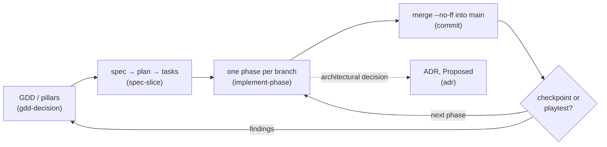

# Harness — developing geometrix with AI agents

How this project is built with AI coding agents (mainly [Claude Code](https://claude.com/claude-code)), and how to
set up your own machine for it. The rules agents follow are in [`CLAUDE.md`](../CLAUDE.md) and
[`.claude/skills/`](../.claude/skills); this page explains the workflow around them.

## The loop

The owner decides the design and approves every gate; agents draft, implement and report. Nothing in the GDD goes
from proposal to decided without the owner's OK.



- **Sources of truth:** the table at the top of `CLAUDE.md`. Start from `docs/dashboard/current-status.md`.
- **Skills** (in `.claude/skills/`): `spec-slice` (spec → plan → tasks), `implement-phase` (a phase, from opening to
  merge), `commit` (commit style, branches, merges), `gdd-decision` (recording the owner's decisions), `adr`.
- **Fresh sessions.** A session starts with a minimal prompt (e.g. `/implement-phase M2 D F1`) and resumes from the
  repository: the dashboard's Now section, the slice's `tasks.md` and `CLAUDE.md`. Anything the next session needs is
  written there before stopping, not left in a conversation.
- **One kind of work per session.** Implementation, design rounds and human checkpoints/playtests stay in separate
  sessions. Findings from a checkpoint become a new phase with concrete tasks, implemented in a fresh session.
- **Branches.** One branch per phase (`m<milestone>/<slice>-f<phase>-<slug>`), merged into `main` with
  `git merge --no-ff`, so `git log --first-parent main` shows one line per phase. Agents push only when the owner
  asks.

## Your machine: `CLAUDE.local.md`

`CLAUDE.md` is shared and describes no particular machine. What only makes sense on yours (where your checkouts
live, where merges run, how you push, OS quirks) goes into a `CLAUDE.local.md` at the repository root. It is in
`.gitignore`.

- **Claude Code** loads it natively, right after `CLAUDE.md`. The two are concatenated, not merged: the local file
  cannot override the shared one, so write it as **additions**. If you need to contradict `CLAUDE.md`, the shared
  file is probably describing a machine and should be fixed instead.
- **It exists only in the checkout where you create it.** A git worktree is a separate directory, so a session opened
  in a worktree sees only the versioned harness (copy the file there if you want it).
- **opencode and Kilo CLI** do not read it on their own. Add it to their global config (once per machine, works for
  every repository): relative entries are searched from the working directory up to the git root, and missing files
  are skipped.

  ```jsonc
  // ~/.config/opencode/opencode.jsonc and ~/.config/kilo/kilo.jsonc
  "instructions": ["CLAUDE.md", "CLAUDE.local.md"]
  ```

  Kilo (7.7) already reads `CLAUDE.md` when there is no `AGENTS.md`. opencode (2.2.5) did not in practice, despite
  its docs, hence `CLAUDE.md` in the list. opencode's background service caches the config:
  `opencode service restart` after editing it. Both read the skills in `.claude/skills/`.
- **Why there is no `AGENTS.md`:** by default Claude Code reads `AGENTS.md` only when there is no `CLAUDE.md` or
  `CLAUDE.local.md`, so with an `AGENTS.md`-only repository a personal `CLAUDE.local.md` would hide the project's
  rules from Claude.

### Recommended layout: worktrees

Keep `main` in one checkout and give each phase branch its own git worktree, so several agents can work in parallel
without touching `main`:

```sh
git worktree add ../<slug> -b <branch>   # one per phase branch; run npm ci inside
# … work, commit, then from the main checkout:
git merge --no-ff <branch> -F <message-file>
git worktree remove ../<slug> && git branch -d <branch>
```

Worktrees share ports (8080, 5173: use `GEO_PORT`) and the CPU, so timing-sensitive tests can skew when several run
at once.

### Example

```markdown
# CLAUDE.local.md — my machine (not versioned)

- This checkout holds `main` and is where merges run. Phase branches get a worktree in `~/work/geometrix/<slug>`.
- git here has no GitHub credentials: finish with local commits and give me the push command.
```
