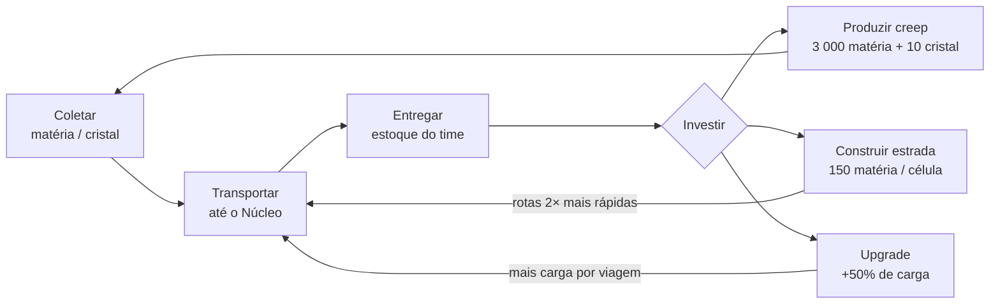
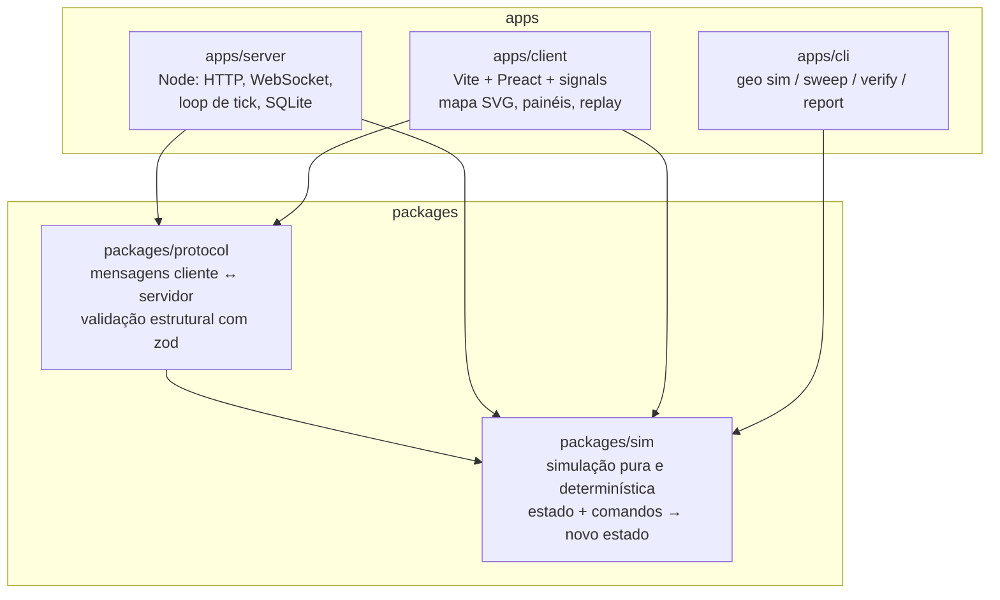
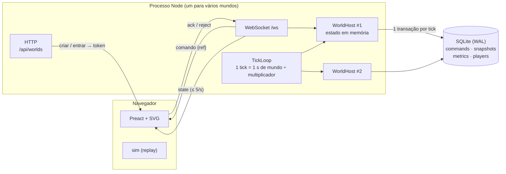
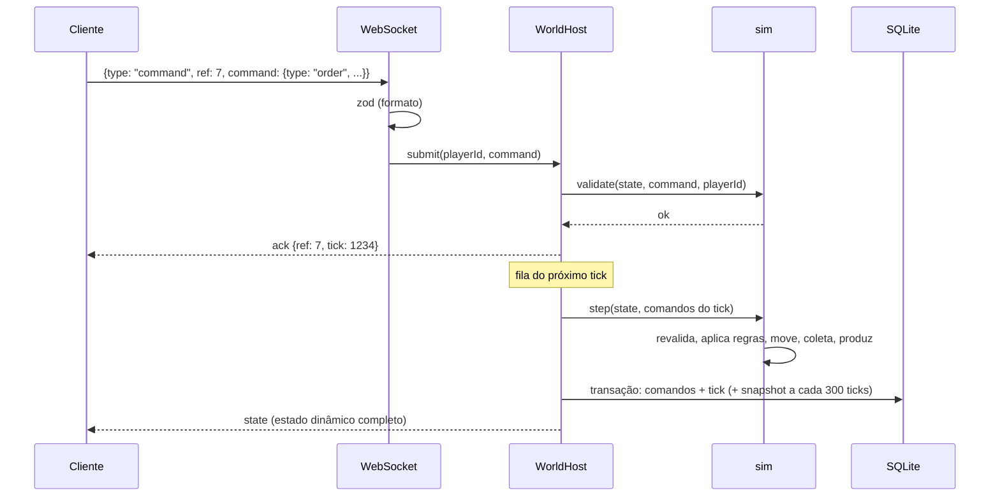
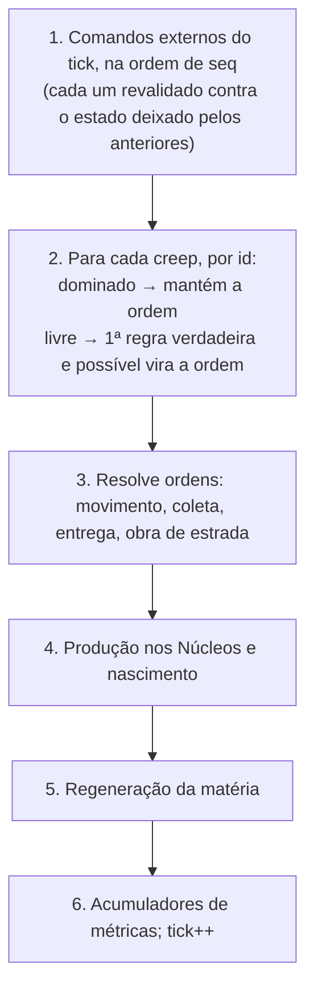
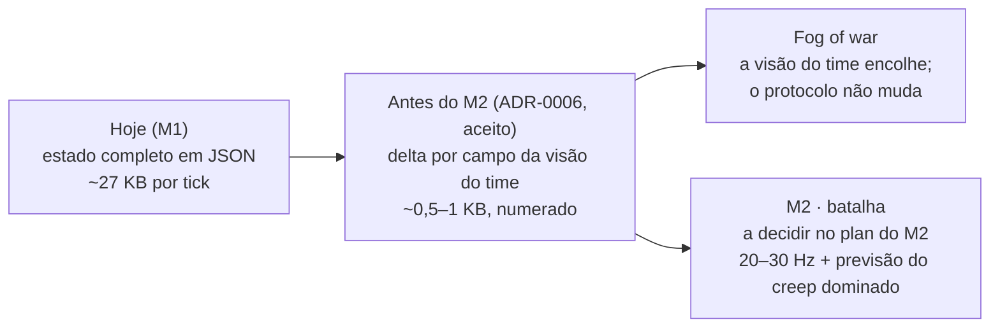

# geometrix: visão geral

> Um tour pelo projeto para quem chegou agora: o que é o jogo, por que ele existe, o que já roda, como a arquitetura
> funciona por dentro, quanto custa e onde estão os limites. As fontes de verdade continuam sendo os docs linkados
> em cada seção; este arquivo é o mapa.
>
> **Retrato de 2026-11-14**, com o M1 concluído. Os números de custo foram medidos nesta data (seção 7).

## Sumário

1. [Em uma frase](#1-em-uma-frase)
2. [O conceito e a motivação](#2-o-conceito-e-a-motivação)
3. [O GDD em uma página](#3-o-gdd-em-uma-página)
4. [Onde estamos: feito × pendente × planejado](#4-onde-estamos-feito--pendente--planejado)
5. [Arquitetura](#5-arquitetura)
6. [Decisões de implementação que valem a conversa](#6-decisões-de-implementação-que-valem-a-conversa)
7. [Sync via WebSocket: quanto custa, e escala?](#7-sync-via-websocket-quanto-custa-e-escala)
8. [Por que não Unity, Unreal ou Godot?](#8-por-que-não-unity-unreal-ou-godot)
9. [Limitações conhecidas](#9-limitações-conhecidas)
10. [Como o projeto é construído](#10-como-o-projeto-é-construído)
11. [FAQ rápido](#11-faq-rápido)
12. [Como rodar e onde ler mais](#12-como-rodar-e-onde-ler-mais)

---

## 1. Em uma frase

**Um jogo de estratégia multiplayer no navegador, num mundo persistente que dura dias**, em que times coletam,
transportam e investem riqueza (camada RTS/economia/sandbox), e em que **batalhas em tempo real no estilo MOBA**
decidem os confrontos, mas não a guerra. Tudo desenhado só com geometria.

## 2. O conceito e a motivação

### A ideia

Pense num cruzamento de três coisas:

- a **macro de um RTS** (economia, logística, construção), mas num mundo que não acaba em 40 minutos: ele roda por
  **dias**, mesmo com você offline;
- o **MOBA** (controle direto de um herói numa luta em tempo real), mas sem herói fixo: **qualquer creep pode virar
  o herói**. Você *domina* um creep do seu time, joga com ele e depois o *libera*;
- a **programação de comportamento** de jogos como Screeps e Gladiabots, ou os *gambits* de Final Fantasy XII:
  enquanto você não está lá, seus creeps seguem as regras de piloto automático que você deixou.

### Os pilares (o filtro de toda decisão)

Resumo de [`PILLARS.md`](PILLARS.md):

| # | Pilar | Na prática |
|---|---|---|
| 1 | **A guerra se ganha na macro; a batalha, na micro** | Economia e logística decidem a partida; o combate ganha confrontos |
| 2 | **Riqueza é física** | Todo recurso existe num lugar do mapa e precisa ser *carregado* até a base. No caminho, pode ser roubado |
| 3 | **Qualquer creep pode ser um herói** | Dominar e liberar no lugar de um herói fixo |
| 4 | **O mundo não espera você** | Partidas de dias; ausente, vale o seu piloto automático |
| 5 | **Decisões coletivas têm regras** | O time se governa: votação, impostos, tesouro, representantes |
| 6 | **A geometria é a linguagem visual** | ■ quadrado = tank melee · ● círculo = glass cannon ranged · ▲ triângulo = meio-termo |

E o que ele **não** é: não é um clone de LoL/Dota, não exige ficar online o tempo todo, não é um e-sport de reflexo
na v1, e **não é uma engine genérica**.

### Por que esse jogo?

Os pilares respondem a uma tensão real dos gêneros:

- **MOBAs** têm a melhor sensação de controle direto, mas cada partida começa do zero e exige 30–40 minutos
  seguidos de atenção.
- **Jogos persistentes** (MMO de estratégia, Screeps) têm consequência de longo prazo, mas raramente têm a micro
  divertida de um MOBA.
- O geometrix junta os dois separando as escalas de tempo: o **mundo** é lento, durável e funciona sozinho; a
  **batalha** é rápida, curta e é onde a habilidade de mão aparece. O elo entre eles é o pilar 2: a carga que
  atravessa a jungle é o alvo da emboscada.

O visual geométrico é uma escolha de linguagem (forma comunica papel) e também de viabilidade: dá para fazer um jogo
legível sem pipeline de arte.

### A pergunta de cada marco

O projeto avança por **hipóteses testáveis**, não por features. Cada marco precisa responder a uma pergunta de
design antes do próximo ([`ROADMAP.md`](ROADMAP.md)):


Verde: concluído. Amarelo: o próximo.

## 3. O GDD em uma página

O [GDD](gdd/README.md) tem um arquivo por sistema, e cada um separa **Decidido** (o dono aprovou), **Proposta**
(ainda não aprovada) e **Perguntas abertas**. Isso é levado a sério: nada vira "decidido" sem o OK explícito do dono.

| Sistema | O que está decidido | O que ainda está em aberto | Marco |
|---|---|---|---|
| [01 Mundo e mapa](gdd/01-mundo.md) | Mundo persistente de dias (hipótese: 3); times de 3; vitória = destruir a base inimiga; início "fundação" (cada time começa com um Núcleo e cresce a partir dele) | Fog of war, entrar no meio da partida, onde se pode construir, rio como rota | M1 |
| [02 Creeps e domínio](gdd/02-creeps-e-dominio.md) | Herói = creep dominado; 1 domínio por jogador; DNA = forma inata; morte permanente; inventário; os 3 DNAs se equivalem na economia (a diferença vem do combate) | Custo de dominar, limite de população, vários creeps na mesma célula, nome do creep no estado | M1 (domínio) · M3 (genética) |
| [03 Economia](gdd/03-economia-e-logistica.md) | Transporte físico; dois recursos no M1: **matéria** (pesada, renovável, perto da base) e **cristal** (leve, valioso, esgotável, disputado); imposto votado | Moeda cunhada × recurso; sumidouros; papel do cristal depois de ~8 h | M1 · M3 |
| [04 Governança](gdd/04-governanca.md) | Votação com níveis de autoridade (bots podem decidir / só humanos / unanimidade); representantes em times grandes | Quais decisões existem, quórum, prazo, voto delegado | M3 |
| [05 Tribos](gdd/05-tribos-e-diplomacia.md) | Jungle com monstros e tribos neutras que podem virar aliadas ou rivais | Quase tudo | M4 |
| [06 Batalhas](gdd/06-batalhas.md) | Mundo e batalha são estados separados; a batalha é uma instância dedicada que devolve só eventos | O gatilho, a "bolha", reforços, duração, o tempo do mundo durante a batalha | M2 |
| [07 Piloto automático](gdd/07-piloto-automatico.md) | Configurável por creep; persiste depois do domínio; no M1, regras declarativas `condição → ação` | Script em sandbox (fase 2), piloto por grupo, macros de cliente | M1 · M4 |

### O ciclo do M1 (o que já se joga)



Os números são provisórios (candidato B da [passada de balanceamento 1](specs/m1-ciclo-da-riqueza/balance.md)).

## 4. Onde estamos: feito × pendente × planejado

### Feito (M0 e M1, concluídos em 2026-11-14)

| Área | O que existe |
|---|---|
| **Design** | Pilares, GDD com 7 sistemas, 5 ADRs `Accepted`, spec/plan/tasks do M1 |
| **Simulação** (`packages/sim`) | Mapa gerado por seed com simetria de ponto (rio, travessias, rochas); movimento em grid 4-direções com A* e cache; coleta, entrega, regeneração; produção com "repetir"; estradas célula a célula; upgrade; domínio; interpretador de regras + 3 presets; estrategista bot; métricas |
| **Servidor** (`apps/server`) | HTTP (criar, listar, entrar), WebSocket com ack/reject, loop de tick com multiplicador, SQLite (log + snapshots + métricas), recuperação após crash, bots por time, liberação automática do domínio por inatividade/desconexão |
| **Cliente** (`apps/client`) | Lobby; mapa SVG com pan/zoom; creeps interpolados com nomes; inspetor; painel do Núcleo; editor de regras; controle direto pelo botão direito; feedback visual (`+N`/`−N`, carga cheia, custo da estrada) |
| **Harness** (`apps/cli`) | `geo sim` (mundo de 3 dias sem interface em ~4 s), `geo sweep` (varredura de parâmetros), `geo verify` (determinismo), `geo report` (relatório legível por humanos e por IA) |
| **Replay** | O navegador roda o mesmo `sim` a partir de seed + log, com linha do tempo e ✓/✗ do hash final, validado no Chromium (V8) e no WebKit (JavaScriptCore) |
| **Testes de resistência** | `npm run soak`: um mundo inteiro bot × bot a ×360, com 5 `kill -9` + 1 SIGTERM no meio; termina com o mesmo hash no servidor, no Node e no navegador |

**Em números:** ~12 200 linhas de código de produção, ~7 100 de teste, **2 033 testes** em 52 arquivos, 140 commits.

| Pacote | Código | Testes |
|---|---|---|
| `packages/sim` | 2 789 | 3 357 |
| `packages/protocol` | 322 | 153 |
| `apps/server` | 2 258 | 1 261 |
| `apps/client` | 5 469 | 1 674 |
| `apps/cli` | 1 392 | 641 |

### Pendente (abre o M2)

- **Publicar o repo** e ver o CI rodar fora da máquina local pela primeira vez.
- **Deploy:** Dockerfile, `compose.yml` (app + Caddy + Litestream), workflow de deploy manual. Desenhado no
  [plan §11](specs/m1-ciclo-da-riqueza/plan.md), ainda não escrito (não existe `infra/`).
- **Playtest de diversão** com pessoas que nunca viram o jogo (o roteiro está em [`PLAYTEST.md`](PLAYTEST.md)).
- **Spec do M2** pela skill `spec-slice`, depois de uma rodada com o dono sobre as perguntas abertas de batalha.

### Planejado

| Marco | Escopo |
|---|---|
| **M2 · A emboscada** | Uma emboscada numa carga em trânsito abre uma instância de batalha; um humano domina um creep e luta; o resultado volta ao mundo como eventos; sem humano presente, a mesma simulação roda acelerada (auto-resolve) |
| **M3 · O time** | 3v3, impostos, votação com níveis de autoridade, genética e progressão dos creeps |
| **M4 · O mundo vivo** | Jungle com tribos e diplomacia, piloto automático scriptável (JS em sandbox), construção ampla |

## 5. Arquitetura

### Os pacotes

Monorepo com npm workspaces. A regra de ouro é que **o `sim` não depende de nada**: nem Node, nem DOM, nem
bibliotecas.



**A mesma simulação roda em três lugares:** no servidor (autoridade), na CLI (bots e balanceamento sem interface) e
no navegador (replay hoje; previsão do creep dominado na batalha do M2). Esse é o motivo número um para tudo ser
TypeScript ([ADR-0003](adr/0003-stack-typescript-node.md)).

### Em execução



### O caminho de um comando

Tudo o que muda o mundo é um **comando** ([ADR-0002](adr/0002-tudo-e-comando.md)). Um humano clicando, o bot de
balanceamento e o servidor liberando um domínio por inatividade passam pelo mesmo funil:



### O pipeline do tick

Ordem fixa, em [`step.ts`](../packages/sim/src/step.ts):



## 6. Decisões de implementação que valem a conversa

### 6.1 Simulação determinística, com matemática inteira

**O quê:** dada a mesma seed, os mesmos parâmetros e o mesmo log de comandos, o estado final é **bit a bit igual**,
em qualquer máquina e em qualquer engine JS. O hash (SHA-256 do JSON canônico do estado) prova isso.

**Por quê:** é a base de quase tudo:

| Determinismo dá… | …o que permite |
|---|---|
| Replay = seed + log | Um mundo **bot × bot inteiro de 3 dias tem 74 comandos no log.** O replay inteiro cabe em poucos KB |
| Recuperação = snapshot + log | Crash não perde o mundo (perde no máximo o tick em andamento) |
| Anti-cheat estrutural | O servidor é a autoridade; o cliente só envia intenção |
| Balanceamento com dados | 5 seeds × N variantes de parâmetro, cada mundo de 3 dias em segundos |
| Previsão no cliente (M2) | O navegador roda o mesmo `sim` que o servidor |

**Como é garantido por ferramenta, não por disciplina:**

- o `tsconfig` do `sim` não tem DOM nem `@types/node`: `window`, `setTimeout` ou `Buffer` **não compilam**;
- o ESLint proíbe `Math.random`, funções transcendentais (`Math.sin`, `Math.exp`…, que podem variar entre V8 e
  JavaScriptCore), `Date`, `for…in` e **literais de ponto flutuante**;
- posições em células, tempo em segundos de mundo, modificadores em **‰**. O movimento usa "pontos": um creep
  acumula `velocidade × modificador‰ / 1000` por tick e anda uma célula ao juntar `CELL_COST = 60 000` pontos.
  "2 células/min" vira 2 000 pontos por tick, sem nenhuma fração;
- RNG xoshiro128** com `Math.imul`, e o estado do RNG faz parte do estado do mundo;
- arrays ordenados por id, ids nunca reaproveitados, nada de `Map`/`Set` no estado (o `serialize` recusa);
- o CI roda `geo verify` com 3 seeds: duas execuções, snapshot → restore → continua, e replay do log. Os três hashes
  têm de bater.

> **Uma história boa:** a primeira passada de balanceamento mostrou o time 1 viajando quase o dobro do time 0 num
> mapa *simétrico*. Não era sorte: o A* desempatava pelo menor índice de célula, e esse critério não é simétrico a
> uma rotação de 180°. Os times construíam estradas com formatos diferentes e terminavam até 19% distantes na
> matéria entregue. Correção: o time 1 desempata na ordem rotacionada. O bug só apareceu porque o harness roda
> dezenas de mundos de 3 dias e compara as métricas
> ([balance.md §1](specs/m1-ciclo-da-riqueza/balance.md)).

### 6.2 Toda ação é um comando, e só os comandos externos vão para o log

O piloto automático, as regras e o bot **não** são gravados: são recalculados a partir do estado. O log guarda só o
que vem de fora da simulação (humanos, edições de regras, o `join` de cada jogador). Por isso um mundo de 3 dias
gera um log minúsculo, e um script de piloto automático nunca pode fazer mais do que um humano faria.

### 6.3 `step` muta o estado no lugar

O ADR-0003 fala em "função pura `estado + comandos → novo estado`". Na prática, copiar o estado a cada tick não
cabia no orçamento de "3 dias de mundo em menos de 10 minutos", então o `step` muta in place (aprovado no plan §5).
O que importa continua valendo: sem I/O, sem relógio, sem aleatoriedade externa. Quem precisa do estado anterior
tira uma cópia com `serialize`.

### 6.4 Persistência: SQLite + snapshot + log

([ADR-0004](adr/0004-persistencia-sqlite-log-de-comandos.md))

- Cada tick é **uma transação**: os comandos aplicados + o número do tick.
- A cada 300 ticks (5 min de mundo), um **snapshot** do estado completo com o hash.
- **Recuperação:** carrega o último snapshot, confere o hash, reaplica os comandos posteriores até o último tick
  gravado. No soak, cada restart voltou em 2–5 s.
- Por que SQLite e não Postgres: **cada mundo tem um único escritor** (o processo que o simula). SQLite embutido dá
  transações com latência de disco local e zero infraestrutura. A escala horizontal é por *shard de mundos*, nunca
  por réplica de escrita.
- O backup contínuo para object storage (Litestream) está decidido, mas entra junto com o deploy.

### 6.5 Tick lento e multiplicador de tempo

O mundo anda **1 tick por segundo de mundo**. O relógio real é `1 s ÷ multiplicador`: a ×1 é o jogo de verdade (3
dias reais), a ×36 um playtest (3 dias em 2 h), a ×360 o soak (12 min). A CLI ignora o relógio e roda o mais rápido
possível: **3 dias de mundo em ~3,5 s** (13 µs por tick, ~75 000× o tempo real).

A batalha do M2 vai ter o próprio tick, de 20–30 Hz, numa instância separada
([ADR-0001](adr/0001-mundo-e-batalha-separados.md)). O mundo nunca precisa ser rápido; a batalha nunca precisa ser
durável.

### 6.6 Cliente: Preact + SVG, e o navegador como engine

- **SVG declarativo via JSX:** cada creep é um `<rect>`, `<circle>` ou `<polygon>`. O mapa estático é desenhado uma
  vez; estradas, depósitos e creeps ficam numa camada dinâmica.
- **Interpolação um estado atrás:** o creep desliza entre os dois últimos estados recebidos com
  `requestAnimationFrame`, então 1 mensagem por segundo ainda parece movimento contínuo.
- **HTML para os painéis:** o editor de regras, o inspetor e o painel do Núcleo são formulários. HTML/CSS é o melhor
  toolkit de UI que existe, e este jogo (e mais ainda o M3, com votação e governança) é pesado em UI.
- **Bundle:** 106 KB (38 KB gzip) + 10 KB de CSS + uma fonte de 10 KB. O replay carrega sob demanda (102 KB, 31 KB
  gzip).

## 7. Sync via WebSocket: quanto custa, e escala?

### Resposta curta

**Sim, estamos mandando o estado dinâmico inteiro a cada broadcast**, em JSON e sem compressão. Foi uma decisão
consciente ("deltas só se a medição mostrar necessidade", plan P3), e para o M1 local ela é ótima: simples, sem bug
de dessincronização, e o cliente fica sem estado de rede. **Para produção a ×1, no pico de população, ela custa
~13–26× mais banda do que o previsto no ADR-0005 (1–2 KB/s por cliente).** A troca foi aceita no
[ADR-0006](adr/0006-sync-do-mundo.md): mandar só o que mudou na **visão de cada time**, campo a campo e numerado, o
que também prepara o terreno para fog of war.

> **Correção (2026-11-14).** A primeira versão desta seção recomendava ligar a compressão do WebSocket como o
> conserto "quase grátis" e dizia que deltas economizariam pouco. Um dev de fora do projeto contestou as duas
> coisas depois de ler este doc, e uma medição melhor deu razão a ele: a compressão custa CPU e memória por socket
> no servidor, e o delta por campo é 24× menor que o estado completo. A primeira versão do ADR-0006 recomendou
> então mandar só os comandos e simular no cliente; como o fog of war é provável e nenhum cliente (nem bot) deve
> ver o estado completo, a recomendação passou para o delta por campo.

### Como funciona hoje

- No **`welcome`** (uma vez por conexão): o mapa estático (8,2 KB em JSON, 238 bytes com gzip) + o estado atual.
- Depois de cada tick, a mensagem **`state`** com tudo o que muda: times e estoques, creeps (sem o caminho em cache),
  depósitos, estradas, obras, jogadores.
- **No máximo 5 envios por segundo** por mundo. A ×1 há um tick por segundo, então na prática é **1 mensagem/s**; o
  limite só age em multiplicadores ≥ 5 (playtest, soak).
- O JSON é gerado **uma vez por mundo** e a mesma string vai para todos os sockets.
- Comandos sobem como mensagens pequenas e voltam com `ack {tick}` ou `reject {motivo}`.

### Medições (seed 42, 3 dias de mundo bot × bot, `default.json`, 2026-11-14)

| Momento do mundo | Creeps | Mensagem `state` | Com gzip (isolada) | `JSON.stringify` | Snapshot no SQLite |
|---|---|---|---|---|---|
| Início | 12 | 6,5 KB | 0,7 KB | ~50 µs | 27 KB |
| 12 h | 14 | 7,8 KB | 1,2 KB | ~50 µs | 28 KB |
| 24 h | 30 | 14,3 KB | 1,5 KB | ~90 µs | 35 KB |
| 36 h | 52 | 23,4 KB | 1,7 KB | ~120 µs | 44 KB |
| 48–72 h (teto) | 60 | **26,6 KB** | **1,9 KB** | ~110–145 µs | 49 KB |

Para onde vão os bytes, com 60 creeps:

| Parte | Bytes | Observação |
|---|---|---|
| Creeps | ~24 400 (~407 por creep) | **Metade de cada creep são as regras do piloto automático**, que quase nunca mudam |
| Depósitos | ~1 000 | |
| Estradas (índices de célula) | ~600 | |
| Times, jogadores | ~370 | |

Entre dois ticks, em média **28 dos 60 creeps mudam**, e quase sempre só nos pontos de movimento, que o cliente
nem usa; sem eles, são 7. O resto da mensagem se repete. As formas de não reenviar o que se repete, medidas no
[ADR-0006](adr/0006-sync-do-mundo.md):

| Modelo | Por mensagem, 60 creeps | Custo |
|---|---|---|
| Estado completo (hoje) | 26,5 KB | |
| Estado completo + `permessage-deflate` | ~0,5 KB | CPU e memória de compressão por socket no servidor; o próprio `ws` alerta para fragmentação de memória no Node |
| **Delta por campo da visão do time** (aceito) | 1,1 KB (≤ 0,45 KB sem os campos que o cliente não usa) | Diff no servidor, patch no cliente; sequência, retomada e hash contra o patch na base errada. Único que funciona com fog |
| Fluxo de comandos | ~45 B por tick sem comando | O cliente roda o `sim` e precisa do estado completo: descartado pelo fog of war |

### Quanto custa cada mensagem

| Recurso | Custo por broadcast | Escala com |
|---|---|---|
| CPU para serializar | ~0,1 ms | nº de mundos (a string é compartilhada) |
| CPU do tick (`step`, com bots) | ~0,013 ms em média | nº de mundos |
| Banda | 6,5–26,6 KB por cliente | nº de clientes × nº de creeps |
| Disco | 1 transação por tick + 27–49 KB a cada 300 ticks | nº de mundos |

### Projeção a ×1 (o jogo de verdade): 60 creeps, 6 jogadores por mundo

| Cenário | Clientes | Banda hoje (JSON cru) | Delta por campo (0,45–1,1 KB/s) | CPU de `step` + `stringify` |
|---|---|---|---|---|
| 1 mundo | 6 | ~160 KB/s | ~3–7 KB/s | ~0,01% de um núcleo |
| 100 mundos | 600 | ~16 MB/s (~128 Mbit/s) | ~0,3–0,7 MB/s | ~1–2% de um núcleo |
| 1 000 mundos | 6 000 | ~160 MB/s (~1,3 Gbit/s) | ~3–7 MB/s | ~12–15% de um núcleo (+ o diff; ver o item 1 abaixo) |

Por cliente, o JSON cru dá ~2,3 GB por dia de mundo (~41 GB de saída para um mundo de 3 dias com 6 jogadores). Com
o delta por campo, ~120–290 MB pelo mundo inteiro, sem fog; com fog, menos.

### Então, é viável em escala?

**A simulação, folgadamente.** 13 µs por tick num mundo que tica uma vez por segundo é uma fração desprezível de
CPU; a CPU não é o gargalo em nenhum cenário razoável. Os gargalos reais, em ordem:

1. **Banda.** JSON cru a 1 Hz por cliente é o que mais pesa. O [ADR-0006](adr/0006-sync-do-mundo.md) (delta por
   campo da visão de cada time, aceito) a traz para dentro da estimativa do ADR-0005, sem compressão. Em troca, a
   CPU sobe: numa versão ingênua, montar a visão e o diff dos dois times custa ~0,8 ms por mundo por envio, ~6× o
   de hoje (~80% de um núcleo com 1 000 mundos a ×1). Uma versão sem cópia profunda é parte da validação local que
   o ADR exige antes do deploy.
2. **Disco: os snapshots nunca são podados.** O soak terminou com **55 MB de SQLite para um mundo de 3 dias**, a maior
   parte em snapshots (864 × ~40 KB ≈ 35 MB; o resto são métricas). Para recuperar só é preciso o último; o replay
   usa seed + log, não os snapshots. Podar é o próximo passo óbvio.
3. **Uma transação (e, no modo padrão, um fsync) por tick por mundo.** A ×1 são 1 000 commits/s com 1 000 mundos.
   Um NVMe aguenta, mas dá para agrupar ticks ou usar `synchronous = NORMAL` no WAL, coerente com a "perda máxima
   de alguns ticks" que o ADR-0004 já aceita. **Ainda não medido.**
4. **Um processo, um event loop.** Todos os mundos de um servidor dividem uma thread; uma pausa de GC atrasa todos.
   No soak, o loop rodou a 100% da velocidade pedida na mediana (93% no pior momento) a ×360, o que dá uma ordem de
   grandeza de centenas de mundos a ×1 num processo (sem clientes conectados; ainda não medido com carga real de
   rede). O caminho de escala do [ADR-0005](adr/0005-deploy-mvp-vps-websocket.md) é shard de mundos por
   processo/VPS e, mais à frente, uma fleet Agones.
5. **Memória:** o estado de um mundo tem ~50 KB; o processo fica em ~125–200 MB, quase todo base do V8.

**A batalha do M2 é outra conversa.** A 20–30 Hz, com latência importando, mandar o estado inteiro em JSON não
serve. Lá entram deltas, provavelmente binário, e **previsão no cliente** para o creep dominado (o motivo de o `sim`
rodar no navegador). WebTransport/WebRTC só se o head-of-line blocking do TCP aparecer na medição.



## 8. Por que não Unity, Unreal ou Godot?

Primeiro, um esclarecimento: **o geometrix não está construindo uma engine.** Não há renderizador, física, editor
nem sistema de cenas. Há uma simulação específica do jogo (~2 800 linhas) e o navegador faz o papel de engine:
SVG desenha, o DOM faz a UI, o Web Crypto calcula o hash. "Não é uma engine genérica" é um não-objetivo explícito
nos [pilares](PILLARS.md).

Segundo, honestidade sobre o histórico: **as engines prontas não aparecem como alternativa no
[ADR-0003](adr/0003-stack-typescript-node.md).** A escolha de "navegador + formas vetoriais" veio antes, dos pilares
(pilar 6), e o ADR comparou TypeScript × Rust/WASM × Go × Bun. O que segue é uma análise retrospectiva do que estava
(e está) na balança.

### O que pesou a favor do caminho atual

| Fator | Por que pesa |
|---|---|
| **A parte difícil do jogo não é gráfica** | É um servidor autoritativo que roda por dias, sobrevive a crash, é determinístico, roda sem interface 75 000× mais rápido para balancear e reproduz qualquer partida a partir de um log. Nenhuma engine dá isso pronto: num RTS determinístico em Unity, você ainda escreve a simulação em ponto fixo à mão, porque a física de engine usa float |
| **A mesma simulação em servidor, CLI e navegador** | Com Unity, o servidor vira um processo da engine por mundo (headless), bem mais pesado que um `WorldHost` de ~50 KB. A CLI de balanceamento também |
| **Navegador primeiro** | Abrir um link e jogar. Unity Web gera builds de vários MB e carrega devagar; Unreal não exporta mais para a web desde 2019. Aqui: ~38 KB gzip de JS |
| **Visual 2D geométrico** | Formas e cores, sem sprites, animação esquelética ou partículas. O renderizador de uma engine acrescenta pouco |
| **Jogo pesado em UI** | Editor de regras, painéis, (M3) votação e governança. HTML/CSS é muito melhor nisso que a UI de qualquer engine |
| **Tudo é texto** | Código, testes, parâmetros, relatórios. Diff legível, CI simples, e é o formato em que o desenvolvimento assistido por IA rende mais (a seção 10 explica por que isso importa aqui). Cenas e prefabs de editor são binários ou YAML difíceis de revisar |
| **Custo e licença** | Zero dependências pesadas; o backend inteiro é Node + `ws` + `better-sqlite3` |

### Onde uma engine seria mais produtiva (e seria honesto admitir)

- **A batalha do M2.** Combate em tempo real é o território das engines: colisão, animação, efeitos, input, áudio,
  câmera, profiler. Vamos escrever à mão coisas que a Unity ou a Godot dão prontas, e o *game feel* de uma luta é
  difícil de acertar em SVG puro. Talvez o SVG nem aguente: um combate com centenas de entidades e efeitos
  provavelmente pede **Canvas/WebGL** (o pilar 6 já prevê "SVG/Canvas"), e isso ainda não foi medido.
- **Netcode.** Delta por propriedade, relevância por cliente (o que cada um pode ver), sequência, retomada e
  confiabilidade sobre UDP vêm prontos na replicação da Unreal, por exemplo. Aqui, cada peça é escrita e testada por
  nós, e algumas só aparecem quando alguém de fora pergunta (foi o que levou ao
  [ADR-0006](adr/0006-sync-do-mundo.md)).
- **Ferramentas.** Não temos editor visual, inspector em tempo real, pipeline de assets nem profiler de cena. Cada
  ferramenta de depuração é código nosso (o replay com linha do tempo foi uma delas).
- **Plataformas.** Mobile e console nativos ficam bem mais longe.
- **Se o geometrix fosse principalmente a batalha MOBA, com visual rico, Unity ou Godot provavelmente seria a
  escolha mais produtiva.** Ele não é: a batalha é o tempero, e o prato é o mundo persistente.

### Os vizinhos mais próximos (que também não estão nos ADRs)

| Alternativa | O que daria | Por que não (ou não ainda) |
|---|---|---|
| **Godot** (web export) | Engine leve e aberta, export web menor que o da Unity, bom para a batalha | O servidor persistente, o determinismo e o replay continuam sendo escritos à mão, e o servidor viraria um processo Godot headless |
| **Phaser / PixiJS** | Renderização 2D em Canvas/WebGL, com sprites e partículas | Candidatos reais **para a batalha do M2**, se o SVG não der conta. Não muda o resto da arquitetura |
| **Colyseus** (Node) | Salas, reconexão e sync de estado com delta binário, prontos | O modelo dele é sincronizar o estado mutável, não reproduzir de seed + log; persistência de dias e replay determinístico seriam por nossa conta. Vale olhar o codec de delta dele quando a banda apertar |
| **Nakama, SpacetimeDB** | Backend de jogo pronto; o SpacetimeDB junta banco e lógica do servidor, pensado para mundos persistentes | Lock-in e um modelo de programação próprio, para um jogo que ainda está validando hipóteses. Um ponto de comparação interessante para o M4 |
| **Control plane em Go** ([do amigo](https://github.com/vitormartins1/go-multiplayer-control-plane)) | Contas, matchmaking, sessão, ranking | Complementar, não concorrente: entra pelo contrato HTTP quando houver contas e matchmaking |

### O balanço


A aposta é que o diferencial do jogo está na metade esquerda. O M2 é onde a metade direita vai cobrar a conta, e
onde trocar o renderizador por Canvas/WebGL (sem mudar a arquitetura) é a primeira alavanca.

## 9. Limitações conhecidas

**De jogo (por design do M1, ou ainda em aberto):**

- Não tem combate, morte nem vitória: o mundo termina por tempo. É por isso que o M1 não teve playtest de
  *diversão*, só de legibilidade.
- Depois do teto de população (~38–50 h de mundo), não há onde gastar: o estoque cresce sem uso. Falta um
  sumidouro (adiado pelo dono).
- O cristal perde o papel depois de ~8 h, e os depósitos "disputados" quase não são disputados. Fica para o M2,
  quando o cristal vira o alvo da emboscada.
- Os três DNAs se equivalem na economia, de propósito; a diferença vem com o combate.
- Creeps não colidem: "gêmeos" andam colados na mesma célula. Os nomes dos creeps são gerados no cliente pela
  ordem de nascimento, o que só funciona porque ninguém morre.
- Sem fog of war: o mapa inteiro é visível.

**Técnicas:**

- **Estado completo em JSON cru a cada broadcast** (seção 7). Ótimo local, caro em produção; a troca foi aceita
  no [ADR-0006](adr/0006-sync-do-mundo.md), a validar localmente antes do M2.
- **Snapshots nunca podados** (~55 MB por mundo de 3 dias).
- **Um processo para todos os mundos**, num event loop só, e uma transação por tick.
- **Mudar o comportamento do `sim` invalida mundos em andamento:** cada mundo guarda o `SIM_VERSION` (hoje 2), e um
  mundo de outra versão não é recuperado. Não existe migração de estado ainda.
- **Sem deploy e sem CI remoto:** tudo rodou na máquina local (WSL). O CI só vai rodar de verdade quando o repo for
  publicado.
- **Login de convidado:** nome + token no `localStorage`, sem conta.
- **Teto de render do SVG não medido** para a escala de uma batalha.
- O piloto automático refaz o A* a cada tick num "construtor de estrada" travado. Coube no orçamento; fica anotado.

## 10. Como o projeto é construído

- **Spec → plan → tasks, com portões de aprovação.** Nada de código antes da spec aprovada; nada de "decidido" no
  GDD sem o OK do dono; decisão de arquitetura vira ADR `Proposed` e só passa a `Accepted` com aprovação. Os
  detalhes que a spec não fixa e foram interpretados na implementação ficam registrados no
  [dashboard](dashboard/current-status.md) para revisão.
- **Fases pequenas, uma branch por fase** (`m1/f6-server`…), Conventional Commits, merge `--no-ff`. O M1 teve 10
  fases (F0–F9).
- **Harness primeiro.** A F5 (CLI, bots, métricas) veio antes do servidor e do cliente. A primeira passada de
  balanceamento aconteceu sem nenhuma interface gráfica, com relatórios em Markdown legíveis por humanos e por IA.
- **Desenvolvido com o Claude Code.** Os 140 commits do M0 e do M1 (dois dias de trabalho, 2026-11-13 e 14) são
  co-autorados com o Claude. O [`CLAUDE.md`](../CLAUDE.md) e as skills em `.claude/skills/` (commit, fase, ADR, GDD,
  fatia) codificam o fluxo; o dono decide o design e aprova cada portão. É um dos motivos de "tudo é texto" pesar
  tanto na seção 8.

## 11. FAQ rápido

**Por que não usar float e pronto?**
Porque o replay no navegador tem de dar o mesmo hash do servidor. `Math.sin` e companhia podem diferir entre V8 e
JavaScriptCore; somas de float dependem da ordem. Inteiros eliminam a classe inteira de bugs. Foi verificado: o
mesmo replay de 3 dias dá ✓ no Chromium e no WebKit.

**O cliente pode trapacear?**
O cliente só envia intenção (`order`, `produce`…). O servidor valida o formato (zod) e a semântica (`validate` no
`sim`), e o `step` revalida na hora de aplicar. Um script ou bot passa pelo mesmo funil e não pode fazer nada que
um humano não faria.

**E se o servidor cair no meio de um mundo de 3 dias?**
Volta do último snapshot + log. O soak derrubou o servidor com `kill -9` cinco vezes num mundo inteiro: cada volta
levou 2–5 s e o hash final bateu com o do replay.

**Por que tick de 1 segundo?**
Porque o mundo é de logística, não de reflexo: creeps andam 2–5 células por minuto. O tick lento deixa a simulação
barata o bastante para rodar 75 000× mais rápido na CLI. O que precisa de reflexo vai para a batalha, com tick
próprio.

**Por que Node e não Bun / Go / Rust?**
Node pela maturidade em processos que rodam por dias; o servidor só usa Node no adaptador, então trocar por Bun é
barato. Go duplicaria a simulação (ou viraria WASM pesado com GC) e mataria a previsão compartilhada do M2. Rust →
WASM seria otimização prematura: o tick médio custa 13 µs. Se um trecho quente da batalha pedir, ele vira WASM
isoladamente ([ADR-0003](adr/0003-stack-typescript-node.md)).

**Por que Preact e não React?**
~5 KB, a mesma API de JSX, e signals para atualizar só o que mudou. O mapa é SVG declarativo.

## 12. Como rodar e onde ler mais

```bash
nvm use                                 # Node 26
npm install
npm run check                           # typecheck, lint, format, 2 033 testes
npm run geo -- sim --seed 42 --days 3   # um mundo de 3 dias bot × bot, com report.md em runs/
npm run geo -- verify --seed 42         # determinismo: 3 caminhos, o mesmo hash
npm run dev:multi -- --clients 2        # servidor + um mundo + uma aba por jogador
npm run soak                            # teste de resistência (~12 min)
```

| Para… | Leia |
|---|---|
| Saber onde estamos agora | [`dashboard/current-status.md`](dashboard/current-status.md) |
| Entender o jogo | [`PILLARS.md`](PILLARS.md) → [`gdd/`](gdd/README.md) → [`GLOSSARY.md`](GLOSSARY.md) |
| Entender as decisões técnicas | [`adr/`](adr/README.md) |
| Ver como o M1 foi especificado e construído | [`specs/m1-ciclo-da-riqueza/`](specs/m1-ciclo-da-riqueza/spec.md) (spec, plan, tasks, balance) |
| Jogar um playtest | [`PLAYTEST.md`](PLAYTEST.md) |
| O que vem depois | [`ROADMAP.md`](ROADMAP.md) |
