# geometrix: an overview

*Português: [OVERVIEW.pt-br.md](OVERVIEW.pt-br.md)*

This page is for someone who has never seen the project: a player curious about the game, a friend invited to a
playtest, or a developer opening the repository for the first time. It explains what the game is, what you can play
today, what is planned, how it works under the hood, and the vocabulary the other documents use. No prior knowledge is
assumed.

> **Status (late November 2026):** pre-alpha. Everything below marked *playable today* runs on a local machine. The
> live snapshot of the project is the [status dashboard](dashboard/current-status.md).

## In one paragraph

geometrix is a **multiplayer strategy game for the browser, drawn only with geometric shapes**. Two teams share a
jungle split by a river. Each team grows from its **core** (the heart of its base) by gathering two resources,
**matéria** and **cristal**, and carrying them home, one bag at a time, with small units called **creeps**. The world
keeps running when you log off: your creeps follow the rules you left them. On the roads, an enemy may stop a loaded
creep and demand its cargo, or simply attack. When that happens, a small **real-time battle** opens, like a tiny
action game, and any human on the team can jump in and play it. The economy decides who wins the war; the battles
decide who wins each clash.

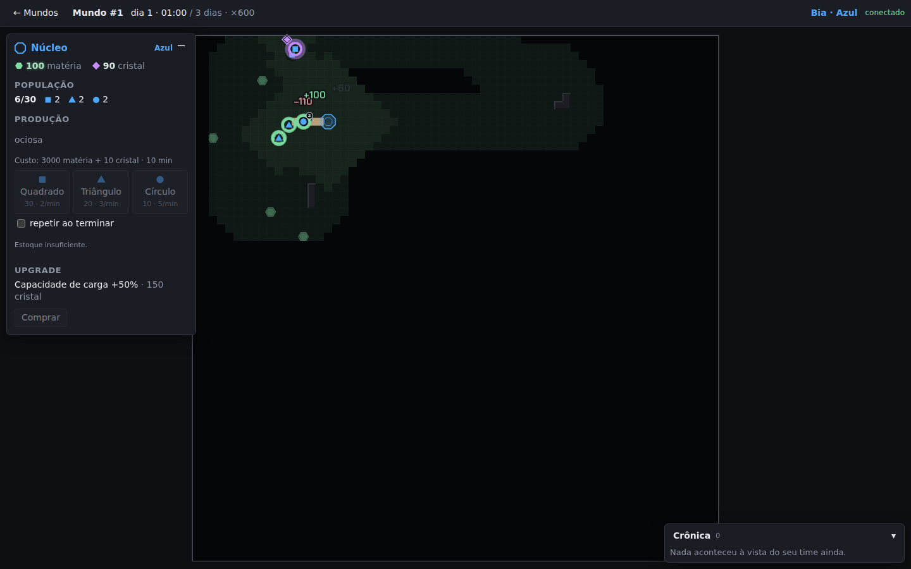

*The first world hour, seen by the Blue team: the core (the blue octagon) with a first stretch of road, six creeps at
work, matéria deposits (green hexagons) and a cristal deposit (the purple diamond at the top). Everything the team
has never seen is black.*

## The game

### A world that does not wait for you

A **match** is one persistent **world**: a map generated from a number (the **seed**), mirrored so both teams get
equivalent conditions, with jungle, rocks that block sight, a river and a few fords to cross it. The design target is a
match that lasts **days** (three, for now), where you check in a few times a day, like a garden that keeps growing
while you are away. For the first playtest with friends the same game is being retuned to fit **about two real
hours**.

The world runs on its own clock, which ticks once per world second. A **multiplier** (written **×N**) says how much
faster than real time the clock runs: at ×6, a world hour goes by in ten real minutes; at ×2000, a whole three-day
world fits in a little over two real minutes, which is how bots and tests play entire matches quickly.

### Creeps, and why shape matters

Every unit is a **creep**: it has a name, hit points (HP), a bag, and it dies for good. Its innate shape is its
**DNA**, and the shape tells you its role at a glance:

| Shape | Role | In the world | In battle |
|---|---|---|---|
| ■ Square | Heavy hauler, melee tank | Carries the most (30), walks the slowest, sees the least (3 cells) | Most HP (300); hits the cell in front of it and blocks the way |
| ▲ Triangle | In between | Carries 20, medium speed, sees 4 cells | 200 HP; shoots at medium range |
| ● Circle | Fast scout, fragile marksman | Carries the least (10), walks the fastest, sees the farthest (6 cells) | 120 HP; shoots projectiles from afar |

The numbers are provisional: they live in data files and change as playtests and simulations teach us something.
The three shapes are designed to move about the same amount of wealth per hour (a big slow bag or a small fast one);
they differ in what happens when trouble comes.

There is **no fixed hero**. Any creep can become the hero for a while: you **dominate** it (take direct control,
give it orders on the map, play it in battle) and later **release** it back to its rules.

### Wealth is physical

Resources are not numbers in a menu. They sit in **deposits** on the map and must be carried to the core:

- **Matéria** (green hexagons): heavy, abundant near the bases, grows back. It pays for most of a new creep and for
  roads.
- **Cristal** (purple diamonds): light, rare, in contested spots, runs out. Every new creep needs a little of it,
  upgrades need more, and it is the natural target of an ambush.

A loaded creep is slower and worth robbing. Teams build **roads** cell by cell to move faster, and roads are
**neutral**: the enemy walks on yours too.

### The autopilot: the rules you leave behind

Since nobody watches a world 24 hours a day, every creep follows an ordered list of **rules**, each one a
`condition → action`: the first rule whose condition is true decides what the creep does. It is the same idea as the
*gambits* of Final Fantasy XII. Ready-made lists, called **presets**, cover the common jobs (matéria gatherer, cristal
gatherer, road builder, scout, raider), and you can edit any rule.

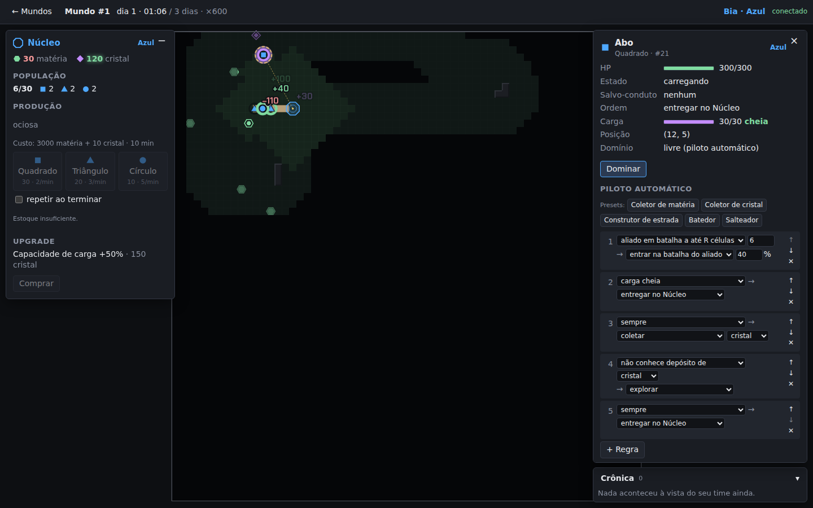

*Clicking a creep shows what it is doing and its rules. This square carries a full bag of cristal home. In order, its
rules say: help an ally fighting within 6 cells, deliver when full, gather cristal, explore if the team knows no
cristal, and otherwise deliver at the core.*

A **bot** (a computer player, called the **strategist** in the code) plays whole teams with these same rules: it
chooses what to produce, where to build roads and how to react to threats, at three difficulty levels. Humans,
autopilot rules and bots all act through the same **commands**, so a bot never has powers a human lacks.

### Fog of war

A team only knows what its core and its creeps see, plus what it remembers. Never-seen ground is **black**;
ground seen before is **dimmed** and shows the last known state (a deposit's last amount, a road); enemy creeps
vanish when they leave sight. The server enforces this: your browser never even receives what your team cannot see,
so there is nothing to "hack" out of it.

### Ambush on the road

When a creep catches an enemy one, an **encounter** starts. The aggressor either:

- **attacks**, which opens a battle at once; or
- **extorts**, demanding the victim's cargo. The victim **pays** (and gets a **safe-conduct**: that team leaves it
  alone for a while) or **refuses**, which opens a battle.

Creeps on autopilot answer by their **stance** (rules like "pay if they ask for less than a quarter of my load, fight
otherwise, run if my HP is low").

### Battles: a small real-time arena

A battle is a separate little game. The world cells around the encounter become a grid **arena** (rocks stay rocks).
Creeps face one of four directions: the square strikes the cell in front of it, while triangles and circles fire
projectiles that travel cell by cell and can be dodged. There is a short countdown at the start, and nobody wins by
the clock: a fight ends when one side is left, or when 15 seconds pass with no damage and everyone flees. To escape,
you stand on the arena's border for a moment without being hit, maybe after dropping your bag to run faster.

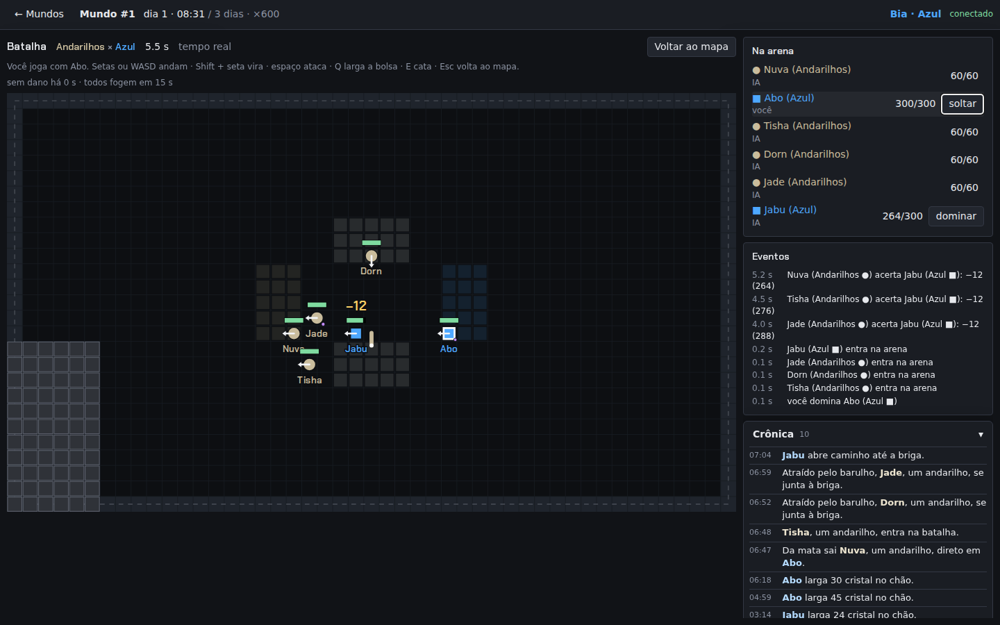

*A battle opened from the world and played live. The player controls Abo (the Blue square on the right, "você"),
three wanderers gang up on Jabu, and the right column lists who is in the arena and every hit.*

Other creeps can **join** a battle in progress, as reinforcements or opportunists, and a battle can have up to four
sides. When no human is playing, the same simulation runs on its own, driven by the battle AI (the **gambits**,
condition → action lists like the autopilot's): this is called **auto-resolve**. The result goes back to the world:
the dead stay dead, survivors keep their wounds, and the winners take the losers' cargo (what does not fit stays on
the ground as **spoils** anyone can pick up).

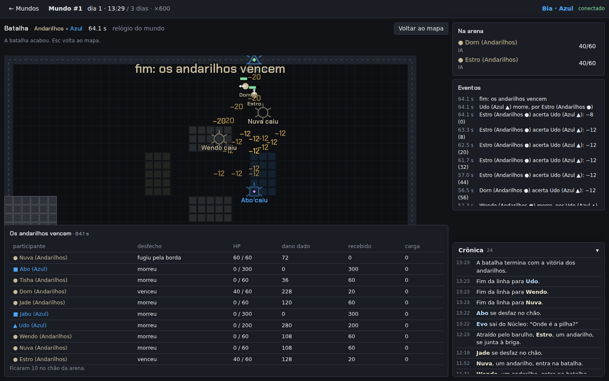

*The end of a 67-second battle that kept growing: two Blue squares and a triangle against five wanderers. The table
shows each participant's fate; the chronicle on the right tells the same story in sentences.*

### The wanderers

Not everything in the jungle belongs to a team. The **wanderers** are hostile neutral creeps (sand-colored circles)
that roam along the river, go after **loaded** creeps, join any nearby fight, and carry what they steal until someone
kills them. They never enter a team's core zone: home is safe from them.

### The chronicle and the replay

Creeps have names, and the game tells their story. The **chronicle** narrates what your team sees: "Nuva, a wanderer,
comes out of the jungle straight at Abo", "Abo drops 30 cristal on the ground". Every finished world can be watched
again as a **replay**, from start to end, with the whole map revealed.

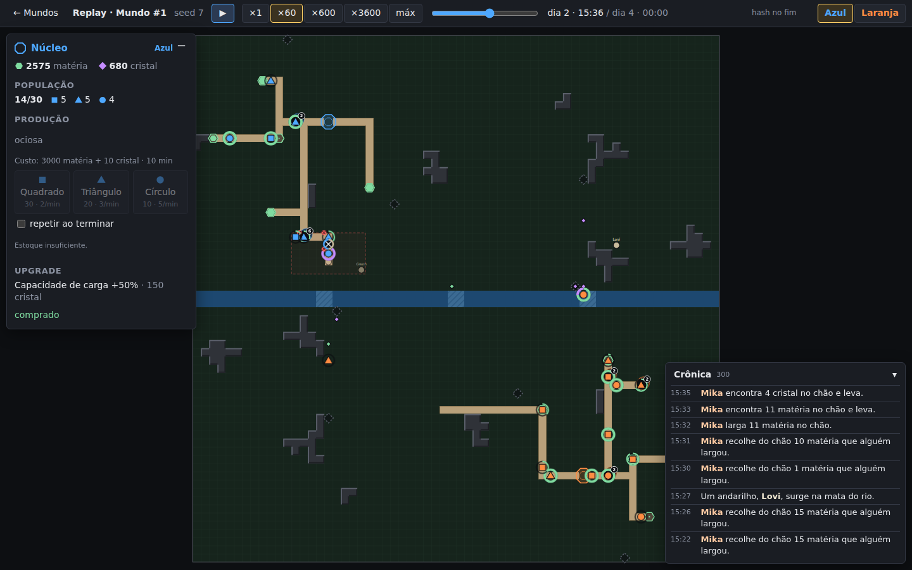

*A replay halfway through a bot-versus-bot world: Blue's roads at the top, Orange's at the bottom, a battle (the dashed
red box) near the Blue base, wanderers by the fords. The timeline at the top jumps anywhere in the match.*

### How a match ends

The long-term goal is that **destroying the enemy core wins**. Until buildings can be attacked (the siege, planned
after the first playtest), a match ends at its clock. The next step, already designed and approved, is a **minimal
end**: a team with no creeps and no way to make more is eliminated, a human can concede, the bot concedes when it has
no chance, the clock gives a draw, and an end screen sums up the match.

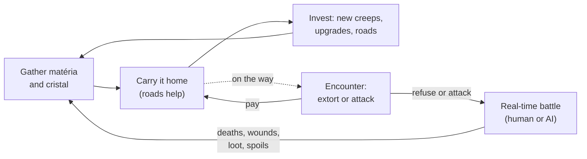

## The battle lab

Combat is designed in a separate page, the **battle lab**, before it reaches the world. There you set up a battle by
hand (arena, sides, shapes, AI difficulty), watch the AI fight or take over any creep, and add fake network delay to
feel how the game plays over the internet. It is where new combat ideas are tested and tuned.

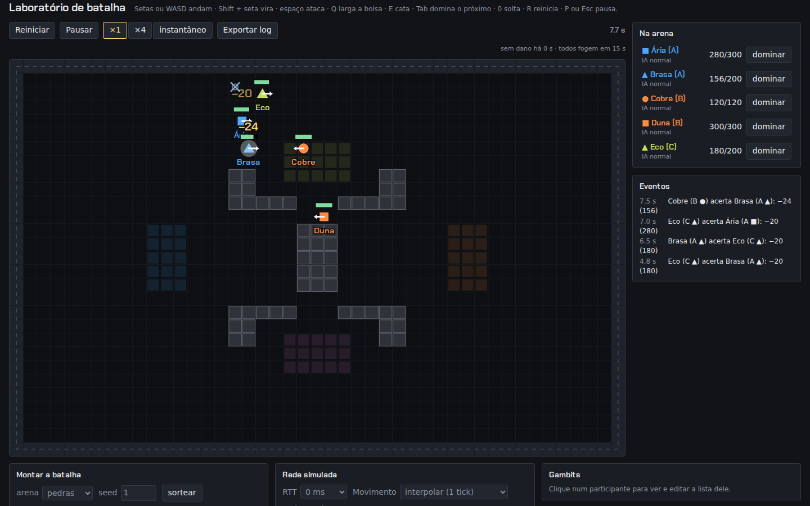

*The lab with three sides (A in blue, B in orange, C in yellow-green) fighting among rock walls, all played by the
AI. The controls at the top restart, pause or speed up the battle, and the panels below set up the next one.*

## What exists today, and what comes next

The project moves in **milestones**, each one answering a design question with a playtest before the next starts.

| Milestone | Question | Status |
|---|---|---|
| **M0 · Design** | What are we building? | ✅ Done |
| **M1 · The wealth cycle** | Is gathering, hauling and investing interesting on its own? | ✅ Done |
| **M1.5 · The fog** | Does hiding information create decisions without making the map unreadable? | ✅ Done |
| **M2 · The ambush** | Can a fight change the course of the world without dominating the game? | 🟡 In progress |

Each milestone is cut into **slices** (pieces of work with a letter). Inside M2:

| Slice | What it brings | Status |
|---|---|---|
| **A · The encounter** | Names, HP, death; attack, extort, pay, refuse; spoils; the chronicle | ✅ Done |
| **B · The battle lab** | The real-time combat and its AI, on a page of its own | ✅ Done |
| **D · The junction** | Joining the two: an encounter opens a real battle, humans play it from the world, the result comes back; the wanderers | ✅ Done |
| **R · Rebalance and pace** | A two-hour match, wanderers early, smarter bots with three difficulties, "follow" an ally, help allies in a fight, a red sign over a creep with hostile intent, a pause in battle | 🟡 In progress |
| **E-min · The minimal end** | Elimination, conceding, a draw at the clock, the end screen, markers in the replay | Designed, next |
| **K · The DNA kits** | A special move per shape (below) | Designed, next |
| **G · Groups and formations** | Squads that follow the creep you play, in formation (below) | Designed |
| **P · The friends' playtest** | Friends joining over the internet, several humans per team and per battle | After R, E-min, K and G |
| **E · Siege and repair** | Attacking the core and the roads; paid repair; victory by destroying the core | After P |
| **T · More teams** | Worlds of up to four teams | After P, competing with E |

### Planned: a special move per shape (slice K)

Today every creep only has a basic attack. Slice K gives each shape its own skill on one key, **Space**: a tap
attacks, and holding Space fills a bar that powers the shape's move. Every shape also gets a **dodge** (tap a
direction twice).

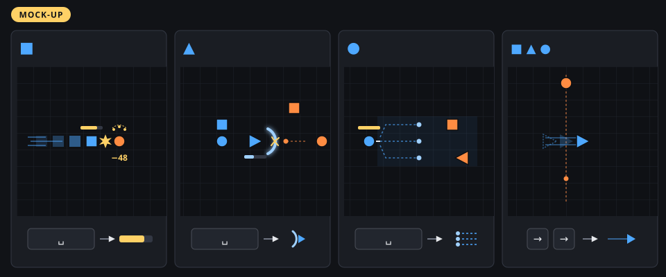

*Mock-up, not in the game yet. From left to right: ■ the square holds Space to charge, running faster and hitting
harder, with a short stun; ▲ the triangle guards, blocking shots that come at its face and sheltering allies behind
it; ● the circle fires a fan of three shots whose reach grows with the bar; and any shape dodges two cells,
untouchable while it dashes.*

### Planned: squads and formations (slice G)

Today you control one creep at a time. Slice G lets a player gather a **squad**: the creep you play (the **embodied**
creep, shown to everyone with a glow and your name) leads, and the others follow it in formation (squares in front,
triangles in the middle and on the flanks, circles behind). A panel lists the squad, numbered so keys 1 to 9 pick a
member, and simple orders (follow, hold, attack a target, fall back) work in the world and in battle.

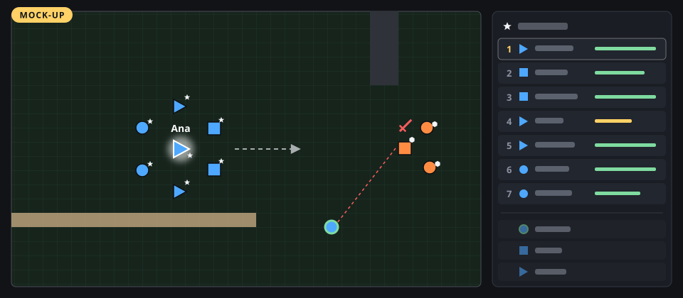

*Mock-up, not in the game yet. Ana's squad (★) moves right in the default formation; a bot's squad (⬢) shows its
symbol but no glow, since no human plays it. Its leader carries the red sword of a hostile intent (coming in slice
R), with a red line to the Blue creep it is chasing.*

### Later: the siege (slice E)

Siege and repair have not been designed yet; they get their own design round after the first playtest. What is
already decided: the **core**, finished **roads** and roads **under construction** will have HP and can be destroyed,
and lost HP only comes back through **paid repair**. A proposal on the table is that destroying a core should be a
process of hours, not an instant, so no team loses while asleep.

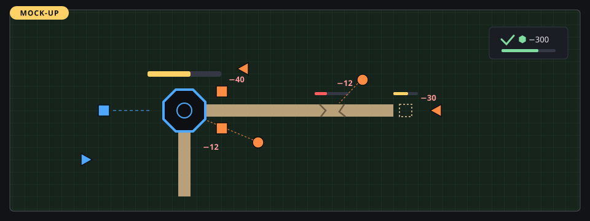

*Concept only: how a siege might look once buildings have HP. None of its rules exist yet.*

### Ideas with no date

The design documents keep a **Parked** list of the owner's ideas with no milestone: creeps that level up and learn
skills, neutral tribes to befriend, bosses, trees to climb for ambushes, team votes and taxes, a world that ends in an
apocalypse, chat with console commands. They give a direction, not a promise.

## Under the hood, in plain words

The interesting engineering is not the graphics (it is all SVG shapes) but a world that runs for days, can be
replayed exactly, and never shows a team what it should not see.

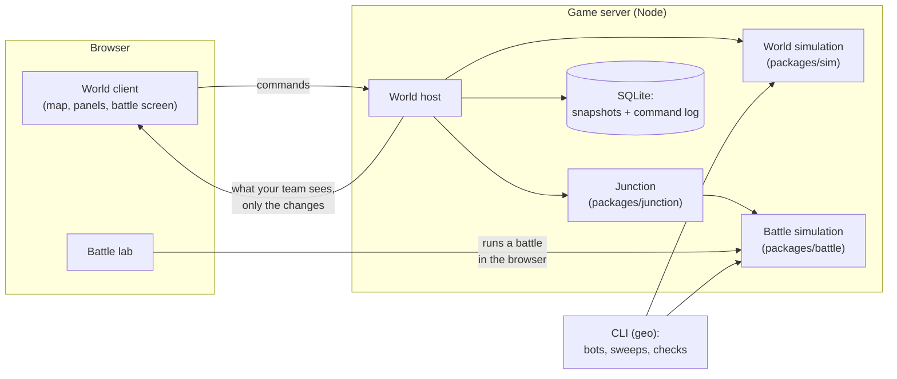

- **Two simulations.** The world (`sim`) and the battle (`battle`) are separate programs with separate clocks: the
  world ticks once per second, a battle 20 times per second. A third piece, the **junction**, runs battles next to the
  world and passes the results back.
- **Deterministic.** Given the same starting seed and the same list of commands, the simulations always produce
  exactly the same result, on any machine and any browser engine. To guarantee it, they use whole numbers only (no
  floating point, no randomness except a seeded generator), and the linter forbids anything that could differ between
  machines.
- **A replay is a seed plus a list of commands.** A whole three-day world between bots fits in a small file.
  The server stores periodic **snapshots** and the **command log** in SQLite, so after a crash it rebuilds the world
  exactly where it was.
- **The server is the authority.** Browsers only send commands ("move here", "dominate this creep"); the server
  checks them, runs the simulation and sends each team a **view**: only what that team sees, and only what changed
  since the last message (a **delta**), about 200 bytes per second per player at normal speed.
- **Network delay.** In a fast battle, a round trip to the server takes time. **Client prediction** means your
  browser draws your own creep moving right away, before the server confirms it, to hide that delay. It exists as an
  experiment in the lab; whether the game needs it will be decided by measuring a real internet playtest.
- **Bots and a headless harness.** The command line tool (`geo`) plays whole worlds bot against bot in seconds,
  runs thousands of AI battles across many seeds, and reports wins, durations and balance, so numbers are tuned with
  data before anyone plays. A **soak test** kills the server several times during a whole world and checks that every
  player ends with exactly the server's view.
- **Stack:** TypeScript on Node 26 (Node runs it directly), Preact with signals and SVG in the browser, Vite, `ws`
  for WebSocket, `better-sqlite3`, zod, Vitest (thousands of tests) and Playwright for screenshots.

| Folder | What lives there |
|---|---|
| `packages/sim` | The world simulation: map, creeps, economy, fog, autopilot, bots |
| `packages/battle` | The battle simulation and its AI |
| `packages/junction` | Runs battles next to the world and returns their results |
| `packages/protocol` | The messages between browser and server |
| `apps/server` | The game server: worlds, players, persistence, WebSocket |
| `apps/client` | The browser game, the replay viewer and the battle lab |
| `apps/cli` | `geo`: headless worlds, battle sweeps, determinism and network checks |
| `params/` | Every balancing number (costs, speeds, HP), as data |
| `docs/` | Design, decisions, specs, playtests and status |
| `scripts/capture/` | The tool that took the screenshots on this page |

## How the project is run

One person, **the owner**, decides the design; AI coding agents (mostly Claude Code) draft documents, implement and
report. Work moves through explicit gates, and nothing becomes a rule of the game without the owner's OK.

- The **pillars** ([PILLARS](PILLARS.md)) are the filter for every idea: the war is won in the economy and the fight
  in the micro; wealth is physical; any creep can be a hero; the world does not wait for you; collective decisions
  have rules; shape is meaning.
- The **game design document** ([GDD](gdd/README.md)) has one file per system, each split into *Decided*,
  *Proposal*, *Parked* and *Open questions*.
- Each slice goes through a **spec** (what and why), a **plan** (how) and **tasks** (the steps, grouped in
  **phases** called F1, F2…), each approved by the owner ([specs](specs/README.md)).
- Architecture choices are recorded as **ADRs** ([architecture decision records](adr/README.md)), *Proposed* until
  the owner *Accepts* them.
- Each phase is built on its own git branch and merged into `main` when the full check (types, lint, format, tests)
  is green. **Checkpoints** and **playtests** with humans ([PLAYTEST](PLAYTEST.md)) feed findings back into the
  design.

## Words you will meet in the other documents

| Term | In plain words |
|---|---|
| **M0, M1, M1.5, M2** | Milestones: the big steps of the [roadmap](ROADMAP.md). M2, "the ambush", is the current one |
| **Slice** (A, B, D, R, E-min, K, G, P, E, T) | A piece of a milestone, named by a letter (see the table above) |
| **Phase** (F1, F2…) | A step inside a slice, one git branch each. "R F3" is phase 3 of slice R |
| **Spec / plan / tasks** | The three documents of a slice: what, how, and the steps |
| **GDD** | Game design document: the rules of the game, one file per system |
| **ADR** | Architecture decision record: a technical choice and why |
| **Checkpoint / C1, C2** | A stop where the owner plays or reviews and gives findings |
| **Owner** | The person who decides the design |
| **`sim`** | The world simulation (`packages/sim`) |
| **`battle`** | The battle simulation (`packages/battle`) |
| **Junction** | The part that opens a battle from the world and returns its result (also slice D's name) |
| **Tick** | One step of a simulation: one world second, or 50 ms of battle |
| **×N, multiplier** | How much faster than real time the world clock runs |
| **Seed** | The number that generates a map and its randomness; same seed, same world |
| **Deterministic** | Same seed and same commands always give the same result |
| **Hash** | A fingerprint of the whole state, used to check two runs match |
| **Command** | The only way to act in a simulation, for humans, rules and bots alike |
| **Command log** | The list of every command, in order: with the seed, it is the whole match |
| **Snapshot** | A saved copy of the whole state at one moment |
| **View / delta** | What one team is allowed to see / only what changed in it since the last message |
| **Fog** | What your team does not see right now |
| **Client prediction** | Drawing your own creep ahead of the server's answer to hide network delay |
| **Core** | The heart of a team's base: it makes creeps and receives deliveries |
| **Creep** | Any unit of a team |
| **DNA** | A creep's innate shape: square, triangle or circle |
| **Dominate / release** | Take direct control of one creep / give it back to its rules |
| **Embodied creep, squad** | The creep a player plays, and the creeps following it (slice G, planned) |
| **Autopilot, rules, preset** | A creep's `condition → action` list; a preset is a ready-made list |
| **Stance** | The autopilot rules for encounters: when to pay, fight or flee |
| **Strategist, bot** | The computer player that runs a whole team |
| **Gambits** | The battle AI's `condition → action` lists |
| **Auto-resolve** | A battle played by the AI alone, with no human |
| **Encounter, extortion, safe-conduct** | Meeting an enemy on the road; demanding its cargo; the immunity bought by paying |
| **Spoils** | Resources left on the ground, free for anyone |
| **Wanderers** | Hostile neutral creeps that hunt loaded creeps |
| **Chronicle** | The story of the match, told in sentences |
| **Battle lab** | The page where combat is tried on its own (`npm run lab`) |
| **Kit** | A shape's special moves in battle (slice K, planned) |
| **Sweep, matrix** | Many simulated worlds or battles over many seeds, to measure balance |
| **Soak test** | A long run that crashes and restarts the server to prove nothing is lost |
| **Playtest** | A session where humans play and report what was fun or confusing |

The full glossary of game terms is in [GLOSSARY](GLOSSARY.md).

## Try it

You need Node 26 (`nvm use` picks it from `.nvmrc`).

```bash
npm install
npm run dev:multi -- --clients 1 --bot   # a world against the bot, one browser tab
npm run lab                              # the battle lab
npm run geo -- sim --seed 42 --days 3    # a whole bot-vs-bot world, report in runs/
npm run capture                          # retake the screenshots of this page, into runs/
```

The game's interface is in Portuguese for now ("Núcleo" is the core, "Dominar" is dominate, "Crônica" is the
chronicle); everything in the repository is in English. More commands are in [CLAUDE.md](../CLAUDE.md).

## Where to go next

| To… | Read |
|---|---|
| See where the project is right now | [Status dashboard](dashboard/current-status.md) |
| Understand the game's rules | [Pillars](PILLARS.md) → [GDD](gdd/README.md) → [Glossary](GLOSSARY.md) |
| See the build order | [Roadmap](ROADMAP.md) |
| Understand the technical choices | [ADRs](adr/README.md) |
| Run or join a playtest | [PLAYTEST](PLAYTEST.md) |
| Work on it with AI agents | [Harness guide](HARNESS.md) |
