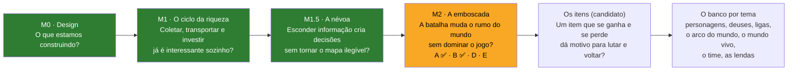
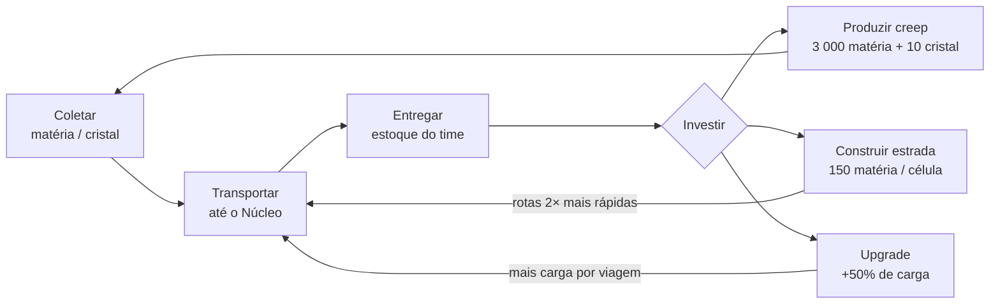
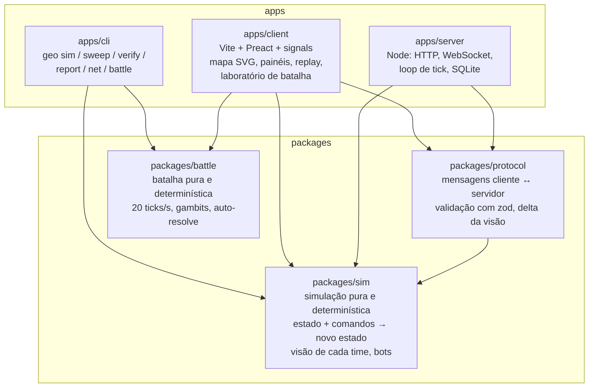
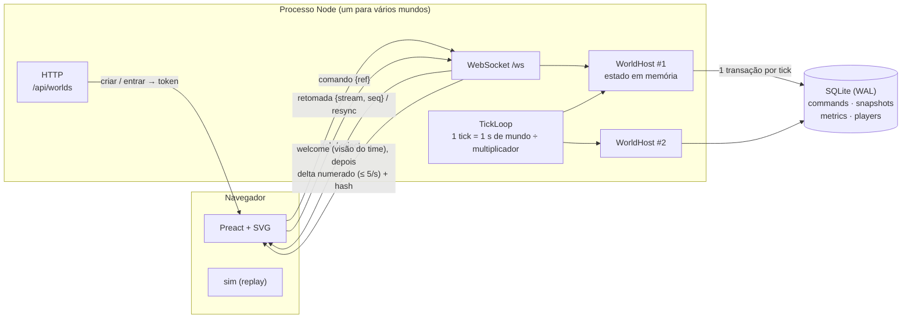
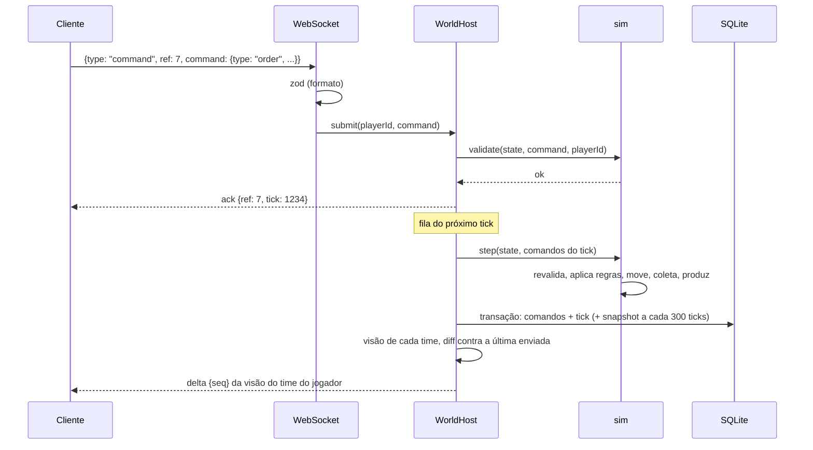
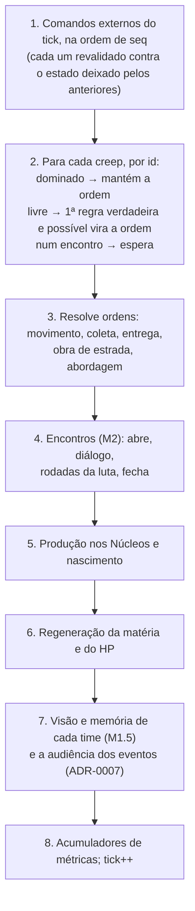
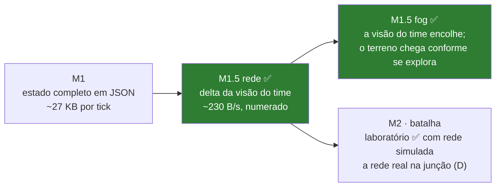
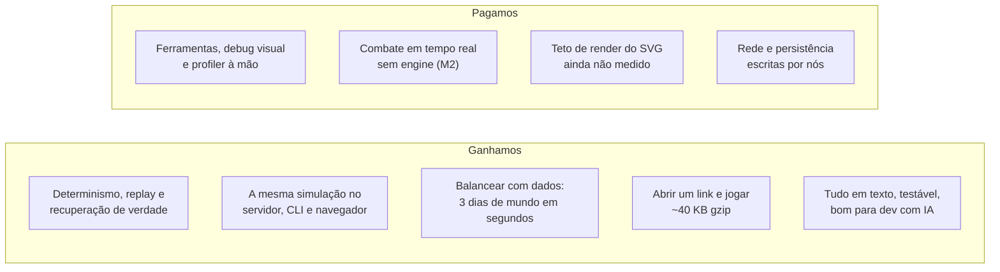

# geometrix: visão geral

> Um tour pelo projeto para quem chegou agora: o que é o jogo, por que ele existe, o que já roda, como a arquitetura
> funciona por dentro, quanto custa e onde estão os limites. As fontes de verdade continuam sendo os docs linkados
> em cada seção; este arquivo é o mapa.
>
> **Retrato de 2026-11-20, no meio do M2 (A emboscada).** O M1 e o M1.5 estão concluídos. Do M2, a fatia A, **o
> encontro** (abordar, extorquir, pagar, lutar ou fugir, com a luta por um sorteio descartável), e a fatia B, **o
> laboratório de batalha** (um pacote de combate determinístico próprio, a regra de grade, a IA de gambits e a
> latência simulada, numa página local), estão concluídas. A próxima frente é a D, **a junção**: o encontro abre a
> batalha de verdade. O ROADMAP virou o marco atual, o próximo candidato (Os itens) e um banco de ideias por tema.
> Para o jogo contado como uma partida, com as ideias que ainda não foram decididas, veja o
> [guia da partida](GAMEPLAY.md); para uma apresentação curta, em inglês, o [README](../README.md).

## Sumário

1. [Em uma frase](#1-em-uma-frase)
2. [O conceito e a motivação](#2-o-conceito-e-a-motivação)
3. [O GDD em uma página](#3-o-gdd-em-uma-página)
4. [Onde estamos: feito × pendente × planejado](#4-onde-estamos-feito--pendente--planejado)
5. [Arquitetura](#5-arquitetura)
6. [Decisões de implementação que valem a conversa](#6-decisões-de-implementação-que-valem-a-conversa)
7. [Sync via WebSocket: quanto custa, e escala?](#7-sync-via-websocket-quanto-custa-e-escala)
8. [Por que não Unity, Unreal ou Godot?](#8-por-que-não-unity-unreal-ou-godot)
9. [Limitações conhecidas](#9-limitações-conhecidas)
10. [Como o projeto é construído](#10-como-o-projeto-é-construído)
11. [FAQ rápido](#11-faq-rápido)
12. [Como rodar e onde ler mais](#12-como-rodar-e-onde-ler-mais)

---

## 1. Em uma frase

**Um jogo de estratégia multiplayer no navegador, num mundo persistente que dura dias**, em que times coletam,
transportam e investem riqueza física (camada RTS/economia/sandbox), creeps programáveis trabalham enquanto o jogador
dorme, e **encontros no caminho** (pedágio, emboscada, fuga) viram batalhas curtas em tempo real que decidem os
confrontos, mas não a guerra. Tudo desenhado só com geometria.

## 2. O conceito e a motivação

### A ideia

Pense num cruzamento de quatro coisas:

- a **macro de um RTS** (economia, logística, construção), mas num mundo que não acaba em 40 minutos: ele roda por
  **dias**, mesmo com você offline;
- a **programação de comportamento** de jogos como Screeps e Gladiabots, ou os *gambits* de Final Fantasy XII:
  enquanto você não está lá, seus creeps seguem as regras de piloto automático que você deixou. Mais à frente, com
  linha de comando, macros e scripts, para quem quiser montar o próprio bot;
- os **encontros e as histórias emergentes** de Mount & Blade, RimWorld e Dwarf Fortress: o inimigo aborda a sua
  carga no caminho e exige pedágio; você paga, luta ou larga a bolsa e corre, e uma crônica conta o que aconteceu.
  Creeps têm nome e morrem de vez;
- o **controle direto** dos jogos de ação (os 2D top-down do BYOND, os MOBAs), mas sem herói fixo: **qualquer creep
  pode virar o herói**. Você *domina* um creep do seu time, joga com ele e depois o *libera*.

### Os pilares (o filtro de toda decisão)

Resumo de [`PILLARS.md`](PILLARS.md):

| # | Pilar | Na prática |
|---|---|---|
| 1 | **A guerra se ganha na macro; a batalha, na micro** | Economia e logística decidem a partida; o combate ganha confrontos |
| 2 | **Riqueza é física** | Todo recurso existe num lugar do mapa e precisa ser *carregado* até a base. No caminho, pode ser roubado |
| 3 | **Qualquer creep pode ser um herói** | Dominar e liberar no lugar de um herói fixo |
| 4 | **O mundo não espera você** | Partidas de dias; ausente, vale o seu piloto automático |
| 5 | **Decisões coletivas têm regras** | Entre os deuses: pactos e alianças com regras (a votação dentro do time fica para o panteão; rodada 5) |
| 6 | **A geometria é a linguagem visual** | ■ quadrado = tank melee · ● círculo = glass cannon ranged · ▲ triângulo = meio-termo |

E o que ele **não** é: não é um clone de LoL/Dota, não exige ficar online o tempo todo, não é um e-sport de reflexo
na v1, e **não é uma engine genérica**.

### Por que esse jogo?

Os pilares respondem a uma tensão real dos gêneros:

- **MOBAs** têm a melhor sensação de controle direto, mas cada partida começa do zero e exige 30–40 minutos
  seguidos de atenção.
- **Jogos persistentes** (MMO de estratégia, Screeps) têm consequência de longo prazo, mas raramente têm a micro
  divertida de um MOBA.
- O geometrix junta os dois separando as escalas de tempo: o **mundo** é lento, durável e funciona sozinho; a
  **batalha** é rápida, curta e é onde a habilidade de mão aparece. O elo entre eles é o pilar 2: a carga que
  atravessa a jungle é o alvo da emboscada.
- Quase todo encontro acontece sem nenhum humano olhando (o mundo não espera ninguém). Por isso o encontro é, antes
  de tudo, uma **regra do piloto automático** ("pago até tanto; se me atacarem, fujo"), e o humano que domina um
  creep é a exceção que escolhe na hora. Configurar essas posturas é o tipo de decisão que o pilar 4 promete.

O visual geométrico é uma escolha de linguagem (forma comunica papel) e também de viabilidade: dá para fazer um jogo
legível sem pipeline de arte.

### A pergunta de cada marco

O projeto avança por **hipóteses testáveis**, não por features. Cada marco precisa responder a uma pergunta de
design antes do próximo ([`ROADMAP.md`](ROADMAP.md)):



Verde: concluído. Amarelo: em construção. Os itens são o candidato a próximo marco; o banco não tem número nem ordem
fixa: uma ideia só ganha marco quando o dono escolhe o próximo, no checkpoint do atual (ROADMAP, 2026-11-20).

## 3. O GDD em uma página

O [GDD](gdd/README.md) tem um arquivo por sistema, e cada um separa **Decidido** (o dono aprovou), **Proposta**
(ainda não aprovada) e **Perguntas abertas**. Isso é levado a sério: nada vira "decidido" sem o OK explícito do dono.
O [guia da partida](GAMEPLAY.md) conta estes sistemas como uma partida, com o estado de cada mecânica.

| Sistema | O que está decidido | O que ainda está em aberto | Marco · temas do banco |
|---|---|---|---|
| [01 Mundo e mapa](gdd/01-mundo.md) | Mundo persistente de dias (hipótese: 3); **um deus por povo**, dois povos agora e N depois (rodada 5); vitória = destruir a base inimiga; início "fundação"; **fog of war** (névoa negra, pedras bloqueiam a visão, memória do time, três estados na tela); **no M2:** construções com HP, o inimigo à vista com nome e HP, o fim mínimo (empate quando o relógio acaba); **o fim do mundo como arco:** atos com gatilhos, a corrupção do cristal esgotado, o ponto sem volta, a vitória pírrica, ramos dentro da corrupção, o mestre que conduz o arco com limites, o segredo na instância; três caminhos de salvação, os portais com lendas da seed, as metas de ritmo por ato | Entrar no meio da partida, onde se pode construir, rio como rota; **a moldura da saga** (em análise) | M1 · M1.5 · M2 · O arco do mundo, A jungle hostil, As lendas |
| [02 Creeps e domínio](gdd/02-creeps-e-dominio.md) | Herói = creep dominado; 1 domínio por jogador; DNA = forma inata; morte permanente; inventário; os 3 DNAs se equivalem na economia; **visão por DNA**; **no M2:** nome no estado, HP que persiste e regenera, stats base por DNA; **a progressão híbrida** (o DNA dá uma skill natural, os itens dão as outras, o level com peso menor); **a liga de um creep líder** (piloto de grupo, recrutamento por diálogo, símbolo); títulos e laços simbólicos primeiro; dominar um creep famoso pede influência; **os kits divinos** pelo estilo, o karma de −1 a +1, os fiéis | Custo de dominar, limite de população, vários creeps na mesma célula; o retornado (em análise) | M1 · M1.5 · M2 · Os itens, Os personagens, As ligas, Os deuses |
| [03 Economia](gdd/03-economia-e-logistica.md) | Transporte físico; **matéria** (pesada, renovável, perto da base) e **cristal** (leve, valioso, esgotável, disputado); imposto (quem define a taxa com um deus por povo está em aberto); **no M2:** extorsão física, saque e **despojo** no chão; **o Núcleo é a forja e o cofre** dos itens; os tributos das tribos no tesouro do time, numa caravana; **o recurso do deus** (nasce dos feitos dos fiéis, acelerado por oferendas e rituais) | Moeda cunhada × recurso; sumidouros; o papel do cristal (uma rodada própria) | M1 · M1.5 · M2 · Os itens, Os deuses, Os pactos |
| [04 Governança](gdd/04-governanca.md) | **O pilar 5 vale entre os deuses** (pactos, alianças); no panteão: votação com níveis de autoridade (bots podem decidir / só humanos / unanimidade); representantes em times grandes; **cada time escolhe o regime:** democracia ou meritocracia pela influência dos deuses | Quais decisões existem, quórum, prazo, voto delegado | Os pactos |
| [05 Tribos](gdd/05-tribos-e-diplomacia.md) | Monstros e tribos neutras que viram aliadas ou rivais; **errantes** (fatia D); **chefões** com buff ou item raro, para quem dá o último golpe; o **final feliz secreto** das tribos, que salva o mundo inteiro; **o mestre da mesa** (neutro, sem mexer no placar; um diretor-bot sempre, com a cadeira aberta a um humano); conversões e tributos | As tribos: relação, quests, aliança | M2 · A jungle hostil, O mundo vivo, O arco do mundo |
| [06 Batalhas](gdd/06-batalhas.md) | Mundo e batalha separados; **o encontro dispara a batalha** (o agressor ataca ou extorque, a vítima paga, recusa ou foge); lados, não grupos; salvo-conduto; fuga largando a bolsa; **a regra de grade** (ataque direcional, projétil que se desvia, o ■ bloqueia, fuga pela borda, contagem de 3 s, inatividade da batalha inteira, sem relógio de duração), divertida para o dono; nenhuma regra nova antes da junção; **a arena pelo terreno do encontro**, com a direção no mundo virando a borda; a quest como batalha com objetivo | O raio da "bolha", o tempo do mundo durante a luta, a predição no cliente ([ADR-0009](adr/0009-predicao-no-laboratorio.md), `Proposed`), golpe crítico | M2 · A batalha, Cenários de quest, As ligas |
| [07 Piloto automático](gdd/07-piloto-automatico.md) | Configurável por creep; persiste depois do domínio; regras declarativas `condição → ação`; decide só pelo que o time sabe; presets (coletor, batedor, construtor, salteador); **no M2:** posturas de encontro e, na batalha, **gambits** por creep com presets por papel e o auto-resolve; a liga como piloto de grupo | Script em sandbox; a quest do deus para o creep (proposta) | M1 · M1.5 · M2 · As ligas, Os deuses, Comunicação e automação |
| [08 Crônica, chat e console](gdd/08-cronica-chat-e-console.md) | A crônica narra os encontros e os eventos (o `sim` emite eventos, o cliente escreve as frases, sem LLM); títulos na crônica; **o jogador entra na crônica**, e a partida termina numa história legível por quem joga às cegas; chat livre, linha de comando no estilo do BYOND e macros de cliente (sem marco) | Canais, sintaxe dos verbos, onde as macros ficam, moderação; a ficha (proposta) | M2 · Os personagens, Os deuses, Comunicação e automação |

### O ciclo do M1 (o que já se joga)



Os números são provisórios (candidato B da [passada de balanceamento 1](specs/m1-ciclo-da-riqueza/balance.md)).

## 4. Onde estamos: feito × pendente × planejado

### Feito (M0, M1, M1.5 e as fatias A e B do M2, até 2026-11-20)

| Área | O que existe |
|---|---|
| **Design** | Pilares, GDD com 8 sistemas, 8 ADRs `Accepted` e 1 `Proposed`, spec/plan/tasks do M1, das duas fatias do M1.5 e das fatias A e B do M2; os brainstorms com as respostas do dono, até o [consolidado depois do M2](brainstorm/2026-11-20-consolidado-depois-do-m2.md); o [guia da partida](GAMEPLAY.md) |
| **Simulação** (`packages/sim`) | Mapa gerado por seed com simetria de ponto (rio, travessias, rochas); movimento em grid 4-direções com A* e cache; coleta, entrega, regeneração; produção com "repetir"; estradas célula a célula; upgrade; domínio; interpretador de regras + 3 presets; estrategista bot; métricas |
| **Servidor** (`apps/server`) | HTTP (criar, listar, entrar), WebSocket com ack/reject, loop de tick com multiplicador, SQLite (log + snapshots + métricas), recuperação após crash, bots por time, liberação automática do domínio por inatividade/desconexão |
| **Cliente** (`apps/client`) | Lobby; mapa SVG com pan/zoom e névoa em três estados; creeps interpolados com nomes; seleção por área (com lista quando o clique cai em vários creeps); cursor com o ícone da ação do clique; inspetor; painel do Núcleo; editor de regras; controle direto pelo botão direito; feedback visual (`+N`/`−N`, carga cheia, custo da estrada) |
| **Harness** (`apps/cli`) | `geo sim` (mundo de 3 dias sem interface em ~13 s), `geo sweep` (varredura de parâmetros), `geo verify` (determinismo), `geo report` (relatório legível por humanos e por IA), `geo net` (banda e CPU dos deltas, com a correção do diff conferida em todo tick), `geo battle sweep` e `geo battle verify` (a matriz de batalhas pela IA e o determinismo da batalha) |
| **Replay** | O navegador roda o mesmo `sim` a partir de seed + log, com linha do tempo e ✓/✗ do hash final, validado no Chromium (V8) e no WebKit (JavaScriptCore) |
| **Testes de resistência** | `npm run soak`: um mundo inteiro bot × bot a ×360, com 5 `kill -9` + 1 SIGTERM no meio e 2 clientes WebSocket sem interface por time seguindo os deltas; termina com o mesmo hash no servidor, no Node e no navegador, e com a visão de cada cliente igual à do servidor |
| **Rede por deltas** (M1.5, fatia 1) | Cada time recebe a própria visão como deltas numerados ([ADR-0006](adr/0006-sync-do-mundo.md)): `welcome` com a visão completa, depois só o que mudou; hash da visão a cada 60 ticks; retomada pelo buffer de 30 s; `resync` quando algo diverge; painel de rede no cliente (`?net=1`). Todos os critérios de viabilidade verdes ([viability.md](specs/m1.5-rede/viability.md)) |
| **Fog of war** (M1.5, fatia 2, F0–F6) | **Simulação:** visão por raio (Núcleo e DNA) com linha de visão inteira (pedras bloqueiam); memória do time; a visão do time só com o que ele vê ou lembra. Caminho, estradas, piloto automático e bots decidem pelo que o time sabe; ação `explore` e preset batedor; comando sobre o que o time não conhece é recusado como id inexistente. **Rede:** o `welcome` só manda o tamanho do mapa, o terreno chega conforme o time explora, a seed de um mundo vivo não aparece e o replay só abre depois que o mundo acaba. **Tela:** nunca visto (negro), lembrado (véu) e visível; o inimigo só como a visão mostra. **Ajustes do playtest (F6):** coletor pelo tempo de viagem e que só espera a matéria se compensar, cristal mais lento, seleção por área, cursor com a ação |
| **O encontro** (M2, fatia A, F0–F6) | Nome no estado, HP que persiste e regenera, morte permanente; abordar com a intenção (atacar ou extorquir), o diálogo com uma janela para o creep dominado, pagar, recusar ou fugir largando a bolsa; salvo-conduto, saque e despojo; a luta por um **sorteio descartável**; posturas de encontro e o preset salteador; os eventos do `sim` ([ADR-0007](adr/0007-eventos-do-sim.md)) e, no cliente, a crônica, o painel de reação e o menu de abordar |
| **O laboratório de batalha** (M2, fatia B, F0–F7) | O pacote `packages/battle` ([ADR-0008](adr/0008-pacote-de-batalha.md)): uma simulação de batalha própria, determinística e inteira, a 20 ticks por segundo; a regra de grade; de 2 a 4 lados e entrada no meio; a IA de gambits com presets por papel e a reação configurável; o auto-resolve; três arenas (aberta, pedras, corredor). A página `lab.html`: a batalha num *worker*, rede simulada (RTT e *jitter*), opções de movimento, os sinais de ataque, golpe e erro, a sessão às cegas e o log exportável, que o `geo battle verify` refaz |

**Em números** (2026-11-20, fim da fatia B; linhas com comentários): ~29 400 linhas de código de produção, ~19 500
de teste, **2 729 testes** em 107 arquivos, 448 commits no `main`.

| Pacote | Código | Testes |
|---|---|---|
| `packages/sim` | 5 766 | 6 798 |
| `packages/battle` | 3 231 | 4 192 |
| `packages/protocol` | 784 | 644 |
| `apps/server` | 3 056 | 1 972 |
| `apps/client` (com o laboratório) | 12 728 | 4 517 |
| `apps/cli` | 3 798 | 1 400 |

### Pendente

- **As fatias D e E do M2.** A **D, a junção**: o encontro abre a instância de batalha no lugar do sorteio, com dois ou
  mais lados, entrada no meio, auto-resolve, os errantes e a arena escolhida pelo terreno do encontro. A **E, cerco e
  reparo**: HP das construções, a vitória pelo Núcleo e o fim mínimo. Cada uma com spec, plan e checkpoint próprios
  ([ROADMAP](ROADMAP.md)). A antiga fatia C (chat, console e macros) saiu do M2 para o banco de ideias.
- **Deploy**: Dockerfile, `compose.yml` (app + Caddy + Litestream), workflow de deploy manual. Desenhado no
  [plan §11](specs/m1-ciclo-da-riqueza/plan.md), ainda não escrito (não existe `infra/`). Espera a junção (dono,
  2026-11-20): a latência aceitável e a predição no cliente se decidem com o ciclo inteiro colado.
- **Playtest de diversão** com pessoas que nunca viram o jogo (o roteiro está em [`PLAYTEST.md`](PLAYTEST.md)). Volta
  quando o dono, que hoje julga a diversão nos playtests locais, achar o jogo divertido o suficiente.

O repo foi publicado em 2026-11-14, e o CI passa no GitHub.

### Planejado

| Marco | Escopo |
|---|---|
| **M2 · A emboscada** | Faltam a **D** (a junção) e a **E** (cerco e reparo). A D herda a arena pelo encontro, a direção no mundo virando a borda da arena e três restrições de contrato: o lado neutro aceita um controlador (o mestre da mesa), o snapshot leva a posição e o recorte do terreno, e o inventário não supõe só matéria e cristal (os itens) |
| **Os itens** (o próximo marco candidato) | A skill vem do item, num modelo híbrido; a forja e o cofre no Núcleo; o cristal como ingrediente; o item que cai no despojo; os presets do bot como a dica da interface. Em paralelo, se o dono quiser, **As fichas**: a identidade simbólica dos creeps e dos deuses, sem efeito mecânico |
| **O banco por tema** | Sem número: os personagens, os deuses, as ligas, a batalha, os cenários de quest, a jungle hostil, o arco do mundo, o mundo vivo, comunicação e automação, a apresentação, o time, as lendas e o deploy ([ROADMAP](ROADMAP.md), com o grafo de dependências; a análise no [consolidado depois do M2](brainstorm/2026-11-20-consolidado-depois-do-m2.md)) |

## 5. Arquitetura

### Os pacotes

Monorepo com npm workspaces. A regra de ouro é que **o `sim` não depende de nada**: nem Node, nem DOM, nem
bibliotecas.



**A mesma simulação roda em três lugares:** no servidor (autoridade), na CLI (bots e balanceamento sem interface) e
no navegador (o replay do mundo; a batalha do laboratório, num *worker*). Esse é o motivo número um para tudo ser
TypeScript ([ADR-0003](adr/0003-stack-typescript-node.md)). **A batalha é uma simulação à parte**, com as mesmas
regras de determinismo e sem dependência do `sim` ([ADR-0008](adr/0008-pacote-de-batalha.md)): a fatia D é que liga
os dois, com o mundo abrindo a instância e aplicando os eventos que ela devolve.

### Em execução



### O caminho de um comando

Tudo o que muda o mundo é um **comando** ([ADR-0002](adr/0002-tudo-e-comando.md)). Um humano clicando, o bot de
balanceamento e o servidor liberando um domínio por inatividade passam pelo mesmo funil:



### O pipeline do tick

Ordem fixa, em [`step.ts`](../packages/sim/src/step.ts):



Os **eventos** do tick (nascimento, encontro, golpe, morte, despojo…) saem do `step` sem entrar no estado, cada um
com a audiência de quem pode vê-lo; o cliente os transforma nas frases da crônica
([ADR-0007](adr/0007-eventos-do-sim.md)).

## 6. Decisões de implementação que valem a conversa

### 6.1 Simulação determinística, com matemática inteira

**O quê:** dada a mesma seed, os mesmos parâmetros e o mesmo log de comandos, o estado final é **bit a bit igual**,
em qualquer máquina e em qualquer engine JS. O hash (SHA-256 do JSON canônico do estado) prova isso.

**Por quê:** é a base de quase tudo:

| Determinismo dá… | …o que permite |
|---|---|
| Replay = seed + log | Um mundo **bot × bot inteiro de 3 dias tem ~140 comandos no log** (137 na seed 42). O replay inteiro cabe em poucos KB |
| Recuperação = snapshot + log | Crash não perde o mundo (perde no máximo o tick em andamento) |
| Anti-cheat estrutural | O servidor é a autoridade; o cliente só envia intenção |
| Balanceamento com dados | 5 seeds × N variantes de parâmetro, cada mundo de 3 dias em segundos |
| Previsão no cliente (a decidir na junção) | O navegador roda as mesmas simulações que o servidor |

**Como é garantido por ferramenta, não por disciplina:**

- o `tsconfig` do `sim` não tem DOM nem `@types/node`: `window`, `setTimeout` ou `Buffer` **não compilam**;
- o ESLint proíbe `Math.random`, funções transcendentais (`Math.sin`, `Math.exp`…, que podem variar entre V8 e
  JavaScriptCore), `Date`, `for…in` e **literais de ponto flutuante**;
- posições em células, tempo em segundos de mundo, modificadores em **‰**. O movimento usa "pontos": um creep
  acumula `velocidade × modificador‰ / 1000` por tick e anda uma célula ao juntar `CELL_COST = 60 000` pontos.
  "2 células/min" vira 2 000 pontos por tick, sem nenhuma fração;
- RNG xoshiro128** com `Math.imul`, e o estado do RNG faz parte do estado do mundo;
- arrays ordenados por id, ids nunca reaproveitados, nada de `Map`/`Set` no estado (o `serialize` recusa);
- o CI roda `geo verify` com 3 seeds: duas execuções, snapshot → restore → continua, e replay do log. Os três hashes
  têm de bater. A batalha tem o mesmo portão, `geo battle verify` (seeds 1, 42 e 649).

> **Uma história boa:** a primeira passada de balanceamento mostrou o time 1 viajando quase o dobro do time 0 num
> mapa *simétrico*. Não era sorte: o A* desempatava pelo menor índice de célula, e esse critério não é simétrico a
> uma rotação de 180°. Os times construíam estradas com formatos diferentes e terminavam até 19% distantes na
> matéria entregue. Correção: o time 1 desempata na ordem rotacionada. O bug só apareceu porque o harness roda
> dezenas de mundos de 3 dias e compara as métricas
> ([balance.md §1](specs/m1-ciclo-da-riqueza/balance.md)).

### 6.2 Toda ação é um comando, e só os comandos externos vão para o log

O piloto automático, as regras e o bot **não** são gravados: são recalculados a partir do estado. O log guarda só o
que vem de fora da simulação (humanos, edições de regras, o `join` de cada jogador). Por isso um mundo de 3 dias
gera um log minúsculo, e um script de piloto automático nunca pode fazer mais do que um humano faria.

### 6.3 `step` muta o estado no lugar

O ADR-0003 fala em "função pura `estado + comandos → novo estado`". Na prática, copiar o estado a cada tick não
cabia no orçamento de "3 dias de mundo em menos de 10 minutos", então o `step` muta in place (aprovado no plan §5).
O que importa continua valendo: sem I/O, sem relógio, sem aleatoriedade externa. Quem precisa do estado anterior
tira uma cópia com `serialize`.

### 6.4 Persistência: SQLite + snapshot + log

([ADR-0004](adr/0004-persistencia-sqlite-log-de-comandos.md))

- Cada tick é **uma transação**: os comandos aplicados + o número do tick.
- A cada 300 ticks (5 min de mundo), um **snapshot** do estado completo com o hash.
- **Recuperação:** carrega o último snapshot, confere o hash, reaplica os comandos posteriores até o último tick
  gravado. Nos soaks, cada restart voltou em 1,3–9 s.
- Por que SQLite e não Postgres: **cada mundo tem um único escritor** (o processo que o simula). SQLite embutido dá
  transações com latência de disco local e zero infraestrutura. A escala horizontal é por *shard de mundos*, nunca
  por réplica de escrita.
- O backup contínuo para object storage (Litestream) está decidido, mas entra junto com o deploy.

### 6.5 Tick lento e multiplicador de tempo

O mundo anda **1 tick por segundo de mundo**. O relógio real é `1 s ÷ multiplicador`: a ×1 é o jogo de verdade (3
dias reais), a ×36 um playtest (3 dias em 2 h), a ×360 o soak (12 min). A CLI ignora o relógio e roda o mais rápido
possível: **3 dias de mundo em ~13 s** (~50 µs por tick, ~20 000× o tempo real). Sem o fog eram ~4 s: a visão e
os caminhos mais longos pelo terreno desconhecido custam ~2,3×, e a escolha do depósito pelo tempo de viagem (um A*
por decisão) leva a ~3×. Aceito pelo dono nos checkpoints do fog; o orçamento é de 10 minutos.

A batalha tem o próprio tick, de 50 ms (20 Hz), numa simulação separada
([ADR-0001](adr/0001-mundo-e-batalha-separados.md), [ADR-0008](adr/0008-pacote-de-batalha.md)). Uma luta 3 × 3 inteira
pelo auto-resolve (2 400 ticks) custa ~41 ms, e o `geo battle sweep` roda 9 200 batalhas em ~45 s. O mundo nunca
precisa ser rápido; a batalha nunca precisa ser durável.

### 6.6 Cliente: Preact + SVG, e o navegador como engine

- **SVG declarativo via JSX:** cada creep é um `<rect>`, `<circle>` ou `<polygon>`. O mapa estático é desenhado uma
  vez; estradas, depósitos e creeps ficam numa camada dinâmica.
- **Interpolação um estado atrás:** o creep desliza entre os dois últimos estados recebidos com
  `requestAnimationFrame`, então 1 mensagem por segundo ainda parece movimento contínuo.
- **HTML para os painéis:** o editor de regras, o inspetor e o painel do Núcleo são formulários. HTML/CSS é o melhor
  toolkit de UI que existe, e este jogo (e mais ainda o tema "Os pactos", com alianças e governança) é pesado em UI.
- **Bundle:** 142 KB (49 KB gzip) + um pedaço compartilhado de 17 KB (7 KB gzip) + 12 KB de CSS + uma fonte de
  10 KB. O replay carrega sob demanda (108 KB, 33 KB gzip). O laboratório é outra página, `lab.html` (60 KB, 19 KB
  gzip, mais o *worker* da batalha, 28 KB).
- **O laboratório** desenha a arena também em SVG. A batalha roda num *worker*, atrás de um canal com atraso e
  *jitter* simulados, como seria a rede; a tela interpola os passos e mostra os sinais de ataque, golpe, erro, morte
  e fuga.
- **A névoa** é uma camada SVG entre o mundo e os creeps: o nunca visto em negro e o lembrado sob um véu, cada um
  num único `<path>` de faixas por linha, refeito só quando o que o time conhece ou vê muda. O terreno é desenhado
  a partir do que o time conhece; o replay mostra o mundo inteiro, sem névoa.
- **Clique por área e cursor:** com o zoom afastado, um creep é alcançado num raio mínimo de 20 px na tela; se o
  clique cai em vários sem um claramente mais perto, abre a lista deles. O cursor mostra a ação do clique (coletar,
  entregar, andar, estrada, selecionar, escolher no mapa), calculado num signal ligado ao `style` do mapa, sem
  re-renderizar a tela a cada movimento do ponteiro.

## 7. Sync via WebSocket: quanto custa, e escala?

### Resposta curta

**Não mandamos mais o estado inteiro.** No M1, o servidor mandava o estado dinâmico completo em JSON a cada
broadcast (26,5 KB com 60 creeps), ~13–26× acima do previsto no ADR-0005 (1–2 KB/s por cliente). A fatia de rede do
M1.5 trocou isso por **deltas da visão de cada time** ([ADR-0006](adr/0006-sync-do-mundo.md)): cada cliente recebe só
o que mudou no que o próprio time vê, numerado e conferido por hash. Medido a ×1, com 60 creeps e o fog: **206 B/s
por cliente** (alvo ≤ 2 KB/s) e **126 µs por mundo por envio** (alvo ≤ 250 µs), com 0 divergências. A banda caiu
~125× em relação ao estado completo ([viability.md](specs/m1.5-rede/viability.md) tem a medição de antes do fog: 227
B/s e 83 µs).

> **Histórico (2026-11-14).** A primeira versão desta seção recomendava ligar a compressão do WebSocket como o
> conserto "quase grátis" e dizia que deltas economizariam pouco. Um dev de fora do projeto contestou as duas
> coisas depois de ler este doc, e uma medição melhor deu razão a ele: a compressão custa CPU e memória por socket
> no servidor, e o delta por campo é muito menor que o estado completo. A primeira versão do ADR-0006 recomendou
> então mandar só os comandos e simular no cliente; como nenhum cliente (nem bot) deve ver o estado completo com
> fog of war, a recomendação passou para o delta por campo, que a fatia de rede implementou e validou no mesmo dia.

### Como funciona hoje

- No **`welcome`** (ao conectar, numa reconexão que o buffer não cobre ou num `resync`): o tamanho do mapa + a visão
  completa do time (~26 KB com 60 creeps no fim de um mundo de 3 dias). O terreno não vai à parte: ele chega na
  visão, conforme o time explora.
- Depois de cada envio, um **`delta`** com o número de sequência do stream do time: só os campos que mudaram
  (creeps, depósitos, estradas, obras, estoques) e, com o fog, as células exploradas novas e o que entrou ou saiu
  da visão.
- A cada 60 ticks, o **hash da visão** (SHA-256 do JSON canônico) vai junto. O cliente confere com o Web Crypto e
  pede `resync` se o hash divergir ou se faltar um número.
- **Retomada:** numa queda curta, o cliente volta com `stream` e `seq`, e o servidor reenvia do buffer de 30 s, sem
  visão completa. Depois de um restart do servidor, o stream é novo e vem um `welcome`.
- O diff é feito **uma vez por time**, não por socket, e roda mesmo sem cliente conectado (a sequência não pula).
  No máximo 5 envios por segundo por mundo; a ×1, 1 por segundo.
- As regras do piloto automático (metade dos bytes de cada creep) são comparadas por referência: só entram no delta
  quando alguém as troca.
- Comandos sobem como mensagens pequenas e voltam com `ack {tick}` ou `reject {motivo}`.

### Medições (seed 42, 3 dias de mundo bot × bot, ×1)

| | Estado completo (M1) | Delta da visão, sem fog | Delta da visão, com fog (fim do M1.5) |
|---|---|---|---|
| Por mensagem, 60 creeps | 26,5 KB | ~250 B em média (mediana 111 B, p95 601 B) | 206 B em média (mediana 178 B, p95 475 B) |
| Banda por cliente | 6,5–26,6 KB/s | 227 B/s em média | 206 B/s em média |
| Pior mensagem | 26,6 KB | 4,6 KB (no tick em que os depósitos regeneram e ~50 creeps voltam a coletar juntos) | 1,9 KB |
| CPU por envio, por mundo | ~120 µs de `JSON.stringify` | 83 µs (visão 11 µs, diff 58 µs, hash amortizado 13 µs) | 126 µs (visão 40 µs, diff 62 µs, hash amortizado 22 µs) |
| Correção | | 0 divergências em 518 400 verificações | 0 divergências em 518 400 verificações; 0 hashes divergentes no soak com quedas |

Com o fog, o inimigo fora da visão não vai mais, mas cada envio monta o que o time conhece (4 096 células) e o
inclui no hash: a banda caiu um pouco e a CPU subiu ~50%, ainda na metade do alvo.

O spike da fatia de rede comparou o diff à mão em JSON com o schema binário do Colyseus (4× menor). Ficou o JSON: o
teto é 2 KB/s, e ele é mais fácil de depurar e não espelha o estado numa biblioteca.

### Quanto custa

| Recurso | Custo | Escala com |
|---|---|---|
| CPU de visão + diff | ~126 µs por mundo por envio (2 times) | nº de mundos (o delta é por time, não por socket) |
| CPU do tick (`step`, com bots e fog) | ~50 µs em média | nº de mundos |
| Banda | ~210 B/s por cliente a ×1 | nº de clientes × atividade no mundo |
| Disco | 1 transação por tick + um snapshot a cada 300 ticks | nº de mundos |

### Projeção a ×1 (o jogo de verdade): 60 creeps, 6 jogadores por mundo

| Cenário | Clientes | Estado completo (M1) | Deltas (medidos) | CPU de `step` + visão + diff |
|---|---|---|---|---|
| 1 mundo | 6 | ~160 KB/s | ~1,2 KB/s | ~0,02% de um núcleo |
| 100 mundos | 600 | ~16 MB/s (~128 Mbit/s) | ~124 KB/s | ~2% de um núcleo |
| 1 000 mundos | 6 000 | ~160 MB/s (~1,3 Gbit/s) | ~1,2 MB/s (~10 Mbit/s) | ~18% de um núcleo |

Por cliente, ~18 MB por dia de mundo: ~320 MB de saída para um mundo de 3 dias com 6 jogadores (eram ~41 GB com o
JSON cru).

### Então, é viável em escala?

**A simulação e a rede, folgadamente, a ×1.** Os gargalos que sobram, em ordem:

1. **Disco: os snapshots nunca são podados, e o fog os dobrou.** O soak termina com **117 MB de SQLite para um mundo
   de 3 dias** (55 MB antes do fog), quase tudo em snapshots (864, um a cada 300 ticks). A memória de cada time
   (bitmaps de 4 096 células: explorado, visível, terreno e estradas lembrados) é ~71% de cada snapshot. Para
   recuperar só é preciso o último; o replay usa seed + log. Podar e guardar a memória compactada ficam para o
   deploy do M2.
2. **Uma transação (e, no modo padrão, um fsync) por tick por mundo.** A ×1 são 1 000 commits/s com 1 000 mundos.
   Um NVMe aguenta, mas dá para agrupar ticks ou usar `synchronous = NORMAL` no WAL, coerente com a "perda máxima
   de alguns ticks" que o ADR-0004 já aceita. **Ainda não medido.**
3. **Um processo, um event loop.** Todos os mundos de um servidor dividem uma thread; uma pausa de GC atrasa todos.
   No soak do M1, o loop rodou a 100% da velocidade pedida na mediana (93% no pior momento) a ×360, o que dá uma
   ordem de grandeza de centenas de mundos a ×1 num processo. Nos soaks com 4 clientes conectados, a mediana segue
   em 100%, mas a pior amostra (2 s) cai a 4–10% num instante, sem investigação. O caminho de escala do
   [ADR-0005](adr/0005-deploy-mvp-vps-websocket.md) é shard de mundos por processo/VPS e, mais à frente, uma fleet
   Agones.
4. **Mundos acelerados.** O alvo é a ×1. A ×36 ou ×360, cada envio cobre vários ticks e quase todo envio leva o hash
   da visão (~650 µs cada, com o fog): ~11 KB/s por cliente a ×360 no soak. Importa para playtest, não para o jogo.
5. **Memória:** o estado de um mundo tinha ~50 KB no M1; com o fog, um snapshot tem ~90 KB, dos quais ~66 KB são a
   memória dos dois times. O processo fica em ~130–215 MB, quase todo base do V8.

**A batalha é outra conversa.** A 20 Hz, com latência importando, o delta em JSON a 1 Hz não basta. O laboratório
(fatia B) preparou o lado de dentro: a batalha roda num *worker*, atrás de um canal com RTT e *jitter* simulados, e o
grupo 7 do [PLAYTEST](PLAYTEST.md) compara as opções de movimento a 0 e a 150 ms. A **predição do próprio creep**
está proposta como opção de experimento ([ADR-0009](adr/0009-predicao-no-laboratorio.md), `Proposed`). A rede real
da batalha, a latência aceitável e o deploy se decidem na junção (fatia D), com o ciclo inteiro colado.
WebTransport/WebRTC só se o head-of-line blocking do TCP aparecer na medição.



## 8. Por que não Unity, Unreal ou Godot?

Primeiro, um esclarecimento: **o geometrix não está construindo uma engine.** Não há renderizador, física, editor
nem sistema de cenas. Há uma simulação específica do jogo (~4 000 linhas) e o navegador faz o papel de engine:
SVG desenha, o DOM faz a UI, o Web Crypto calcula o hash. "Não é uma engine genérica" é um não-objetivo explícito
nos [pilares](PILLARS.md).

Segundo, honestidade sobre o histórico: **as engines prontas não aparecem como alternativa no
[ADR-0003](adr/0003-stack-typescript-node.md).** A escolha de "navegador + formas vetoriais" veio antes, dos pilares
(pilar 6), e o ADR comparou TypeScript × Rust/WASM × Go × Bun. O que segue é uma análise retrospectiva do que estava
(e está) na balança.

### O que pesou a favor do caminho atual

| Fator | Por que pesa |
|---|---|
| **A parte difícil do jogo não é gráfica** | É um servidor autoritativo que roda por dias, sobrevive a crash, é determinístico, roda sem interface ~20 000× mais rápido para balancear e reproduz qualquer partida a partir de um log. Nenhuma engine dá isso pronto: num RTS determinístico em Unity, você ainda escreve a simulação em ponto fixo à mão, porque a física de engine usa float |
| **A mesma simulação em servidor, CLI e navegador** | Com Unity, o servidor vira um processo da engine por mundo (headless), bem mais pesado que um `WorldHost` de ~50 KB. A CLI de balanceamento também |
| **Navegador primeiro** | Abrir um link e jogar. Unity Web gera builds de vários MB e carrega devagar; Unreal não exporta mais para a web desde 2019. Aqui: ~40 KB gzip de JS |
| **Visual 2D geométrico** | Formas e cores, sem sprites, animação esquelética ou partículas. O renderizador de uma engine acrescenta pouco |
| **Jogo pesado em UI** | Editor de regras, painéis, (mais adiante) votação e governança. HTML/CSS é muito melhor nisso que a UI de qualquer engine |
| **Tudo é texto** | Código, testes, parâmetros, relatórios. Diff legível, CI simples, e é o formato em que o desenvolvimento assistido por IA rende mais (a seção 10 explica por que isso importa aqui). Cenas e prefabs de editor são binários ou YAML difíceis de revisar |
| **Custo e licença** | Zero dependências pesadas; o backend inteiro é Node + `ws` + `better-sqlite3` |

### Onde uma engine seria mais produtiva (e seria honesto admitir)

- **A batalha.** Combate em tempo real é o território das engines: colisão, animação, efeitos, input, áudio,
  câmera, profiler. O laboratório escreveu à mão coisas que a Unity ou a Godot dão prontas (a interpolação dos
  passos, os sinais de golpe e de erro, o teclado com a contagem, o canal com latência simulada), e o *game feel*
  levou duas rodadas de ajustes do dono (F6 e F7). Até aqui, a grade em SVG ficou divertida, com até 4 lados e 5
  creeps por lado. Um combate com centenas de entidades e efeitos (as ligas sonham com 10 × 10 × 10) provavelmente
  pede **Canvas/WebGL** (o pilar 6 já prevê "SVG/Canvas"), e isso ainda não foi medido.
- **Netcode.** Delta por propriedade, relevância por cliente (o que cada um pode ver), sequência, retomada e
  confiabilidade sobre UDP vêm prontos na replicação da Unreal, por exemplo. Aqui, cada peça é escrita e testada por
  nós, e algumas só aparecem quando alguém de fora pergunta (foi o que levou ao
  [ADR-0006](adr/0006-sync-do-mundo.md)). A fatia de rede do M1.5 escreveu delta, relevância por time, sequência e
  retomada em cinco fases, com teste de propriedade e soak para provar que o diff não diverge.
- **Ferramentas.** Não temos editor visual, inspector em tempo real, pipeline de assets nem profiler de cena. Cada
  ferramenta de depuração é código nosso (o replay com linha do tempo foi uma delas).
- **Plataformas.** Mobile e console nativos ficam bem mais longe.
- **Se o geometrix fosse principalmente a batalha MOBA, com visual rico, Unity ou Godot provavelmente seria a
  escolha mais produtiva.** Ele não é: a batalha é o tempero, e o prato é o mundo persistente.

### Os vizinhos mais próximos (que também não estão nos ADRs)

| Alternativa | O que daria | Por que não (ou não ainda) |
|---|---|---|
| **Godot** (web export) | Engine leve e aberta, export web menor que o da Unity, bom para a batalha | O servidor persistente, o determinismo e o replay continuam sendo escritos à mão, e o servidor viraria um processo Godot headless |
| **Phaser / PixiJS** | Renderização 2D em Canvas/WebGL, com sprites e partículas | Candidatos reais **para a batalha**, se o SVG não der conta na escala das ligas. Não muda o resto da arquitetura |
| **Colyseus** (Node) | Salas, reconexão e sync de estado com delta binário, prontos | O modelo dele é sincronizar o estado mutável, não reproduzir de seed + log; persistência de dias e replay determinístico seriam por nossa conta. O spike da rede (M1.5) testou o schema de delta dele: funciona e é 4× menor, mas ficou o diff à mão em JSON, que já cabe com folga no alvo de banda |
| **Nakama, SpacetimeDB** | Backend de jogo pronto; o SpacetimeDB junta banco e lógica do servidor, pensado para mundos persistentes | Lock-in e um modelo de programação próprio, para um jogo que ainda está validando hipóteses. Um ponto de comparação interessante para o mundo vivo |
| **Control plane em Go** ([do amigo](https://github.com/vitormartins1/go-multiplayer-control-plane)) | Contas, matchmaking, sessão, ranking | Complementar, não concorrente: entra pelo contrato HTTP quando houver contas e matchmaking |

### O balanço



A aposta é que o diferencial do jogo está na metade esquerda. O M2 começou a cobrar a conta da metade direita (o
laboratório é código nosso de ponta a ponta), e trocar o renderizador por Canvas/WebGL (sem mudar a arquitetura)
continua sendo a primeira alavanca.

## 9. Limitações conhecidas

**De jogo (por design do M1 e do M1.5, ou ainda em aberto):**

- **A luta no mundo ainda é um sorteio descartável.** O encontro, a morte e o saque já existem (fatia A), e a batalha
  de grade existe no laboratório (fatia B), mas os dois só se juntam na fatia D. A vitória pelo Núcleo vem na E; até
  lá, o mundo termina por tempo. Nas sessões do dono, a luta por sorteio não compensa o risco, e a extorsão contra o
  bot sai quase de graça.
- **O combate não está balanceado, de propósito:** "não se balanceia combate cru antes de skills, nível e stats"
  (dono, checkpoint da F3 do laboratório). A IA da batalha é previsível nos corredores: um humano aprende o trajeto
  do ●.
- Depois do teto de população (~38–50 h de mundo), não há onde gastar: o estoque cresce sem uso. Falta um
  sumidouro (adiado pelo dono). A ×6, o meio de jogo fica vazio depois de explorar (a sessão do dono na F6 do
  encontro).
- O cristal se esgota em ~10 h de 72, e os depósitos "disputados" quase não são disputados. A coleta mais lenta do
  M1.5 (1 unidade a cada 5 s) quase não adia isso: os bots coletam todo o cristal do mapa e terminam com ~68% dele
  parado no estoque. O papel do cristal pede uma rodada de design própria; Os itens o fazem ingrediente.
- Os três DNAs se equivalem na economia, de propósito; a diferença está na visão e no combate.
- Creeps não colidem: "gêmeos" andam colados na mesma célula.
- **Num mundo só de humanos, ninguém explora sem ordem:** todo creep nasce coletor de matéria, que só explora
  quando o time não conhece depósito do recurso. É a regra (o jogador explora com o preset batedor); a observar no
  playtest com pessoas novas.
- Sob o fog, os dois times espelhados divergem depois de ~13–32 h (seeds 3 e 42): num depósito disputado quase
  vazio, o creep de id menor coleta primeiro (regra do M1). Aceito pelo dono; fica para uma rodada de
  rebalanceamento. Antes disso, um teste garante que os times continuam espelhos.

**Técnicas:**

- **Snapshots nunca podados** (~117 MB por mundo de 3 dias, com a memória do fog).
- **Um processo para todos os mundos**, num event loop só, e uma transação por tick.
- **Mudar o comportamento do `sim` invalida mundos em andamento:** cada mundo guarda o `SIM_VERSION` (hoje 9), e um
  mundo de outra versão não é recuperado. A batalha tem o próprio `BATTLE_VERSION` (hoje 4). Não existe migração de estado ainda.
- **Sem deploy:** o jogo só rodou na máquina local (WSL). O CI roda no GitHub.
- **Mundos acelerados gastam mais banda** que o jogo a ×1 (seção 7): ~2,9 KB/s por cliente a ×36.
- **O tick com fog custa ~3× o sem fog** (~50 µs). Folgado no orçamento; candidatos se apertar: a busca de célula
  nunca vista do estrategista dos bots e o A* da escolha de depósito.
- **Login de convidado:** nome + token no `localStorage`, sem conta.
- **Teto de render do SVG não medido** para a escala de uma liga.
- O piloto automático refaz o A* a cada tick num "construtor de estrada" travado. Coube no orçamento; fica anotado.

## 10. Como o projeto é construído

- **Spec → plan → tasks, com portões de aprovação.** Nada de código antes da spec aprovada; nada de "decidido" no
  GDD sem o OK do dono; decisão de arquitetura vira ADR `Proposed` e só passa a `Accepted` com aprovação. Os
  detalhes que a spec não fixa e foram interpretados na implementação ficam registrados no
  [dashboard](dashboard/current-status.md) para revisão.
- **Fases pequenas, uma branch por fase** (`m1/f6-server`, `m1.5/fog-f2-knowledge`…), Conventional Commits, merge
  `--no-ff`. O M1 teve 10 fases (F0–F9); a fatia de rede do M1.5, 6 (F0–F5); a de fog, 7 (F0–F6, a última com os
  ajustes do playtest do dono); a do encontro (M2 A), 7 (F0–F6); a do laboratório (M2 B), 8 (F0–F7, as duas últimas
  com os ajustes do checkpoint do dono).
- **Viabilidade antes de compromisso.** A troca do protocolo veio com critérios numéricos na spec (banda, CPU,
  correção, retomada), medidos por ferramenta (`geo net`, soak) e julgados pelo dono num relatório
  ([viability.md](specs/m1.5-rede/viability.md)) antes de o fog começar.
- **Harness primeiro.** A F5 (CLI, bots, métricas) veio antes do servidor e do cliente. A primeira passada de
  balanceamento aconteceu sem nenhuma interface gráfica, com relatórios em Markdown legíveis por humanos e por IA.
- **Brainstorm → consolidado → rodada.** As ideias do dono entram em `docs/brainstorm/` com a análise do agente;
  depois vem um consolidado com expectativa × realidade e as perguntas em grupos, que o dono responde. Só então o
  GDD e o ROADMAP mudam, e o que o dono pede para estudar antes fica marcado como em análise.
- **Desenvolvido com o Claude Code.** Os 448 commits do `main`, do M0 à fatia B do M2 (2026-11-13 a 20), são quase
  todos co-autorados com o Claude. O [`CLAUDE.md`](../CLAUDE.md) e as skills em `.claude/skills/` (commit, fase, ADR, GDD,
  fatia) codificam o fluxo; o dono decide o design e aprova cada portão. É um dos motivos de "tudo é texto" pesar
  tanto na seção 8.

## 11. FAQ rápido

**É um MOBA?**
Não. Do MOBA vêm os creeps, a ideia de dominar um deles e a luta curta em tempo real, mas a batalha é o tempero: o
prato é o mundo persistente, a logística e os encontros no caminho. Um jogador que nunca entra numa luta ainda decide
a partida pela economia, pelas rotas e pelas regras que deixa para os creeps (pilar 1). A primeira regra de combate, a de
grade (como os jogos de ação do BYOND), saiu do laboratório de batalha e agradou ao dono; outras (a livre, a forja)
só depois da junção.

**Por que não usar float e pronto?**
Porque o replay no navegador tem de dar o mesmo hash do servidor. `Math.sin` e companhia podem diferir entre V8 e
JavaScriptCore; somas de float dependem da ordem. Inteiros eliminam a classe inteira de bugs. Foi verificado: o
mesmo replay de 3 dias dá ✓ no Chromium e no WebKit.

**O cliente pode trapacear?**
O cliente só envia intenção (`order`, `produce`…). O servidor valida o formato (zod) e a semântica (`validate` no
`sim`), e o `step` revalida na hora de aplicar. Um script ou bot passa pelo mesmo funil e não pode fazer nada que
um humano não faria. Com o fog, cada cliente e cada bot recebem só a visão do próprio time, e um comando que cita
algo que o time não conhece é recusado com a mesma resposta de um id inexistente: aceitar ou recusar não revela
nada. O `welcome` não manda o terreno, e a seed de um mundo vivo não aparece (com ela, o cliente, que embute o
`sim`, regeraria o mapa).

**E se o servidor cair no meio de um mundo de 3 dias?**
Volta do último snapshot + log. O soak derrubou o servidor com `kill -9` cinco vezes num mundo inteiro: cada volta
levou 1,3–9 s, o hash final bateu com o do replay e os clientes conectados retomaram com a visão igual à do servidor.

**Por que tick de 1 segundo?**
Porque o mundo é de logística, não de reflexo: creeps andam 2–5 células por minuto. O tick lento deixa a simulação
barata o bastante para rodar ~20 000× mais rápido na CLI. O que precisa de reflexo vai para a batalha, com tick
próprio (50 ms).

**Por que Node e não Bun / Go / Rust?**
Node pela maturidade em processos que rodam por dias; o servidor só usa Node no adaptador, então trocar por Bun é
barato. Go duplicaria a simulação (ou viraria WASM pesado com GC) e mataria a previsão compartilhada do M2. Rust →
WASM seria otimização prematura: o tick médio custa ~50 µs, com o fog. Se um trecho quente da batalha pedir, ele vira WASM
isoladamente ([ADR-0003](adr/0003-stack-typescript-node.md)).

**Por que Preact e não React?**
~5 KB, a mesma API de JSX, e signals para atualizar só o que mudou. O mapa é SVG declarativo.

## 12. Como rodar e onde ler mais

```bash
nvm use                                 # Node 26
npm install
npm run check                           # typecheck, lint, format, 2 729 testes
npm run geo -- sim --seed 42 --days 3   # um mundo de 3 dias bot × bot, com report.md em runs/
npm run geo -- verify --seed 42         # determinismo: 3 caminhos, o mesmo hash
npm run geo -- net --seed 42 --days 3   # banda e CPU dos deltas da visão, com o diff conferido em todo tick
npm run dev:multi -- --clients 2 --net  # servidor + um mundo + uma aba por jogador, com o painel de rede
npm run soak                            # teste de resistência (~12 min)
npm run lab                             # o laboratório de batalha (lab.html)
npm run geo -- battle sweep            # 9 200 batalhas pela IA em ~45 s, com battle.md em runs/
```

| Para… | Leia |
|---|---|
| Saber onde estamos agora | [`dashboard/current-status.md`](dashboard/current-status.md) |
| Entender o jogo | [`GAMEPLAY.md`](GAMEPLAY.md) (a partida contada) → [`PILLARS.md`](PILLARS.md) → [`gdd/`](gdd/README.md) → [`GLOSSARY.md`](GLOSSARY.md) |
| Entender as decisões técnicas | [`adr/`](adr/README.md) |
| Ver como o M1 foi especificado e construído | [`specs/m1-ciclo-da-riqueza/`](specs/m1-ciclo-da-riqueza/spec.md) (spec, plan, tasks, balance) |
| Ver o M1.5 | [`specs/m1.5-rede/`](specs/m1.5-rede/spec.md) (com o [relatório de viabilidade](specs/m1.5-rede/viability.md)) · [`specs/m1.5-fog/`](specs/m1.5-fog/spec.md) |
| Ver o M2 | [brainstorm do M2–M3](brainstorm/2026-11-15-m2-m3.md) · [`specs/m2-encontro/`](specs/m2-encontro/spec.md) (fatia A) · [`specs/m2-laboratorio/`](specs/m2-laboratorio/spec.md) (fatia B) |
| Jogar um playtest | [`PLAYTEST.md`](PLAYTEST.md) |
| O que vem depois | [`ROADMAP.md`](ROADMAP.md) · [consolidado depois do M2](brainstorm/2026-11-20-consolidado-depois-do-m2.md) |
