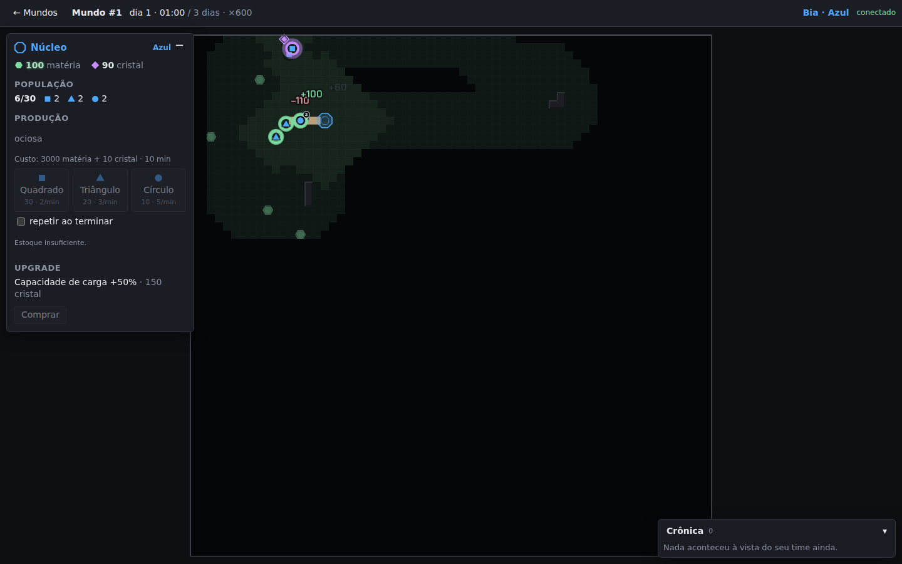
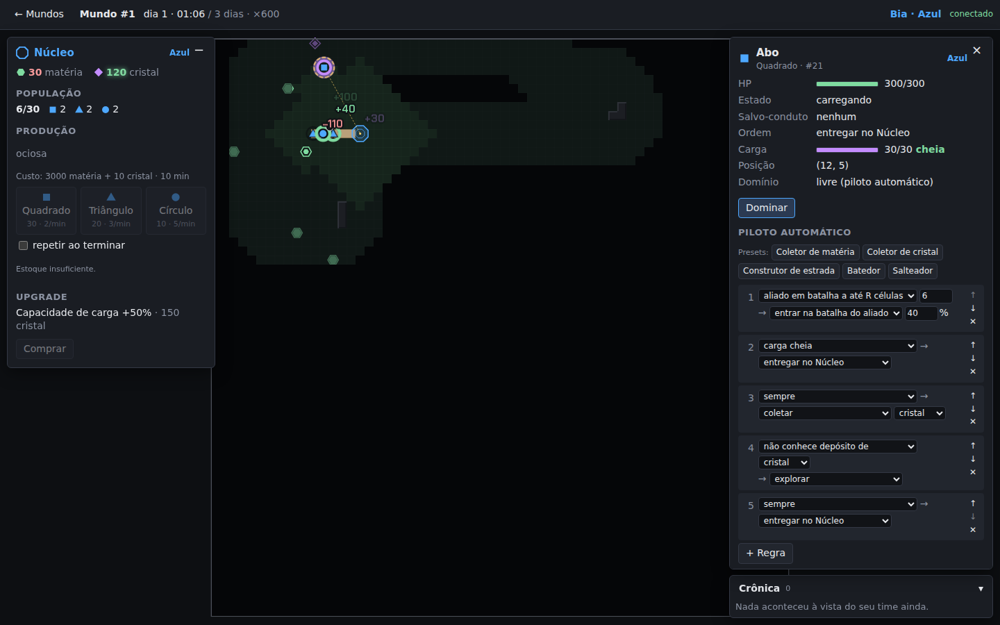
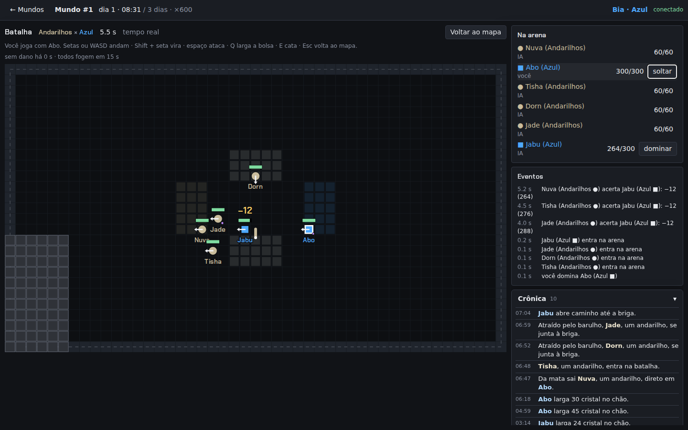
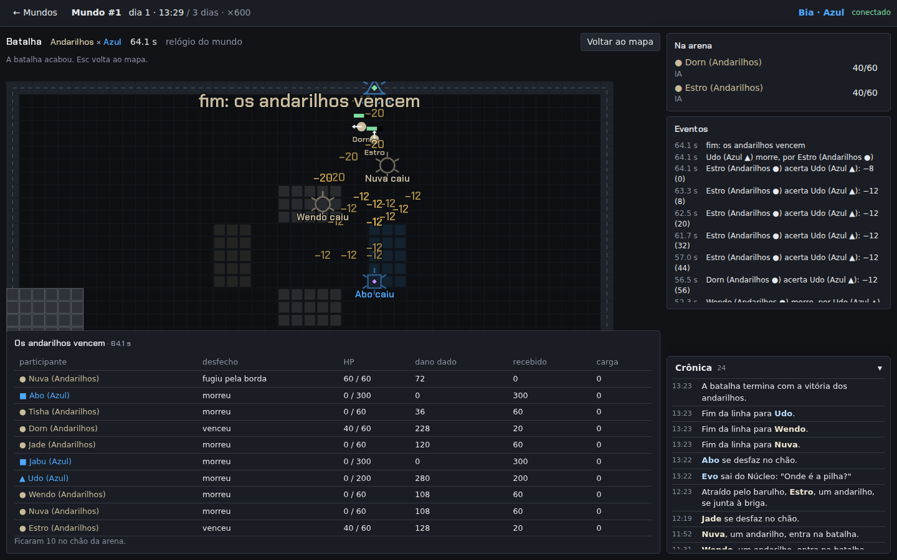
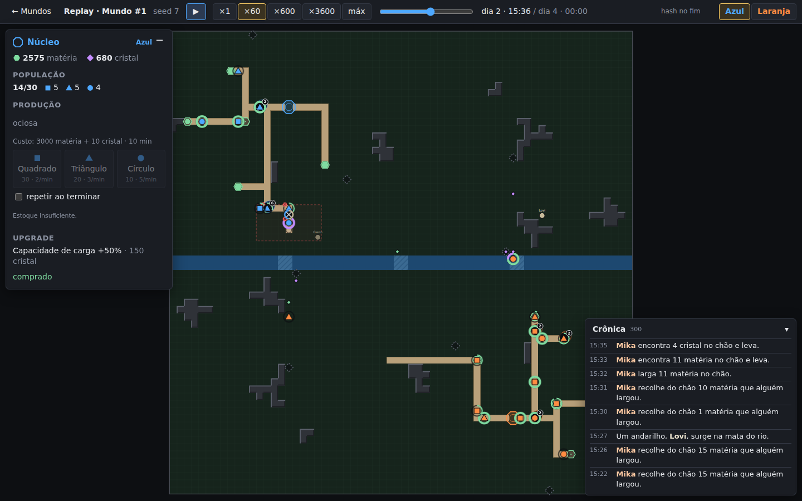
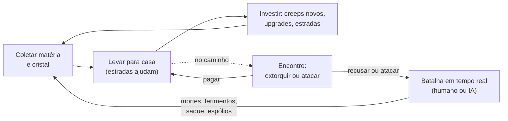
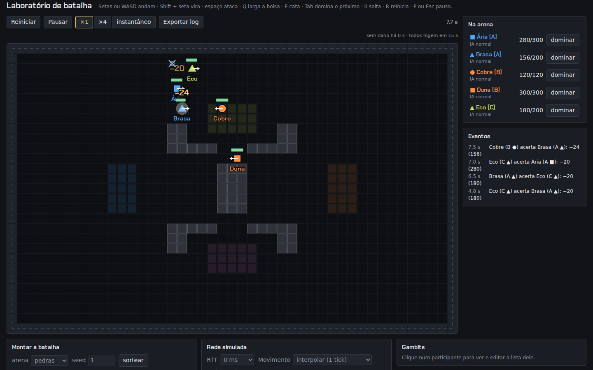
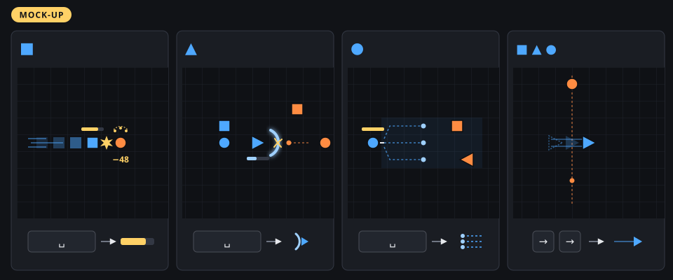
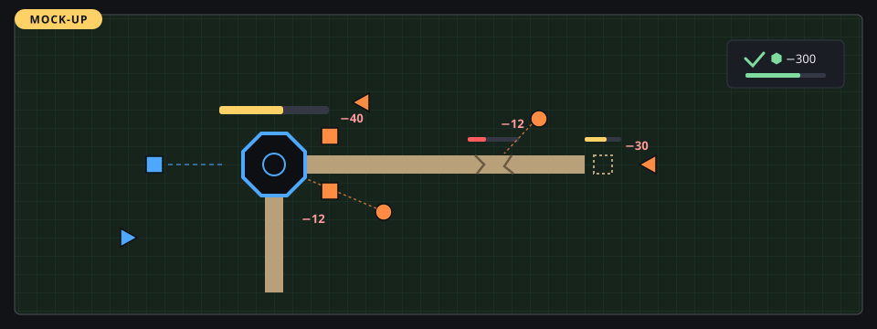
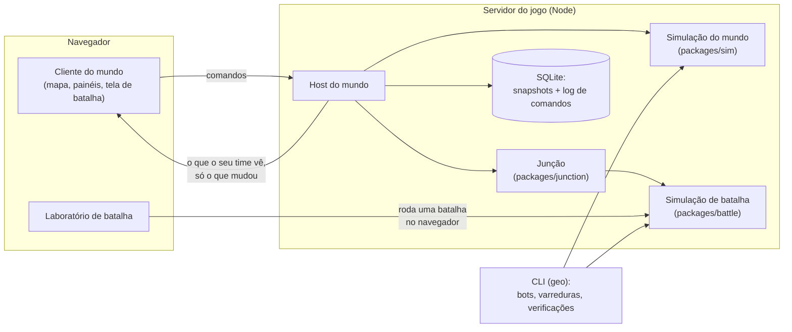

# geometrix: visão geral

*English: [OVERVIEW.md](OVERVIEW.md)*

Esta página é para quem nunca viu o projeto: alguém curioso pelo jogo, um amigo convidado para um playtest ou quem
abre o repositório pela primeira vez. Ela explica o que é o jogo, o que já dá para jogar, o que está planejado, como
ele funciona por dentro e o vocabulário que os outros documentos usam. Não precisa saber nada antes.

> **Situação (fim de novembro de 2026):** pré-alfa. Tudo o que aparece aqui como *jogável hoje* roda numa máquina
> local. O retrato atualizado do projeto fica no [painel de status](dashboard/current-status.md) (em inglês, como o
> resto do repositório; só esta página tem versão em português).

## Em um parágrafo

geometrix é um **jogo de estratégia multiplayer para navegador, desenhado só com formas geométricas**. Dois times
dividem uma selva cortada por um rio. Cada time cresce a partir do seu **Núcleo** (o coração da base) juntando dois
recursos, **matéria** e **cristal**, e levando tudo para casa, uma bolsa por vez, com unidades pequenas chamadas
**creeps**. O mundo continua rodando quando você sai: seus creeps seguem as regras que você deixou. Na estrada, um
inimigo pode parar um creep carregado e exigir a carga, ou simplesmente atacar. Quando isso acontece, abre uma
**batalha em tempo real**, como um pequeno jogo de ação, e qualquer humano do time pode entrar e jogar. A economia
decide quem ganha a guerra; as batalhas decidem quem ganha cada confronto.



*A primeira hora do mundo, vista pelo time Azul: o Núcleo (o octógono azul) com um primeiro trecho de estrada, seis
creeps trabalhando, depósitos de matéria (hexágonos verdes) e um de cristal (o losango roxo, no alto). Tudo o que o
time nunca viu fica preto.*

## O jogo

### Um mundo que não espera por você

Uma **partida** é um **mundo** persistente: um mapa gerado a partir de um número (a **seed**), espelhado para que os
dois times tenham condições equivalentes, com selva, pedras que bloqueiam a visão, um rio e alguns vaus para
atravessá-lo. A meta de design é uma partida que dura **dias** (três, por enquanto), em que você dá uma passada
algumas vezes por dia, como um jardim que continua crescendo enquanto você está fora. Para o primeiro playtest com
amigos, o mesmo jogo está sendo reajustado para caber em **cerca de duas horas reais**.

O mundo tem seu próprio relógio, que avança um tick por segundo de mundo. Um **multiplicador** (escrito **×N**) diz
quantas vezes mais rápido que o tempo real esse relógio anda: a ×6, uma hora de mundo passa em dez minutos reais; a
×2000, um mundo inteiro de três dias cabe em pouco mais de dois minutos, e é assim que bots e testes jogam partidas
inteiras rapidinho.

### Creeps, e por que a forma importa

Toda unidade é um **creep**: tem nome, pontos de vida (HP), uma bolsa, e morre de vez. A forma inata dele é o seu
**DNA**, e a forma já diz o papel dele:

| Forma | Papel | No mundo | Na batalha |
|---|---|---|---|
| ■ Quadrado | Carregador pesado, tanque corpo a corpo | Carrega mais (30), anda mais devagar, enxerga menos (3 células) | Mais HP (300); golpeia a célula à frente e bloqueia a passagem |
| ▲ Triângulo | Meio-termo | Carrega 20, velocidade média, enxerga 4 células | 200 HP; atira a média distância |
| ● Círculo | Batedor rápido, atirador frágil | Carrega menos (10), anda mais rápido, enxerga mais longe (6 células) | 120 HP; atira projéteis de longe |

Os números são provisórios: ficam em arquivos de dados e mudam conforme playtests e simulações ensinam alguma coisa.
As três formas foram pensadas para mover mais ou menos a mesma riqueza por hora (uma bolsa grande e lenta ou uma
pequena e rápida); a diferença aparece quando surge encrenca.

**Não existe herói fixo.** Qualquer creep pode virar o herói por um tempo: você o **domina** (assume o controle
direto, dá ordens no mapa, joga com ele na batalha) e depois o **libera** de volta para as regras dele.

### A riqueza é física

Recurso não é número num menu. Ele fica em **depósitos** no mapa e precisa ser levado até o Núcleo:

- **Matéria** (hexágonos verdes): pesada, farta perto das bases, se regenera. Paga a maior parte de um creep novo e
  as estradas.
- **Cristal** (losangos roxos): leve, rara, em pontos disputados, se esgota. Todo creep novo precisa de um pouco, os
  upgrades precisam de mais, e é o alvo natural de uma emboscada.

Um creep carregado anda mais devagar e vale a pena ser roubado. Os times constroem **estradas** célula a célula para
andar mais rápido, e as estradas são **neutras**: o inimigo também anda nas suas.

### O piloto automático: as regras que você deixa

Como ninguém fica olhando um mundo 24 horas por dia, cada creep segue uma lista ordenada de **regras**, cada uma uma
`condição → ação`: a primeira regra com condição verdadeira decide o que o creep faz. É a mesma ideia dos *gambits*
de Final Fantasy XII. Listas prontas, os **presets**, cobrem os trabalhos comuns (Coletor de matéria, Coletor de
cristal, Construtor de estrada, Batedor, Salteador), e qualquer regra pode ser editada.



*Clicar num creep mostra o que ele está fazendo e as regras dele. Este quadrado leva para casa uma bolsa cheia de
cristal. Em ordem, as regras dizem: ajudar um aliado em batalha a até 6 células, entregar quando cheio, coletar
cristal, explorar se o time não conhece cristal e, fora isso, entregar no Núcleo.*

Um **bot** (um jogador do computador, chamado de **estrategista** no código) joga times inteiros com essas mesmas
regras: escolhe o que produzir, onde abrir estradas e como reagir a ameaças, em três níveis de dificuldade. Humanos,
regras do piloto automático e bots agem pelos mesmos **comandos**, então um bot nunca tem um poder que um humano não
tenha.

### A névoa de guerra

Um time só sabe o que o Núcleo e os creeps dele enxergam, mais o que ele lembra. Chão nunca visto fica **preto**;
chão já visto fica **esmaecido** e mostra o último estado conhecido (a última quantidade de um depósito, uma
estrada); creeps inimigos somem quando saem da visão. Quem garante isso é o servidor: o seu navegador nem chega a
receber o que o seu time não vê, então não há nada para "hackear" ali.

### Emboscada na estrada

Quando um creep alcança um inimigo, começa um **encontro**. O agressor:

- **ataca**, o que abre uma batalha na hora; ou
- **extorque**, exigindo a carga da vítima. A vítima **paga** (e ganha um **salvo-conduto**: aquele time a deixa em
  paz por um tempo) ou **recusa**, o que abre uma batalha.

Creeps no piloto automático respondem pela **postura** deles (regras como "pagar se pedirem menos de um quarto da
minha carga, lutar no resto, fugir se o HP estiver baixo").

### Batalhas: uma pequena arena em tempo real

Uma batalha é um joguinho à parte. As células do mundo em volta do encontro viram uma **arena** em grade (pedra
continua pedra). Os creeps olham para uma de quatro direções: o quadrado golpeia a célula à frente, enquanto
triângulos e círculos disparam projéteis que andam célula a célula e podem ser desviados. Há uma contagem curta no
começo, e ninguém ganha pelo relógio: a luta acaba quando sobra um lado só, ou quando passam 15 segundos sem dano e
todo mundo foge. Para escapar, você fica um instante na borda da arena sem levar dano, talvez depois de largar a
bolsa para correr mais.



*Uma batalha aberta a partir do mundo e jogada ao vivo. O jogador controla Abo (o quadrado Azul à direita, "você"),
três andarilhos se juntam contra Jabu, e a coluna da direita lista quem está na arena e cada golpe.*

Outros creeps podem **entrar** numa batalha em andamento, como reforço ou como oportunistas, e uma batalha pode ter
até quatro lados. Quando nenhum humano está jogando, a mesma simulação roda sozinha, guiada pela IA de batalha (os
**gambits**, listas de condição → ação como as do piloto automático): isso se chama **auto-resolve**. O resultado
volta para o mundo: quem morreu continua morto, quem sobreviveu leva os ferimentos, e os vencedores ficam com a carga
dos perdedores (o que não cabe fica no chão como **espólio**, que qualquer um pode recolher).



*O fim de uma batalha de 67 segundos que não parou de crescer: dois quadrados e um triângulo Azuis contra cinco
andarilhos. A tabela mostra o destino de cada participante; a crônica à direita conta a mesma história em frases.*

### Os andarilhos

Nem tudo na selva pertence a um time. Os **andarilhos** são creeps neutros e hostis (círculos cor de areia) que
vagam ao longo do rio, perseguem creeps **carregados**, entram em qualquer briga por perto e carregam o que roubam até
alguém matá-los. Eles nunca entram na zona do Núcleo de um time: em casa você está a salvo deles.

### A crônica e o replay

Os creeps têm nome, e o jogo conta a história deles. A **crônica** narra o que o seu time vê: "Da mata sai Nuva, um
andarilho, direto em Abo", "Abo larga 30 cristal no chão". Todo mundo terminado pode ser assistido de novo como
**replay**, do começo ao fim, com o mapa inteiro revelado.



*Um replay na metade de um mundo entre bots: as estradas do Azul em cima, as do Laranja embaixo, uma batalha (o
retângulo vermelho tracejado) perto da base Azul, andarilhos junto aos vaus. A linha do tempo no topo pula para
qualquer momento da partida.*

### Como uma partida termina

O objetivo de longo prazo é que **destruir o Núcleo inimigo vença**. Enquanto não dá para atacar construções (o
cerco, planejado para depois do primeiro playtest), uma partida termina no relógio. O próximo passo, já desenhado e
aprovado, é um **fim mínimo**: um time sem creeps e sem como fazer outros é eliminado, um humano pode desistir, o bot
desiste quando não tem chance, o relógio dá empate, e uma tela de fim resume a partida.



## O laboratório de batalha

O combate é desenhado numa página à parte, o **laboratório de batalha**, antes de chegar ao mundo. Lá você monta uma
batalha à mão (arena, lados, formas, dificuldade da IA), assiste a IA lutar ou assume qualquer creep, e acrescenta
atraso de rede falso para sentir como o jogo fica pela internet. É onde ideias novas de combate são testadas e
ajustadas.



*O laboratório com três lados (A em azul, B em laranja, C em verde-amarelado) lutando entre paredes de pedra, todos
jogados pela IA. Os controles no topo reiniciam, pausam ou aceleram a batalha, e os painéis embaixo montam a próxima.*

## O que existe hoje, e o que vem depois

O projeto anda em **marcos** (*milestones*), e cada um responde a uma pergunta de design com um playtest antes de o
próximo começar.

| Marco | Pergunta | Situação |
|---|---|---|
| **M0 · Design** | O que estamos construindo? | ✅ Feito |
| **M1 · O ciclo da riqueza** | Coletar, transportar e investir é interessante por si só? | ✅ Feito |
| **M1.5 · A névoa** | Esconder informação cria decisões sem deixar o mapa ilegível? | ✅ Feito |
| **M2 · A emboscada** | Uma luta consegue mudar o rumo do mundo sem dominar o jogo? | 🟡 Em andamento |

Cada marco é cortado em **fatias** (*slices*, pedaços de trabalho com uma letra). Dentro do M2:

| Fatia | O que traz | Situação |
|---|---|---|
| **A · O encontro** | Nomes, HP, morte; atacar, extorquir, pagar, recusar; espólios; a crônica | ✅ Feita |
| **B · O laboratório de batalha** | O combate em tempo real e a IA dele, numa página própria | ✅ Feita |
| **D · A junção** | Juntar os dois: um encontro abre uma batalha de verdade, humanos jogam a partir do mundo, o resultado volta; os andarilhos | ✅ Feita |
| **R · Rebalanceamento e ritmo** | Uma partida de duas horas, andarilhos mais cedo, bots mais espertos com três dificuldades, "seguir" um aliado, ajudar aliados numa briga, um sinal vermelho sobre um creep com intenção hostil, pausa na batalha | 🟡 Em andamento |
| **E-min · O fim mínimo** | Eliminação, desistência, empate no relógio, a tela de fim, marcadores no replay | Desenhada, a seguir |
| **K · Os kits de DNA** | Um movimento especial por forma (abaixo) | Desenhada, a seguir |
| **G · Grupos e formações** | Esquadrões que seguem o creep que você joga, em formação (abaixo) | Desenhada |
| **P · O playtest com amigos** | Amigos entrando pela internet, vários humanos por time e por batalha | Depois de R, E-min, K e G |
| **E · Cerco e reparo** | Atacar o Núcleo e as estradas; reparo pago; vitória destruindo o Núcleo | Depois de P |
| **T · Mais times** | Mundos com até quatro times | Depois de P, disputando a vez com E |

### Planejado: um movimento especial por forma (fatia K)

Hoje todo creep só tem um ataque básico. A fatia K dá a cada forma uma habilidade numa tecla só, a **barra de
espaço**: um toque ataca, e segurar o espaço enche uma barra que alimenta o movimento da forma. Toda forma também
ganha uma **esquiva** (dois toques numa direção).



*Mock-up, ainda não está no jogo. Da esquerda para a direita: ■ o quadrado segura o espaço para carregar, correndo
mais e batendo mais forte, com um atordoamento curto; ▲ o triângulo se defende, bloqueando os tiros que chegam pela
frente e protegendo os aliados atrás dele; ● o círculo dispara um leque de três tiros cujo alcance cresce com a
barra; e qualquer forma se esquiva duas células, intocável durante o avanço.*

### Planejado: esquadrões e formações (fatia G)

Hoje você controla um creep por vez. A fatia G deixa um jogador montar um **esquadrão**: o creep que você joga (o
**encarnado**, que todo mundo vê com um brilho e o seu nome) lidera, e os outros o seguem em formação (quadrados na
frente, triângulos no meio e nos flancos, círculos atrás). Um painel lista o esquadrão, numerado para que as teclas
de 1 a 9 escolham um membro, e ordens simples (seguir, segurar posição, atacar um alvo, recuar) funcionam no mundo e
na batalha.


*Mock-up, ainda não está no jogo. O esquadrão de Ana (★) se move para a direita na formação padrão; o esquadrão de um
bot (⬢) mostra o símbolo mas não o brilho, já que nenhum humano o joga. O líder dele leva a espada vermelha de uma
intenção hostil (que chega na fatia R), com uma linha vermelha até o creep Azul que está perseguindo.*

### Mais tarde: o cerco (fatia E)

Cerco e reparo ainda não foram desenhados; vão ter uma rodada de design própria depois do primeiro playtest. O que já
está decidido: o **Núcleo**, as **estradas** prontas e as estradas **em construção** vão ter HP e poder ser
destruídos, e o HP perdido só volta com **reparo pago**. Uma proposta na mesa é que destruir um Núcleo seja um
processo de horas, não um instante, para nenhum time perder enquanto dorme.



*Só um conceito: como um cerco poderia parecer quando as construções tiverem HP. Nenhuma regra dele existe ainda.*

### Ideias sem data

Os documentos de design guardam uma lista de **Parked** (estacionadas): ideias do dono sem marco, como creeps que
sobem de nível e aprendem habilidades, tribos neutras para fazer amizade, chefões, árvores para subir e emboscar,
votações e impostos do time, um mundo que termina num apocalipse, chat com comandos de console. Elas dão uma direção,
não uma promessa.

## Por dentro, em palavras simples

A engenharia interessante não está nos gráficos (é tudo forma em SVG), e sim num mundo que roda por dias, pode ser
repetido exatamente e nunca mostra a um time o que ele não deveria ver.



- **Duas simulações.** O mundo (`sim`) e a batalha (`battle`) são programas separados com relógios separados: o
  mundo avança uma vez por segundo, uma batalha 20 vezes por segundo. Uma terceira peça, a **junção**, roda as
  batalhas ao lado do mundo e devolve os resultados.
- **Determinísticas.** Com a mesma seed inicial e a mesma lista de comandos, as simulações sempre dão exatamente o
  mesmo resultado, em qualquer máquina e qualquer motor de navegador. Para garantir isso, só usam números inteiros
  (nada de ponto flutuante, nada de aleatoriedade fora de um gerador com seed), e o linter proíbe qualquer coisa que
  possa variar entre máquinas.
- **Um replay é uma seed mais uma lista de comandos.** Um mundo inteiro de três dias entre bots cabe num arquivo
  pequeno. O servidor guarda **snapshots** periódicos e o **log de comandos** no SQLite, então depois de uma queda
  ele reconstrói o mundo exatamente onde estava.
- **O servidor é a autoridade.** Os navegadores só mandam comandos ("vá para cá", "domine este creep"); o servidor
  confere, roda a simulação e manda a cada time uma **visão**: só o que aquele time vê, e só o que mudou desde a
  última mensagem (um **delta**), uns 200 bytes por segundo por jogador na velocidade normal.
- **Atraso de rede.** Numa batalha rápida, ir e voltar do servidor leva tempo. **Predição no cliente** (*client
  prediction*) é o navegador desenhar o seu próprio creep se mexendo na hora, antes de o servidor confirmar, para
  esconder esse atraso. Ela existe como experimento no laboratório; se o jogo precisa dela vai ser decidido medindo um
  playtest de verdade pela internet.
- **Bots e testes sem interface.** A ferramenta de linha de comando (`geo`) joga mundos inteiros de bot contra bot em
  segundos, roda milhares de batalhas da IA em muitas seeds e mostra vitórias, durações e equilíbrio, para que os
  números sejam ajustados com dados antes de alguém jogar. Um **teste de resistência** (*soak test*) derruba o
  servidor várias vezes durante um mundo inteiro e confere que cada jogador termina com exatamente a visão do
  servidor.
- **Tecnologias:** TypeScript no Node 26 (o Node roda direto), Preact com signals e SVG no navegador, Vite, `ws` para
  WebSocket, `better-sqlite3`, zod, Vitest (milhares de testes) e Playwright para as capturas de tela.

| Pasta | O que tem lá |
|---|---|
| `packages/sim` | A simulação do mundo: mapa, creeps, economia, névoa, piloto automático, bots |
| `packages/battle` | A simulação de batalha e a IA dela |
| `packages/junction` | Roda as batalhas ao lado do mundo e devolve os resultados |
| `packages/protocol` | As mensagens entre navegador e servidor |
| `apps/server` | O servidor do jogo: mundos, jogadores, persistência, WebSocket |
| `apps/client` | O jogo no navegador, o visualizador de replay e o laboratório de batalha |
| `apps/cli` | `geo`: mundos sem interface, varreduras de batalha, verificações de determinismo e de rede |
| `params/` | Todo número de balanceamento (custos, velocidades, HP), como dado |
| `docs/` | Design, decisões, specs, playtests e status |
| `scripts/capture/` | A ferramenta que tirou as capturas de tela desta página |

## Como o projeto é tocado

Uma pessoa, **o dono** (*the owner*), decide o design; agentes de IA de programação (principalmente o Claude Code)
escrevem rascunhos, implementam e relatam. O trabalho passa por portões explícitos, e nada vira regra do jogo sem o
OK do dono.

- Os **pilares** ([PILLARS](PILLARS.md)) são o filtro de toda ideia: a guerra se ganha na economia e a luta no
  micro; a riqueza é física; qualquer creep pode ser herói; o mundo não espera por você; decisões coletivas têm
  regras; a forma é o significado.
- O **documento de game design** ([GDD](gdd/README.md)) tem um arquivo por sistema, cada um dividido em *Decided*
  (decidido), *Proposal* (proposta), *Parked* (estacionado) e *Open questions* (perguntas em aberto).
- Cada fatia passa por uma **spec** (o quê e por quê), um **plano** (como) e as **tarefas** (os passos, agrupados em
  **fases** chamadas F1, F2…), cada um aprovado pelo dono ([specs](specs/README.md)).
- As escolhas de arquitetura ficam registradas em **ADRs** ([registros de decisão de arquitetura](adr/README.md)),
  *Proposed* (propostos) até o dono marcá-los como *Accepted* (aceitos).
- Cada fase é feita no seu próprio branch do git e entra no `main` quando a verificação completa (tipos, lint,
  formatação, testes) passa. **Checkpoints** e **playtests** com humanos ([PLAYTEST](PLAYTEST.md)) trazem achados de
  volta para o design.

## Palavras que você vai encontrar nos outros documentos

Os outros documentos são em inglês; a tabela mostra o termo como aparece lá.

| Termo | Em palavras simples |
|---|---|
| **M0, M1, M1.5, M2** | Marcos: os grandes passos do [roadmap](ROADMAP.md). O M2, "a emboscada", é o atual |
| **Slice** (A, B, D, R, E-min, K, G, P, E, T) | Fatia: um pedaço de um marco, com nome de letra (veja a tabela acima) |
| **Phase** (F1, F2…) | Fase: um passo dentro de uma fatia, um branch do git cada. "R F3" é a fase 3 da fatia R |
| **Spec / plan / tasks** | Os três documentos de uma fatia: o quê, como e os passos |
| **GDD** | Documento de game design: as regras do jogo, um arquivo por sistema |
| **ADR** | Registro de decisão de arquitetura: uma escolha técnica e o porquê |
| **Checkpoint / C1, C2** | Uma parada em que o dono joga ou revisa e traz achados |
| **Owner** | O dono, quem decide o design |
| **`sim`** | A simulação do mundo (`packages/sim`) |
| **`battle`** | A simulação de batalha (`packages/battle`) |
| **Junction** | Junção: a parte que abre uma batalha a partir do mundo e devolve o resultado (também o nome da fatia D) |
| **Tick** | Um passo de uma simulação: um segundo de mundo, ou 50 ms de batalha |
| **×N, multiplier** | Multiplicador: quantas vezes mais rápido que o tempo real o relógio do mundo anda |
| **Seed** | O número que gera um mapa e a aleatoriedade dele; mesma seed, mesmo mundo |
| **Deterministic** | Determinístico: mesma seed e mesmos comandos sempre dão o mesmo resultado |
| **Hash** | Uma impressão digital do estado inteiro, usada para conferir que duas execuções batem |
| **Command** | Comando: o único jeito de agir numa simulação, igual para humanos, regras e bots |
| **Command log** | Log de comandos: a lista de todos os comandos, em ordem; com a seed, é a partida inteira |
| **Snapshot** | Uma cópia salva do estado inteiro num momento |
| **View / delta** | Visão: o que um time pode ver / delta: só o que mudou nela desde a última mensagem |
| **Fog** | Névoa: o que o seu time não está vendo agora |
| **Client prediction** | Predição no cliente: desenhar o seu creep antes da resposta do servidor para esconder o atraso de rede |
| **Core** | Núcleo: o coração da base de um time; faz creeps e recebe entregas |
| **Creep** | Qualquer unidade de um time |
| **DNA** | A forma inata de um creep: quadrado, triângulo ou círculo |
| **Dominate / release** | Dominar: assumir o controle direto de um creep / liberar: devolvê-lo às regras dele |
| **Embodied creep, squad** | O encarnado (o creep que um jogador joga) e o esquadrão que o segue (fatia G, planejada) |
| **Autopilot, rules, preset** | Piloto automático: a lista `condição → ação` de um creep; um preset é uma lista pronta |
| **Stance** | Postura: as regras do piloto automático para encontros (quando pagar, lutar ou fugir) |
| **Strategist, bot** | Estrategista: o jogador do computador que toca um time inteiro |
| **Gambits** | As listas `condição → ação` da IA de batalha |
| **Auto-resolve** | Uma batalha jogada só pela IA, sem humano |
| **Encounter, extortion, safe-conduct** | Encontro com um inimigo na estrada; extorsão, exigir a carga dele; salvo-conduto, a imunidade comprada ao pagar |
| **Spoils** | Espólios: recursos deixados no chão, livres para qualquer um |
| **Wanderers** | Andarilhos: creeps neutros e hostis que caçam creeps carregados |
| **Chronicle** | Crônica: a história da partida, contada em frases |
| **Battle lab** | Laboratório de batalha: a página onde o combate é testado sozinho (`npm run lab`) |
| **Kit** | Os movimentos especiais de uma forma na batalha (fatia K, planejada) |
| **Sweep, matrix** | Varredura: muitos mundos ou batalhas simulados em muitas seeds, para medir o equilíbrio |
| **Soak test** | Teste de resistência: uma execução longa que derruba e reinicia o servidor para provar que nada se perde |
| **Playtest** | Uma sessão em que humanos jogam e contam o que foi divertido ou confuso |

O glossário completo dos termos do jogo fica no [GLOSSARY](GLOSSARY.md).

## Experimente

Você precisa do Node 26 (`nvm use` pega a versão do `.nvmrc`).

```bash
npm install
npm run dev:multi -- --clients 1 --bot   # um mundo contra o bot, numa aba do navegador
npm run lab                              # o laboratório de batalha
npm run geo -- sim --seed 42 --days 3    # um mundo inteiro de bot contra bot, com relatório em runs/
npm run capture                          # tira de novo as capturas desta página, em runs/
```

A interface do jogo está em português; o repositório inteiro (código, documentos, commits) está em inglês, com
exceção desta página. Mais comandos estão no [CLAUDE.md](../CLAUDE.md).

## Para onde ir depois

| Para… | Leia |
|---|---|
| Ver onde o projeto está agora | [Painel de status](dashboard/current-status.md) |
| Entender as regras do jogo | [Pilares](PILLARS.md) → [GDD](gdd/README.md) → [Glossário](GLOSSARY.md) |
| Ver a ordem de construção | [Roadmap](ROADMAP.md) |
| Entender as escolhas técnicas | [ADRs](adr/README.md) |
| Rodar ou participar de um playtest | [PLAYTEST](PLAYTEST.md) |
| Trabalhar no projeto com agentes de IA | [Guia do harness](HARNESS.md) |
