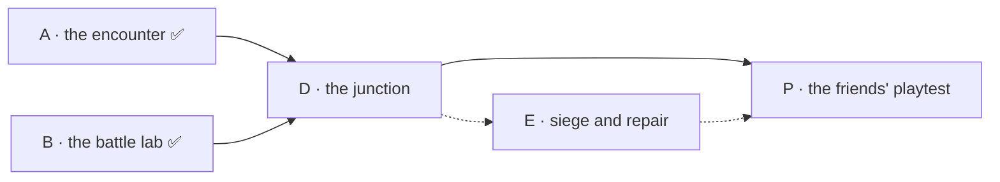

# Roadmap

Each milestone answers a design question in a playtest before the next. The roadmap names only the **current
milestone** and what comes **right after it**; ideas with no milestone stay in the GDD's **Parked** sections.

| Milestone | Scope | Question it answers | Status |
|---|---|---|---|
| **M0 — Design** | Pillars, GDD, ADRs, the DX harness (CLAUDE.md, spec flow) | What are we building? | ✅ |
| **M1 — The wealth cycle** | A minimal world: 2 cores on a small mirrored map, matéria + cristal, creeps that gather and carry to the base, creep production, road building, a basic declarative autopilot, dominate/release ([spec](specs/m1-wealth-cycle/spec.md)) | Is gathering, transporting and investing interesting on its own? | ✅ |
| **M1.5 — The fog** | Per-team view deltas ([ADR-0006](adr/0006-world-sync.md), [network spec](specs/m1.5-network/spec.md)); fog of war, in which clients and bots see only what their team sees ([fog spec](specs/m1.5-fog/spec.md)) | Does hiding information create interesting decisions without making the map unreadable? | ✅ |
| **M2 — The ambush** | An encounter with a load in transit opens a battle instance; a human dominates a creep; the result returns to the world; auto-resolve with no human. Then the first playtest with friends | Does the battle change the course of the world without dominating the game? | **Current** |

## M2 — The ambush

| Slice | Scope | Status |
|---|---|---|
| **A — The encounter** ([spec](specs/m2-encounter/spec.md)) | Names, creep HP, death; approach, attack, extort; pay, refuse, flee; spoils, loot, safe-conduct; the fight by a throwaway roll; autopilot stances; `sim` events and the chronicle | ✅ 2026-11-17 |
| **B — The battle lab** ([spec](specs/m2-battle-lab/spec.md)) | The deterministic battle package, the first combat rule (the grid), the gambits AI, base stats per DNA and simulated latency, on a local page with no world | ✅ 2026-11-20 |
| **D — The junction** | The encounter opens the battle instance instead of the roll; two or more sides and joining mid-fight; a human plays the battle from the world client; auto-resolve with no human; the result returns to the world; the **wanderers**, the first neutral faction. Its own ADR for the world side of the contract | **Next** |
| **P — The friends' playtest** | Prepare the ground for a multiplayer playtest with more than one human: the local server reached through a free tunnel, friends joining from their machines, several humans in the same world and the same battle | After D |
| **E — Siege and repair** | HP of the core, finished roads and road jobs; how a building is attacked; paid repair; victory by the core; **the minimal end** (a draw when the clock runs out, an end screen with the chronicle summary, replay markers). Needs its own design round | Order vs. P: at D's checkpoint |

### Why this order (owner, 2026-11-20)

> "The battle has to come in with the junction, and right after it we prepare the ground for the multiplayer
> playtest with more than one human." The goal is a playtest with friends over a free tunnel and a local server,
> with **real gameplay to test**, not only an economy simulator with extortion and RNG combat.

- **D first:** the grid is fun and good enough to see combat in a real match; no new combat rule before the junction
  (lab checkpoint, C9).
- **P right after D:** the deploy, even a test one, and client prediction waited for the joined cycle (C10). The
  playtest runs on the owner's machine with a free tunnel ([ADR-0005](adr/0005-mvp-deploy-vps-websocket.md):
  Cloudflare Tunnel or Tailscale Funnel), not a VPS.
- **E is the open question:** without it a match has no goal (the core cannot fall). Whether E enters before the
  friends' playtest is decided at D's checkpoint.
- **Slice C** (chat, console and macros) left M2 (2026-11-20); it waits for a milestone.

### What P should contain (agent's proposal, to approve in P's spec)

- A tunnel how-to in the [PLAYTEST](PLAYTEST.md), tested from outside the owner's network (WSL2 included).
- Friends joining with a link: the lobby, the token in the URL, a reconnection that does not lose the domination.
- Several humans per team and in the same battle (`teams.maxHumans` is 3 today), and spectators.
- The latency over a real network measured in the battle, which decides client prediction (C10, ADR-0009).
- A short in-game help for someone who has never seen the game, and a session script with a questionnaire.

## Decisions along the way (condensed)

- **M1 with no fun playtest** (owner, 2026-11-14): with no combat there was nothing to win. M1 closed with the owner's
  session, bots, a compressed soak test and a local readability round (F9).
- **M1.5 before M2** (owner, 2026-11-14): the ambush assumes not everything is visible. Two slices: the network
  (deltas, validated locally) and the fog (after a design round).
- **Fun before deploy** (owner, 2026-11-15): the deploy and the playtest with new people stopped blocking M2; fun was
  judged by the owner in local playtests. **Revised at the lab checkpoint** (2026-11-20): the grid held up to 100 ms
  blind, but the deploy and client prediction wait for the joined junction.
- **The refocus** (owner, 2026-11-20): the brainstorms after the lab checkpoint drifted from the goal of joining the
  world with the battle. They were dropped from the repo; the GDD keeps the older ideas in **Parked**, with no
  milestone. The next milestone is chosen after the friends' playtest.
- The full map of 3 lanes + 2 jungles comes as milestones ask for it, not before.
