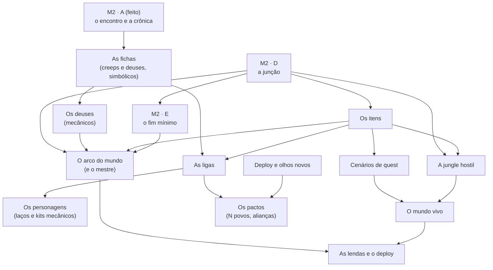

# Roadmap

> **Formato** (dono, 2026-11-20, na rodada do
> [consolidado depois do M2](brainstorm/2026-11-20-consolidado-depois-do-m2.md)): o ROADMAP mostra só os marcos
> concluídos, o marco atual (com as fatias que faltam) e **o próximo marco**, com a pergunta dele. O resto é um
> **banco de ideias por tema**, sem número e sem ordem fixa. Uma ideia só ganha marco quando o dono escolhe o próximo,
> no checkpoint do atual, com o que os playtests ensinaram. Cada marco precisa de uma pergunta de design respondida em
> playtest antes do próximo.

## Marcos concluídos

| Marco | Escopo | Pergunta que ele respondeu |
|---|---|---|
| **M0 — Design** | Pilares, GDD, ADRs, harness de DX (CLAUDE.md, fluxo de spec) | O que estamos construindo? |
| **M1 — O ciclo da riqueza** | Mundo mínimo: 2 Núcleos num mapa pequeno e simétrico, matéria + cristal, creeps que coletam e carregam até a base, produção de creeps, construção de estrada, piloto automático declarativo básico, dominar/liberar | Coletar, transportar e investir já é interessante sozinho? |
| **M1.5 — A névoa** | Sincronização por deltas da visão de cada time ([ADR-0006](adr/0006-sync-do-mundo.md)), com a viabilidade validada localmente; fog of war no mundo, em que clientes e bots só veem o que o próprio time enxerga (névoa negra, visão por DNA, memória do time, piloto e caminho pelo que o time sabe; [GDD 01](gdd/01-mundo.md)) | Esconder informação cria decisões interessantes (explorar, proteger rotas) sem tornar o mapa ilegível? |

## Marco atual: M2 — A emboscada

**Pergunta:** a batalha muda o rumo do mundo sem dominar o jogo?

Uma emboscada numa carga em trânsito abre uma instância de batalha; um humano domina um creep; o resultado volta ao
mundo; auto-resolve quando não há humano. O encontro com diálogo, com dois ou mais lados e entrada no meio da luta;
o laboratório de batalha; stats base por DNA; HP de creeps e construções; saque e despojo; errantes; o fim mínimo.

| Fatia | Escopo | Estado |
|---|---|---|
| **A — O encontro** ([spec](specs/m2-encontro/spec.md)) | Nome no estado, HP de creep, morte; abordar, atacar, extorquir; pagar, recusar, fugir; despojo, saque, salvo-conduto; a luta por um sorteio descartável; posturas do piloto; eventos do `sim` e a crônica | ✅ 2026-11-17 |
| **B — O laboratório de batalha** ([spec](specs/m2-laboratorio/spec.md)) | O pacote de batalha determinístico, a 1ª regra de combate (grade), a IA de gambits, os stats base por DNA e a latência simulada, numa página local sem mundo | ✅ 2026-11-20 |
| **D — A junção** | O encontro abre a instância de batalha no lugar do sorteio; dois ou mais lados e entrada no meio da luta; auto-resolve; os **errantes**, a primeira facção neutra, com a curva de reaparecimento por ato do fim do mundo. **Da rodada de 2026-11-20:** a **arena mínima pelo encontro** (escolhida entre as três do laboratório pelo terreno; cada creep nasce, entra e foge pela direção em que estava no mundo); e três restrições de contrato, sem construir nada: o lado neutro aceita um controlador (o mestre da mesa), o snapshot leva a posição no mundo e o recorte do terreno, e o inventário e a pilha não supõem só matéria e cristal (os itens). O ADR do lado neutro lista os consumidores conhecidos (errantes, chefões, tribos, invasores, o mestre) | ⬜ |
| **E — Cerco e reparo** | HP do Núcleo, das estradas prontas e das obras; como uma construção é atacada; o reparo pago; a vitória pelo Núcleo; **o fim mínimo**: empate quando o relógio acaba, tela de fim de mundo com o resumo da crônica, replay com marcadores. Pede uma rodada de design própria (o cerco leva horas? avisa o atacado?) | ⬜ |

**A fatia C saiu do M2** (dono, 2026-11-20): chat, console e macros não respondem à pergunta do marco. Foi para o
tema "Comunicação e automação" do banco.

**Ordem:** a D depende da A e da B; a E depende da A e da rodada de design do cristal e da E. O mapa completo de 3
lanes + 2 jungles entra conforme os marcos pedirem, não antes.

## Próximo marco (candidato): Os itens

**Pergunta:** um item que se ganha e se perde dá motivo para lutar e para voltar ao jogo?

Escolhido como candidato pelo dono (2026-11-20); confirma-se no checkpoint do M2. **A skill vem do item** (o mesmo
efeito para todos os DNAs, com algumas simbioses), num modelo **híbrido**: o DNA dá uma skill natural ao creep, os
itens dão as outras, e o level do creep continua, com peso menor ([GDD 02](gdd/02-creeps-e-dominio.md)). Entra pelo
laboratório (itens e skills na batalha, contra o bot), depois no mundo: a **forja e o cofre no Núcleo**, o cristal
como ingrediente, a durabilidade, o item que cai no despojo, os presets do bot como a dica da interface.

**Em paralelo, se o dono quiser,** uma fatia pequena, **As fichas**: a identidade simbólica dos creeps e dos deuses
(traits na voz da crônica, fama, títulos conquistados e disputados, a influência e a conduta do jogador, a ficha com
o resumo no topo). Só depende do encontro, não tem efeito mecânico e serve a qualquer moldura da saga.

**Por que este** (análise no [consolidado](brainstorm/2026-11-20-consolidado-depois-do-m2.md) §5): é o pré-requisito
para balancear o combate ("não se balanceia combate cru antes de skills, nível e stats"); dá ao cristal um papel e um
motivo para emboscar; muda o que um creep é, e as ligas se desenham melhor depois; o dono testa sozinho.

## Banco de ideias por tema

Sem número e sem ordem fixa. A coluna "Pede humanos?" diz o que o dono não consegue testar sozinho contra o bot: é o
critério mais forte para a ordem.

| Tema | O que entra | Pede humanos? |
|---|---|---|
| **Os itens** | (o próximo marco candidato, acima) O laboratório de itens, os presets da comunidade e o ranking ficam com o deploy | Não |
| **Os personagens** | Traits com kits de crônica (origem e side-quest), fama, títulos, laços (simbólicos primeiro: na ficha e na crônica; os buffs e o luto quando o playtest pedir), side-quests pessoais, renomear; **creeps especiais da seed** (ex.: o retornado, em análise) | Não |
| **Os deuses** (nome provisório do papel do jogador) | **Influência** (um peso: dominar creeps famosos pede influência; pesa contra a inatividade dominando e a fuga que abandona aliados); **conduta** (nasce das ações; o cruel ganha rápido e fecha portas; o equilíbrio pelas regras, medido com bots); **o recurso do deus** (híbrido: nasce dos feitos dos fiéis, acelerado por oferendas e rituais), gasto em **sussurros** (o resultado depende da abordagem), **poderes no mundo** e **investimento em creeps qualificados**; as **quests do deus para o creep**; o **deus-bot**; a ficha do deus e o nome na história do mundo; **os kits divinos** pelo estilo de jogo, com **o karma numa escala de −1 a +1** (a neutralidade perto de zero, um buff nos pontos absolutos); **os fiéis** (o creep que reconhece o deus); bots de perfil para medir as metas de ritmo. Simbólicos primeiro | Não |
| **As ligas** | A liga é de um creep líder (dominado para formar, continua pelos gambits quando solto); piloto de grupo com a formação pelo DNA e até 3 ordens; recrutamento por diálogo, quase sempre pela fama; símbolo como identidade (o estandarte físico, com os itens); o teto que cresce (o level do líder, com o modelo híbrido); até 10 × 10 × 10 | Não (uma liga contra o bot) |
| **A batalha** | A arena gerada pelo recorte do mundo e o tamanho por faixa de participantes, a IA que aprende, regras novas (a livre), acampamentos e torres | Não |
| **Cenários de quest** | A quest como **batalha com objetivo** (escoltar, segurar uma área, recuperar um item, sobreviver a ondas), com um modo de cenário no laboratório; depois dos itens | Não |
| **A jungle hostil** | Chefões com buff e artefato, árvores destrutíveis, a curva dos errantes por ato, a 3ª ação do encontro por DNA | Não |
| **O arco do mundo** (era "O fim do mundo") | **A main quest line secreta:** o arco em atos, com gatilhos e **presets como ramos dentro da corrupção** (um apocalipse só); a corrupção do cristal esgotado, o ponto sem volta, a vitória pírrica, a crônica do fim, o registro das lendas; **o mestre da mesa** (neutro, sem mexer no placar; um diretor-bot sempre, com a cadeira aberta a um humano), que escolhe os presets e ajusta os gatilhos dentro de limites, por comandos, com o arco revelado no fim; o painel do mestre; o segredo na instância e a história legível às cegas; **as metas de ritmo por ato** (~um dia cada a ×1); **os portais** do ato III, com lendas geradas pela seed como neutros; **três caminhos de salvação** (as tribos, o retornado, os ramos especiais do ato III), ganhando ou perdendo a guerra; **os sem-Núcleo** seguem até o fim do mundo; a liga independente (em análise) | Não (o mestre humano, sim) |
| **O mundo vivo** | Tribos e diplomacia, a relação do time com cada tribo, as **conversões** e os **tributos** (no tesouro do time, numa caravana física), o final feliz secreto (o ramo benevolente do arco), construção ampla | Não |
| **Comunicação e automação** | Chat, console e macros de cliente (a antiga fatia C), piloto scriptável, macros no servidor | Em parte |
| **A apresentação** | Som, anúncios de abate e de fuga, a tela de fim e o replay além do mínimo | Não |
| **Os pactos** (era "O time") | **N povos (3 ou 4)**, um deus cada, num mapa com simetria por rotação; **os pactos**: alianças com regras entre deuses (o que se compartilha, como se quebra, a vitória com aliados, o "dois contra um"); a diplomacia entre humanos. **O panteão** (vários deuses num povo) como ideia, não como base: o regime (democracia ou meritocracia pela influência dos deuses), a votação, os representantes, o comandante do time, várias ligas por povo. Impostos (quem define a taxa com um deus por povo está em aberto), genética | **Sim** |
| **As lendas e o deploy** | Invasões entre mundos (as lendas reais; as da seed entram pelos portais do arco), contas (o control plane em Go), presets da comunidade e ranking, deploy de testes, olhos novos; **a moldura da saga** (em análise: a torre, a convocação, os mundos como capítulos) | **Sim** |

**As dependências** (para escolher o próximo marco vendo o que cada tema destrava):

## Histórico das decisões de planejamento

**M1 sem playtest de diversão** (dono, 2026-11-14): sem combate não há o que vencer. O M1 fecha com a sessão do
dono, bots, um teste de resistência comprimido (no lugar do mundo de 24 h) e uma rodada de **legibilidade e
playtest humano** local, sem deploy (F9) ([spec M1 §8](specs/m1-ciclo-da-riqueza/spec.md)). O deploy e o playtest
de diversão abrem o M2.

**M1.5 antes do M2** (dono, 2026-11-14): duas fatias, nesta ordem. (1) **Rede:** deltas da visão de cada time,
sem mudar o gameplay, com a viabilidade validada localmente antes de qualquer deploy (critérios na spec da fatia;
se reprovar, o ADR-0006 volta à mesa). (2) **Fog of war:** depois de uma rodada de design sobre as perguntas abertas
do GDD 01, com playtest local de legibilidade. Motivo: a emboscada do M2 pressupõe que nem tudo é visível.

**Escopo da fatia de fog** (rodada de design, 2026-11-14): o dono escolheu a névoa negra e a visão por DNA, que vão
além de só filtrar a visão. A fatia passa a incluir a ação "explorar" do piloto automático, o caminho calculado pelo
que o time sabe (cache por time), o terreno explorado no delta da rede (hoje o mapa vai inteiro no `welcome`) e a
exploração no estrategista dos bots, e a linha de visão (pedras bloqueiam; spec do fog, D1).

**M1.5 concluído** (dono, 2026-11-14): as duas fatias entregues, com uma fase a mais no fog (F6, ajustes do
playtest do dono: coleta por tempo de viagem, ritmo de coleta por recurso, seleção por área e cursor com a ação).
Hipótese: nas sessões do dono, o fog e a exploração cumprem o papel sem tornar o mapa ilegível; a mesma pergunta
volta no playtest de diversão do M2, com pessoas que nunca viram o jogo. Ficaram para o M2: o esgotamento e o papel
do cristal ([GDD 03](gdd/03-economia-e-logistica.md)) e o tamanho do snapshot com a memória do fog (deploy).

**Diversão antes do deploy** (dono, 2026-11-15): o deploy e o playtest com pessoas que nunca viram o jogo **deixam
de bloquear o M2 e o M3**. O indicador de sucesso de diversão passa a ser a aprovação do dono nos playtests locais;
o teste com olhos novos volta quando o dono achar o jogo divertido o suficiente. O deploy espera o combate, que é
quem vai dizer quanta latência é aceitável. **Revisto no checkpoint do laboratório** (dono, 2026-11-20): a grade
aguentou bem até 100 ms de RTT às cegas, mas o deploy (mesmo o de testes) e a decisão sobre a predição no cliente
esperam a **junção** colada: o mundo abre a instância, o canal fica aberto para reforços e terceiros, e o resultado
volta ao mundo. A predição no cliente pode entrar. Na sessão solo do dono, o jogo ainda não tem fator diversão.

**M2.5 entre o M2 e o M3** (dono, 2026-11-15, na rodada interativa do
[brainstorm M2–M3](brainstorm/2026-11-15-m2-m3.md)): o M3 já tinha 3v3, impostos, votação, genética e progressão, e
somar a jungle hostil a ele deixaria o marco grande demais. O M2.5 recebeu os chefões, a progressão, os
temperamentos, a 3ª ação por DNA e as árvores. As tribos ficaram no M4, com uma tribo-protótipo antes só se os
encontros do M2 provarem diversão. **Substituído em 2026-11-20** pelo banco de ideias por tema (abaixo).

**Fatias do M2** (dono, 2026-11-15): A o encontro, B o laboratório de batalha, C chat, console e macros, D a junção
(com os errantes), E cerco e reparo, cada uma com spec, plan e checkpoint próprios em `docs/specs/`.

**O fim do mundo e a ordem como grafo** (dono, 2026-11-15, na rodada interativa do
[brainstorm do fim do mundo](brainstorm/2026-11-15-fim-do-mundo.md)): a duração do mundo termina num apocalipse, a
corrupção dos depósitos de cristal esgotados (GDD 01, 03). O M2.5 recebeu o fim do mundo; o M4, o final feliz
secreto; e nasceu o M5, as lendas. As fatias do M2 deixaram de ser uma fila e viraram um grafo de dependências, para
que os bloqueios andem primeiro e o que é independente ande em paralelo. **Dois marcos não andam ao mesmo tempo:** o
gargalo são as rodadas de design, os portões e os playtests do dono.

**O banco de ideias por tema** (dono, 2026-11-20, na rodada do
[consolidado depois do M2](brainstorm/2026-11-20-consolidado-depois-do-m2.md); pedido no checkpoint do
laboratório: "tem muita coisa com marco"): os marcos M2.5 (A jungle hostil e o fim do mundo), M3 (O time), M4 (O
mundo vivo) e M5 (As lendas) viraram **temas do banco**, com os mesmos nomes; o M2.5 se dividiu em "A jungle
hostil", "O fim do mundo" e a progressão, que virou "Os itens" e "Os personagens". A fatia C saiu do M2. O próximo
marco candidato é **Os itens**. Cinco levas de ideias do dia (o mestre da mesa, as ligas, a arena pelo encontro, os
itens, a reputação, o regime, o recrutamento, os laços, os traits, os títulos, os cenários de quest) estão no
consolidado, com a análise fria de cada uma.

**Os deuses e o arco do mundo** (dono, 2026-11-20, rodada 2 do [consolidado](brainstorm/2026-11-20-consolidado-depois-do-m2.md) §10.1): o jogador entra na
crônica como um deus (nome provisório), com influência, conduta e um recurso próprio; o tema "O fim do mundo" vira
"O arco do mundo", a main quest line secreta que o mestre conduz; nasce o tema "Os deuses"; a fatia paralela vira
"As fichas". **A moldura da saga** (a torre, a convocação, os anfitriões, os times que nascem do jogo) ficou em
análise, sem decisão, a pedido do dono (§11 do consolidado). O próximo marco continua Os itens.

**O papel do jogador** (dono, 2026-11-20, rodada 3 do [consolidado](brainstorm/2026-11-20-consolidado-depois-do-m2.md) §12.7): o deus escolhe um kit
pelo estilo de jogo, e o karma vira uma escala de −1 a +1, com a neutralidade e os extremos; o fiel é o creep que
reconhece o deus; as metas de ritmo dos três dias valem por ato, medidas com bots de perfil; os portais do ato III
trazem lendas da seed; o mundo se salva pelas tribos, pelo retornado ou por um ramo especial, ganhando ou perdendo a
guerra, e os sem-Núcleo seguem até o fim com o arco. Nada muda no M2 nem no próximo marco.

**A fidelidade e a lenda do portal** (dono, 2026-11-20, rodada 4 do [consolidado](brainstorm/2026-11-20-consolidado-depois-do-m2.md) §13.7): cada creep tem
uma fidelidade por deus, que abre as camadas da ficha sem mudar o time; os únicos se disfarçam com pistas; o incômodo
vem só de quem tem pouca fidelidade; a relação é a crônica, não o karma; "demônio" é pele, e a ambição do deus não
decide a guerra; uma lenda só, no portal do centro; a escolta do xamã é o final feliz das tribos; a informação
comprada vira um lembrado. **"Seu time" e a saga** (a simetria questionada, os episódios entre mundos) ficaram em
análise (§13.8). Nada muda no M2 nem no próximo marco.

**A estrutura: um deus por povo** (dono, 2026-11-20, rodada 5 da
[estrutura](brainstorm/2026-11-20-estrutura-seu-time.md) §10.1): as decisões estruturais do M0 (dois times fixos, times
de 3 jogadores, um Núcleo por time, qualquer jogador domina qualquer creep do time) foram reavaliadas à luz dos deuses.
**Cada povo (o que o código chama de time) tem um deus só**; jogar junto é pelos **pactos** entre deuses de povos
diferentes; **dois povos agora, N (3 ou 4) quando houver humanos**, no lugar do 3v3; o povo nasce dado no Núcleo,
confuso (o povo convertido é experimento do tema "Os deuses"); o domínio dos creeps do seu povo é garantido (fecha a
pergunta 40); **o pilar 5 vale entre os deuses**; ausente, valem o piloto dos creeps e o piloto divino que o jogador
deixou (a desenhar), com um deus-bot regente opcional. O tema "O time" virou **"Os pactos"**, e o panteão ficou como
ideia dentro dele. Nada muda no M2 nem em Os itens: a batalha só conhece lados, e `teams.maxHumans` já aceita 1.
