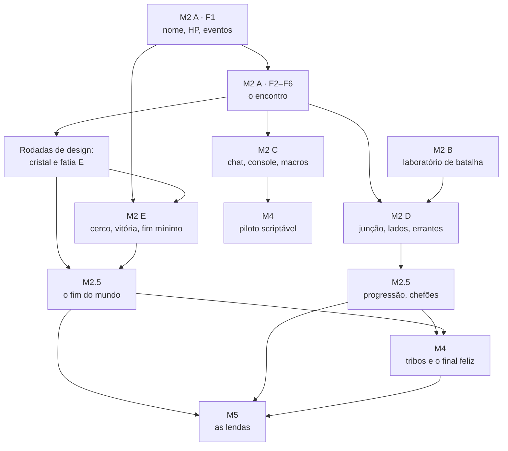

# Roadmap

> Proposta, a validar. Cada marco precisa de uma pergunta de design respondida em playtest antes do próximo.

| Marco | Escopo | Pergunta que ele responde |
|---|---|---|
| **M0 — Design** | Pilares, GDD, ADRs, harness de DX (CLAUDE.md, fluxo de spec) | O que estamos construindo? |
| **M1 — O ciclo da riqueza** | Mundo mínimo: 2 Núcleos num mapa pequeno e simétrico, matéria + cristal, creeps que coletam e carregam até a base, produção de creeps, construção de estrada, piloto automático declarativo básico, dominar/liberar | Coletar, transportar e investir já é interessante sozinho? |
| **M1.5 — A névoa** | Sincronização por deltas da visão de cada time ([ADR-0006](adr/0006-sync-do-mundo.md)), com a viabilidade validada localmente; fog of war no mundo, em que clientes e bots só veem o que o próprio time enxerga (design decidido em 2026-11-14 no [GDD 01](gdd/01-mundo.md): névoa negra, visão por DNA, memória do time, piloto e caminho pelo que o time sabe) | Esconder informação cria decisões interessantes (explorar, proteger rotas) sem tornar o mapa ilegível? |
| **M2 — A emboscada** | Uma emboscada numa carga em trânsito abre uma instância de batalha; um humano domina um creep; o resultado volta ao mundo; auto-resolve quando não há humano. Pela rodada de design de 2026-11-15: o encontro com diálogo (atacar, extorquir; pagar, recusar, fugir), com dois ou mais lados e entrada no meio da luta; o laboratório de batalha com o combate configurável, em paralelo; stats base por DNA; HP de creeps e construções; saque e despojo; errantes; crônica, chat, console e macros. O fim mínimo (vitória pelo Núcleo, empate no relógio, tela de fim, replay com marcadores) | A batalha muda o rumo do mundo sem dominar o jogo? |
| **M2.5 — A jungle hostil e o fim do mundo** | O fim do mundo: a corrupção dos depósitos de cristal esgotados, o ponto sem volta, a vitória pírrica, os chefões despertos e o registro das lendas. Chefões com buffs e artefato; level, XP, evolução e skills; temperamentos; 3ª ação do encontro por DNA; árvores destrutíveis que bloqueiam a visão (nome provisório; marco criado em 2026-11-15, fim do mundo somado no mesmo dia) | O fim do mundo dá à partida um clímax que o jogador quer rever? |
| **M3 — O time** | 3v3, impostos, votação com níveis de autoridade, genética (a progressão foi para o M2.5) | A governança gera decisões interessantes, ou só burocracia? |
| **M4 — O mundo vivo** | Jungle com tribos e diplomacia, o final feliz secreto (a quest das tribos que salva o mundo inteiro do apocalipse), piloto automático scriptável, construção ampla | — |
| **M5 — As lendas** | Os creeps que sobrevivem ao fim de um mundo invadem outros mundos no fim deles, com a crônica da invasão; deploy com contas entre mundos (candidato: o control plane em Go). Marco criado em 2026-11-15 | — |

**M1 sem playtest de diversão** (dono, 2026-11-14): sem combate não há o que vencer. O M1 fecha com a sessão do
dono, bots, um teste de resistência comprimido (no lugar do mundo de 24 h) e uma rodada de **legibilidade e
playtest humano** local, sem deploy (F9) ([spec M1 §8](specs/m1-ciclo-da-riqueza/spec.md)). O deploy e o playtest
de diversão abrem o M2.

**M1.5 antes do M2** (dono, 2026-11-14): duas fatias, nesta ordem. (1) **Rede:** deltas da visão de cada time,
sem mudar o gameplay, com a viabilidade validada localmente antes de qualquer deploy (critérios na spec da fatia;
se reprovar, o ADR-0006 volta à mesa). (2) **Fog of war:** depois de uma rodada de design sobre as perguntas abertas
do GDD 01, com playtest local de legibilidade. Motivo: a emboscada do M2 pressupõe que nem tudo é visível. O deploy
e o playtest de diversão continuam abrindo o M2.

**Escopo da fatia de fog** (rodada de design, 2026-11-14): o dono escolheu a névoa negra e a visão por DNA, que vão
além de só filtrar a visão. A fatia passa a incluir a ação "explorar" do piloto automático, o caminho calculado pelo
que o time sabe (cache por time), o terreno explorado no delta da rede (hoje o mapa vai inteiro no `welcome`) e a
exploração no estrategista dos bots, e a linha de visão (pedras bloqueiam; spec do fog, D1).

**M1.5 concluído** (dono, 2026-11-14): as duas fatias entregues, com uma fase a mais no fog (F6, ajustes do
playtest do dono: coleta por tempo de viagem, ritmo de coleta por recurso, seleção por área e cursor com a ação).
Hipótese: nas sessões do dono, o fog e a exploração cumprem o papel sem tornar o mapa ilegível; a mesma pergunta
volta no playtest de diversão do M2, com pessoas que nunca viram o jogo. Ficaram para o M2: o esgotamento e o papel
do cristal ([GDD 03](gdd/03-economia-e-logistica.md)) e o tamanho do snapshot com a memória do fog (deploy).

**Diversão antes do deploy** (dono, 2026-11-15): o deploy e o playtest com pessoas que nunca viram o jogo **deixam
de bloquear o M2 e o M3**. O indicador de sucesso de diversão passa a ser a aprovação do dono nos playtests locais;
o teste com olhos novos volta quando o dono achar o jogo divertido o suficiente. O deploy espera o combate, que é
quem vai dizer quanta latência é aceitável. **Revisto no checkpoint do laboratório** (dono, 2026-11-20): a grade
aguentou bem até 100 ms de RTT às cegas, mas o deploy (mesmo o de testes) e a decisão sobre a predição no cliente
esperam a **junção** colada: o mundo abre a instância, o canal fica aberto para reforços e terceiros, e o resultado
volta ao mundo. A predição no cliente pode entrar. Na sessão solo do dono, o jogo ainda não tem fator diversão. O que
pode entrar no M2 e nos marcos seguintes (encontros, jungle hostil, tribos e quests, progressão, combate) está no
[brainstorm de 2026-11-15](brainstorm/2026-11-15-m2-m3.md).

**M2.5 entre o M2 e o M3** (dono, 2026-11-15, na rodada interativa do brainstorm): o M3 já tinha 3v3, impostos,
votação, genética e progressão, e somar a jungle hostil a ele deixaria o marco grande demais. O M2.5 recebe os
chefões, a progressão (level, XP, evolução, skills), os temperamentos, a 3ª ação por DNA e as árvores. O M2 ficou
grande mesmo assim: cada frente tende a virar uma fatia com spec, plan e checkpoint próprios, como no M1.5. As
tribos ficam no M4, com uma tribo-protótipo antes só se os encontros do M2 provarem diversão. Decisões nos GDD 01,
02, 03, 05, 06, 07 e 08.

**Fatias do M2** (dono, 2026-11-15), na ordem de dependências do grafo abaixo (não uma fila), cada uma com spec, plan e checkpoint próprios em `docs/specs/`:

| Fatia | Escopo |
|---|---|
| **A — O encontro** ([spec](specs/m2-encontro/spec.md)) | Nome no estado, HP de creep, morte; abordar, atacar, extorquir; pagar, recusar, fugir; despojo, saque, salvo-conduto; a luta por um sorteio descartável; posturas do piloto; eventos do `sim` e a crônica |
| **B — O laboratório de batalha** ([spec](specs/m2-laboratorio/spec.md)) | O pacote de batalha determinístico, a 1ª regra de combate (grade), a IA de gambits, os stats base por DNA e a latência simulada, numa página local sem mundo. Independente da A |
| **C — Chat, console e macros** | Chat livre, a linha de comando no chat e as macros de cliente, sobre o painel da crônica da A |
| **D — A junção** | O encontro abre a instância de batalha no lugar do sorteio; dois ou mais lados e entrada no meio da luta; auto-resolve; os **errantes**, a primeira facção neutra (o "frágil e fraco" só faz sentido com stats de combate), com a curva de reaparecimento por ato do fim do mundo. O ADR do lado neutro lista os consumidores conhecidos (errantes, chefões, tribos, invasores) como restrições |
| **E — Cerco e reparo** | HP do Núcleo, das estradas prontas e das obras; como uma construção é atacada; o reparo pago; a vitória pelo Núcleo; **o fim mínimo**: empate quando o relógio acaba, tela de fim de mundo com o resumo da crônica, replay com marcadores. Pede uma rodada de design própria (o cerco leva horas? avisa o atacado?) |

O mapa completo de 3 lanes + 2 jungles entra conforme os marcos pedirem, não antes.

**O fim do mundo e a ordem como grafo** (dono, 2026-11-15, na rodada interativa do
[brainstorm do fim do mundo](brainstorm/2026-11-15-fim-do-mundo.md)): a duração do mundo termina num apocalipse, a
corrupção dos depósitos de cristal esgotados (GDD 01, 03). O M2.5 recebe o fim do mundo; o M4, o final feliz
secreto; e nasce o M5, as lendas. As fatias do M2 deixam de ser uma fila e viram um grafo de dependências, para que
os bloqueios andem primeiro e o que é independente ande em paralelo (subagentes em *worktrees*, quando as faixas
morarem em pacotes diferentes):

- **A** segue primeiro: a F1 (nome, HP, eventos) é a raiz de quase tudo.
- **B** não depende de nada em andamento: a spec começa já, e a implementação anda em paralelo à A, no pacote de
  batalha (os stats base por DNA ficam nos params desse pacote até a junção).
- **Depois do checkpoint da A F3**, duas rodadas de design do dono, enquanto a A segue: **o papel do cristal** (o
  esgotamento já tem destino, a corrupção) e **a E** (se o cerco passa pela instância de batalha, a E depende da D;
  se é uma ação no mundo, pode vir antes da D e dar ao jogo um objetivo mais cedo).
- **C** depende só da A e anda em paralelo à D.
- **D** depende da A e da B.
- **No M2.5**, a corrupção depende da A, da E e do cristal, não do combate: pode ser a primeira fatia. Se o marco
  ficar grande demais, divide-se em M2.5a, o fim do mundo, e M2.5b, a jungle hostil.
- **Dois marcos não andam ao mesmo tempo:** o gargalo são as rodadas de design, os portões e os playtests do dono.

