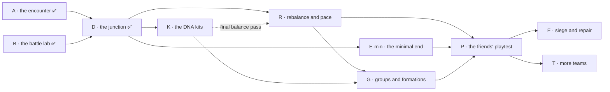

# Roadmap

Each milestone answers a design question in a playtest before the next. The roadmap names only the **current
milestone** and what comes **right after it**; ideas with no milestone stay in the GDD's **Parked** sections.

| Milestone | Scope | Question it answers | Status |
|---|---|---|---|
| **M0 — Design** | Pillars, GDD, ADRs, the DX harness (CLAUDE.md, spec flow) | What are we building? | ✅ |
| **M1 — The wealth cycle** | A minimal world: 2 cores on a small mirrored map, matéria + cristal, creeps that gather and carry to the base, creep production, road building, a basic declarative autopilot, dominate/release ([spec](specs/m1-wealth-cycle/spec.md)) | Is gathering, transporting and investing interesting on its own? | ✅ |
| **M1.5 — The fog** | Per-team view deltas ([ADR-0006](adr/0006-world-sync.md), [network spec](specs/m1.5-network/spec.md)); fog of war, in which clients and bots see only what their team sees ([fog spec](specs/m1.5-fog/spec.md)) | Does hiding information create interesting decisions without making the map unreadable? | ✅ |
| **M2 — The ambush** | An encounter with a load in transit opens a battle instance; a human dominates a creep; the result returns to the world; auto-resolve with no human. Then the first playtest with friends | Does the battle change the course of the world without dominating the game? | **Current** |

## M2 — The ambush

| Slice | Scope | Status |
|---|---|---|
| **A — The encounter** ([spec](specs/m2-encounter/spec.md)) | Names, creep HP, death; approach, attack, extort; pay, refuse, flee; spoils, loot, safe-conduct; the fight by a throwaway roll; autopilot stances; `sim` events and the chronicle | ✅ 2026-11-17 |
| **B — The battle lab** ([spec](specs/m2-battle-lab/spec.md)) | The deterministic battle package, the first combat rule (the grid), the gambits AI, base stats per DNA and simulated latency, on a local page with no world | ✅ 2026-11-20 |
| **D — The junction** ([spec](specs/m2-junction/spec.md)) | The encounter opens the battle instance instead of the roll; two or more sides and joining mid-fight; a human plays the battle from the world client; auto-resolve with no human; the result returns to the world; the **wanderers**, the first neutral faction. Its own ADR for the world side of the contract | ✅ 2026-11-25 |
| **R — Rebalance and pace** | A 2-hour match: a shorter world at a moderate ×N with faster DNAs, by a balance pass of sweeps ([GDD 01](gdd/01-world.md)); the wanderers early and regular ([GDD 05](gdd/05-tribes-and-diplomacy.md)); only the pace rescale against the snowball ([GDD 03](gdd/03-economy-and-logistics.md)); the opening countdown for humans ([GDD 06](gdd/06-battles.md)); "follow", helping an ally in battle, the road builder as an autopilot preset with its plan on the map, and the strategist for both playtest modes ([GDD 07](gdd/07-autopilot.md)); in the client, the selected creep's destination on the map and the current action's estimated time in the panel. Added at the spec's review (owner, 2026-11-25): the click that lists every actor under it, the red sign of a hostile action, the bot's difficulty (the hardest by default) and its reaction to each encounter by estimated risk, dropping the load in the world, and pausing a battle with P. **Out:** combat stats (slice K), the role of cristal, a sink, the deposit tie-break, the empty-deposit memory, the corridor AI. Its final balance pass runs after K's merge | **Spec approved** (2026-11-25); plan next, before P |
| **E-min — The minimal end** | Before the siege: defeat by elimination in fact, a team's concession, the bot conceding with no chance, a draw at the clock; the world ends when one team remains and freezes read-only; the end screen with the chronicle summary; replay markers; written for N teams ([GDD 01](gdd/01-world.md)) | **Next**, in parallel with R (design round 2026-11-25) |
| **K — The DNA kits** | A dodge for every DNA; the square's charged strike and charge; the triangle's frontal guard; the circle's fan ([GDD 02](gdd/02-creeps-and-domination.md), [GDD 06](gdd/06-battles.md)). In the lab first, behind params; the gambits use them; the battle screen shows charge and cooldowns | **Next**, in parallel with R and E-min, before P (2026-11-25) |
| **G — Groups and formations** | Formation commands, presets and rules in the style of Mount & Blade, in the world (the default formation by DNA and the side each DNA engages from, which revises where a joiner is born in the arena) and in battle (tactical formations for humans and the battle bots); the battle bot's load experiment (drop or hold it when help is coming, world → battle). Lab first ([GDD 06](gdd/06-battles.md), [GDD 07](gdd/07-autopilot.md)) | **Design round next**, in a parallel session; after K, before P (owner, with R's spec, 2026-11-25) |
| **P — The friends' playtest** | Prepare the ground for a multiplayer playtest with more than one human: the local server reached through a free tunnel, friends joining from their machines, several humans in the same world and the same battle; two teams, humans against humans or in co-op against the bot | After R, E-min, K and G |
| **E — Siege and repair** | HP of the core, finished roads and road jobs; how a building is attacked; paid repair; victory by the core. Needs its own design round | After P (C2) |
| **T — More teams** | Worlds of up to 4 teams, with a map that adapts and the wanderers adjusted ([GDD 01](gdd/01-world.md), proposal with the agent's analysis). Needs its own design round | After P, a candidate competing with E; the order at P's checkpoint (2026-11-25) |

### Why this order (owner, 2026-11-20)

> "The battle has to come in with the junction, and right after it we prepare the ground for the multiplayer
> playtest with more than one human." The goal is a playtest with friends over a free tunnel and a local server,
> with **real gameplay to test**, not only an economy simulator with extortion and RNG combat.

- **D first:** the grid is fun and good enough to see combat in a real match; no new combat rule before the junction
  (lab checkpoint, C9).
- **P right after D:** the deploy, even a test one, and client prediction waited for the joined cycle (C10). The
  playtest runs on the owner's machine with a free tunnel ([ADR-0005](adr/0005-mvp-deploy-vps-websocket.md):
  Cloudflare Tunnel or Tailscale Funnel), not a VPS.
- **E split at D's checkpoint** (owner, 2026-11-25, C2): the owner's session against the bot ended with every enemy
  creep dead and no way to end the match. Only E's **minimal end** comes before P; siege and repair after it.
- **A rebalance and pace round before P** (owner, 2026-11-25, C2): the bot never helped a fight, could not replace its
  losses, the wanderers came late and the map was explored in 3 of 72 world hours. **Scope warning:** R grows M2 with
  the strategist's changes and a new action ("follow"); its design round decides what is in.
- **The R and E-min design round** (owner, 2026-11-25): one round, two slices, run in parallel. The pace was the
  root of C2's findings: the economy was tuned for 72 world hours of bot against bot, and the session covered 4. The
  round also placed the owner's new requests: the road builder as a preset and two panel readouts go into R; the DNA
  kits become slice K before P (**scope warning:** it revises GDD 02's "only base stats in M2" and grows M2 by the
  battle package, the gambits, the lab and the battle screen; the lab first contains the risk); more teams become
  slice T after P, since 4 humans already fit in two teams.
- **R's spec review** (owner, 2026-11-25): the owner added items to R (the actors' list on a click, the hostile sign,
  the bot's difficulty and its reaction to encounters, dropping the load, pausing a battle) and asked for formations
  in the world and in battle. **Scope warning:** R was already the largest slice of M2 and grows again. The agent
  placed the formations and the battle bot's load experiment in a new slice **G** after K, not in R: the world
  formation's entry side changes where a joiner is born in the arena (junction D6), and the battle formation is built
  on the kits (the triangle's guard shields whoever is behind it), so both belong after K and in the lab first. G
  before P delays the playtest. **The owner approved it with R's spec** (2026-11-25): G's design round runs in a
  parallel session while R's plan is written.
- **Slice C** (chat, console and macros) left M2 (2026-11-20); it waits for a milestone.

### What P should contain (agent's proposal, to approve in P's spec)

- A tunnel how-to in the [PLAYTEST](PLAYTEST.md), tested from outside the owner's network (WSL2 included).
- Friends joining with a link: the lobby, the token in the URL, a reconnection that does not lose the domination.
- Several humans per team and in the same battle (`teams.maxHumans` is 3 today), and spectators. Two teams:
  humans against humans, or humans in co-op against the bot (owner, 2026-11-25).
- The latency over a real network measured in the battle, which decides client prediction (C10, ADR-0009).
- A short in-game help for someone who has never seen the game, and a session script with a questionnaire.

## Decisions along the way (condensed)

- **M1 with no fun playtest** (owner, 2026-11-14): with no combat there was nothing to win. M1 closed with the owner's
  session, bots, a compressed soak test and a local readability round (F9).
- **M1.5 before M2** (owner, 2026-11-14): the ambush assumes not everything is visible. Two slices: the network
  (deltas, validated locally) and the fog (after a design round).
- **Fun before deploy** (owner, 2026-11-15): the deploy and the playtest with new people stopped blocking M2; fun was
  judged by the owner in local playtests. **Revised at the lab checkpoint** (2026-11-20): the grid held up to 100 ms
  blind, but the deploy and client prediction wait for the joined junction.
- **The refocus** (owner, 2026-11-20): the brainstorms after the lab checkpoint drifted from the goal of joining the
  world with the battle. They were dropped from the repo; the GDD keeps the older ideas in **Parked**, with no
  milestone. The next milestone is chosen after the friends' playtest.
- The full map of 3 lanes + 2 jungles comes as milestones ask for it, not before.
