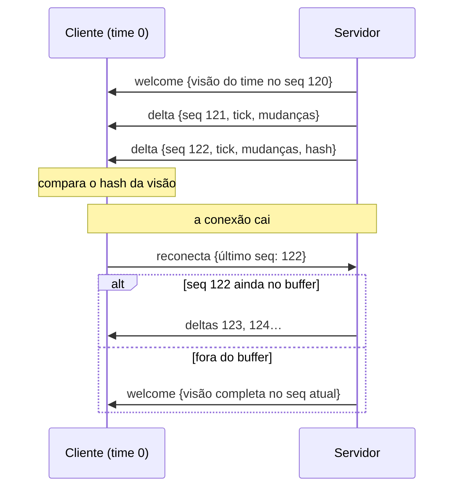

# ADR-0006: Sincronização do mundo: deltas por campo da visão de cada time

**Status:** Accepted (2026-11-14) · **Data:** 2026-11-14 (revisto no mesmo dia: a recomendação passou de C para B)
**Relaciona:** ADR-0002 (tudo é comando), ADR-0003 (o mesmo `sim` no navegador), ADR-0004 (o que o banco guarda),
ADR-0005 (transporte por WebSocket, que não muda), plan M1 P3 (estado completo, que este ADR revisita),
[OVERVIEW §7](../OVERVIEW.md#7-sync-via-websocket-quanto-custa-e-escala), GDD [01](../gdd/01-mundo.md) (fog of
war)

## Contexto

No M1, o servidor manda o **estado dinâmico completo** em JSON depois de cada tick, com no máximo 5 envios por
segundo (plan P3: "deltas só se a medição mostrar necessidade"). Para o M1 local foi a escolha certa: simples e sem
bug de dessincronização. A medição agora mostra a necessidade. A ×1 sai uma mensagem por segundo, e com 60 creeps
ela tem 26,5 KB. São 13–26× a estimativa do ADR-0005 (1–2 KB/s por cliente), ~2,3 GB por cliente por dia de mundo
e ~128 Mbit/s com 100 mundos de 6 jogadores. O deploy é a primeira etapa do M2 ([ROADMAP](../ROADMAP.md)), e esta
decisão precisa vir antes dele.

Duas forças novas:

- **Fog of war é provável** (inclinação do dono, 2026-11-14; ver GDD 01). Com fog, **nenhum cliente, e nenhum bot,
  pode receber o estado completo**: só o que o time dele enxerga. Isso elimina qualquer modelo em que o cliente
  roda a simulação inteira.
- **Uma revisão de fora.** Depois de ler o OVERVIEW, um dev de fora do projeto fez estas observações:
  1. *Compressão (`permessage-deflate`) tem custo.* Correto: o próprio README do `ws` avisa que o deflate no Node
     pode causar fragmentação de memória e lentidão sob concorrência, e cada socket ganha um contexto zlib no
     servidor.
  2. *Mandar só o que mudou.* Correto, e o ganho é maior do que o OVERVIEW dizia (medições abaixo). Uma redução de
     24× em JSON cru não exige compressão nenhuma.
  3. *Capturar as mudanças do banco e mandar esse delta.* Não se aplica ao pé da letra (alternativa D).
  4. *Numerar os pacotes; ao receber o 34 sem ter recebido o 33, pedir o 33 e guardar o 34 num buffer.* É o
     esquema certo sobre UDP. Sobre WebSocket (TCP), cabe uma versão mais simples (regra 5 da Decisão).
  5. *"Tudo isso a engine já faz."* Em boa parte, sim: a replicação da Unreal (delta por propriedade, relevância por
     cliente, confiabilidade sobre UDP) e o schema do Colyseus (delta binário com filtro por cliente) resolvem este
     problema. É o custo de "rede escrita por nós" que o OVERVIEW §8 já lista, agora com nome e endereço
     (alternativa E).

### Medições

Seed 42, `default.json`, bot × bot, média de 20 pares de estados consecutivos, a ×1 (1 tick entre mensagens). Sem
fog, a visão de um time é o estado dinâmico inteiro, então estes números são o pior caso de B; com fog, a visão
encolhe.

| Modelo | Por mensagem, 60 creeps (48 h) | Com 12 creeps (6 h) | Observação |
|---|---|---|---|
| Estado completo (hoje) | 26,5 KB | 7,1 KB | |
| **A.** Estado completo + deflate | ~0,5 KB | — | Deflate de uma mensagem com a anterior no dicionário |
| **B.** Delta por campo | 1,1 KB | 0,45 KB | Em média, 28 dos 60 creeps mudam por tick |
| **B, sem `movePoints`** | ≤ 0,45 KB | ≤ 0,24 KB | O cliente não usa `movePoints` (nem `trip` e `path`); sem ele, só 7 creeps mudam por tick |
| **C.** Fluxo de comandos | ~45 B por tick sem comando | ~45 B | Um mundo bot × bot de 3 dias tem 74 comandos, 7,6 KB no total |

Uma verificação de hash custa ~0,7 ms (`serialize` + SHA-256 de 26 KB).

CPU de B, numa versão ingênua (cópia profunda do estado para montar a visão, diff campo a campo por id), 60 creeps,
média de 2 000 ticks: **~0,34 ms para montar a visão e ~0,07 ms para o diff, por time**, ~396 bytes por delta.
São ~0,8 ms por mundo por envio, ~6× o `JSON.stringify` de hoje (~0,12 ms). A cópia profunda domina; uma versão que
não copie o estado inteiro a cada tick é parte da validação (regra 10).

## Alternativas

- **A. Manter o estado completo e ligar `permessage-deflate`.**
  - Prós: uma linha de configuração; o protocolo e o cliente não mudam.
  - Contras: CPU e memória de compressão **por socket** no servidor, com o aviso de fragmentação de memória do
    próprio `ws`. Resolve a banda criando outro gargalo. Com fog, continuaria mandando o estado completo, o que
    não pode.
- **B. Delta por campo da visão de cada time, calculado no servidor** (escolhida). O servidor projeta o estado na
  **visão** de cada time (o que o time enxerga, só com os campos que o cliente usa), guarda a última visão enviada
  e manda só as diferenças, numeradas. O cliente aplica o patch.
  - Prós:
    - 24× menos banda em JSON cru, 59× ou mais sem os campos que o cliente não usa; com fog, menos ainda;
    - **é o único modelo que funciona com fog of war**: o servidor decide o que cada time vê, e o resto nunca sai
      dele;
    - o cliente continua sem simulação, só exibindo;
    - o diff é **por time**, não por jogador: os jogadores do mesmo time veem a mesma coisa. São 2 diffs por mundo
      por envio, cada um compartilhado pelos sockets do time.
  - Contras:
    - código novo dos dois lados: visão, diff, patch, e remoção de entidades (morte, a partir do M2; entrar e sair
      da visão, com fog);
    - **uma classe nova de bug: o patch aplicado sobre a base errada.** A Decisão trata dela com número de
      sequência, base bem definida, retomada e verificação por hash (regras 4–7);
    - CPU no servidor: montar e comparar a visão de cada time a cada envio. Na versão ingênua, ~0,8 ms por mundo
      por envio (Contexto), ~6× o custo de hoje; a 1× isso daria ~80% de um núcleo com 1 000 mundos.
- **C. Fluxo de comandos, com o `sim` rodando no cliente.** O servidor manda só os comandos de cada tick; o cliente
  restaura o estado e roda o mesmo `step`, como o replay já faz. Era a recomendação da primeira versão deste ADR.
  - Prós: banda praticamente zero (~45 B por tick); nenhum código de diff; reaproveita o replay.
  - Contras: **o cliente precisa do estado completo para simular.** Com fog, isso entrega ao cliente tudo o que ele
    não deveria ver (o "maphack" clássico de RTS em lockstep). Desync vira falha ao vivo, e cliente e servidor
    precisam rodar o mesmo `SIM_VERSION`. **Descartada pelo fog of war.** Continua sendo o modelo certo para o
    replay de um mundo encerrado, em que ver tudo é o objetivo.
- **D. Capturar as mudanças do banco (CDC) e mandar o delta.**
  - Contras: o estado vivo não está no banco. Ele fica em memória no `WorldHost`; o banco recebe só os comandos de
    cada tick e um snapshot a cada 300 ticks (ADR-0004, que descartou gravar estado derivado). Para haver o que
    capturar, seria preciso gravar o estado a cada tick, o oposto do ADR-0004. A intuição certa por trás dela
    (mandar o que mudou, a partir da fonte) é a alternativa B, com a fonte sendo a memória.
- **E. B, implementado com uma biblioteca pronta** (ex.: o schema do Colyseus, que faz delta binário com filtro de
  visão por cliente).
  - Prós: código testado em produção para a parte mais sujeita a bug; formato binário.
  - Contras: o estado do `sim` é JSON puro, sem classes (ADR-0003, `serialize`), então seria preciso espelhá-lo nas
    classes da biblioteca a cada tick, e esse espelho já é um diff; binário é mais difícil de depurar; uma
    dependência no centro do protocolo. **A avaliar num spike no plan da fatia de rede** (regra 10), antes de
    escrever o diff à mão.

## Decisão

**B para o mundo**, com estas regras.

1. **Visão do time** (`view(state, team)`): uma função pura no `sim`, porque o que um time enxerga é regra de jogo.
   Sem fog (M1), é o estado dinâmico sem os campos que o cliente não usa (`path`, `movePoints`, `trip`). Com fog,
   ela filtra o que está fora da visão. O plan do M2 define os campos.
2. **Os bots também só veem a visão do time.** O estrategista passa a receber `view(state, team)` em vez do estado
   completo, para um bot nunca saber mais do que um humano do mesmo time saberia (o mesmo princípio do ADR-0002).
   O piloto automático dos creeps é parte da regra de jogo e roda no `sim`; se as condições dele (ex.: "recurso
   visível num raio R") respeitam o fog é uma pergunta de design para o GDD 01/07.
3. **Mensagens.** Entidades em arrays por id, como no estado. O delta lista, por coleção, as entidades novas
   (inteiras), os campos que mudaram nas existentes e os ids removidos. Cada delta leva `seq` (sequência do
   stream daquele time, +1 a cada envio) e o `tick`.
4. **Base bem definida na entrada.** O `welcome` manda a **última visão enviada** ao time (não o estado atual),
   com o `seq` dela. Assim o próximo delta parte exatamente da base que o cliente tem.
5. **Sequência e retomada.** Sobre WebSocket, as mensagens de uma conexão chegam todas e em ordem (TCP), então
   não existe "receber o 34 sem o 33" numa conexão viva. A perda acontece **entre conexões**. Por isso:
   - ao reconectar, o cliente informa o último `seq` aplicado e o id do stream que o `welcome` lhe deu (novo a
     cada processo do servidor: um `seq` de antes de um restart nunca cai no buffer novo; dono, 2026-11-14);
   - o servidor guarda um buffer circular dos últimos deltas de cada time (ex.: 30 s reais). Se o `seq` está no
     buffer, reenvia os que faltam; se não, manda a visão completa como um `welcome`;
   - um `seq` fora de ordem numa conexão viva é bug: o cliente pede a visão completa e registra o incidente.

   Se a batalha do M2 for para datagramas (WebTransport/WebRTC, ADR-0005), aí vale o esquema completo da revisão
   de fora: confirmação, pedido do que faltou e buffer de reordenação.
6. **Verificação em produção.** A cada N ticks (configuração do servidor; ex.: 60), o delta leva o hash da visão
   que o servidor acredita que o time tem. Hash diferente no cliente = divergência: ele pede a visão completa, e o
   incidente é registrado com o tick e o `seq` para reproduzir.
7. **Verificação no CI.** Um teste de propriedade sobre um mundo bot × bot inteiro: em todo tick, para cada time,
   `apply(visãoAnterior, diff(visãoAnterior, visãoNova))` é igual a `visãoNova`. É barato (o harness roda 3 dias em
   segundos) e pega a maior parte da classe de bug antes de ela chegar ao cliente.
8. **O que não muda:** o transporte (WebSocket, ADR-0005), a autoridade do servidor, os comandos (subida, `ack`,
   `reject`), o teto de 5 mensagens por segundo, o log e os snapshots (ADR-0004).
9. **Escopo:** só o mundo. A batalha do M2 (20–30 Hz, previsão do creep dominado) se decide no plan do M2.
10. **Quando e como validar** (dono, 2026-11-14): **antes do M2**, numa fatia própria, não na etapa de deploy. A
    viabilidade é **validada localmente** antes de qualquer deploy, com critérios definidos na spec da fatia (no
    mínimo: banda por cliente, CPU de visão + diff por mundo, o teste de propriedade da regra 7 num mundo de 3 dias,
    e o `npm run soak` com clientes conectados terminando com o hash da visão igual ao do servidor). **Se a
    validação reprovar, este ADR volta a ser discutido.** Formato das mensagens, N, o tamanho do buffer e o spike da
    alternativa E ficam para o plan da fatia. O fog of war, que é gameplay, segue o GDD 01 e vem depois desta
    fatia.

## Consequências

- A banda cai para ~0,5–1 KB/s por cliente, dentro da estimativa do ADR-0005, sem compressão. Restam como
  gargalos o disco (snapshots não podados), o fsync por tick e o event loop único
  ([OVERVIEW §7](../OVERVIEW.md#7-sync-via-websocket-quanto-custa-e-escala)).
- O `DynamicState` do `protocol` vira a **visão do time**, e o `toDynamicState` dá lugar a `view` no `sim` + diff
  no servidor.
- O store do cliente deixa de trocar o estado a cada mensagem e passa a aplicar patches. A interpolação (um estado
  atrás) continua igual.
- O estrategista bot muda de entrada (a visão, não o estado) e o determinismo continua: a visão é função pura do
  estado.
- **O export de replay de um mundo em andamento vaza tudo** (`GET /api/worlds/:id/replay` exporta qualquer mundo
  hospedado, F8). Com fog, ele precisa ficar restrito a mundos encerrados (ou a um papel de espectador). O replay
  continua sendo seed + log com o `sim` no navegador: depois do fim, ver tudo é o objetivo.
- O cliente hoje mostra o Núcleo, os creeps e as regras do outro time só para leitura (F7, sem fog). Com fog, o que
  aparece do outro time passa a ser decisão de design.
- Com fog, entrar e sair da visão vira "entidade nova" e "removida" no delta. O teste de propriedade da regra 7
  cobre isso quando a `view` filtrar.
- O plan M1 P3 fica como registro: foi a decisão certa para o M1 local, e a medição que ele pedia é a deste ADR.
