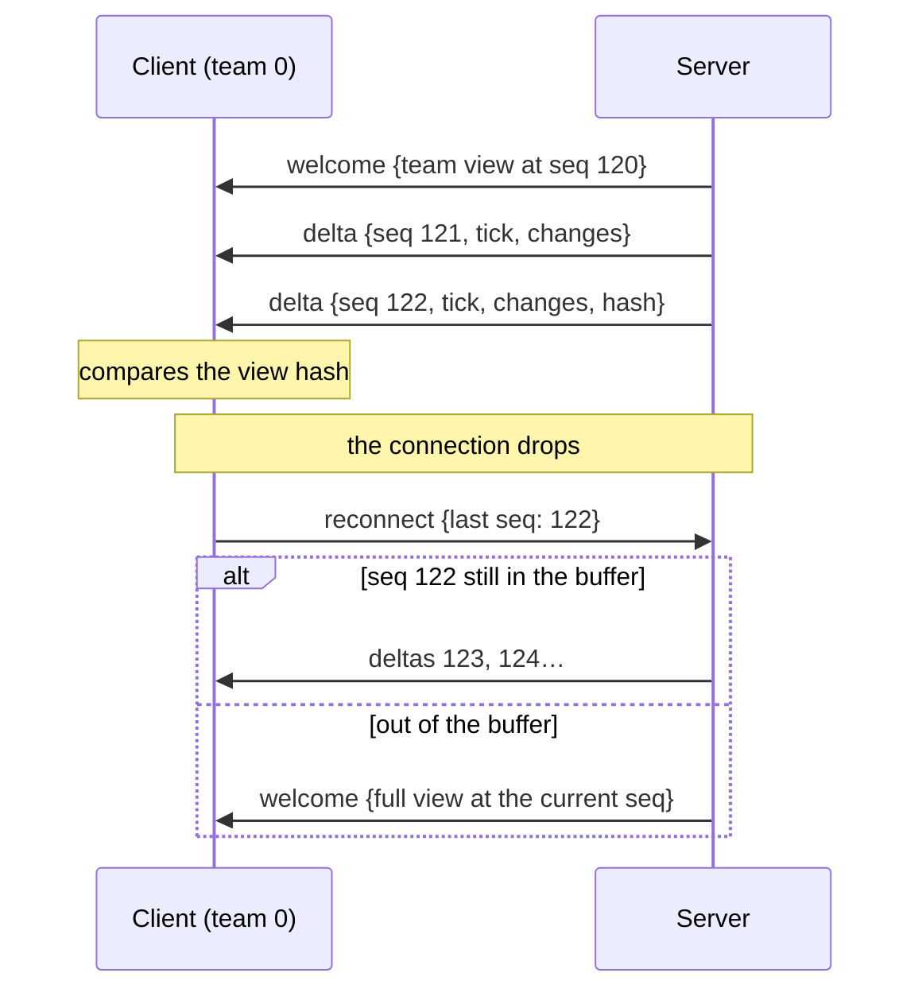

# ADR-0006: World sync: per-field deltas of each team's view

**Status:** Accepted (2026-11-14) · **Date:** 2026-11-14 (revised the same day: the recommendation moved from C to B)
**Related:** ADR-0002 (everything is a command), ADR-0003 (the same `sim` in the browser), ADR-0004 (what the
database stores), ADR-0005 (WebSocket transport, unchanged), M1 plan P3 (full state, which this ADR revisits),
GDD [01](../gdd/01-world.md) (fog of war)

## Context

In M1 the server sends the **full dynamic state** as JSON after each tick, at most 5 messages per second (plan P3:
"deltas only if measurement shows the need"). For local M1 it was the right choice: simple, with no desync bugs. The
measurement now shows the need. At ×1 there is one message per second, and with 60 creeps it weighs 26.5 KB. That is
13–26× the ADR-0005 estimate (1–2 KB/s per client), ~2.3 GB per client per world day, and ~128 Mbit/s with 100
worlds of 6 players. This decision must come before any deploy.

Two new forces:

- **Fog of war is likely** (owner's leaning, 2026-11-14; see GDD 01). With fog, **no client, and no bot, may receive
  the full state**: only what its team sees. That rules out any model where the client runs the whole simulation.
- **An outside review.** After reading the project overview, a developer from outside the project made these
  points:
  1. *Compression (`permessage-deflate`) has a cost.* Correct: the `ws` README itself warns that deflate in Node can
     cause memory fragmentation and slowness under concurrency, and each socket gets its own zlib context.
  2. *Send only what changed.* Correct, and the gain is larger than the overview said (measurements below). A 24×
     reduction in raw JSON needs no compression at all.
  3. *Capture the database changes and send that delta.* Does not apply literally (alternative D).
  4. *Number the packets; on receiving 34 without 33, ask for 33 and buffer 34.* The right scheme over UDP. Over
     WebSocket (TCP), a simpler version fits (rule 5 of the Decision).
  5. *"An engine already does all of this."* Largely yes: Unreal's replication (per-property delta, per-client
     relevance, reliability over UDP) and Colyseus's schema (binary delta with a per-client filter) solve this
     problem. It is the cost of "networking written by us", now with a name and an address (alternative E).

### Measurements

Seed 42, `default.json`, bot × bot, average of 20 pairs of consecutive states, at ×1 (1 tick between messages).
Without fog, a team's view is the whole dynamic state, so these numbers are B's worst case; with fog, the view
shrinks.

| Model | Per message, 60 creeps (48 h) | With 12 creeps (6 h) | Note |
|---|---|---|---|
| Full state (today) | 26.5 KB | 7.1 KB | |
| **A.** Full state + deflate | ~0.5 KB | — | Deflate of one message with the previous one in the dictionary |
| **B.** Per-field delta | 1.1 KB | 0.45 KB | On average, 28 of the 60 creeps change per tick |
| **B, without `movePoints`** | ≤ 0.45 KB | ≤ 0.24 KB | The client does not use `movePoints` (nor `trip` and `path`); without it, only 7 creeps change per tick |
| **C.** Command stream | ~45 B per tick without commands | ~45 B | A 3-day bot × bot world has 74 commands, 7.6 KB in total |

A hash check costs ~0.7 ms (`serialize` + SHA-256 of 26 KB).

CPU for B, in a naive version (deep copy of the state to build the view, field-by-field diff by id), 60 creeps,
average over 2,000 ticks: **~0.34 ms to build the view and ~0.07 ms for the diff, per team**, ~396 bytes per delta.
That is ~0.8 ms per world per send, ~6× today's `JSON.stringify` (~0.12 ms). The deep copy dominates; a version that
does not copy the whole state every tick is part of the validation (rule 10).

## Alternatives

- **A. Keep the full state and turn on `permessage-deflate`.**
  - Pros: one line of configuration; the protocol and the client do not change.
  - Cons: compression CPU and memory **per socket** on the server, with the memory fragmentation warning from `ws`
    itself. Solves bandwidth by creating another bottleneck. With fog, it would still send the full state, which is
    not allowed.
- **B. Per-field delta of each team's view, computed on the server** (chosen). The server projects the state onto
  each team's **view** (what the team sees, with only the fields the client uses), keeps the last view sent and
  sends only the numbered differences. The client applies the patch.
  - Pros:
    - 24× less bandwidth in raw JSON, 59× or more without the fields the client does not use; less still with fog;
    - **the only model that works with fog of war**: the server decides what each team sees, and the rest never
      leaves it;
    - the client still has no simulation; it only displays;
    - the diff is **per team**, not per player: players of the same team see the same thing. That is 2 diffs per
      world per send, each shared by the team's sockets.
  - Cons:
    - new code on both sides: view, diff, patch, and entity removal (death from M2 on; entering and leaving sight
      with fog);
    - **a new class of bug: a patch applied over the wrong base.** The Decision handles it with sequence numbers, a
      well-defined base, resumption and hash checks (rules 4–7);
    - server CPU: building and comparing each team's view on every send. Naively, ~0.8 ms per world per send
      (Context), ~6× today's cost; at ×1 that would be ~80% of a core with 1,000 worlds.
- **C. Command stream, with the `sim` running on the client.** The server sends only each tick's commands; the
  client restores the state and runs the same `step`, as the replay already does. It was the first version's
  recommendation.
  - Pros: practically zero bandwidth (~45 B per tick); no diff code; reuses the replay.
  - Cons: **the client needs the full state to simulate.** With fog, that hands the client everything it should not
    see (the classic lockstep RTS "maphack"). A desync becomes a live failure, and client and server must run the
    same `SIM_VERSION`. **Ruled out by fog of war.** Still the right model for replaying a finished world, where
    seeing everything is the point.
- **D. Capture the database changes (CDC) and send the delta.**
  - Cons: the live state is not in the database. It lives in memory in the `WorldHost`; the database only receives
    each tick's commands and a snapshot every 300 ticks (ADR-0004, which ruled out storing derived state). To have
    something to capture, the state would have to be stored every tick, the opposite of ADR-0004. The right
    intuition behind it (send what changed, from the source) is alternative B, with memory as the source.
- **E. B, implemented with a ready-made library** (e.g. Colyseus's schema, which does binary deltas with a per-client
  view filter).
  - Pros: production-tested code for the most bug-prone part; a binary format.
  - Cons: the `sim` state is plain JSON, with no classes (ADR-0003, `serialize`), so it would have to be mirrored
    into the library's classes every tick, and that mirror is already a diff; binary is harder to debug; a dependency
    at the center of the protocol. **To be evaluated in a spike in the network slice's plan** (rule 10), before
    writing the diff by hand.

## Decision

**B for the world**, with these rules.

1. **Team view** (`view(state, team)`): a pure function in the `sim`, because what a team sees is a game rule.
   Without fog (M1), it is the dynamic state minus the fields the client does not use (`path`, `movePoints`,
   `trip`). With fog, it filters what is out of sight. The M2 plan defines the fields.
2. **Bots also see only the team view.** The strategist receives `view(state, team)` instead of the full state, so a
   bot never knows more than a human of the same team would (the same principle as ADR-0002). The creeps' autopilot
   is part of the game rules and runs in the `sim`; whether its conditions (e.g. "resource visible within radius R")
   respect the fog is a design question for GDD 01/07.
3. **Messages.** Entities in arrays by id, as in the state. The delta lists, per collection, the new entities
   (whole), the changed fields of existing ones and the removed ids. Each delta carries `seq` (the sequence of that
   team's stream, +1 per send) and the `tick`.
4. **A well-defined base on entry.** The `welcome` sends the **last view sent** to the team (not the current state),
   with its `seq`. So the next delta starts exactly from the base the client has.
5. **Sequence and resumption.** Over WebSocket, a connection's messages all arrive, in order (TCP), so "receiving 34
   without 33" does not happen on a live connection. Loss happens **between connections**. Therefore:
   - on reconnecting, the client sends the last `seq` it applied and the stream id the `welcome` gave it (new for
     each server process: a `seq` from before a restart never falls into the new buffer; owner, 2026-11-14);
   - the server keeps a ring buffer of each team's latest deltas (e.g. 30 real seconds). If the `seq` is in the
     buffer, it resends the missing ones; if not, it sends the full view as a `welcome`;
   - an out-of-order `seq` on a live connection is a bug: the client asks for the full view and logs the incident.

   If the M2 battle moves to datagrams (WebTransport/WebRTC, ADR-0005), the outside review's full scheme applies:
   acknowledgment, a request for what is missing, and a reorder buffer.
6. **Production check.** Every N ticks (a server setting; e.g. 60), the delta carries the hash of the view the server
   believes the team has. A different hash on the client = divergence: it asks for the full view, and the incident is
   logged with the tick and the `seq` for reproduction.
7. **CI check.** A property test over a whole bot × bot world: on every tick, for each team,
   `apply(previousView, diff(previousView, newView))` equals `newView`. It is cheap (the harness runs 3 days in
   seconds) and catches most of this bug class before it reaches the client.
8. **What does not change:** the transport (WebSocket, ADR-0005), server authority, commands (upstream, `ack`,
   `reject`), the cap of 5 messages per second, the log and the snapshots (ADR-0004).
9. **Scope:** the world only. The M2 battle (20–30 Hz, prediction of the dominated creep) is decided in the M2 plan.
10. **When and how to validate** (owner, 2026-11-14): **before M2**, in a slice of its own, not in the deploy step.
    Viability is **validated locally** before any deploy, with criteria defined in the slice's spec (at least:
    bandwidth per client, view + diff CPU per world, the property test of rule 7 on a 3-day world, and `npm run soak`
    with connected clients ending with the view hash equal to the server's). **If validation fails, this ADR is
    reopened.** Message format, N, the buffer size and the spike of alternative E are left to the slice's plan. Fog
    of war, which is gameplay, follows GDD 01 and comes after this slice.

## Consequences

- Bandwidth drops to ~0.5–1 KB/s per client, within the ADR-0005 estimate, with no compression. The remaining
  bottlenecks are the disk (unpruned snapshots), the per-tick fsync and the single event loop.
- The `protocol`'s `DynamicState` becomes the **team view**, and `toDynamicState` gives way to `view` in the `sim`
  plus a diff on the server.
- The client store stops replacing the state on each message and applies patches instead. Interpolation (one state
  behind) stays the same.
- The bot strategist changes input (the view, not the state), and determinism holds: the view is a pure function of
  the state.
- **Exporting the replay of a running world leaks everything** (`GET /api/worlds/:id/replay` exports any hosted
  world, M1 F8). With fog, it must be restricted to finished worlds (or to a spectator role). The replay stays seed +
  log with the `sim` in the browser: after the end, seeing everything is the point.
- Today the client shows the other team's core, creeps and rules read-only (M1 F7, no fog). With fog, what shows of
  the other team becomes a design decision.
- With fog, entering and leaving sight become "new entity" and "removed" in the delta. The property test of rule 7
  covers that once the `view` filters.
- M1 plan P3 stays on record: it was the right decision for local M1, and the measurement it asked for is this ADR's.
