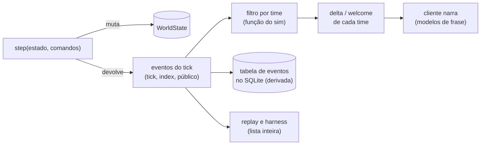

# ADR-0007: Eventos do `sim`: saída derivada do `step`, fora do estado

**Status:** Accepted (2026-11-15) · **Data:** 2026-11-15
**Relaciona:** ADR-0002 (tudo é comando; o vocabulário versionado), ADR-0003 (o `sim` puro e determinístico),
ADR-0004 (o que o banco guarda; o event sourcing descartado), ADR-0006 (a visão de cada time e o delta),
[spec M2 do encontro](../specs/m2-encontro/spec.md) (D16, D17, K-1..K-3, N-1, N-2), GDD
[08](../gdd/08-cronica-chat-e-console.md) (crônica)

## Contexto

Até o M1.5, o `sim` não conta o que aconteceu: o `step` só muta o estado, e quem quer saber compara dois estados
(o `+N`/`−N` do Núcleo no cliente faz isso). Com o encontro do M2, isso não basta:

- **A crônica precisa de fatos, não de diferenças.** "Taro extorquiu 10 de cristal de Lumo, que pagou" não sai de
  comparar dois estados: o encontro abre e fecha no mesmo tick quando a vítima livre paga na hora; o sorteio e a
  fuga consomem o `rng` e só o `sim` sabe o que saiu; um creep morto some do estado.
- **Os bots leem o evento, não o texto** (GDD 08). O estrategista pode precisar reagir a "fui extorquido" sem
  interpretar frases.
- **O fog vale para os eventos** (spec K-2): um time só recebe o evento em que um creep dele participa ou que
  acontece numa célula que ele vê naquele tick. Esse filtro precisa ser o mesmo no servidor, no harness, no soak e
  no replay.
- **A crônica sobrevive a um restart** (spec N-2), e o cliente que reconecta recebe as últimas entradas no
  `welcome` (N-1).
- **Ordem de grandeza:** bot × bot, os encontros devem ficar entre alguns e algumas dezenas por hora de mundo, e os
  nascimentos e as mortes, menos. Somados, os eventos não passam de algumas centenas por hora, contra 3 600 ticks.
  Um evento em JSON tem ~100–200 bytes.

## Alternativas

- **A. O `step` devolve os eventos do tick, fora do estado** (escolhida).
  - Prós: o estado e o hash não mudam de tamanho nem de forma; o snapshot não cresce; o replay e a recuperação
    recalculam os eventos de graça, porque o `sim` é determinístico; um teste confere o evento direto, sem montar
    dois estados.
  - Contras: quem precisa do histórico (o servidor, para N-2) tem de guardá-lo; um evento só existe para quem rodou
    o tick.
- **B. Os eventos recentes no `WorldState`** (um buffer circular, filtrado pela `view`).
  - Prós: o histórico vem no snapshot e no delta sem infraestrutura nova; o restart não perde nada.
  - Contras: o estado cresce e o hash passa a cobrir texto de crônica; o tamanho do buffer vira regra de jogo
    (`SIM_VERSION` a cada ajuste); mais campos no diff de cada time, todo tick.
- **C. Inferir os eventos comparando estados consecutivos** (no servidor ou no cliente).
  - Prós: nada muda no `sim`.
  - Contras: perde o que abre e fecha no mesmo tick, o resultado do `rng` e os mortos; cada consumidor reimplementa
    a inferência. É o problema que motiva este ADR.
- **D. Event sourcing** (os eventos como fonte do estado). Já descartado no ADR-0004: redundante com o `sim`
  determinístico.

## Decisão

**Opção A**, com as regras abaixo.

1. **O `step` devolve os eventos do tick**, numa lista ordenada, sem mudar a assinatura do estado. Os eventos não
   entram no `WorldState`, no `serialize` nem no hash. A mesma entrada (estado + comandos) dá a mesma lista, na
   mesma ordem, em qualquer execução e em qualquer engine.
2. **Um evento é dado estruturado, nunca texto:** `{ tick, index, type, ...campos }`, só JSON (ids, DNAs, nomes,
   células, quantias, a intenção, o desfecho). `index` é a posição na lista do tick, **antes** de qualquer filtro
   por time: com `tick`, identifica o evento e é o número que o cliente usa para escolher a variante da frase
   (spec D17), igual para todos os times.
3. **O público é calculado pelo `sim`:** cada evento sai com a lista de times que o veem (participante, ou a
   célula visível para o time na visão do fim daquele tick). Uma função pura do `sim` filtra a lista para um time,
   e o servidor, o harness, o soak e o replay usam a mesma. O replay, que mostra tudo, usa a lista inteira.
4. **O vocabulário de eventos é um contrato**, como o de comandos (ADR-0002): os tipos ficam no `sim`, exportados
   pelo `index.ts`. Mudar o que o `sim` emite sobe o `SIM_VERSION`; mudar o formato do que vai na rede sobe o
   `PROTOCOL_VERSION`. O texto da crônica fica no cliente e muda sem nenhum dos dois.
5. **Na rede**, os eventos não são diffados: o delta de cada time leva os eventos novos que o time vê desde o
   envio anterior (um envio pode cobrir vários ticks), e o `welcome`, as últimas entradas da crônica do time.
6. **No servidor, a crônica é guardada como dado derivado**, numa tabela própria do SQLite, como as métricas: o
   servidor grava os eventos de cada tick com o público, e **nunca os lê para reconstruir o estado**. Na
   recuperação, os eventos posteriores ao snapshot são apagados e o `step` os emite de novo, iguais, ao reaplicar
   o log (regra 1). O esquema da tabela, a retenção e a ordem de gravação ficam para o `plan.md` da fatia.
7. **Os bots** podem receber os eventos do próprio time, filtrados como os de um humano. Na fatia A, o estrategista
   não precisa deles; a assinatura muda quando precisar.

## Consequências

- **Testes:** cada regra da spec que emite um evento ganha a asserção sobre o evento; um teste de propriedade
  confere que o replay de um mundo reproduz a crônica gravada pelo servidor; o soak compara a crônica final de cada
  cliente com a do servidor (spec §7).
- **Custo:** a lista de eventos de cada tick é pequena, mas é alocação a mais num laço quente; o `geo sim` mede (a
  spec dá ao tick até 1,5× o da F6 do fog). O filtro por time roda uma vez por envio, não por tick.
- **Banco:** uma tabela nova, que cresce com os encontros (centenas de linhas por hora de mundo, no máximo). Entra
  na conta do tamanho do SQLite que o deploy já tem de rever (snapshot do fog, 117 MB num mundo de 3 dias).
- **Determinismo:** um evento depende só do estado e dos comandos. Nada no evento pode vir de fora do `sim` (nome
  de jogador, por exemplo, continua vindo do `GET /api/worlds`).
- **Fatias seguintes:** o chat (fatia C) não é evento do `sim`: mensagem de jogador não muda o mundo e vai por
  outro caminho do servidor; a crônica e o chat podem dividir o painel no cliente. A batalha da junção (fatia D)
  devolve ao mundo os próprios eventos de resultado (ADR-0001), e o mundo os traduz para este vocabulário.
- **Fica para o `plan.md`:** a forma da assinatura do `step` (lista devolvida ou um coletor passado como
  parâmetro), a lista exata de tipos de evento da fatia A, o esquema e a retenção da tabela, quantas entradas o
  `welcome` leva (a spec chuta 100).
