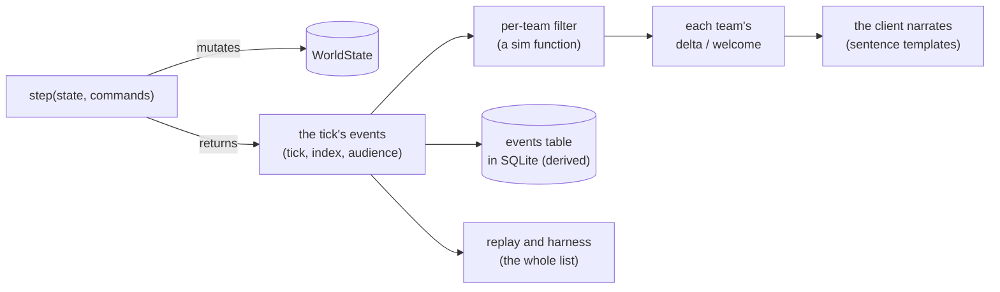

# ADR-0007: `sim` events: output derived from `step`, outside the state

**Status:** Accepted (2026-11-15) · **Date:** 2026-11-15
**Related:** ADR-0002 (everything is a command; the versioned vocabulary), ADR-0003 (the pure, deterministic `sim`),
ADR-0004 (what the database stores; event sourcing ruled out), ADR-0006 (each team's view and the delta),
[M2 encounter spec](../specs/m2-encounter/spec.md) (D16, D17, K-1..K-3, N-1, N-2), GDD
[08](../gdd/08-chronicle-chat-and-console.md) (chronicle)

## Context

Up to M1.5, the `sim` does not tell what happened: `step` only mutates the state, and whoever wants to know compares
two states (the core's `+N`/`−N` on the client does that). With the M2 encounter, that is not enough:

- **The chronicle needs facts, not differences.** "Taro extorted 10 cristal from Lumo, who paid" does not come out of
  comparing two states: the encounter opens and closes in the same tick when a free victim pays at once; the roll and
  the escape consume the `rng`, and only the `sim` knows what came out; a dead creep disappears from the state.
- **Bots read the event, not the text** (GDD 08). The strategist may need to react to "I was extorted" without
  parsing sentences.
- **Fog applies to events** (spec K-2): a team only receives an event in which one of its creeps takes part, or that
  happens on a cell it sees in that tick. That filter must be the same on the server, in the harness, in the soak and
  in the replay.
- **The chronicle survives a restart** (spec N-2), and a reconnecting client receives the latest entries in the
  `welcome` (N-1).
- **Order of magnitude:** bot × bot, encounters should stay between a few and a few dozen per world hour, and births
  and deaths fewer. Together, events stay below a few hundred per hour, against 3,600 ticks. An event in JSON is
  ~100–200 bytes.

## Alternatives

- **A. `step` returns the tick's events, outside the state** (chosen).
  - Pros: the state and the hash keep their size and shape; the snapshot does not grow; replay and recovery
    recompute the events for free, because the `sim` is deterministic; a test checks the event directly, without
    building two states.
  - Cons: whoever needs the history (the server, for N-2) must store it; an event only exists for whoever ran the
    tick.
- **B. Recent events in the `WorldState`** (a ring buffer, filtered by the `view`).
  - Pros: the history comes in the snapshot and the delta with no new infrastructure; a restart loses nothing.
  - Cons: the state grows and the hash covers chronicle data; the buffer size becomes a game rule (`SIM_VERSION` on
    every tweak); more fields in each team's diff, every tick.
- **C. Infer events by comparing consecutive states** (on the server or the client).
  - Pros: nothing changes in the `sim`.
  - Cons: loses what opens and closes in the same tick, the `rng` result and the dead; each consumer reimplements the
    inference. It is the problem that motivates this ADR.
- **D. Event sourcing** (events as the source of the state). Already ruled out in ADR-0004: redundant with a
  deterministic `sim`.

## Decision

**Option A**, with the rules below.

1. **`step` returns the tick's events**, in an ordered list, without changing the state's signature. Events do not
   go into the `WorldState`, the `serialize` or the hash. The same input (state + commands) gives the same list, in
   the same order, on any run and any engine.
2. **An event is structured data, never text:** `{ tick, index, type, ...fields }`, JSON only (ids, DNAs, names,
   cells, amounts, the intent, the outcome). `index` is the position in the tick's list **before** any per-team
   filter: with `tick`, it identifies the event and is the number the client uses to pick the sentence variant (spec
   D17), the same for every team.
3. **The audience is computed by the `sim`:** each event comes with the list of teams that see it (a participant, or
   the cell visible to the team in the view at the end of that tick). A pure `sim` function filters the list for one
   team, and the server, the harness, the soak and the replay all use it. The replay, which shows everything, uses
   the whole list.
4. **The event vocabulary is a contract**, like the commands' (ADR-0002): the types live in the `sim`, exported from
   `index.ts`. Changing what the `sim` emits bumps `SIM_VERSION`; changing the format on the wire bumps
   `PROTOCOL_VERSION`. The chronicle text lives on the client and changes without either.
5. **On the wire**, events are not diffed: each team's delta carries the new events the team sees since the previous
   send (one send can cover several ticks), and the `welcome` carries the team's latest chronicle entries.
6. **On the server, the chronicle is stored as derived data**, in its own SQLite table, like the metrics: the server
   writes each tick's events with their audience and **never reads them to rebuild the state**. On recovery, the
   events after the snapshot are deleted and `step` emits them again, identical, while replaying the log (rule 1).
   The table schema, the retention and the write order are left to the slice's `plan.md`.
7. **Bots** may receive their own team's events, filtered as a human's would be. In slice A, the strategist does not
   need them; the signature changes when it does.

## Consequences

- **Tests:** every spec rule that emits an event gets an assertion on the event; a property test checks that a
  world's replay reproduces the chronicle stored by the server; the soak compares each client's final chronicle with
  the server's (spec §7).
- **Cost:** each tick's event list is small, but it is one more allocation in a hot loop; `geo sim` measures it (the
  spec allows the tick up to 1.5× that of fog F6). The per-team filter runs once per send, not per tick.
- **Database:** a new table that grows with encounters (hundreds of rows per world hour at most). It counts toward
  the SQLite size the deploy already has to review (the fog snapshot, 117 MB in a 3-day world).
- **Determinism:** an event depends only on the state and the commands. Nothing in an event may come from outside the
  `sim` (a player's name, for instance, still comes from `GET /api/worlds`).
- **Next slices:** chat is not a `sim` event: a player message does not change the world and travels another server
  path; the chronicle and the chat can share the client panel. The junction's battle (slice D) returns its own result
  events to the world (ADR-0001), and the world translates them into this vocabulary.
- **Left to the `plan.md`:** the shape of `step`'s signature (a returned list or a collector passed as a parameter),
  the exact list of slice A event types, the table schema and retention, how many entries the `welcome` carries (the
  spec guesses 100).
