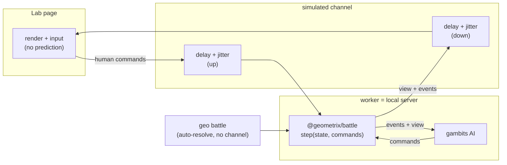

# ADR-0008: Battle package: its own deterministic simulation and the internal contract v0

**Status:** Accepted (2026-11-15) · **Date:** 2026-11-15
**Related:** ADR-0001 (world and battle separated; the contract is the most important interface), ADR-0002
(everything is a command), ADR-0003 (pure, integer simulation), ADR-0007 (events outside the state),
[M2 battle lab spec](../specs/m2-battle-lab/spec.md), GDD [06](../gdd/06-battles.md) (experimental, configurable
combat)

## Context

ADR-0001 separated the world from the battle: the world hands over the participants, the battle returns events. Until
now only the world exists. M2 slice B builds the battle side **before** joining it with the world (slice D), in a
local lab, and in parallel with slice A, which changes the `sim` at the same time.

The forces at play:

- **The battle needs the same guarantees as the world:** auto-resolve (a battle with no human, decided by the gambits
  AI) runs on the server and must give the same result in the replay and the harness. So: pure, integer, with the RNG
  in the state (ADR-0003).
- **Opposite rhythms:** the world has 1 tick per world second; the battle, 20 to 30 per real second (ADR-0001), with
  few entities (2 to a dozen in slice B).
- **Experimental, configurable combat** (GDD 06): different rules behind the same contract, so one does not block
  another. Slice B builds only the first rule, the grid.
- **Parallel work:** slice A changes `params.ts`, `world.ts`, `step.ts`, the `SIM_VERSION` and the `sim`'s fixed
  hashes. Anything slice B puts in the `sim` becomes a merge conflict and a redone hash.
- **Latency:** the deploy waits for combat to say how much latency is acceptable. The lab must measure that without
  a remote server, with the battle behind a channel with simulated latency.
- **The direction of the dependency:** at the junction, the world (the `sim` or the server) will call the battle for
  auto-resolve. If the battle imports the `sim`, the junction creates a cycle.

## Alternatives

- **A. A package of its own, `packages/battle` (`@geometrix/battle`)** (chosen).
  - Pros: its own version, params, tests and hashes; slice B does not touch slice A's files; the battle tick does not
    mix with the world's; the package runs the same on the server, in the CLI, in the browser and in a worker.
  - Cons: the lint and tsconfig determinism guards must cover it too; pure utilities the `sim` already has (the RNG,
    the hash, serialization) must be shared or copied.
- **B. A module inside the `sim`** (`packages/sim/src/battle/`).
  - Pros: inherits the lint, the RNG and the hash with no effort.
  - Cons: every lab change touches the world's `SIM_VERSION` and hashes; a direct conflict with slice A in parallel;
    the state of two simulations with different rhythms in one package.
- **C. Non-deterministic combat** (floating-point physics, wall-clock time, on the server or the client).
  - Pros: the fastest way to prototype the "feel" of combat.
  - Cons: no reproducible auto-resolve, no replay, no hash: breaks ADR-0001 and ADR-0003. What the lab learned would
    have to be rewritten at the junction.

## Decision

**Option A**, with the rules below.

1. **Package `@geometrix/battle`, pure and deterministic**, under the ADR-0003 rules: integer math, a seeded RNG in
   the state, no clock, I/O or runtime APIs. The `sim`'s lint and tsconfig guards apply to it as well.
2. **The battle imports neither the `sim` nor the `protocol`.** At the junction, the arrow goes from the world to the
   battle. Pure utilities both need (the RNG, the hash) are shared in a way that does not create the cycle; which way
   (a small common package or a copy) is left to the slice's `plan.md`.
3. **Its own params**, in the same format as the `sim` (`schema`, `default.json`, `checkConsistency`, fixed test
   params). The **base combat stats per DNA** live there until the junction. Slice D decides the single source for
   the numbers that exist on both sides (max HP, capacity).
4. **JSON-only state, with a hash**, ids from a counter, arrays ordered by id, a `serialize` that refuses `Map`, `Set`
   and classes, as in the `sim`. Its own fixed tick, in params. Its own `BATTLE_VERSION`, bumped when the result of
   the same log changes.
5. **The API is a simulation's, not an engine's:** create the battle from a *setup* (arena, sides, participants, rule,
   seed); advance one tick with that tick's commands; the step returns the **tick's events outside the state**, as
   ADR-0007 did in the `sim`; a view of the state for whoever renders.
6. **Everything is a command** (ADR-0002): the human dominating a participant and the gambits AI emit the same
   commands, validated by the same function. The AI reads only the view and never mutates the state.
7. **The combat rule is a field of the setup.** In slice B only the grid exists. **No generic rule interface** until
   a second one exists (first the concrete): when it comes, what the two share gets extracted.
8. **Internal contract v0.** This package's setup and result events are the battle side of the ADR-0001 contract,
   versioned by `BATTLE_VERSION`. **The world side is left to slice D's ADR** (answered by
   [ADR-0010](0010-world-side-of-the-battle-contract.md)): who is locked in the world, the bubble,
   how much world time passes, how the world keeps feeding the battle with late arrivals, and how the events become
   `sim` events. Slice B already accepts **sides and participants that join mid-fight** (spec, D12), so D starts from
   an engine that supports it.
9. **In the lab, the battle runs as a local authoritative server** (a browser worker), and the page only renders what
   it receives, **with no prediction**, behind a channel with simulated latency and jitter. What goes over the
   channel (full state or delta) is left to the `plan.md`.

## Consequences

- **CI:** `npm run check` covers the package; a battle `verify` (2 runs + snapshot → restore with the same hash; a log
  exported from the lab gives the same hash in the CLI) runs in CI.
- **Lint and tsconfig:** the determinism rules stop being `sim`-only; the `eslint.config` and the base tsconfig gain
  the new package.
- **Commits:** the package needs a new scope (`battle`) in the closed list of the `commit` skill.
- **Deliberate duplication:** max HP and capacity per DNA exist in both the `sim` params (slice A) and the battle's
  until the junction. Slice D picks one owner for each number.
- **Maintenance cost:** two deterministic simulations. It is the price of ADR-0001; the gain is that slice B moves
  without touching the world.
- **Left to the `plan.md`:** how to share the RNG and the hash; the exact shape of the setup, commands and events;
  the lab channel format; the tick (the spec guesses 20 per second).
- **Left to slice D (its own ADR):** the contract with the world, the bubble, world time during the fight, the entry
  of participants coming from the world and the translation of result events.
