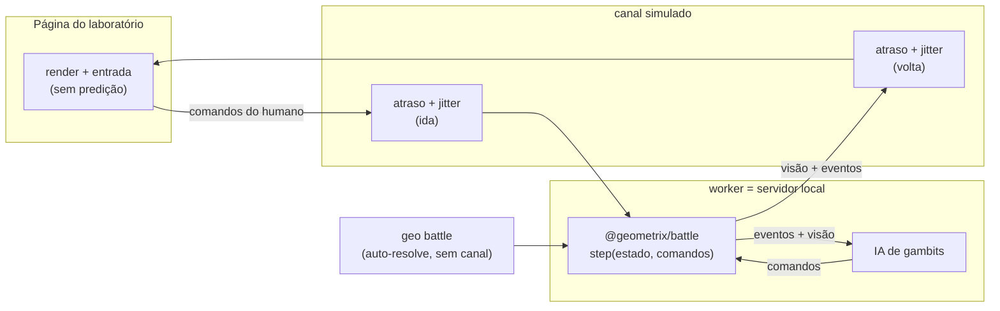

# ADR-0008: Pacote de batalha: simulação determinística própria e o contrato interno v0

**Status:** Accepted (2026-11-15) · **Data:** 2026-11-15
**Relaciona:** ADR-0001 (mundo e batalha separados; o contrato é a interface mais importante), ADR-0002 (tudo é
comando), ADR-0003 (simulação pura e inteira), ADR-0007 (eventos fora do estado),
[spec M2 do laboratório](../specs/m2-laboratorio/spec.md), GDD [06](../gdd/06-batalhas.md) (combate experimental e
configurável), [brainstorm M2–M3](../brainstorm/2026-11-15-m2-m3.md) §6

## Contexto

O ADR-0001 separou o mundo da batalha: o mundo entrega os participantes, a batalha devolve eventos. Até aqui só o
mundo existe. A fatia B do M2 constrói o lado da batalha **antes** da junção com o mundo (fatia D), num laboratório
local, e em paralelo à fatia A, que mexe no `sim` ao mesmo tempo.

As forças em jogo:

- **A batalha precisa das mesmas garantias do mundo:** o auto-resolve (a batalha sem humano, decidida pela IA de
  gambits) roda no servidor e tem de dar o mesmo resultado no replay e no harness. Logo, pura, inteira e com o RNG
  no estado (ADR-0003).
- **Ritmos opostos:** o mundo tem 1 tick por segundo de mundo; a batalha, 20 a 30 por segundo real (ADR-0001), com
  poucas entidades (de 2 a uma dúzia na fatia B).
- **Combate experimental e configurável** (GDD 06): regras diferentes atrás do mesmo contrato, sem uma bloquear a
  outra. A fatia B só constrói a primeira regra, a grade.
- **Paralelismo:** a fatia A muda `params.ts`, `world.ts`, `step.ts`, o `SIM_VERSION` e os hashes fixos do `sim`.
  Tudo o que a B puser no `sim` vira conflito de merge e hash refeito.
- **Latência:** o deploy espera o combate dizer quanta latência é aceitável (ROADMAP, 2026-11-15). O laboratório
  tem de medir isso sem servidor remoto, com a batalha atrás de um canal com latência simulada.
- **A seta da dependência:** na junção, o mundo (o `sim` ou o servidor) vai chamar a batalha para o auto-resolve.
  Se a batalha importar o `sim`, a junção cria um ciclo.

## Alternativas

- **A. Um pacote próprio, `packages/battle` (`@geometrix/battle`)** (escolhida).
  - Prós: versão, params, testes e hashes próprios; a fatia B não toca nos arquivos da A; o tick da batalha não se
    mistura com o do mundo; o pacote roda igual no servidor, na CLI, no navegador e num *worker*.
  - Contras: as guardas de determinismo do lint e do tsconfig precisam valer também para ele; utilidades puras que
    o `sim` já tem (o RNG, o hash, a serialização) precisam ser compartilhadas ou copiadas.
- **B. Um módulo dentro do `sim`** (`packages/sim/src/battle/`).
  - Prós: herda o lint, o RNG e o hash sem esforço.
  - Contras: cada mudança no laboratório mexe no `SIM_VERSION` e nos hashes do mundo; conflito direto com a fatia A
    em paralelo; o estado de duas simulações com ritmos diferentes no mesmo pacote.
- **C. Combate não determinístico** (física em ponto flutuante, tempo real de relógio, no servidor ou no cliente).
  - Prós: o jeito mais rápido de prototipar o "sentir" do combate.
  - Contras: sem auto-resolve reproduzível, sem replay, sem hash: quebra o ADR-0001 e o ADR-0003. O que o
    laboratório aprendesse teria de ser reescrito na junção.

## Decisão

**Opção A**, com as regras abaixo.

1. **Pacote `@geometrix/battle`, puro e determinístico**, com as regras do ADR-0003: math inteira, RNG com seed
   no estado, nada de relógio, I/O ou API do runtime. As guardas do lint e do tsconfig do `sim` passam a valer para
   ele também.
2. **A batalha não importa o `sim` nem o `protocol`.** Na junção, a seta vai do mundo para a batalha. Utilidades
   puras que os dois precisam (o RNG, o hash) são compartilhadas por um caminho que não crie o ciclo; qual (um
   pacote comum pequeno ou cópia) fica para o `plan.md` da fatia.
3. **Params próprios**, no mesmo formato do `sim` (`schema`, `default.json`, `checkConsistency`, params fixos de
   teste). Os **stats base por DNA de combate** moram neles até a junção. A fatia D decide a fonte única dos números
   que existem dos dois lados (o HP máximo, a capacidade).
4. **Estado só JSON, com hash**, ids de um contador, arrays ordenados por id, `serialize` que recusa `Map`, `Set` e
   classes, como no `sim`. Tick fixo próprio, em params. Uma `BATTLE_VERSION` própria, que sobe quando o resultado
   de um mesmo log muda.
5. **A API é a de uma simulação, não a de uma engine:** criar a batalha a partir de um *setup* (arena, lados,
   participantes, regra, seed); avançar um tick com os comandos daquele tick; o passo devolve os **eventos do tick
   fora do estado**, como o ADR-0007 fez no `sim`; uma visão do estado para quem renderiza.
6. **Tudo é comando** (ADR-0002): o humano que domina um participante e a IA de gambits emitem os mesmos comandos,
   validados pela mesma função. A IA lê só a visão e nunca muta o estado.
7. **A regra de combate é um campo do setup.** Na fatia B, só existe a grade. **Nenhuma interface genérica de
   regra** até existir a segunda (CLAUDE.md: primeiro o concreto): quando ela vier, extrai-se o que as duas
   compartilham.
8. **Contrato interno v0.** O setup e os eventos de resultado deste pacote são o lado da batalha do contrato do
   ADR-0001, versionado pela `BATTLE_VERSION`. **O lado do mundo fica para o ADR da fatia D**: quem fica travado
   no mundo, a bolha, quanto tempo do mundo passa, como o mundo continua a alimentar a batalha com quem chega
   depois, e como os eventos viram eventos do `sim`. A fatia B já aceita **lados e participantes que entram no meio
   da luta** (spec, D12), então a D parte de um motor que suporta isso.
9. **No laboratório, a batalha roda como um servidor autoritativo local** (um *worker* do navegador), e a página só
   renderiza o que recebe, **sem predição**, atrás de um canal com latência e *jitter* simulados. O que vai pelo
   canal (estado inteiro ou delta) fica para o `plan.md`.

## Consequências

- **CI:** o `npm run check` passa a cobrir o pacote; um `verify` da batalha (2 execuções + snapshot → restore com o
  mesmo hash; o log exportado do laboratório dá o mesmo hash na CLI) entra no CI.
- **Lint e tsconfig:** as regras de determinismo deixam de ser só do `sim`; o `eslint.config` e o tsconfig base
  ganham o pacote novo.
- **Commits:** o pacote pede um scope novo (`battle`) na lista fechada da skill `commit`.
- **Duplicação consciente:** o HP máximo e a capacidade por DNA existem nos params do `sim` (fatia A) e nos da
  batalha até a junção. A D escolhe um dono para cada número.
- **Custo de manutenção:** duas simulações determinísticas. É o preço do ADR-0001; o ganho é que a fatia B anda
  sem tocar no mundo.
- **Fica para o `plan.md`:** como compartilhar o RNG e o hash; a forma exata do setup, dos comandos e dos eventos;
  o formato no canal do laboratório; o tick (a spec chuta 20 por segundo).
- **Fica para a fatia D (ADR próprio):** o contrato com o mundo, a bolha, o tempo do mundo durante a luta, a
  entrada de participantes vindos do mundo e a tradução dos eventos de resultado.
