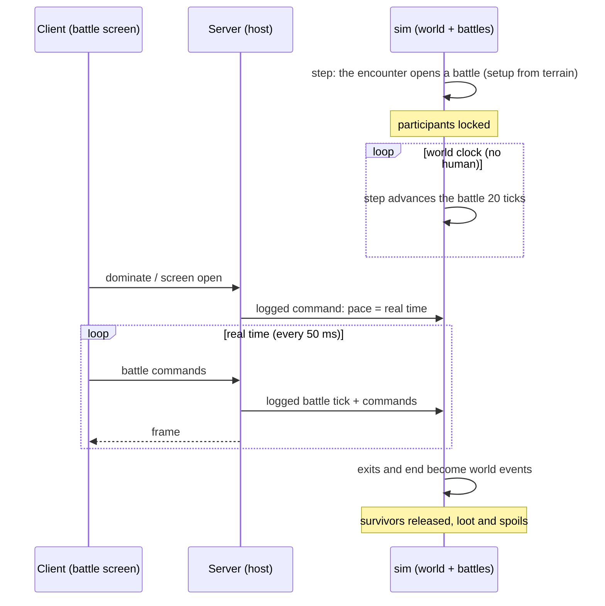

# ADR-0010: The world side of the battle contract: battles inside the world state

**Status:** Proposed · **Date:** 2026-11-24
**Related:** ADR-0001 (world and battle separated; this ADR refines where the instance lives), ADR-0003 (pure,
integer simulation), ADR-0004 (the command log; its format changes), ADR-0006 (the per-team deltas), ADR-0008 (the
battle package; rule 8 leaves the world side to slice D), [junction spec](../specs/m2-junction/spec.md),
GDD [05](../gdd/05-tribes-and-diplomacy.md) (the wanderers), [06](../gdd/06-battles.md)

## Context

ADR-0001 separated the world from the battle and ADR-0008 built the battle side: a pure package, `@geometrix/battle`,
driven by `stepBattle(state, commands)` every 50 ms, with its own params, version and hash, which imports neither the
`sim` nor the `protocol`. The world side was left to slice D: who is locked, the bubble, how much world time passes,
how late arrivals enter and how the results become `sim` events.

The owner's decisions in the junction spec fix the forces:

- **Two paces for the same battle.** With a human controlling a participant, the battle runs in **real time** while
  the world keeps its ×N (D3); with no human, it runs **on the world clock**, 20 battle ticks per world second (D4).
  A battle switches pace when a human takes over or leaves (D12, D13).
- **The world must replay and recover** (ADR-0001, ADR-0004): `geo verify`, the soak test with `kill -9` and the
  replay all start from a snapshot plus the command log. A battle played by a human must replay too, and a crash in
  the middle of a battle must not lose it or apply half of it.
- **The harness has no server:** `geo sim`, `geo sweep` and the bot-world tests step the world alone, and bot
  battles must happen there as they do on the server.
- **Battles change the world while they run:** a participant that dies or escapes leaves the world on that tick
  (D7), and creeps keep joining from the world (D6).
- **Orders of magnitude:** a 3 × 3 battle costs ~41 ms per 2,400 ticks (lab F7), so ~0.35 ms per world tick on the
  world clock. A world has a handful of battles open at a time. A human produces battle commands at most every
  50 ms, and only while pressing or releasing keys.

## Alternatives

- **A. Battles inside the world state, stepped by the `sim`** (recommended).
  - What it is: each open battle's `BattleState` is a field of the world state (JSON, like the rest). On the world
    clock, `step` advances it by one world second of battle ticks. On real time, the host advances it between world
    ticks through a `sim` entry point, and **each of those battle ticks is an entry of the world log**, with its
    commands. Which pace a battle is on is world state, changed by a logged command.
  - Pros: one log, one snapshot and one hash for everything: `geo verify`, the replay, recovery and the soak test
    cover battles with no new machinery; the harness runs bot battles with no host; no protocol between two logs that
    can disagree after a crash; joins and exits are plain world code.
  - Cons: the `sim` depends on the battle package, and a `BATTLE_VERSION` bump bumps `SIM_VERSION`; the world log
    gains battle-tick entries (only for real-time battles); the snapshot carries the open battles; the world tick gets
    more expensive with battles on the world clock.
- **B. Separate instances next to the world** (the ADR-0001 picture taken literally).
  - What it is: the world keeps a stub of each battle and locks its participants; a battle host steps the instances
    with their own logs; each exit and the end come back to the world log as system inputs at the world tick they
    land on.
  - Pros: the world snapshot stays small; a battle could move to another process with no change to the world.
  - Cons: two logs that must agree after a `kill -9` (an exit applied in the world with the battle log behind, or the
    reverse); the harness needs its own host to run bot battles; the world hash no longer covers the fight, and
    `geo verify` checks only half; joins become a message between the two.
- **C. Battles in another process or server.**
  - Pros: scales to many battles at once.
  - Cons: everything in B plus the operation of a second service and an internal network hop, for a playtest that
    runs on one machine (ADR-0005, slice P).

## Decision

Proposed: **alternative A**, with these rules.

1. **The arrow ADR-0008 foresaw:** `@geometrix/sim` imports `@geometrix/battle`; the battle still imports neither
   the `sim` nor the `protocol`. The battle's contract (setup, commands, events, view) stays the only surface between
   them, so B or C remain possible later without changing the battle.
2. **The battle state is world state.** An open battle is a world field with its `BattleState`, the world's ids of its
   participants and its pace; `serialize` and the hash cover it. A `BATTLE_VERSION` bump bumps `SIM_VERSION`.
3. **Two paces, one simulation.** On the world clock, `step` advances the battle by one world second of battle ticks
   (20). On real time, the server advances it between world ticks, and each battle tick is logged with its commands,
   in order with the world ticks. Changing the pace is a logged command, so the replay knows how every tick was
   stepped. What sets the pace (a human in control with the screen open, D13) is the server's to observe; the `sim`
   only obeys the logged command.
4. **One owner per number** (spec D9): the world's params own max HP and capacity; the participant setup carries them;
   the battle params keep only combat (damage, range, cooldowns, speeds). HP crosses in whole points. This changes the
   setup (`BATTLE_VERSION`).
5. **The world drives the battle from outside:** opening (the setup from the encounter and the terrain window),
   joining (a `join` command when a creep enters the bubble), domination (a `control` command) and the gambits per
   creep are the world's, through the battle's own commands. The battle knows nothing of the world.
6. **The battle's events become `sim` events** in the world: deaths, escapes, joins and the end change the world on
   the tick they happen and are narrated by the chronicle. The blow-by-blow (hits, misses) goes only to the battle
   screen.
7. **A side is a team or the wanderers.** The wanderers are the only side that is not a team, built only for them
   (GDD 05 proposal): no core, stock, player or domination. How the `sim` models them is left to the `plan.md`.
8. **The battle's internal state does not enter the world delta** (ADR-0006): the team view carries a battle stub
   (cell, bubble, participants, sides) through the fog; the arena frames go only to whoever has the battle screen
   open.
9. **Left to the `plan.md`:** the log format of the battle-tick entries (one per tick or batched per world tick); the
   frame format (the full view, as in the lab, or a delta); whether an exit applies on the battle tick or at the next
   world tick; the mapping between arena and world cells; the server's real-time timer next to the world's
   `TickLoop`.

## Consequences

- **The command log changes** (ADR-0004): it holds world ticks and battle ticks in order. Old logs and snapshots
  become invalid (`BREAKING CHANGE`), as in every `SIM_VERSION` bump.
- **Tick cost:** battles on the world clock run inside `step`; `geo sim` measures it against the baseline (spec §7,
  at most 1.5×).
- **Snapshot and memory:** each open battle adds its state (a few KB). Measured by `geo net` and the soak test.
- **The harness gains battles for free:** `geo verify`, `geo sim`, `geo sweep` and the soak test exercise them.
  `geo battle` and the lab keep running the battle alone, from a setup that now carries max HP and capacity (the lab
  and the CLI fill them from a table of their own; the plan says where).
- **ADR-0001's "battles in other processes"** is postponed, not dropped: rule 1 keeps that door open.
- **ADR-0008 rule 8** (the world side left to slice D) is answered by this ADR; on acceptance, ADR-0008 gains a note
  pointing here.
