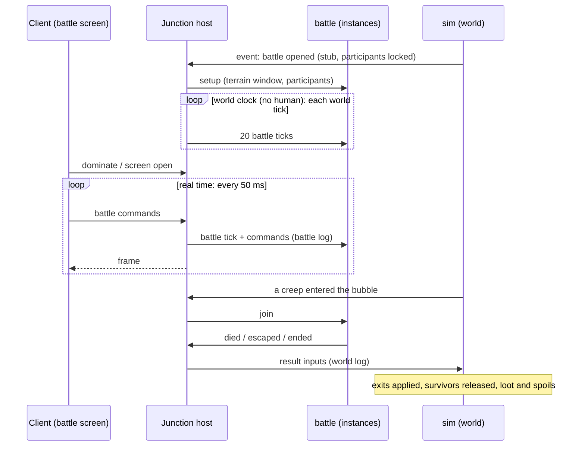

# ADR-0010: The world side of the battle contract: battle instances next to the world

**Status:** Accepted (2026-11-24) · **Date:** 2026-11-24
**Related:** ADR-0001 (world and battle separated; this ADR places the instances), ADR-0003 (pure, integer
simulation), ADR-0004 (the command log; it gains the battle logs), ADR-0006 (the per-team deltas), ADR-0008 (the
battle package; rule 8 leaves the world side to slice D), [junction spec](../specs/m2-junction/spec.md),
GDD [05](../gdd/05-tribes-and-diplomacy.md) (the wanderers), [06](../gdd/06-battles.md)

## Context

ADR-0001 separated the world from the battle and ADR-0008 built the battle side: a pure package, `@geometrix/battle`,
driven by `stepBattle(state, commands)` every 50 ms, with its own params, version and hash, which imports neither the
`sim` nor the `protocol`. The world side was left to slice D: who is locked, the bubble, how much world time passes,
how late arrivals enter and how the results become `sim` events.

The owner's decisions in the junction spec fix the forces:

- **Two paces for the same battle.** With a human controlling a participant, the battle runs in **real time** while
  the world keeps its ×N (D3); with no human, it runs **on the world clock**, 20 battle ticks per world second (D4).
  A battle switches pace when a human takes over or leaves (D12, D13).
- **The world must replay and recover** (ADR-0001, ADR-0004): `geo verify`, the soak test with `kill -9` and the
  replay start from a snapshot plus the command log. A battle played by a human must replay too, and a crash in the
  middle of a battle must not lose it or apply half of it.
- **The world lasts days; the battle will change.** Combat is experimental and configurable (GDD 06): new rules,
  balance and AI changes will come while worlds are running. A battle change must not invalidate a world's log.
- **The harness has no server:** `geo sim`, `geo sweep` and the bot-world tests step the world alone, and bot
  battles must happen there as they do on the server.
- **Battles change the world while they run:** a participant that dies or escapes leaves the world (D7), and creeps
  keep joining from the world (D6).
- **Orders of magnitude:** a 3 × 3 battle costs ~41 ms per 2,400 ticks (lab F7). A world has a handful of battles open
  at a time, each lasting tens of seconds to a few minutes. A human produces battle commands at most every 50 ms, and
  only while pressing or releasing keys. Any replayable battle with a human needs those commands stored somewhere,
  whatever the alternative.

## Alternatives

- **A. Separate instances next to the world, driven by a junction host** (chosen).
  - What it is: the world keeps only a **stub** of each battle (its cell, its window, its participants' ids and
    sides) and locks the participants. A **junction host**, which depends on the `sim` and the battle, owns the
    instances: it builds the setup from the world, steps each battle on its pace, passes joins in, and turns exits and
    the end into **result inputs in the world log**. Each battle has its own log (setup + commands per tick).
  - Pros: the world replays its log **without running any battle**, so a battle change (rules, balance, AI) does not
    touch the world's version, hash or logs while the contract holds; the `sim` and the battle stay independent of
    each other; the pace is the host's alone, and the world never knows whether a battle is in real time; the world
    snapshot does not grow with arenas.
  - Cons: a new piece (the host), shared by the server and the CLI; two levels of verification (the world log with the
    results; each battle log against the results the world applied); two kinds of log to keep consistent through a
    crash (solved by one SQLite transaction, rule 5).
- **B. Battles inside the world state, stepped by the `sim`.**
  - What it is: each open battle's `BattleState` is a world field; `step` advances battles on the world clock, and
    battle ticks in real time are entries of the world log, interleaved with the world ticks.
  - Pros: one log, one snapshot and one hash; the harness gets battles with no host.
  - Cons: every battle change bumps `SIM_VERSION` and invalidates the logs of running worlds; the `sim` imports the
    battle; the world log mixes a 1 Hz rhythm with a 20 Hz one, and the `sim` must know each battle's pace.
- **C. Battles in another process or server.** Discarded for M2 (owner, 2026-11-24): everything in A plus a second
  service and a network hop, for a playtest on one machine (ADR-0005, slice P). Alternative A keeps it possible later.

## Decision

**Alternative A** (owner, 2026-11-24: a battle change must not touch the world), with these rules.

1. **Three pieces, one direction.** The `sim` does not import the battle; the battle imports neither the `sim` nor the
   `protocol` (ADR-0008); the **junction host** imports both and is the only place that knows the two. The battle's
   contract (setup, commands, events, view) is the only surface the host uses on the battle side.
2. **The world side, in the `sim`:** the battle stub; opening it from the encounter (an event the host reacts to);
   locking the participants; detecting who enters the bubble to join (D6); applying the **result inputs** (an exit:
   died or escaped, with HP, load and the cell it comes back on; the end: survivors, loot and spoils), validated like
   any command; the `sim` events of the chronicle. The `sim` knows nothing of arenas, ticks or paces.
3. **The battle side, in the host:** building the setup (the arena from the terrain window, the participants with
   their HP, max HP, capacity, load and gambits, D5, D9, D10); stepping each battle on the world clock (20 battle
   ticks per world tick, synchronously) or in real time (D13); the `join` and `control` commands; the human's battle
   commands; turning the battle's events into result inputs.
4. **Replay at two levels.** The world log has the result inputs, so the world replays alone. Each battle log replays
   alone (`geo battle verify`) and must give the results the world log applied; the soak test and `geo verify` check
   both.
5. **One SQLite transaction per world tick** (ADR-0004): the world tick's commands, the result inputs and the battle
   ticks run since the previous world tick are written together. After a `kill -9`, what was not committed did not
   happen on either side: the world restores from its snapshot and log, and the host rebuilds each open battle from
   its setup and log, up to the last committed tick.
6. **With no human, the host is deterministic:** stepping synchronously with the world, battles are a function of the
   world state. The harness (`geo sim`, `geo sweep`, `geo verify`, the bot-world tests) steps through the host and
   keeps its reproducibility; a snapshot of a run includes the open battles' states.
7. **One owner per number** (spec D9): the world's params own max HP and capacity; the participant setup carries them;
   the battle params keep only combat (damage, range, cooldowns, speeds). HP crosses in whole points. This changes the
   setup (`BATTLE_VERSION`).
8. **A side is a team or the wanderers.** The wanderers are the only side that is not a team, built only for them
   (GDD 05 proposal): no core, stock, player or domination. How the `sim` models them is left to the `plan.md`.
9. **The battle's internal state does not enter the world delta** (ADR-0006): the team view carries the stub through
   the fog; the arena frames go only to whoever has the battle screen open.
10. **Left to the `plan.md`:** the host's package and name; the shape of the result inputs (one per exit or batched
    per world tick); the battle log's storage; the frame format (the full view, as in the lab, or a delta); whether
    battles keep snapshots or always rebuild from the setup; the mapping between arena and world cells; the real-time
    timer next to the world's `TickLoop`.

## Consequences

- **The world's version follows only the contract:** a change inside the battle (a rule, a number, the AI) bumps
  `BATTLE_VERSION` and leaves `SIM_VERSION`, the world's hashes and running worlds' logs alone. Changing the contract
  (what the setup carries, what a result says) changes the host and the `sim`.
- **The log gains the battle logs** (ADR-0004), written in the same transaction as the world tick. Old world logs
  become invalid with this slice's `SIM_VERSION` bump, as in every slice that adds gameplay.
- **A new piece to maintain:** the host, used by the server and the CLI. The harness changes to step through it.
- **Verification crosses two logs:** a bug in turning battle events into results only shows when replaying each
  battle log against the world log; the soak test does it.
- **The world snapshot stays the world's:** the arenas live in the host; a run's snapshot (harness, recovery) carries
  both.
- **ADR-0001's "battles in other processes"** stays possible: rule 1 keeps the host as the only meeting point.
- **ADR-0008 rule 8** (the world side left to slice D) is answered by this ADR; on acceptance, ADR-0008 gains a note
  pointing here.
