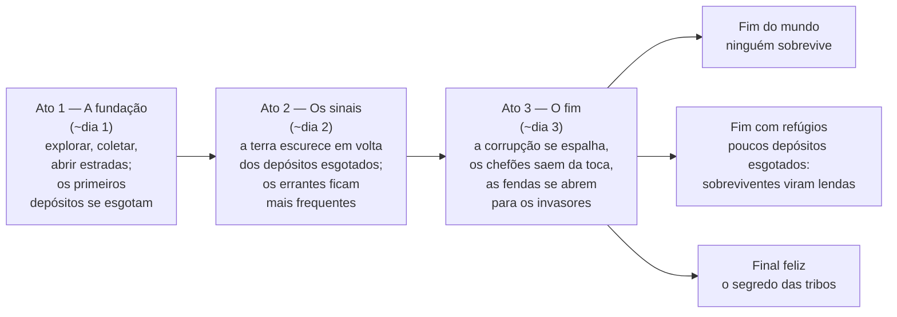
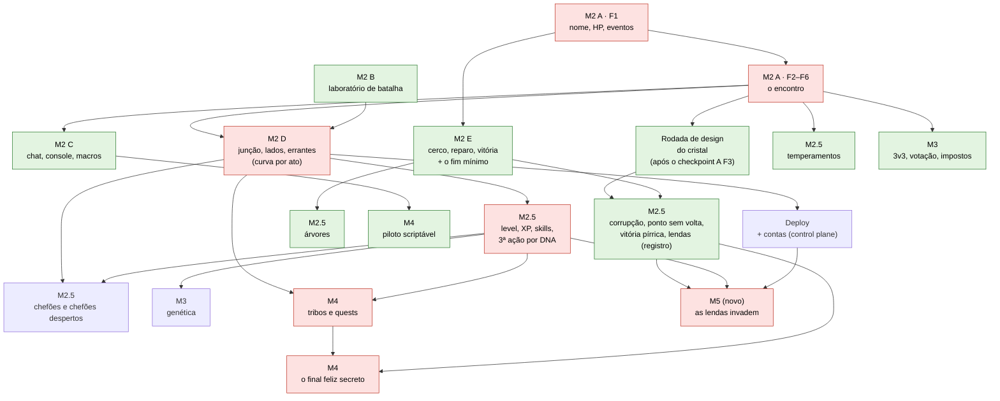

# Brainstorm: o fim do mundo (apocalipse, vitória, crônica e lendas)

> **Esboço de 2026-11-15.** Ideia do dono para dar um arco e um clímax à duração do mundo, com a análise e as
> recomendações do agente, e uma reanálise das dependências entre os marcos do M2 ao último documentado. Só está
> decidido o que aparece na §0. As ideias do dono vêm marcadas **[dono]**, e as sugestões do agente, **[agente]**.
> As decisões estão no GDD 01, 02, 03, 05 e 08 (em Decidido) e no [ROADMAP](../ROADMAP.md); o approach do agente
> continua como Proposta. O resto do documento é o registro da rodada e não é atualizado depois. Os números são
> exemplos para dar forma às ideias; nenhum foi medido.

## 0. Decidido nesta rodada (dono, 2026-11-15, rodada interativa)

As perguntas da §6, todas respondidas pela alternativa recomendada:

| Tema | Decisão | Onde |
|---|---|---|
| O fim do mundo | A duração termina num apocalipse que se desenvolve durante a partida, com crônica e final explosivo; vitória pírrica com humor; invasores com crônica (ideias do dono, aprovadas com o roadmap) | [01](../gdd/01-mundo.md) · [08](../gdd/08-cronica-chat-e-console.md) |
| Apocalipse | **Um só: a corrupção dos depósitos de cristal esgotados.** Errantes em ondas e chefões despertos são camadas por cima; variedade por seed só se o playtest pedir | [01](../gdd/01-mundo.md) · [03](../gdd/03-economia-e-logistica.md) · [05](../gdd/05-tribos-e-diplomacia.md) |
| Limpar a corrupção | **Não pode.** Só o final feliz das tribos a detém | [01](../gdd/01-mundo.md) · [03](../gdd/03-economia-e-logistica.md) |
| Fog | **A corrupção é vista de longe** (brilha), uma exceção ao fog para avisar o fim | [01](../gdd/01-mundo.md) |
| Final feliz | **Salva o mundo inteiro**, inclusive o inimigo (M4) | [05](../gdd/05-tribos-e-diplomacia.md) |
| Lendas | **Qualquer creep vivo no fim**, inclusive do time derrotado | [02](../gdd/02-creeps-e-dominio.md) |
| Relógio no M2 | **Empate** quando o relógio acaba sem Núcleo derrubado (fatia E), até o apocalipse do M2.5 | [01](../gdd/01-mundo.md) |
| Roadmap | **As mudanças da §5, todas:** as fatias do M2 como grafo (B já em paralelo, C em paralelo à D, E antes ou em paralelo à D); as rodadas de design do cristal e da E depois do checkpoint da A F3; o fim mínimo na E e a curva dos errantes por ato na D; o M2.5 "A jungle hostil e o fim do mundo"; o final feliz no M4; o M5 novo, "As lendas" | [ROADMAP](../ROADMAP.md) |

Ficaram como proposta do agente, sem resposta nesta rodada: os três atos, os focos com raio, os refúgios abaixo do
limiar, o epílogo acelerado, os nomes dos eventos, o caminho do final feliz por seed, um invasor por time com o
poder escalado, as lendas em camadas e o enredo das fendas.

## Em uma frase

Os 3 dias deixam de ser um relógio que só para e viram **o terceiro ato da partida**: a mineração do cristal
envenena a terra, os sinais aparecem na crônica, a jungle fica cada vez mais hostil e o mundo acaba. Só escapa quem
descobrir o segredo das tribos. Quem vence a guerra pode perder o mundo, e os poucos creeps que sobrevivem viram
**lendas** que um dia invadem outros mundos.

## 1. O problema: o relógio que só para [agente]

- **Hoje o fim não existe como regra.** O `world.durationSeconds` (259 200 s, 72 h, provisório) encerra a
  simulação: o servidor para de rodar ticks e o `geo sim` para de simular. O GDD 01 diz "Vitória: destruir a base
  inimiga. A definição será aprofundada", e **não há regra para quando ninguém destrói ninguém**.
- **O fim de partida tende a ser a parte mais chata.** Na passada de balanceamento 1 (balance.md §5), o estoque
  cresce sem uso nas últimas 20 a 30 h do mundo.
- **O cristal acaba cedo e sem propósito.** O cristal do mapa se esgota em ~9,7 h das 72 (GDD 03). O papel do
  cristal e o esgotamento ficaram para o M2, e a fatia A **mede** mas não decide.

A ideia do dono transforma esses três problemas numa coisa só: o esgotamento vira a semente do fim, e o fim dá ao
último dia uma razão para existir.

## 2. A ideia do dono [dono]

- O limite de tempo do mundo fica sem graça sem uma **crônica** por trás e sem um **final explosivo**.
- A crônica e o final se desenvolvem **durante a partida**. A duração máxima é alcançada por uma **série de eventos
  apocalípticos** que termina na destruição completa, por algum motivo. Exemplos:
  - a mineração dos cristais causou um **desequilíbrio bioquímico** que começa a **envenenar** quem está perto dos
    depósitos já esgotados, e o raio de destruição cresce até cobrir o mapa inteiro;
  - o mundo começa a ser aberto a **invasores**: jogadores com creeps específicos que **sobreviveram a uma partida
    anterior** e foram até o final. Ex.: entram 2 jogadores com creeps de level alto, cada um com o objetivo de
    destruir um dos times, de forma **equilibrada, mas apocalíptica**;
  - **invasões de monstros** e coisas do tipo.
- A condição para vencer a partida **sem morrer no apocalipse é um segredo**: só se chega a esse final "feliz"
  seguindo a **quest das tribos neutras** e coisas do tipo.
- **Vitória pelo Núcleo com uma pitada de humor:** "ok, você venceu a guerra, mas…". Dependendo de quantos
  depósitos de cristal se esgotaram, o apocalipse **já é inevitável**, e nenhum creep sobrevive para que os
  vencedores usem os creeps que venceram pelo Núcleo, por exemplo, numa invasão.
- **A invasão precisa de uma crônica** para fazer sentido.
- O objetivo é transformar o limite de 3 dias em algo **épico, que o jogador queira rever no replay e mostrar aos
  amigos**.

## 3. O arco da partida [agente]

A partida ganha três atos. As fronteiras entre eles são parâmetros em ‰ da duração do mundo (provisórios), e cada
virada é anunciada na crônica para todos os times.

**Referências que fazem isso bem:**

- **Majora's Mask:** três dias e a lua caindo. O relógio vira o personagem principal, e o jogador aprende o mundo
  pelos sinais do fim.
- **Outer Wilds:** o mundo acaba num ciclo fixo, e o final verdadeiro é um segredo que se descobre por conhecimento,
  não por poder.
- **Dwarf Fortress, modo Legends:** depois que o mundo acaba, a história dele fica para ser lida. É o que o
  geometrix já tem pela metade: o replay determinístico (M1 F8) e a crônica de eventos (ADR-0007).
- **A zona do battle royale:** o mapa que encolhe força o confronto no fim. Aqui o encolhimento tem causa: foi o
  próprio jogador que minerou.

## 4. Feature por feature [agente]

Cada item diz o que é, por que encaixa nos pilares, o approach recomendado, do que depende, o marco sugerido e os
riscos. A ordem é a recomendada para construir.

### 4.1 O fim mínimo: vitória, relógio e tela de fim

| | |
|---|---|
| **O que é** | A regra do fim de partida que falta hoje: o que acontece quando um Núcleo cai e quando o relógio acaba. Uma **tela de fim de mundo** com o resultado e o resumo da crônica, e o **replay com marcadores** dos eventos principais na linha do tempo. |
| **Por que** | Sem isso, nenhuma das outras ideias tem onde pousar. É barato: o replay já existe (M1 F8) e os eventos chegam na fatia A (ADR-0007). |
| **Approach** | Dois eventos novos do `sim`: `coreDestroyed` e `worldEnded`, este com o motivo (Núcleo, relógio). Público: todos os times. O `step` deixa de rodar depois do `worldEnded`, e o servidor marca o mundo como encerrado. Os marcadores do replay saem da lista de eventos, sem estado novo. |
| **Depende de** | Fatia A (HP e eventos), fatia E (HP do Núcleo e cerco). |
| **Marco** | **M2, fatia E** (cerco e reparo), que já tem a vitória pelo Núcleo no escopo. |
| **Riscos** | Decidir o que vale quando o relógio acaba antes de existir o apocalipse (empate? quem tem mais HP no Núcleo?). É uma regra provisória, que o M2.5 substitui. |

### 4.2 A corrupção dos depósitos esgotados

| | |
|---|---|
| **O que é** | O motor do apocalipse. Todo depósito de cristal que chega a zero vira um **foco de corrupção**. No ato 2, a terra em volta dele escurece; no ato 3, o raio cresce até cobrir o mapa. Na terra corrompida, os creeps e as construções perdem HP, e os depósitos de matéria ficam inúteis. |
| **Por que** | **Pilar 1:** a decisão é de macro (minerar mais agora × acelerar o fim). **Pilar 2:** o apocalipse é físico, está no mapa e tem causa. Resolve o papel do cristal (GDD 03) com uma **tragédia dos comuns**: os dois times ganham minerando, e os dois pagam pelo esgotamento. O mapa encolhe e força o confronto no último dia, que hoje é o mais chato. |
| **Approach** | **Focos com raio, não um autômato celular.** Cada foco guarda a célula e o tick em que nasceu, e o raio (Manhattan, como a visão) é uma função inteira do tempo e do ato. O estado fica pequeno (um item por depósito esgotado), o delta da rede é trivial, o custo do tick é O(focos), e a borda é previsível, o que é bom para avisar o jogador (pilar 4). Um autômato celular dá bordas mais orgânicas, mas custa estado, delta e CPU; fica como evolução, se o visual pedir. O dreno de HP é em ‰ do HP máximo por minuto, nos params. O A* passa a pesar as células corrompidas (o piloto e os bots desviam), e o estrategista dos bots ganha a noção de "refúgio". |
| **Ponto sem volta** | A ideia do dono: **o número de depósitos de cristal esgotados decide se o fim é inevitável.** Proposta: abaixo de um limiar (‰ dos depósitos de cristal, nos params), a corrupção do ato 3 para antes de cobrir tudo, e sobram **refúgios** onde se sobrevive ao fim. Acima do limiar, o fim é total, e só o final feliz salva. A crônica avisa as viradas ("a terra geme", em 25%, 50% e 75% do limiar) sem dar o número exato: o humor funciona melhor quando o aviso existe e foi ignorado. |
| **Depende de** | A (HP de creep), E (HP do Núcleo e das construções, o fim mínimo) e a **decisão do papel do cristal**. **Não depende do combate** (B, D). |
| **Marco** | **M2.5**, como a primeira fatia ("A jungle hostil e o fim do mundo"). |
| **Riscos** | Bots que mineram tudo em 10 h disparam o fim total em toda partida. O esgotamento precisa ser rebalanceado junto, com o `geo sweep`. O fog: a corrupção é vista de longe (brilha) ou só dentro da visão? (pergunta aberta). |

### 4.3 A jungle que acorda: errantes em ondas e chefões despertos

| | |
|---|---|
| **O que é** | A invasão de monstros. Os errantes já foram decididos com reaparecimento "cada vez mais frequente conforme a partida avança" (GDD 05): isso já é um proto-apocalipse. A proposta é atrelar essa curva aos atos e, no ato 3, tirar os chefões (M2.5) da toca: eles passam a andar em direção aos Núcleos. |
| **Por que** | Reaproveita sistemas que já vão existir, em vez de criar um sistema novo de "invasão de monstros". |
| **Approach** | A curva de aparecimento dos errantes é um parâmetro por ato. O chefão desperto ganha uma ordem nova ("marchar"), dada pelo `sim` na virada do ato 3, com um evento na crônica. |
| **Depende de** | D (os errantes e a facção neutra), M2.5 (os chefões). |
| **Marco** | A curva por ato entra **na fatia D** (é só a forma do parâmetro que já está decidido). Os chefões despertos, **no M2.5**. |

### 4.4 A vitória pírrica: "você venceu a guerra, mas…"

| | |
|---|---|
| **O que é** | A ideia do dono com humor. Derrubar o Núcleo inimigo vence a guerra, mas **não salva o mundo**. Se o ponto sem volta já passou, os vencedores assistem ao fim como todo mundo, e a crônica conta isso com ironia. |
| **Por que** | Torna o esgotamento uma decisão até para quem está ganhando. O time que vence pela força e minera sem freio sai sem nenhuma lenda; o que vence com cuidado leva os creeps para o próximo mundo (§4.7). Rende a história que se conta aos amigos. |
| **Approach** | **Epílogo acelerado:** a queda do Núcleo dispara a fase final mais cedo (params), para o fim chegar enquanto os jogadores ainda estão olhando, e não horas depois. O vencedor tem esse tempo para correr a um refúgio ou terminar o segredo das tribos (M4). A tela de fim mostra duas linhas separadas: **a guerra** (quem venceu) e **o mundo** (sobreviveu? quantas lendas saíram dele?). |
| **Exemplos de frase** (o agente escreve, o dono revisa o tom, como no D17 da fatia A) | "O Núcleo laranja caiu no dia 2. Parabéns, Azul. A corrupção, que não lê o placar, chegou à base azul seis horas depois." · "O Azul venceu a guerra. Sobreviventes para contar a história: nenhum." · "Lendas levadas deste mundo: 0. Talvez minerar um pouco menos da próxima vez?" |
| **Depende de** | 4.1 (o fim mínimo), 4.2 (a corrupção e o ponto sem volta). |
| **Marco** | **M2.5**, junto da corrupção. No M2 (fatia E), a vitória pelo Núcleo encerra o mundo direto, sem epílogo. |

### 4.5 A crônica do fim do mundo

| | |
|---|---|
| **O que é** | A narração do arco: as viradas de ato, os focos novos, o ponto sem volta se aproximando, a vitória e o epílogo. Uma voz de "narrador do mundo", diferente da voz dos creeps (que vem pelo DNA no M2 e pelo temperamento no M2.5). |
| **Approach** | Tudo cabe no ADR-0007 sem mudança: são eventos estruturados com o público "todos os times", e os modelos de frase ficam no cliente. A memória do time pode lembrar onde viu a corrupção. **Nenhum LLM** em tempo de execução (GDD 08). |
| **Depende de** | A (eventos e crônica). Os eventos novos nascem junto de cada feature que eles narram. |
| **Marco** | Acompanha cada feature (E, M2.5, M4, M5). |

### 4.6 O final feliz secreto

| | |
|---|---|
| **O que é** | A única saída do fim total: uma cadeia de quests das tribos que termina num ritual, numa escolta ou num artefato que **detém a corrupção**. |
| **O cuidado principal** | **Um segredo fixo morre no primeiro replay compartilhado.** O que pode ficar conhecido é *que* o final existe. **O caminho varia por seed** (qual tribo, qual artefato, onde) e se descobre sob o fog, conversando e cumprindo quests. Mostrar o replay aos amigos não estraga nada; dá vontade de tentar. |
| **Approach** | Uma quest nos verbos que o mundo já tem (carregar, explorar, construir, lutar, escoltar), como no brainstorm M2–M3 §3. Ex.: levar o artefato da tribo até o foco mais antigo, escoltado e cruzando um vau, enquanto o inimigo tenta tomá-lo (o pilar 2 de novo: o que salva o mundo também é físico e pode ser roubado). |
| **Pergunta para o dono** | O final feliz salva **só o time que o cumpriu** ou **o mundo inteiro**? Se salvar todos, nasce uma tensão boa: cooperar com o inimigo para não morrer, ou sabotar o ritual dele. |
| **Depende de** | As tribos (M4), a corrupção (M2.5). |
| **Marco** | **M4**, com as tribos. |

### 4.7 As lendas: os sobreviventes e as invasões entre mundos

| | |
|---|---|
| **O que é** | Os creeps vivos no fim do mundo viram **lendas**: guardam o nome, o DNA, o level, os stats e a **ficha** (os feitos, tirados da crônica do mundo de origem). Uma lenda pode **invadir** outro mundo que está no ato 3, pelas "fendas" que o fim abre. Ex. do dono: entram 2 jogadores com lendas, cada um com o objetivo de destruir um dos times, de forma equilibrada. |
| **Por que** | Dá peso ao que acontece no fim de cada partida: um mundo bem jogado rende lendas. A morte permanente (GDD 02) vale para elas também: invadir arrisca perder a lenda para sempre, e é isso que dá tensão à invasão. |
| **A crônica da invasão** (o dono pediu) | A invasão só faz sentido se o mundo invadido souber quem chegou e por quê. Proposta de enredo: **quando um mundo está morrendo, a fronteira com os outros afina**, e as fendas se abrem no ato 3. A invasão, então, é parte do apocalipse, não um modo à parte. A crônica apresenta o invasor pela ficha: "Pela fenda do vau leste chega **Brasa**, quadrado, sobrevivente do mundo *Vale Sete*, onde viu o fim de perto e derrubou sozinho três salteadores. Veio atrás do Laranja." O mundo de origem também ganha uma linha: a lenda leva a história adiante. Quando a lenda morre, a crônica dos dois mundos registra. |
| **Approach** | Em três camadas, das mais baratas às mais caras: **(1) Registrar as lendas** no fim do mundo, mesmo sem uso: só um evento `legendsRecorded` com a ficha. Planta o gancho cedo e faz a tela de fim contar "lendas levadas: N". **(2) A invasão por bots:** a lenda entra num mundo como um terceiro lado controlado pela IA, sem contas. Testa o equilíbrio. **(3) A invasão por jogadores:** contas e persistência entre mundos, e o casamento entre a lenda e o mundo no ato 3. É o território do control plane em Go ([gmcp](https://github.com/vitormartins1/go-multiplayer-control-plane)): contas, matchmaking e sessão. |
| **Equilíbrio** | **Um invasor por time, com o mesmo orçamento de poder**, para ninguém ser sorteado contra uma lenda mais forte. O poder da lenda **escala para o mundo invadido** (um teto pelo level médio dos times), para que uma partida antiga não vire *power creep* sem fim. |
| **Depende de** | Progressão (M2.5: level, stats), facção neutra / um terceiro lado (D), fim do mundo (M2.5), deploy (que espera o combate), contas entre mundos (control plane). |
| **Marco** | Camada 1 no **M2.5**, junto do epílogo. Camadas 2 e 3 num **marco novo depois do M4** (nome provisório: **M5 — As lendas**). |
| **Riscos** | Um invasor humano chegando no último dia de um mundo de dias pode ser frustrante para quem está lá. O aviso das fendas e o equilíbrio por time são a mitigação. A pergunta aberta "jogadores podem entrar num mundo em andamento?" (GDD 01) passa a ter uma resposta parcial: só como invasor, só no ato 3. |

### 4.8 Mostrar aos amigos

| | |
|---|---|
| **O que é** | O replay como produto: os marcadores dos momentos (4.1), a velocidade que acelera nos trechos parados e desacelera nos eventos, e a tela de fim compartilhável. |
| **Approach** | Tudo sai da lista de eventos, sem estado novo. O link público do replay depende do deploy. |
| **Marco** | Marcadores no **M2, fatia E**; o resto quando houver deploy. |

## 5. Reanálise das dependências do M2 ao M5 [agente]

### O grafo

As setas apontam de quem precisa vir antes para quem depende. Em vermelho, o **caminho crítico**: a sequência mais
longa, que define quando o jogo chega ao fim do roadmap. Em verde, o que pode andar em paralelo ao caminho crítico.

### O que a reanálise encontrou

1. **A F1 da fatia A é a raiz de quase tudo.** HP, eventos e nomes no estado alimentam o encontro, o cerco, a
   corrupção, a crônica e as lendas. Ela continua sendo a próxima execução, sem discussão.
2. **O laboratório de batalha (B) não depende de nada que esteja em andamento.** O dono já decidiu tocar o encontro
   e o laboratório em paralelo, mas a ordem escrita no ROADMAP (A → B → C → D → E) parece sequencial. **A spec do B
   pode começar já**, enquanto a A é implementada. B é o melhor candidato a subagente em paralelo: mora num pacote
   próprio e quase não encosta nos arquivos que a A mexe. O único ponto de atrito é o lugar dos stats base por DNA:
   se ficarem nos params do pacote de batalha até a junção, não há conflito com o `params.ts` do `sim`.
3. **O chat, o console e as macros (C) dependem só da A** (o painel da crônica na F5 e os eventos no protocolo na
   F4), **não da junção.** A seta C → D do brainstorm M2–M3 é fraca. C pode andar em paralelo com D, e mora quase
   todo no cliente, no protocolo e no servidor.
4. **O cerco e a vitória (E) dependem da A, e só dependem da D se o ataque a uma construção passar pela instância
   de batalha.** Essa é a pergunta que a rodada de design da E responde. **Recomendação: fazer a rodada de design da
   E cedo**, junto da do cristal, porque ela decide a própria dependência. Se o cerco for uma ação no mundo (como a
   flecha da torre na ideia de acampamento do GDD 01), a E pode vir **antes da D**, e o jogo ganha um objetivo e um
   fim mais cedo. Isso adianta a diversão, que é o critério do dono desde 2026-11-15.
5. **O apocalipse, na base, não depende do combate.** A corrupção precisa de HP (A), do HP das construções e do fim
   mínimo (E) e da decisão do papel do cristal. Ela não precisa da instância de batalha (B, D). Pode ser a primeira
   fatia do M2.5 e começar assim que a E fechar.
6. **O papel do cristal é um bloqueio escondido.** Ele trava a corrupção, os sumidouros, o escambo e,
   indiretamente, os impostos. Hoje está "para o M2" sem data. **Recomendação:** uma rodada de design do cristal
   logo depois do checkpoint da A F3 (que mede o cristal), já com a corrupção na mesa como candidata a papel. A
   restrição para não fechar a porta já vale no código: o depósito esgotado continua no estado, com `amount` 0. Basta
   não removê-lo.
7. **Temperamentos e árvores (M2.5) não dependem do combate.** Os temperamentos dependem do encontro (a postura
   padrão e a voz na crônica); as árvores, da visão do M1.5 e do HP de objetos (E). São faixas paralelas naturais
   dentro do M2.5, enquanto a progressão anda no caminho crítico.
8. **A facção neutra da fatia D é o eixo do resto.** Errantes, chefões, tribos e invasores são todos "um lado que
   não é um time". Hoje os times saem dos Núcleos do layout (dois). **Recomendação:** quando a D desenhar o lado
   neutro, o ADR dela lista esses quatro consumidores conhecidos como restrições, sem construir nenhum deles
   antes da hora ("primeiro o concreto"). Assim se evita reescrever o modelo de lados três vezes.
9. **A governança do M3 não depende do M2.5; a genética, sim.** Votação, autoridade e 3v3 dependem só do M2 (e do
   recurso × moeda para os impostos). Dá para tocar a governança em paralelo com o M2.5, mas **não recomendo dois
   marcos ao mesmo tempo**: cada marco termina com o dono respondendo a uma pergunta de design em playtest, e o
   gargalo real é a atenção do dono, não o código.
10. **O piloto scriptável (M4) depende só do console (C).** É independente de tribos e de combate. Se as macros do
    C mostrarem que os jogadores querem mais, ele pode antecipar.
11. **As lendas são a ponta mais longa.** Dependem da progressão, do fim do mundo, do deploy (que espera o combate)
    e das contas entre mundos (control plane). Só a camada 1 (registrar) é barata e cabe no M2.5.

### A ordem recomendada

**O caminho crítico (sequencial):** A F1 → A F2–F6 → D → progressão (M2.5) → tribos (M4) → final feliz (M4) →
lendas (M5).

**As faixas paralelas** (subagentes em *worktrees* próprias, quando fizer sentido):

| Quando | Faixa principal | Em paralelo | Por que é seguro |
|---|---|---|---|
| Agora | A F1 → F2 (`sim`) | **Spec do B** (dono) e depois a implementação do B num subagente | B mora num pacote próprio |
| Depois do checkpoint A F3 | A F4–F6 (rede, cliente, soak) | **Rodada de design do cristal e da E** (dono) | Design não mexe em código |
| Depois da A | **E** (se o cerco for no mundo) ou **D** (se o B estiver pronto) | **C** num subagente | C mora no cliente, no protocolo e no servidor |
| Depois da D e da E | Progressão (M2.5) | **Corrupção** e depois **temperamentos** | Ver o limite abaixo |
| M4 | Tribos → final feliz | Piloto scriptável | Depende só do C |

**O limite do paralelismo.** Duas faixas que mexem no `sim` ao mesmo tempo brigam pelos mesmos arquivos
(`params.ts`, `default.json`, `world.ts`, `step.ts`, o `SIM_VERSION` e os hashes travados). O custo é de merge e de
hashes refeitos. Na prática:

- **paralelo de verdade:** faixas em pacotes diferentes (B no pacote de batalha; C no cliente, no protocolo e no
  servidor) e rodadas de design do dono enquanto os agentes implementam;
- **paralelo com cuidado:** duas faixas no `sim` (ex.: corrupção e temperamentos). Uma rebaseia sobre a outra antes
  do merge e refaz os hashes; o `SIM_VERSION` sobe uma vez por merge;
- **nunca em paralelo:** os portões do dono (spec, plan e checkpoints). Um subagente não aprova a própria spec.

### O que mudaria no ROADMAP (proposta, sem aplicar)

- **M2:** a ordem das fatias vira um grafo, não uma fila: A; B em paralelo desde já; C em paralelo à D; E antes ou
  em paralelo à D, conforme a rodada de design dela. A E ganha o fim mínimo (§4.1) e a D, a curva dos errantes por
  ato (§4.3).
- **M2.5** vira **"A jungle hostil e o fim do mundo"**, com a corrupção como primeira fatia e uma pergunta de design
  que ele ainda não tem: *"O fim do mundo dá à partida um clímax que o jogador quer rever?"*
- **M4** ganha o final feliz secreto.
- **M5 — As lendas** (novo, depois do M4): as invasões entre mundos, o deploy com contas e a integração com o control
  plane.

⚠️ **Guarda de escopo:** o M2.5 cresce bastante. Ele já tinha chefões, progressão, temperamentos, a 3ª ação e as
árvores. Se ficar grande demais, a divisão natural é **M2.5a, o fim do mundo** (corrupção, epílogo, registro das
lendas: não depende do combate) e **M2.5b, a jungle hostil** (progressão, chefões, temperamentos, árvores).

## 6. Perguntas para o dono

Respondidas na rodada interativa de 2026-11-15 (§0).

1. **Final feliz:** salva só o time que o cumpriu, ou o mundo inteiro?
2. **Apocalipse:** um só (a corrupção) ou vários sorteados por seed (corrupção, maré de errantes, chefão
   desperto)? O agente recomenda começar com um.
3. **Ponto sem volta:** abaixo do limiar, sobram refúgios e há sobreviventes. Quem sobrevive vira lenda: só o time
   vencedor, ou qualquer creep vivo, inclusive do time derrotado ("perdeu a guerra, mas o círculo Fulano
   sobreviveu")?
4. **Relógio antes do apocalipse** (fatia E, no M2): quando o relógio acaba sem Núcleo derrubado, é empate ou vence
   quem tem mais HP no Núcleo?
5. **A corrupção pode ser limpa** pelos jogadores (gastando cristal, por exemplo)? O agente recomenda que não, para
   o segredo das tribos continuar valendo.
6. **Fog:** a corrupção é vista de longe (ela brilha) ou só dentro da visão do time?
7. **Roadmap:** aprova as mudanças da §5 (as fatias do M2 como grafo, a rodada de design do cristal e da E cedo,
   o M2.5 com o fim do mundo e o M5 novo)?
