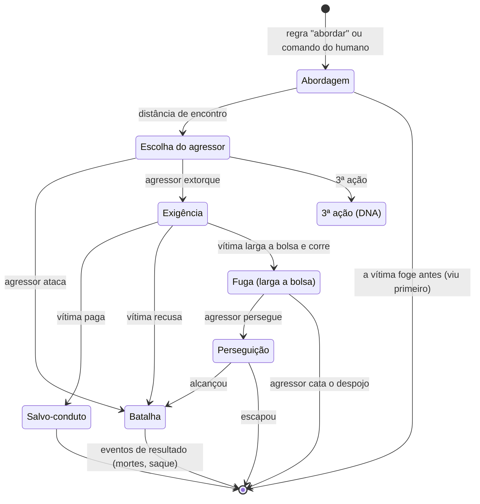
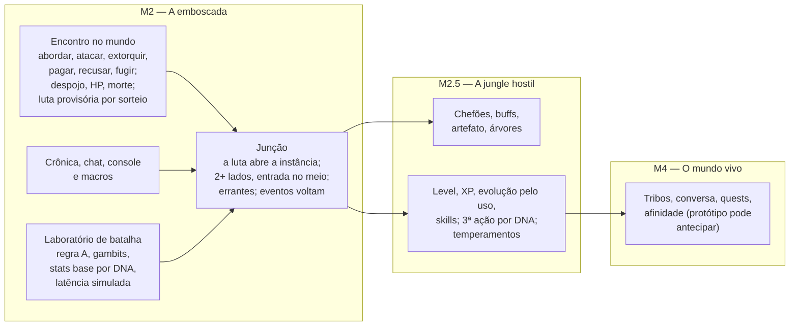

# Brainstorm M2–M3: encontros, jungle hostil, tribos e combate

> **Esboço de 2026-11-15.** Rodada de design e brainstorm, antes de qualquer spec. Só está decidido o que aparece
> como **Decidido (dono)**. As ideias do dono vêm marcadas **[dono]**, e as sugestões do agente, **[agente]**. As
> decisões do dono vão para o GDD pela skill `gdd-decision` e ficam resumidas na §0; o resto do documento é o
> registro da rodada (o que foi proposto e por quê) e não é atualizado depois. Os números são exemplos para dar
> forma às ideias; nenhum foi medido.

## 0. Decidido nesta rodada (dono, 2026-11-15)

- **O deploy e o playtest com pessoas que nunca viram o jogo deixam de bloquear o M2 e o M3.** O indicador de
  sucesso de diversão passa a ser **a aprovação do dono** nos playtests locais. O teste com olhos novos volta
  quando o dono achar o jogo divertido o suficiente.
- **O deploy espera o combate.** Ele traz um custo e uma pergunta que ainda não têm resposta: quanta latência é
  aceitável. Quem define isso é o combate, se é que ele vai precisar de latência baixa.
- **Diagnóstico da sessão solo do dono:** o jogo ainda não tem fator diversão. É o esperado: sem combate não há
  conflito, e os DNAs se equivalem de propósito.

### Respostas do dono às perguntas da §8 (rodada interativa, 2026-11-15)

Registradas no GDD e no [ROADMAP](../ROADMAP.md). Onde o item mora:

| Tema | Decisão | GDD |
|---|---|---|
| Ordem do M2 | Encontro no mundo e laboratório de batalha **em paralelo**, com a junção depois. Até a junção, a luta se resolve por um sorteio descartável | [06](../gdd/06-batalhas.md) |
| Encontro | Abordagem com diálogo; o Mount & Blade inspira só a conversa. No M2: atacar e extorquir; pagar, recusar e fugir. **Mínimo 1×1, com dois ou mais lados** (times, tribos, monstros) e entrada no meio da luta | [06](../gdd/06-batalhas.md) |
| Quem vence | Level, stats, skills e a micro de quem joga, não o DNA ou a carga sozinhos. **No M2, só stats base por DNA** | [02](../gdd/02-creeps-e-dominio.md) · [06](../gdd/06-batalhas.md) |
| Depois de pagar | **Salvo-conduto restrito**: imune só ao time que extorquiu, por um tempo ou até a própria rede de estradas; perde ao abordar alguém | [06](../gdd/06-batalhas.md) |
| Fuga | **Largar a bolsa e correr**, com o **despojo** no chão (que também guarda o saque que não coube e o artefato caído) | [03](../gdd/03-economia-e-logistica.md) · [06](../gdd/06-batalhas.md) |
| HP | Creeps, Núcleo, estradas prontas e obras em andamento têm HP no M2. **O HP persiste no mundo** e regenera devagar (mais rápido perto do Núcleo); construções só se recuperam com reparo pago | [01](../gdd/01-mundo.md) · [02](../gdd/02-creeps-e-dominio.md) |
| Errantes | **No M2** | [05](../gdd/05-tribos-e-diplomacia.md) |
| Crônica, chat e console | **Crônica + chat livre + linha de comando no chat** (estilo BYOND: verbos que viram os mesmos comandos, com rate limit) **+ macros de cliente**, no M2. Sem LLM. Scripts continuam no M4 | [08](../gdd/08-cronica-chat-e-console.md) |
| Marco novo | **M2.5** entre o M2 e o M3, com chefões, buffs, artefato, level, XP, evolução pelo uso, skills, **temperamentos**, **3ª ação por DNA** e **árvores destrutíveis** que bloqueiam a visão | [ROADMAP](../ROADMAP.md) |
| Chefões (M2.5) | Os chefões-buff ficam **no caminho do inimigo**; a casinha do chefão do rio é **ponto cego dele e esconderijo dele** ao mesmo tempo; quando dois lados ferem o chefão, leva **quem dá o último golpe** | [05](../gdd/05-tribos-e-diplomacia.md) |
| Tribos | **M4**, com uma tribo-protótipo antes só se os encontros do M2 provarem diversão | [05](../gdd/05-tribos-e-diplomacia.md) |

Ficaram como proposta, sem resposta nesta rodada: a extorsão limitada pela capacidade livre do agressor, a
iniciativa no encontro mútuo, as posturas do piloto, o texto fora do `sim` por modelos, o item do rio que só funciona
no Núcleo, a regra de nada de buff de dano puro, os detalhes da 3ª ação e dos temperamentos, e a evolução pelo uso.

## 1. Leitura geral [agente]

**O que falta hoje é conflito e história.** As ideias do dono atacam as duas: o encontro traz conflito com escolha,
e o diálogo narrado traz história. Mount & Blade, RimWorld e Dwarf Fortress vivem disso: o jogador lembra do bandido
que exigiu pedágio, não da fórmula de dano.

**O fato que mais pesa no desenho: o mundo é lento e os humanos ficam quase sempre fora.** Um creep anda de 2 a 5
células por minuto de mundo, a partida dura 3 dias, e o pilar 4 diz que o mundo não espera ninguém. A maioria dos
encontros vai acontecer **sem nenhum humano olhando**. Por isso o encontro é, antes de tudo, **uma regra do piloto
automático** (a postura do creep diante de um inimigo), e o diálogo é a narração do que a postura decidiu. O humano
que domina um creep é a exceção: ele escolhe na hora. Isso é uma qualidade, não um problema. Configurar posturas
("pago até 20% da carga; acima disso, luto; se eu for mais rápido, fujo") é exatamente o tipo de decisão que o pilar
4 promete, e enriquece o piloto automático, que hoje só coleta e explora.

**O combate é o maior risco de diversão e o item mais caro.** O encontro pode dar diversão mais barata e não
depende do combate estar pronto: com uma resolução provisória da luta, ele já cria tensão no mundo. Daí a
recomendação central deste documento: **separar o encontro (no mundo) do laboratório de combate (fora dele), tocar
os dois em paralelo e juntar depois** (§7).

**Dois riscos, ditos com franqueza:**

1. **Escopo.** As seis ideias juntas são o M2, o M3 e o M4 inteiros. A §7 separa o núcleo do M2 do que pode
   esperar.
2. **Diversão julgada só pelo criador.** Concordo em não bloquear o M2 com o teste de olhos novos: hoje não há o
   que testar. O viés, porém, é real. O criador sabe as regras e não sente a curva de aprendizado. Antes de abrir o
   jogo para qualquer pessoa, uma sessão com quem nunca viu o jogo continua valendo, e a legibilidade (a crônica, os
   painéis, as posturas) precisa ser julgada como se você não soubesse as regras.

## 2. Encontros entre times (ideia 1)

### O que o dono propôs [dono]

- O encontro de creeps de times adversários dispara um diálogo no estilo Mount & Blade.
- O agressor escolhe a primeira ação. A vítima pode reagir, se a ação não abrir batalha na hora.
- O texto do diálogo aparece para todos os jogadores e bots no chat da partida (que ainda não existe).
- Ações do agressor:
  - **iniciar batalha**, com uma frase marcante, construindo uma identidade editorial para os diálogos do
    geometrix ou de cada creep (pelo DNA, pelos stats e afins);
  - **extorquir** uma quantidade de recursos relativa ao DNA e aos stats do extorsionário. A vítima reage abrindo
    a batalha ou pagando; se pagar, fica um tempo protegida, para se afastar antes de outro ataque;
  - **uma terceira ação pelo DNA** de quem provocou o encontro. Fica em aberto.
- **Encontro mútuo** (os dois lados provocaram): favorecer quem está mais bem posicionado (ex.: fora do rio) e com
  menos carga (bolsa menor, reação mais rápida).

### Análise [agente]

**O gatilho é uma abordagem.** O agressor é o creep cuja regra do piloto (ou o humano que o domina) manda abordar
um inimigo à vista. O coletor não aborda ninguém. Isso pede uma condição nova no piloto ("inimigo à vista", filtrável
por DNA e carga) e uma ação nova ("abordar"). O encontro começa quando os dois ficam a uma distância curta (ex.: 1
célula). Antes disso, a vítima pode ter visto o agressor chegar e fugido: com o fog, quem enxerga mais longe (o
círculo) escolhe se aceita o encontro.

**Durante o encontro, os participantes param** por uma janela de resposta, em segundos de mundo (parâmetro). Quem
está dominado responde num painel; os outros respondem pela postura. Num playtest comprimido (×36), uma janela de 30 s
de mundo dura menos de 1 s real, então ali quase tudo será decidido pelas posturas. É coerente com o pilar 4.

**Fugir precisa existir** (já é proposta no [GDD 02](../gdd/02-creeps-e-dominio.md): com morte permanente, recuar
tem de ser possível, com custo). Proposta: **"largar a bolsa e correr"**. A vítima larga parte da carga, ou toda,
num **despojo** no chão e ganha velocidade (a carga já pesa no movimento: `movementPermille.loaded`). O agressor
escolhe entre catar o despojo ou perseguir a vítima. É um dilema bom, físico (pilar 2), e usa a ideia do dono de que
bolsa menor reage mais rápido.

**A extorsão é física.** O que a vítima paga sai da carga dela e entra na carga do agressor, limitado pela
**capacidade livre do agressor**. O DNA dá identidade sem número novo: um círculo (capacidade 10) extorque pouco; um
quadrado (30) extorque muito, mas é lento para alcançar alguém. Isso fala só de quanto cabe na bolsa, não de quem
venceria a luta. A fração exigida pode vir do temperamento (abaixo). Na referência, o Mount & Blade já faz isso:
bandidos aceitam suborno para não atacar, e alguns (os Sea Raiders) nunca aceitam.

**O Mount & Blade inspira só a conversa antes da luta** (dono, 2026-11-15): a abordagem, a exigência, pagar ou
recusar. O combate não segue o dele; continua aberto e experimental (§6). **Quem vence não sai do DNA nem da
carga:** um círculo sem carga não vence por isso um quadrado carregado. Decidem o level, os stats, as skills e a
micro de quem joga, humano ou bot. O DNA é arquétipo, não destino.

**Salvo-conduto no lugar de "invencível".** A invencibilidade abre um abuso: pagar 1 cristal para ficar imune e
atravessar o território inimigo. Proposta: o creep que pagou fica imune **só a novas abordagens do time que
extorquiu**, por N segundos de mundo ou até chegar à própria rede de estradas, e perde a proteção se abordar alguém.
O mesmo agressor também não pode extorquir o mesmo creep de novo por um tempo.

**Iniciativa no encontro mútuo.** Os critérios do dono viram uma pontuação determinística: terreno (no rio ou num vau
perde), carga relativa (carga ÷ capacidade; menor ganha). **O desempate final não pode ser pelo id do creep:** a F6 do
fog mostrou que o id quebra o espelho entre os times. O `state.rng` serve: é justo e não depende do lado do mapa. A
iniciativa decide só **quem escolhe primeiro** no encontro, nunca quem vence a luta.

**Lados, não grupos** (dono, 2026-11-15). O encontro é **no mínimo 1×1** (como no Desafiar do triângulo) e pode ter
**mais de dois lados**: times, tribos neutras e monstros. Também dá para **entrar numa batalha já começada**: um
monstro por perto entra na briga; ou um time chega numa luta que outro começou, para roubar o buff ou o item do
chefão, ou para defender a tribo atacada e ganhar a amizade dela. Daí saem três pontos [agente]:

- **Arquitetura:** o contrato do [ADR-0001](../adr/0001-mundo-e-batalha-separados.md) era "o snapshot entra uma
  vez, os eventos saem". Com quem chega depois, a instância precisa aceitar **lados e participantes novos durante a
  luta**, e o mundo continua a alimentá-la. É a pergunta da "bolha" e dos reforços do [GDD 06](../gdd/06-batalhas.md),
  agora com resposta de direção: os reforços entram, inclusive de terceiros.
- **Regra nova:** quem leva o buff ou o item quando dois lados feriram o chefão: quem deu o último golpe (a
  "roubada" do LoL e do Dota) ou quem causou mais dano? E que ajuda conta para a gratidão da tribo?
- **Diálogo:** só existe na abertura do encontro. Quem chega depois entra sem conversa, e a crônica registra a entrada.

**Quem vê o diálogo.** Com dois times, os dois participam de todo encontro, então mostrar a crônica para os dois não
vaza nada. Com mais de dois times (ou com tribos), mostrar para todos revela a posição e a carga de creeps sob o fog:
aí vale a regra que o dono já propôs para as tribos, só quem participou. Os bots não leem texto; leem o evento.

### Ideias para a terceira ação [agente]

A forma do creep já diz o papel (pilar 6). Uma ação por DNA, cada uma com um custo diferente do da batalha:

| DNA | Ação | O que faz | Por que combina |
|---|---|---|---|
| Quadrado (tank) | **Barrar** | "Daqui você não passa." A vítima volta e procura outro caminho, ou luta. Custa tempo, não riqueza. | O tank segura uma passagem. Os vaus já são gargalos ([GDD 01](../gdd/01-mundo.md)): um quadrado num vau vira um pedágio de tempo. |
| Círculo (glass cannon, batedor) | **Espreitar** | Passa sem lutar, mas lê a vítima: a carga, o destino e, por um tempo, a vítima fica visível para o time do círculo. | Informação como saque. Usa o fog do M1.5, e o círculo já é quem vê mais longe. |
| Triângulo (meio-termo) | **Desafiar** | Duelo 1×1, com uma aposta declarada (ex.: a carga dos dois). O resto do grupo assiste. | Limita a batalha a dois creeps: o tamanho ideal para o primeiro combate do M2. Dá um sabor de honra à identidade editorial. |

Outras que surgiram e não dependem do DNA:

- **Escambo entre times:** oferecer matéria por cristal, ou o contrário, com o inimigo. Os bots terminam a partida
  com ~68% do cristal parado no estoque (checkpoint da F6 do fog): há o que trocar. Responde a uma pergunta aberta do
  [GDD 03](../gdd/03-economia-e-logistica.md) ("Existe comércio entre times?").
- **Recrutar** (subornar o creep inimigo para mudar de lado): forte demais e difícil de equilibrar com morte
  permanente; deixo registrado só para descartar com consciência.

### Texto e identidade editorial [agente]

- **O texto não mora no `sim`.** O `sim` emite um evento estruturado (encontro, participantes, ação, valores, uma
  semente). O cliente transforma o evento em frase por modelos e uma gramática simples, escolhida pela semente. Assim
  o texto é determinístico (todos leem a mesma frase), muda sem trocar o `SIM_VERSION`, pode ser traduzido e o dono
  escreve sem mexer em código de simulação.
- **Temperamento ao nascer.** Um traço sorteado pelo `state.rng` entre poucos (ex.: ganancioso, bravo, cauteloso,
  falastrão). Ele serve duas vezes: dá a postura padrão (o ganancioso exige mais, o cauteloso paga ou foge) e dá a
  voz da frase. DNA e temperamento juntos dão a "personalidade" que o dono pediu, sem stats ainda.
- **O nome no estado deixa de ser opcional.** O [GDD 02](../gdd/02-creeps-e-dominio.md) já diz que ele precisa
  chegar no M2, porque a morte muda a ordem de nascimento que gera os nomes hoje. A crônica precisa de nomes estáveis.
- **Crônica ≠ chat.** A crônica é o registro dos eventos do jogo, narrado, por time, respeitando o fog. O chat livre
  entre humanos é outra coisa e, quando houver deploy, pede moderação. No M2 (dois times, o dono jogando sozinho) só
  a crônica é necessária.
- **LLM no texto?** É tentador para as "frases marcantes", mas não em tempo de execução: custo, latência, texto não
  determinístico e moderação. Um bom uso é na autoria: gerar e revisar o banco de modelos offline.

## 3. Tribos neutras, conversa e quests (ideia 2)

### O que o dono propôs [dono]

- O encontro com creeps neutros não é necessariamente hostil. O diálogo com a tribo só aparece no chat do time que
  interagiu.
- Ações: **iniciar batalha**; **conversar** (texto e uma história por trás de cada DNA de tribo).
- Depois de conversar, a tribo pode pedir ajuda numa tarefa (**quest**, que o dono quer bem autêntica) em troca de
  creeps ou material, **conforme o estoque da tribo** (toda riqueza é física). Ex.: 150 cristais por um creep único,
  diferente dos que o Núcleo produz; derrotar um chefão que ameaça a tribo e ganhar um artefato sagrado de magia
  xamânica (item com função especial, que cai no chão e pode ser pego por outro creep se quem o carrega morrer).
- Com a relação amigável, surge a troca de material; conforme as quests avançam, surgem outras ações, de acordo com
  o nível de relacionamento do creep que interage, o DNA, o level e os stats.

### Análise [agente]

**O estoque físico da tribo é a melhor ideia do bloco.** A recompensa existe no mapa. Se o inimigo saquear a aldeia,
a recompensa da sua quest some. Se os dois times cortejam a mesma tribo, ela vira disputa diplomática. Nada disso
precisa de regra nova: sai do pilar 2.

**Quest autêntica = um pedido feito nos verbos que o jogo já tem.** Nenhum tipo de quest deveria precisar de uma
mecânica que o mundo não tem. Isso as torna únicas deste jogo e baratas de implementar:

| Verbo do mundo | Quest | O que a torna boa |
|---|---|---|
| Carregar | Entregar 150 cristais na aldeia | A carga vira alvo de emboscada no caminho: o M2 dentro da quest. |
| Explorar | Achar o covil do chefão | Usa o fog e o batedor. |
| Construir | Abrir uma estrada da aldeia até o vau | A estrada é neutra: o inimigo também vai usar. Ajudar a tribo tem um custo estratégico. |
| Lutar | Derrotar o chefão; defender a aldeia dos errantes por X horas | Liga a tribo à jungle hostil (§4). |
| Escoltar | Levar o xamã até o outro lado do rio | Um creep alheio, frágil, que não pode morrer. |

**A recompensa também fala a língua do jogo.** Um "creep único" pode ser um **DNA de tribo**: uma forma nova
(pentágono, hexágono) com um papel que os três DNAs base não têm. A linguagem geométrica do pilar 6 cresce sem
quebrar.

**A relação em duas camadas.** O [GDD 05](../gdd/05-tribos-e-diplomacia.md) já decidiu que a tribo vira aliada ou
rival *do time*. A ideia do dono acrescenta a **afinidade do creep** que conversou e cumpriu as quests. Com morte
permanente, isso dá um motivo forte para o jogo: o seu diplomata vira um alvo valioso, e o inimigo ganha um motivo
para caçá-lo. Pergunta aberta: se o diplomata morre, a relação do time cai junto?

**Escopo: é o maior bloco das seis ideias.** Precisa de uma facção neutra no `sim`, aldeias no mapa, estoque da
tribo, uma máquina de quests, a afinidade, e conteúdo escrito por tribo. Recomendo deixar no M4, onde o ROADMAP já o
coloca, e antecipar **uma tribo-protótipo** (conversa + uma quest de entrega) só se os encontros do M2 provarem
diversão.

## 4. Jungle hostil: errantes e chefões (ideia 3)

### O que o dono propôs [dono]

- **Errantes:** creeps hostis por natureza que vagam rápido, mais frágeis e fracos, e reaparecem cada vez mais
  frequentemente conforme a partida avança.
- **Chefões que "moram" num ponto do mapa:** mais lentos e com respawn bem mais lento.
  - um **na ponta horizontal oposta a cada Núcleo**, intermediário: não dropa nada, mas **dá um buff ao time** que o
    derrotar (ex.: carga máxima maior, velocidade maior), que dura no máximo até o respawn, bem espaçado;
  - um **mais forte no meio do caminho entre os Núcleos, perto do rio**, com uma casinha de pedra que bloqueia a
    visão dele só na frente imediata; dropa um item raro.

### Análise [agente]

**Os errantes resolvem dois problemas que já medimos.** A pressão que cresce com o tempo é um **sumidouro natural**:
a passada de balanceamento 1 mostrou o estoque crescendo sem uso nas últimas 20–30 h do mundo
([balance.md](../specs/m1-ciclo-da-riqueza/balance.md) §5), e o fog mostrou 68% do cristal parado. E eles dão
**combate a quem joga sozinho**, que é o caso do dono hoje. O [GDD 05](../gdd/05-tribos-e-diplomacia.md) já decidiu
que a jungle tem monstros e que eles são fonte de XP.

**O buff logístico é a assinatura do geometrix.** No LoL e no Dota os acampamentos dão dano. Aqui, a ideia do dono dá
carga e velocidade: o chefão vale para a economia, não só para a luta (pilar 1). Isso responde ao não-objetivo "não
é um clone de LoL/Dota". Vale manter essa regra para os buffs: **nada de buff de dano puro**.

**O item raro do rio pode ser a própria emboscada do M2.** Proposta: o item só funciona depois de **entregue no
Núcleo**. Quem derrota o chefão precisa escoltá-lo pelo mapa, cruzando um vau, e o inimigo sabe disso. É a pergunta
do M2 ("uma emboscada numa carga em trânsito") com a carga mais valiosa do jogo.

**A casinha de pedra custa quase nada.** A linha de visão do fog já faz a pedra bloquear a visão. A casinha são
algumas células de pedra no gerador de mapa, perto do covil. Preciso confirmar a intenção (pergunta 7, §8).

**Posição, pela minha leitura.** O mapa é girado 180° entre os times (`mirrorCell`). Se o Núcleo do time 0 fica à
esquerda do lado de cima, o chefão-buff dele fica no extremo direito do lado de cima; o do time 1, no extremo
esquerdo do lado de baixo. O chefão do rio fica no centro, perto de um vau. A pergunta é de quem é cada chefão-buff:
se ele fica do lado de cada time, os dois tendem a pegar o próprio e o buff vira só um bônus de tempo. Se fica no
caminho do inimigo, vira disputa.

**Arquitetura.** Os monstros são a **primeira facção neutra no `sim`**. Hoje os times são índices em
`WorldState.teams`. A facção neutra que os monstros pedem é a mesma base que as tribos vão usar no M4. Começar pelos
monstros constrói a fundação com o conteúdo mais simples (IA de vagar e atacar, timers de respawn nos params).

**Ordem.** Os errantes podem entrar no M2 (alvo de combate sem segundo jogador, e sumidouro). Os chefões, os buffs e
o artefato, no marco seguinte (§7).

## 5. Recompensa, punição e progressão (ideia 4)

### O que o dono propôs [dono]

- Se ninguém fugir, o vencedor fica com todos os recursos dos perdedores que morreram na batalha.
- Criar o **level** e os **stats** individuais de cada creep, além das **skills** pelo DNA.

### Análise [agente]

**O saque é físico.** O vencedor recolhe a carga dos mortos até a sua capacidade livre; o que sobra fica num
**despojo** no chão, que qualquer creep pode catar. É uma entidade nova com três usos: o saque que não coube, a bolsa
largada na fuga (§2) e o artefato que cai quando o portador morre (§3). Uma entidade, três mecânicas.

**Level e stats já estão decididos como conceito** ([GDD 02](../gdd/02-creeps-e-dominio.md)), e o ROADMAP põe a
progressão no M3. Recomendo: **no M2, só stats base por DNA** (vida, dano, alcance, velocidade na batalha), nos
params. Level e XP no marco seguinte. O motivo: primeiro achar a diversão do combate, depois a da progressão. Uma
progressão viciante consegue esconder um combate ruim, e queremos ver o combate nu.

**Evolução pelo uso** [agente]. Nos jogos de ação do BYOND, o jogador subia os stats treinando (no Dragon Ball
Asylum: treino solo, sparring, meditação, salas de gravidade). No geometrix, isso caberia muito bem: **o creep
melhora no que faz**. O coletor fica mais resistente, o batedor enxerga mais longe, o lutador luta melhor, e tudo
isso acontece pelo piloto automático, enquanto você dorme. Cada creep vira único sem microgerenciamento (pilares 3 e
4), e a morte permanente passa a doer, o que dá valor a recuar. **Atenção:** se o uso aumentar a vazão econômica sem
teto, quebra a equivalência econômica dos DNAs (decidida); a evolução precisa de teto, ou ficar fora da economia.

**Skills.** O conceito inicial prevê 3 skills base + 1 ultimate. A lição do Swordcraft Story (§6) é que o kit vem da
arma. Aqui o kit vem do DNA, e um equipamento, mais tarde, varia o kit.

## 6. Combate (ideias 5 e 6)

### O que o dono propôs [dono]

- A mecânica de combate não está decidida. Experimentar variedades até achar as mais divertidas, com o combate
  **configurável**, para uma variante não bloquear a outra.
- Referências: os jogos de ação 2D top-down do BYOND (mundo aberto, combate em tempo real com skills criativas e
  mecânicas simples) e o Summon Night: Swordcraft Story (GBA: forja e movesets por arma).

### Análise [agente]

**Concordo com o combate configurável, com uma condição: o que fica fixo é o contrato.** O
[ADR-0001](../adr/0001-mundo-e-batalha-separados.md) já separa mundo e batalha: o snapshot dos participantes entra,
os eventos de resultado saem. Atrás desse contrato, a regra de combate pode ser trocada por parâmetro. O mundo não
precisa saber qual regra rodou.

**Laboratório de batalha.** Uma página do cliente que abre uma batalha local com participantes inventados (sem
mundo), contra a IA de gambits, com um seletor de regra e um seletor de **latência simulada** (ex.: 0, 80, 150 e 250 ms,
com jitter). Ele responde à pergunta que trava o deploy, **quanta latência é aceitável, localmente e por regra**,
sem gastar com servidor. E itera a diversão em minutos, sem esperar o mundo.

| Candidata | Como é | Latência | Custo e risco |
|---|---|---|---|
| **A. Grade** (BYOND) | Movimento célula a célula, golpe no adjacente, projéteis que andam pelas células, cooldowns e energia. Servidor autoritativo, sem predição. | Tolera mais (palpite: 100–150 ms; a medir no laboratório) | Barata. Reaproveita a grade, as formas e os inteiros do `sim`. Risco: rígida demais. |
| **B. Livre** (MOBA-lite) | Posições em frações de célula (inteiras), skillshots, esquiva. | Acima de ~80 ms pede predição no cliente (palpite) | Mais expressiva, mais cara: netcode e colisão. |
| **C. Forja** (Swordcraft) | Não é um modo, é uma camada: armas físicas forjadas com matéria e cristal; a forma da arma muda o moveset; a arma se desgasta e quebra. | Herda a de A ou B | Mais tarde. Ver abaixo. |
| **D. Tático** (só gambits) | O humano dá ordens; os creeps executam. | Qualquer uma | Vai contra o pilar 1 ("a batalha, na micro"). Mas é o auto-resolve: a mesma simulação, só com gambits. |

**Recomendação:** começar pela **A**, tentar a **B** como variante quando a A der sinal, deixar a **C** para depois e
ter a **IA de gambits desde o primeiro dia**: ela é o adversário do laboratório e o auto-resolve do mundo. Toda regra
nova precisa da sua IA, então poucas candidatas de cada vez.

**O que vale aproveitar do Swordcraft Story.** Três coisas, todas ligadas aos pilares:

- **vencer pelo desgaste da arma, não pela vida:** no Swordcraft, dá para vencer quebrando a arma do inimigo, e o
  material dela fica com você. Aqui, desarmar sem matar é uma saída para a morte permanente (o inimigo vive, mas
  perde a arma), e o material cai no chão (pilar 2);
- **a durabilidade é um sumidouro** de matéria e cristal, que o [GDD 03](../gdd/03-economia-e-logistica.md) procura;
- **a forja com material físico** dá ao cristal o papel que ele ainda não tem (pergunta aberta do GDD 03).

**Formato provável da batalha:** de 1×1 a poucos creeps, com dois ou mais lados (times, neutros, monstros) e entrada
no meio da luta (§2); curta (1 a 2 min); cada humano controla só o creep que domina (1 domínio por jogador), e o resto
vai pelos gambits. O creep dominado é o herói entre aliados controlados pela IA. Quem vence depende do level, dos
stats, das skills e da micro, não do DNA sozinho.

**Engenharia:** a simulação de batalha deve ser determinística e inteira como o `sim` (auto-resolve, replay, hash),
provavelmente num pacote próprio. Isso vira um ADR (`Proposed`) na spec do M2.

## 7. Proposta de fatiamento [agente]

Atualizada com as respostas do dono (§0).

O M2 continua grande, e cada frente tende a virar uma fatia com spec, plan e checkpoint próprios, como no M1.5. A
ordem das fatias se decide na spec (skill `spec-slice`).

## 8. Perguntas para o dono

Respondidas na rodada interativa de 2026-11-15 (§0). As que surgiram nas respostas e ficam abertas estão no GDD:

- **Encontro e batalha** ([06](../gdd/06-batalhas.md)): o raio do encontro e da "bolha"; a janela de resposta; a
  duração da batalha e como ela termina; quanto tempo do mundo passa durante a luta; o custo do reparo.
- **Crônica, chat e console** ([08](../gdd/08-cronica-chat-e-console.md)): os canais (time, global), a sintaxe dos
  verbos, o rate limit, onde as macros ficam guardadas, quem vê a crônica com três ou mais lados.

## Fontes

- [Summon Night: Swordcraft Story (Wikipedia)](https://en.wikipedia.org/wiki/Summon_Night:_Swordcraft_Story):
  tipos de arma, forja, durabilidade, vencer pelo desgaste da arma.
- [Summon Night: Swordcraft Story 2 (Wikipedia)](https://en.wikipedia.org/wiki/Summon_Night:_Swordcraft_Story_2)
- [Bribes (Mount & Blade Wiki)](https://mountandblade.fandom.com/wiki/Bribes): suborno de bandidos e desertores.
- [Mount & Blade (TV Tropes, YMMV)](https://www.tvtropes.org/pmwiki/pmwiki.php/YMMV/MountAndBlade): Sea Raiders não
  aceitam suborno.
- [Dragon Ball Asylum Wiki](https://dankgoduk.github.io/DBA-Wiki/): stats e treino num jogo de ação do BYOND.
