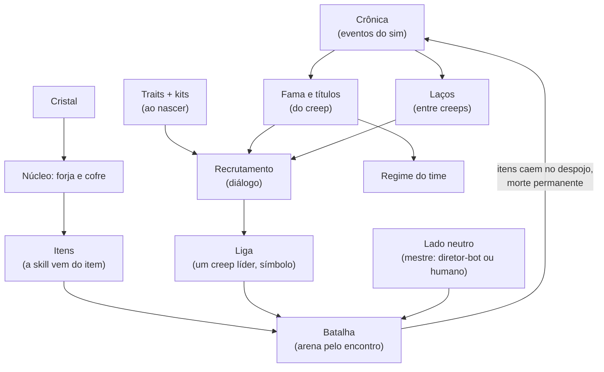
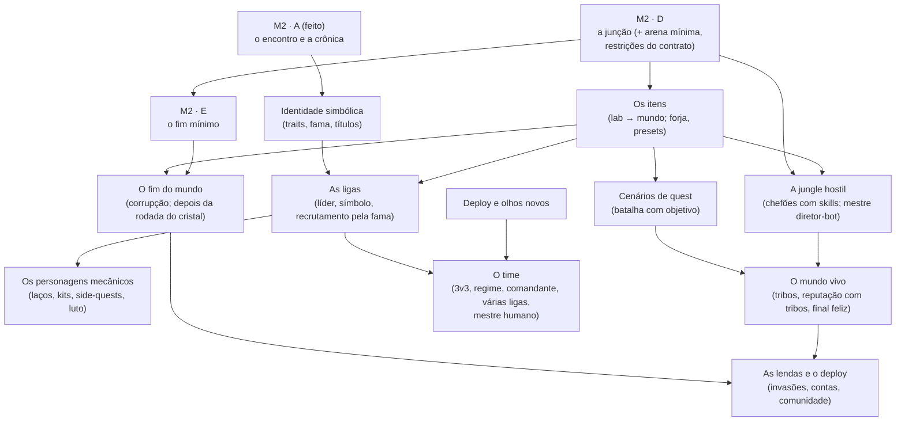
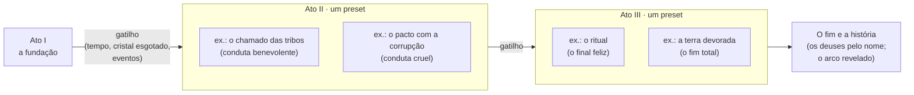
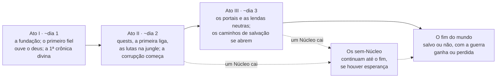
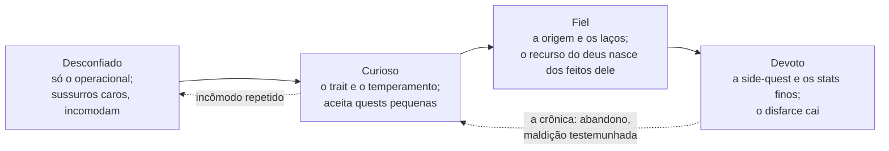
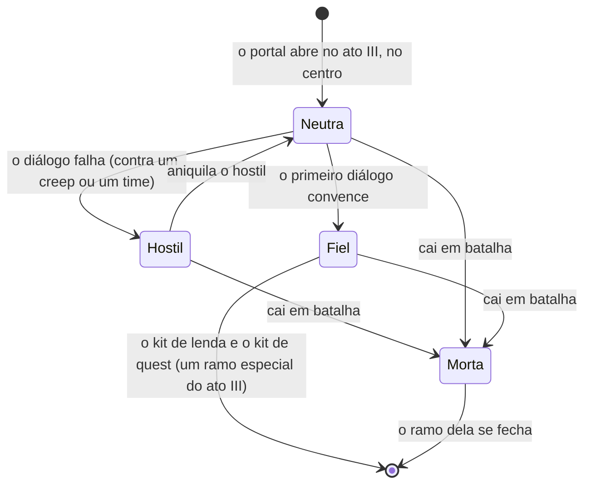

# Consolidado: as ideias e o planejamento depois do M2

> **Status:** consolidação do agente (2026-11-20), pedida pelo dono. **Rodada 1 respondida (§0); rodada 2 respondida
> (§10.1); a moldura da saga está em análise, sem decisão (§11); rodada 3 (o papel do jogador) respondida
> (§12.7); rodada 4 (a fidelidade, os únicos e as lendas) respondida (§13.7), com "seu time" e a saga em análise
> (§13.8).** O documento junta a
> [proposta do ROADMAP](2026-11-20-roadmap-depois-do-m2.md) e as quatro levas de ideias do dia, registra a 5ª leva
> e faz a análise fria pedida: expectativa × realidade, benefícios × trade-offs e uma recomendação por ideia. **As
> perguntas foram refeitas aqui** (§7), em quatro grupos, só com o que é decisão do dono. As perguntas numeradas das
> levas ficam como histórico.

| Leva | Arquivo | O quê |
|---|---|---|
| 1ª | [roadmap-depois-do-m2](2026-11-20-roadmap-depois-do-m2.md) | O formato do ROADMAP, a fatia C, o próximo marco; o comandante, os anúncios, o som, a IA que aprende |
| 2ª | [mestre-ligas-arena](2026-11-20-mestre-ligas-arena.md) | O mestre da mesa, as ligas, a arena pelo encontro |
| 3ª | [itens-reputacao-governanca](2026-11-20-itens-reputacao-governanca.md) | O teto da liga, a reputação e o Núcleo, a skill que vem do item, o regime do time |
| 4ª | [recrutamento-lacos-traits](2026-11-20-recrutamento-lacos-traits.md) | O recrutamento por diálogo, os laços, os traits com kits de crônica |
| 5ª | este arquivo, §2 | A liga por creep líder e o símbolo, os itens iguais para todos, os títulos, a instância de quest, o laboratório |
| 6ª | este arquivo, §8 | Os deuses (Black & White), o karma, a main quest line secreta, os tributos e a influência |
| 7ª | este arquivo, §11 | A moldura da saga: a torre, a convocação, os sussurros, o retornado |
| 8ª | este arquivo, §12 | O papel do jogador: os kits divinos por estilo, o ritmo dos três dias, os portais, salvar o mundo perdendo a guerra |
| 9ª | este arquivo, §13 | A ficha velada e a fidelidade, os únicos disfarçados, o ramo do retornado, a lenda do portal, comprar informação |

## 0. Respostas do dono (rodada interativa, 2026-11-20)

Quatro grupos, num formulário por grupo, com o contexto de cada um no chat antes. **O dono aceitou as recomendações
em 15 das 16 perguntas; na 13, escolheu o híbrido.** As decisões foram para o [ROADMAP](../ROADMAP.md) (reescrito no
formato de banco por tema) e para os GDD 02, 03, 04, 05, 06, 07 e 08.

| # | Pergunta | Resposta |
|---|---|---|
| 1 | O formato do ROADMAP | **O banco por tema:** o marco atual, o próximo e o banco sem número |
| 2 | A fatia C | **Sai do M2** para o tema "Comunicação e automação" |
| 3 | O próximo marco | **Os itens** (candidato, confirmado no checkpoint do M2), com a identidade simbólica em paralelo, se o dono quiser |
| 4 | A instância de quest | **Uma batalha com objetivo**, no mesmo pacote, com um modo de cenário no laboratório, depois dos itens |
| 5 | A arena na D | **O mínimo:** escolhida entre as três do laboratório pelo terreno; o snapshot leva o recorte |
| 6 | A direção vira posição | **Nos três casos:** começo, entrada no meio e fuga |
| 7 | O mandato do mestre | **Neutro, sem mexer no placar** |
| 8 | A cadeira do mestre | **Um diretor-bot sempre, com a cadeira aberta a um humano;** na D, o lado neutro aceita um controlador |
| 9 | O controle da liga | **Piloto de grupo:** o líder pelo humano, os seguidores na formação pelos gambits, até 3 ordens |
| 10 | O recrutamento | **Diálogo, quase sempre pela fama;** a side-quest para os traits raros |
| 11 | O símbolo da liga | **Só identidade, por ora;** o estandarte com os itens |
| 12 | Laços e luto | **Simbólicos primeiro;** o efeito mecânico quando o playtest pedir |
| 13 | A progressão | **Híbrido:** o DNA dá uma skill natural, os itens dão as outras, e o level do creep continua, com peso menor (revê o decidido do GDD 02) |
| 14 | O Núcleo | **A forja e o cofre** |
| 15 | Os títulos | **Conquistados e disputados** |
| 16 | O regime do time | **Direção registrada;** qual vem primeiro, quando houver times de humanos |

**Consequências que o agente registrou:**

- **O híbrido traz de volta o teto da liga pelo level do líder** (a ideia original do dono na 3ª leva).
- **A fatia D herda:** a arena mínima pelo encontro, a direção nos três casos, e as três restrições de contrato (o lado
  neutro com um controlador, a posição no mundo e o recorte no snapshot, o inventário e a pilha prontos para itens).
- **O resto da §3 ao §6 abaixo é a análise que levou às perguntas.** Onde ela recomenda "o poder no item", vale o
  híbrido.

## 1. O retrato [agente]

Somadas, as ideias descrevem um jogo maior que o MVP: o mundo de economia (RTS) e a batalha em grade (MOBA-lite), com
um **RPG de grupo** por cima (ligas, itens, personagens) e uma **camada social** (regime, mestre, diplomacia). Elas
se encaixam num desenho só:

**A tese que amarra tudo** (3ª leva): **o poder fica no item** (físico, perigoso, pode ser perdido), e **a identidade
fica no creep** (nome, trait, fama, títulos, laços). A crônica é a matéria-prima da identidade, e quase tudo nela é
uma leitura de eventos que o `sim` já emite.

## 2. A 5ª leva [dono e agente]

### 2.1 A liga é de um creep líder, não de um jogador; e tem símbolo

**[dono]** A liga não precisa ser uma por jogador: faz mais sentido ser uma por creep que virou líder ao ser dominado.
Se o jogador soltar o creep, ele continua atuando como líder pelos gambits. Cada liga tem um símbolo (bandeira,
tatuagem ou algo assim) que a diferencia e dá identidade visual, para identificar os membros de uma liga específica,
inclusive de inimigos e de tribos neutras. "Faz sentido?"

**[agente]** Faz, e resolve a pergunta 8 da 2ª leva (a liga sem humano) do jeito que eu recomendava. Consequências:

- **Um jogador pode ter várias ligas ao longo da partida:** domina um líder, recruta, solta, domina outro. O teto
  vem da economia (cada seguidor sai da coleta) e do teto de cada liga.
- **A liga sobrevive ao líder?** Proposta: o **símbolo é da liga, não do líder**. Se o líder morre, a liga fica sem
  líder, e os membros voltam às regras de antes. Quem dominar um membro pode assumir a liga e o símbolo. A crônica
  conta ("a Liga do Triângulo Partido tem um novo líder").
- **O símbolo na geometria (pilar 6):** uma marca pequena dentro da forma do creep (um ponto, uma barra, um anel, um
  ângulo), de um catálogo curto e bem distinto, para ser legível no zoom afastado. A cor continua sendo do time; o
  símbolo é da liga. O inimigo só reconhece a liga quando a vê (o fog vale), e o time inimigo passa a lembrar das
  ligas ("a liga do anel de novo").
- **O símbolo e o estandarte:** o símbolo pode ser só identidade, ou virar um **estandarte**, um item que o líder
  carrega, que cai e pode ser roubado (3ª leva, §1). A recomendação fria é começar pelo símbolo como identidade e
  deixar o estandarte para quando houver itens (§7, grupo 3).

### 2.2 Itens: o mesmo efeito para todos, com simbioses; presets e dicas

**[dono]** Cada item faz o mesmo efeito para todos, e alguns criam efeitos simbióticos com DNAs específicos. Presets
de itens e evoluções para os bots e na interface, para o jogador casual, de acordo com o creep dominado (como no Dota
2, que tem até presets da comunidade e ranking). Começar simples: oferecer os itens com uma nota de dicas para
escolher, do jeito mais amigável e menos denso possível.

**[agente]** Isso **decide a pergunta 16** (o item e o DNA) contra a minha recomendação, e com razão na análise fria:
um efeito por item e algumas simbioses é muito mais barato de balancear e de ensinar do que três efeitos por item.

- **A simbiose é a exceção que dá sabor:** ex.: um gancho puxa o inimigo para qualquer DNA, mas no quadrado ele
  ainda o atordoa. Poucas simbioses, cada uma com um porquê na forma.
- **O preset do bot é a dica do humano:** o bot precisa de presets de itens de qualquer jeito, para equipar os
  próprios creeps. A mesma fonte vira a sugestão da interface ("para um ● batedor: o gancho; ele foge melhor"). Uma
  fonte, dois usos, e o texto é uma linha.
- **Presets da comunidade e ranking** pedem contas e um servidor público: ficam com o deploy entre mundos (o control
  plane, tema "As lendas e o deploy").

### 2.3 Títulos

**[dono]** Completar quests, vencer batalhas e o desenvolvimento natural das crônicas individuais geram títulos. No
começo, só simbólicos, usados na crônica ("O Rei Batedor, Fulano"). Talvez dinâmicos; aberto a ideias melhores.

**[agente]** É a ideia de **melhor sabor por custo** da lista: regras sobre os feitos que a crônica já registra, e o
texto no cliente. Dois tipos:

- **Conquistados** (permanentes): por um feito único ("Matador do Chefão do Rio", "Sobrevivente do Vau").
- **Disputados** (dinâmicos): o melhor do mundo num feito agora ("O Rei Batedor" é quem mais explorou). Passam para
  quem superar, e a crônica conta a troca ("Fulano perdeu o título de Rei Batedor para Sicrano"). Cria rivalidade, e
  a perda de um título também é história.
- **O risco é a inflação:** se todo creep tem título, nenhum vale. Os disputados são um por feito no mundo; os
  conquistados pedem feitos raros. As lendas levam os títulos para o próximo mundo.

### 2.4 A instância de quest e o laboratório de cenários

**[dono]** Uma "instância de quest" criada a partir do mundo, como a de combate, mas voltada a cenários (kits) de
quest que se adaptam ao mundo gerado e às zonas e arenas. Com gameplay próprio, e um laboratório de experimentos
para os kits de quest.

**[agente]** A análise fria está na §3 (linha da instância de quest). Em resumo: **um motor novo de quest é o
item mais caro da lista** (a fatia B levou 8 fases só para a batalha). O caminho barato é que **o cenário seja uma
batalha com objetivo** em vez de aniquilação: escoltar alguém até a saída, segurar uma área por um tempo, recuperar
um item no meio da arena, sobreviver a ondas. É o mesmo pacote de batalha, com a arena pelo encontro (2ª leva) e um
**modo de cenário no laboratório que já existe**. Isso dá ao mestre (2ª leva) algo para lançar quando o mundo está
parado.

### 2.5 O laboratório e a análise fria

**[dono]** O laboratório vai ajudar muito no balanceamento e no playtest humano quando entrarem os itens e as skills,
mas as ideias precisam ser analisadas com calma e friamente.

**[agente]** Concordo, com um limite: **o laboratório responde "é divertido de jogar?" e "o bot quebra?", mas não
responde "o sistema social funciona?"**. Itens, skills, ligas contra o bot e cenários se testam lá. O regime, o mestre
humano, várias ligas por time e o comandante do time só se testam com várias pessoas.

## 3. Expectativa × realidade [agente]

| Ideia | O que se espera | O que custa de verdade | A favor | Contra | Recomendação |
|---|---|---|---|---|---|
| **Arena pelo encontro** | A batalha representa o lugar e a aproximação | O mínimo é barato (escolher entre as 3 arenas do laboratório pelo terreno; nascer pela direção). O gerador é médio. Ser fiel ao rio e à estrada pede regras novas | O pilar 1 chega à batalha: a aproximação no mundo decide a posição. Dá sentido ao nome do M2 | A arena gerada pode ser injusta no espelho e perde a familiaridade das 3 arenas conhecidas | **O mínimo na D**; o gerador no banco |
| **Mestre da mesa** | O mundo nunca fica parado; chefões nas mãos de um humano | O diretor-bot é a curva dos errantes crescida (barato). A cadeira humana pede uma pessoa a mais, uma visão "deus" no cliente, permissões, regras contra conluio, e só se testa com 3 pessoas ou mais | Pilar 4; uma ferramenta de playtest para o dono | O mestre decidindo o vencedor (*kingmaking*); um mestre humano entediado | **Restrição no ADR do lado neutro na D** (custo quase zero); o diretor-bot na jungle hostil; a cadeira humana quando houver olhos novos |
| **Ligas** | Batalhas maiores e mais humanas; escolta | Seguir em formação custa no tick do mundo; 10 × 10 × 10 passa dos limites de hoje (4 lados, 5 por lado) e tem custo de auto-resolve a medir; 30 creeps na tela pesam na leitura | Pilar 3 em escala; uso para o recurso que sobra; identidade pelo símbolo | **Com 10 seguidores pelos gambits, a micro do humano pesa menos na batalha** (pilar 1, "a batalha, na micro"); ataque básico em massa pode virar bagunça | Piloto de grupo com até 3 ordens; liga por creep líder (dono). **Melhor depois dos itens**, que dão o que fazer a cada membro |
| **Recrutamento por diálogo** | Cada recruta é uma história | Conteúdo (kits), checagem das side-quests por eventos, a tela de diálogo. **No 20º recruta, persuadir um por um vira tarefa** | Momento de jogo; usa a fama | Atrito para o casual; repetição | **Diálogo, mas a maioria aceita pela fama**; a side-quest fica para os traits raros |
| **Laços, buffs e luto** | Camaradagem que nasce sozinha | Estado por par (limitado), regras de buff a balancear, e o "por que meu creep fugiu?" (luto) a explicar | Pilar 3; a morte permanente dói | Mais uma camada de números invisíveis, que se soma a itens e traits | **Simbólico primeiro:** o laço na ficha e na crônica; o efeito mecânico só depois do playtest |
| **Traits com kits** | Personagens únicos por seed | **O gargalo é o conteúdo:** 6 a 8 traits ficam repetitivos num mundo com centenas de creeps; a combinação trait × origem × side-quest ajuda | Barato no `sim` (ids e parâmetros); só depende do encontro | Escrita contínua | **Cedo e pequeno**; a escrita cresce com um LLM offline |
| **Títulos** | "O Rei Batedor, Fulano" | Barato: regras sobre os feitos, o texto no cliente | Muito sabor por pouco custo; liga a crônica e as lendas | Inflação de títulos | **Cedo, simbólicos**, conquistados e disputados |
| **Fama** | Pesa na diplomacia, no recrutamento e no regime | Barata (leitura da crônica), mas o peso de cada feito pede balanceamento | É a base dos títulos e do recrutamento | **Bola de neve:** quem vence ganha fama, recruta mais e vence mais | Simples, que cai com derrotas e com o tempo |
| **Itens com skills** | Progressão perigosa e simples, à Dota; o cristal ganha papel | **O maior sistema da lista:** catálogo, cada skill é uma regra de combate nova que a IA de gambits precisa aprender a usar ("toda regra nova precisa da sua IA"), a forja, a interface de escolha. Revisa o decidido do GDD 02 | Um catálogo só para skill, item e progressão; pilar 2 (o poder se rouba); sumidouro; o papel do cristal | **Bola de neve:** quem vence pega os itens de quem perdeu. Pede durabilidade e despojo disputado | **Candidato a próximo marco**, primeiro no laboratório (como o combate), depois no mundo |
| **Presets e dicas** | O casual escolhe sem ler | O preset do bot já é necessário; mostrar uma linha de dica é barato. Comunidade e ranking pedem contas | Uma fonte para o bot e o humano | — | **Com os itens**; a comunidade, com o deploy |
| **Regime do time** | Governança interessante | **Só se testa com vários humanos por time**, e hoje o dono joga sozinho | Pilar 5; o time escolhe a burocracia | Decidir agora é decidir sem o playtest | **Registrar como direção** e escolher o primeiro regime quando houver times de humanos |
| **Instância de quest** | Quests com gameplay próprio, adaptadas ao mundo | Um motor e um laboratório novos, com IA para cada cenário, e conteúdo pesado. A fatia B levou 8 fases | Variedade; algo para os momentos parados (o mestre) | Divide o jogo em "masmorras", longe dos verbos do mundo | **O cenário é uma batalha com objetivo**, num modo do laboratório que já existe, depois dos itens |
| **Comandante do time, várias ligas por time** | Tática coletiva | Pede times de humanos | Pilar 5 | Não dá para testar sozinho | Com o tema "O time", depois do deploy |

**Três lições de conjunto:**

1. **O gargalo é conteúdo e playtest, não engenharia.** Itens, traits, kits, títulos e cenários são catálogos: cada
   um pede escrita e balanceamento. E as rodadas de design e os playtests são do dono, um de cada vez.
2. **Simbólico antes de mecânico.** O dono já propôs isso para os títulos. Vale para laços, traits e símbolos: primeiro
   na ficha e na crônica, que custam pouco e mostram se o jogador se importa; o efeito mecânico entra quando o playtest
   pedir.
3. **Quase tudo premia quem vence** (itens, fama, títulos, laços, recrutamento). A pergunta do M2 é "a batalha muda o
   rumo do mundo **sem dominar o jogo**?", e essas camadas puxam para o "dominar". Cada uma precisa da sua perda: a
   durabilidade, a morte permanente, a fama que cai, o título disputado.

## 4. O que só se testa com mais gente [agente]

| Dá para o dono testar sozinho (contra o bot, no laboratório) | Pede outros humanos |
|---|---|
| Arena pelo encontro, itens e skills, presets, uma liga contra o bot, traits, títulos, fama, laços na crônica, cenários de quest, o mestre como diretor-bot | O regime do time, o mestre humano, várias ligas por time, o comandante do time, os presets da comunidade |

É o critério mais forte para a ordem: **o que o dono pode testar sozinho vem antes**, porque o deploy e os olhos
novos esperam a junção e a diversão.

## 5. O planejamento revisto [agente]

**O formato** continua o da 1ª leva: o ROADMAP mostra os marcos concluídos, o atual e o próximo (com uma pergunta), e
o resto vira um banco de ideias por tema, sem número. A novidade é a ordem do banco como **grafo de dependências**,
para o dono escolher o próximo marco vendo o que cada tema destrava.

**O M2 fecha com a D e a E:**

- **D — A junção**, com três restrições baratas que as ideias pedem, sem construir nenhuma: o lado neutro aceita um
  controlador (o mestre); o snapshot leva a posição de cada creep no mundo e o recorte do terreno; o inventário e a
  pilha da arena não supõem que só existem matéria e cristal (os itens). E, se o dono quiser, a arena mínima (escolhida
  pelo terreno, nascimento pela direção).
- **E — Cerco, reparo e o fim mínimo**, como está.
- **A C** (chat, console, macros) vai para o banco, a não ser que o dono a queira no M2.

**O próximo marco** (recomendação): **Os itens**, com a pergunta "**Um item que se ganha e se perde dá motivo para
lutar e para voltar ao jogo?**". Ele entra pelo laboratório (os itens e as skills na batalha, contra o bot), depois no
mundo (a forja no Núcleo, o cristal, o despojo, os presets do bot como dica). Por quê:

- é o pré-requisito para balancear o combate (decidido: "não se balanceia combate cru antes de skills, nível e
  stats");
- dá ao cristal o papel que falta e um motivo para emboscar;
- muda o que um creep é, e as ligas (o estandarte, o que cada membro faz) se desenham melhor depois dele;
- o dono testa sozinho.

**Em paralelo e barato** (uma fatia pequena, se o dono quiser): **a identidade simbólica**, com traits na voz da
crônica, fama e títulos. Só depende do encontro, não mexe no combate e mostra cedo se o jogador se importa com os
personagens.

**As alternativas para o próximo marco:** as ligas (batalhas maiores logo depois da junção), ou o fim do mundo (o
clímax da partida, que depende da rodada do cristal e da E).

### Os temas do banco, consolidados

| Tema | O que entra | Pede humanos? |
|---|---|---|
| **Os itens** | A skill vem do item (o mesmo efeito para todos, algumas simbioses com DNAs), a forja e o cofre no Núcleo, o cristal como ingrediente, a durabilidade, os presets do bot como dica, o laboratório de itens, o golpe crítico como propriedade de item | Não |
| **Os personagens** | Traits com kits de crônica, fama, títulos (conquistados e disputados), laços, side-quests pessoais, luto e vingança, renomear | Não |
| **As ligas** | Liga por creep líder, que continua pelos gambits quando solto; símbolo; formação pelo DNA; até 3 ordens; recrutamento por diálogo; o teto que cresce; o estandarte (com os itens); 10 × 10 × 10 | Não (uma liga contra o bot) |
| **A batalha** | A arena gerada pelo recorte e o tamanho por faixa, a IA que aprende, regras novas (livre), acampamentos e torres | Não |
| **Cenários de quest** | A batalha com objetivo (escoltar, segurar, recuperar, sobreviver), o modo de cenário no laboratório | Não |
| **A jungle hostil** | Chefões, buffs e artefato, árvores, a curva dos errantes por ato, o mestre como diretor-bot | Não |
| **O fim do mundo** | Corrupção, ponto sem volta, vitória pírrica, crônica do fim, registro das lendas | Não |
| **O mundo vivo** | Tribos, diplomacia e reputação com as tribos, o final feliz, construção ampla | Não |
| **Comunicação e automação** | Chat, console, macros (a fatia C), piloto scriptável | Em parte (o chat) |
| **A apresentação** | Som, anúncios de abate e de fuga, a tela de fim e o replay além do mínimo | Não |
| **O time** | 3v3, impostos, regime (democracia ou meritocracia), o comandante do time, várias ligas por time, genética, o mestre humano | **Sim** |
| **As lendas e o deploy** | Invasões, contas, o control plane, presets da comunidade e ranking, deploy de testes, olhos novos | **Sim** |

## 6. O que o agente decide ou propõe sem perguntar [agente]

São propostas, a validar em playtest ou na spec de cada tema. O dono pode vetar qualquer uma:

- **Itens e DNA:** o mesmo efeito para todos, com poucas simbioses (decidido pelo dono na 5ª leva; fecha a pergunta 16).
- **A liga sem humano:** o líder solto continua pelos gambits (decidido pelo dono na 5ª leva; fecha a pergunta 8).
- **A liga sem líder:** se o líder morre, os membros voltam às próprias regras, e a liga e o símbolo ficam para quem
  assumir (fecha a pergunta 9).
- **O teto da liga** começa em 1 seguidor e cresce. A fonte (o level, a fama ou o estandarte) se decide com os itens
  (pergunta 12).
- **A reputação em duas camadas:** a fama do creep e a relação do time com cada tribo (pergunta 13).
- **A side-quest pelo piloto** quando o jogador sai (pilar 4; pergunta 19).
- **De onde vêm os laços,** quantos níveis e quantos cada creep guarda (perguntas 20 e 23): detalhes que o playtest
  ajusta.
- **O texto da crônica, dos traits e dos títulos fica no cliente;** o `sim` guarda ids e parâmetros.
- **Sem *streaming* de arena;** o gerador mora na camada da junção, não no pacote de batalha.
- **O símbolo da liga** é uma marca geométrica dentro da forma, num catálogo curto, e respeita o fog.

## 7. As perguntas para o dono

Dezesseis perguntas em quatro grupos, só com decisões de design ou de plano. Entre parênteses, as perguntas antigas
que cada uma substitui.

**Grupo 1: o plano**

1. O formato do ROADMAP: o marco atual, o próximo e o banco por tema (1)
2. A fatia C sai do M2 ou fica (2)
3. O próximo marco (3)
4. A instância de quest: um cenário de batalha com objetivo, ou um sistema próprio (5ª leva)

**Grupo 2: a D e o mestre**

5. Quanto da arena entra na D (11)
6. A direção no mundo vira posição na arena: no começo, na entrada e na fuga (10)
7. O mandato do mestre: neutro sem mexer no placar, pesar contra quem lidera, livre, ou antagonista (4 e 5)
8. A cadeira do mestre: um diretor-bot sempre, com a cadeira aberta a um humano, ou só humano (6)

**Grupo 3: as ligas e os personagens**

9. A liga como piloto de grupo, com até 3 ordens, ou o controle de RTS (7)
10. O recrutamento: diálogo com a maioria aceitando pela fama, side-quest para cada um, automático, ou clique (18)
11. O símbolo: só identidade, ou já um estandarte físico (5ª leva)
12. Laços e luto: simbólicos primeiro, já mecânicos, ou só crônica para sempre (21 e 22)

**Grupo 4: itens, Núcleo, títulos e regime**

13. A revisão da progressão: o poder no item e a identidade no creep, o híbrido, ou manter o decidido (15)
14. A utilidade nova do Núcleo (14)
15. Os títulos: conquistados e disputados, ou só um dos tipos (5ª leva)
16. O regime do time: registrar a direção e decidir quando houver times de humanos, ou já escolher o primeiro (17)

---

# Rodada 2: os deuses e o arco do mundo

> A 6ª leva (dono, 2026-11-20, depois da rodada 1) mexe no modelo de reputação, no mestre e no fim do mundo. **Onde
> esta parte conflitar com as §1 a §7, vale esta.** As decisões da rodada 1 (§0) continuam valendo; o que esta
> parte propõe mudar nelas está marcado e vai para as perguntas da §10.

## 8. A 6ª leva [dono e agente]

### 8.1 O pedido [dono]

Com o Black & White como referência (um RTS em que os jogadores são deuses que podem evoluir para o bem ou para o
mal):

1. **O jogador entra na crônica como um deus.** O nome dele fica gravado naquele mundo e gera uma história no fim da
   partida. **Jogadores malvados conseguem recursos com mais facilidade e rapidez desde o começo**, o que o mestre da
   mesa tem de equilibrar de forma justa e imparcial. Daí, um conceito de **karma** ou **honra**, que pode definir a
   progressão da *main quest line*.
2. **Uma main quest line secreta**, que só o mestre conhece e pode ajustar: as regras que disparam a passagem entre os
   atos (I → II → III) e **presets de main quest line**, escolhidos na criação do mundo ou durante o jogo, até o ato
   correspondente ficar ativo (como a passagem de era do Age of Empires, em que se escolhe um caminho). O mestre
   decide durante o jogo, conforme a crônica se desenvolve.
3. **Uma interface para observar a crônica de um creep**, com um resumo que deixe o mestre bater o olho no que pesa
   na decisão.
4. **Tributos pela influência:** jogadores, ou "deuses" de uma tribo, coletam tributos conforme a influência
   (conquistada por domínio, por conversões via diálogo etc.). A **influência** do jogador vem da crônica dos eventos
   dele (talvez substituindo ou complementando o karma) e pesa até no poder de domínio sobre os creeps.
   - **Pesam contra:** ficar inativo dominando um creep; fugir de uma batalha (sem ser a fuga automática por
     inatividade); coisas do tipo.
   - **Pesam a favor:** o domínio ativo; converter fiéis e gerar entradas na crônica do jogador no mundo.

### 8.2 A leitura fria [agente]

- **Encaixa no que o jogo já é.** Dominar um creep já é "possuir" um corpo, como um deus. O pilar 3 ganha um segundo
  herói: o creep é o herói da batalha, e o jogador é o deus da história. E **o `sim` já tem o jogador como entidade**
  (`Player { id, team, bot }`, em `domination.ts`): a influência e a conduta dele são uma leitura dos eventos pelo id
  do jogador, como a fama e os laços.
- **O pilar 4, bem resolvido pelo próprio dono:** o que pesa contra é a inatividade **dominando**, não a ausência.
  Quem sai do jogo e deixa o piloto não perde nada; quem segura um creep e não faz nada, sim.
- **O risco principal é o pilar 1:** "o mal ganha recursos mais rápido" vira a estratégia dominante se o bem não tiver
  um retorno do mesmo tamanho. No Black & White, os dois caminhos são viáveis porque cada um abre e fecha portas.
- **O segundo risco é a sopa de números:** fama, laços, influência, karma, relação com as tribos. Sem um modelo, o
  jogador não entende nenhum. A §8.3 junta tudo em três escalas.
- **O terceiro é a confiança no mestre:** um humano que ajusta regras secretas no meio da partida pode favorecer
  alguém sem ninguém ver.

### 8.3 O modelo recomendado: três escalas [agente]

Substitui a "reputação em duas camadas" da 3ª leva:

| Escala | O quê | De onde vem | Para que serve |
|---|---|---|---|
| **O creep** | **Fama** (e títulos, laços) | Os feitos dele na crônica | Recrutar (o líder famoso), títulos, a ficha, as lendas |
| **O jogador (o deus)** | **Influência** (quanto ele pesa) | O domínio ativo, as conversões, os feitos dos creeps que dominou; contra: inatividade dominando, abandonar aliados | Dominar creeps famosos, os tributos, o peso no regime do time |
| **O jogador (o deus)** | **Conduta** (o karma: do benevolente ao cruel) | O tipo das ações: extorquir, atacar quem pagou, matar quem fugia (cruel); poupar, cumprir quests, salvar (benevolente) | O caminho da main quest line, a relação com as tribos, a história no fim |
| **O time × cada tribo** | **Relação** (a diplomacia) | A conduta dos deuses do time e as ações diretas com a tribo | Comércio, quests, alianças, tributos |

- **Influência e conduta são eixos diferentes**, como no Black & White (a crença e o alinhamento): dá para ser um deus
  muito influente e cruel, ou pouco influente e benevolente. "Karma" e "influência" se complementam, não se
  substituem.
- **A influência é um peso, não uma moeda** (recomendação): não se gasta. Uma moeda divina pediria um sistema de
  milagres, que ninguém propôs.
- **Os tributos vão para o tesouro do time**, com o crédito da influência para o deus que converteu. Uma carteira do
  jogador seria um terceiro nível de economia, além do inventário do creep e do tesouro (GDD 03, decidido). E o
  tributo é físico: uma caravana da tribo traz, e ela pode ser emboscada (pilar 2).
- **A influência no domínio** (recomendação): dominar um creep famoso pede um deus com influência. Liga as duas
  escalas sem mexer no domínio comum (os parâmetros de custo, cooldown e distância já existem, em zero).
- **A fuga** (contraponto ao dono): recuar está **decidido** como possível, com custo (largar a bolsa), e a fuga é
  parte da emboscada. Se toda fuga tirar influência, o jogador para de recuar quando deveria. Recomendação: pesa
  contra só a fuga que **abandona aliados que ainda lutam** (a mesma ideia do laço "não foge enquanto o amigo luta").

### 8.4 Cruel × benevolente: o equilíbrio pelas regras [agente]

| Caminho | Ganha | Perde |
|---|---|---|
| **Cruel** | Recursos cedo e rápido: extorsão, saque, tributo pelo medo | As tribos ficam hostis; o ramo benevolente da main quest line se fecha (o final feliz); a crônica conta |
| **Benevolente** | O que dura: tribos aliadas, comércio, conversões, o ramo do final feliz | É mais lento no começo |

- **Quem equilibra são as regras e os números, medidos com os bots**, não o mestre por julgamento: um *sweep* com bots
  cruéis contra bots benevolentes, como o `geo battle sweep` mede os DNAs. É o "justo e imparcial" que o dono pediu,
  sem depender da opinião de ninguém.
- **O mestre não dá desvantagem a ninguém** (decidido: "neutro, sem mexer no placar"). O papel dele é **escolher o
  caminho do arco** que responde à conduta dos deuses: o mundo reage a eles.
- **A conduta nasce das ações**, como no Black & White: ninguém escolhe "sou mau" num menu.

### 8.5 O arco do mundo: a main quest line secreta [agente]

**A main quest line é o próprio arco do fim do mundo**, organizado como o dono descreveu:

(Os nomes dos presets são só ilustração do formato; o conteúdo é do dono.)

- **O que fica do que já foi decidido:** a corrupção continua sendo o apocalipse, e o final feliz das tribos continua
  sendo a única saída. Os presets são **ramos dentro do mesmo apocalipse**, o que respeita "um apocalipse só;
  variedade por seed só se o playtest pedir" (2026-11-15). Apocalipses diferentes seriam uma revisão do decidido
  (pergunta da §10).
- **O preset de cada ato** pode ser escolhido na criação do mundo ou durante o jogo, até o ato começar (a passagem de
  era do Age of Empires). Quem escolhe é o mestre: o humano, se houver, ou o diretor-bot, por regras (ex.: o ramo que
  responde à conduta dominante dos deuses).
- **O mestre ajusta os gatilhos dentro de limites** que o preset define, nunca livremente: cada ajuste é um
  **comando** (ADR-0002), registrado no log, e o replay continua determinístico.
- **O segredo e a confiança:** os jogadores descobrem o arco pela crônica ("a terra geme"), sem ver as regras. **No
  fim, a história revela o arco inteiro**, inclusive cada escolha do mestre. Isso dá confiança (quem quiser confere
  depois) e dá a melhor parte da tela de fim.
- **Para o dono, é uma ferramenta de playtest:** nos testes locais, ele mesmo pode sentar na cadeira do mestre e
  conduzir o arco.

### 8.6 A ficha e o painel do mestre [agente]

- **Uma ficha só, para o creep e para o deus:** no topo, um resumo de 3 a 5 números que pesam (fama, títulos, laços,
  HP e o item do creep; influência e conduta do deus); embaixo, a crônica dele, filtrada. Abre sob demanda, como hoje
  se escolhe um creep: nada a mais na tela do jogador casual.
- **O painel do mestre** junta o estado do arco (ato atual, presets disponíveis, gatilhos perto de disparar) com as
  fichas mais relevantes (os deuses, os creeps mais famosos, quem está perto de um título).
- **A ficha é barata e vem primeiro:** é uma leitura da crônica, sem regra nova. É a peça que torna visível tudo o que
  é "simbólico primeiro" (laços, títulos, fama, conduta).

### 8.7 Tributos e conversões [agente]

- **"Converter fiéis"** é uma ação de diálogo com os neutros, sobretudo as tribos (tema "O mundo vivo"). Uma tribo
  convertida vira tributária do time: manda uma parte do estoque dela, numa caravana física.
- **O deus que converteu ganha influência**, e a crônica registra. Os creeps do próprio time não precisam ser
  convertidos: eles já são do time.
- **Os errantes são hostis por natureza** (decidido), então não se convertem.

### 8.8 O que muda na reconciliação [agente]

| O quê | Antes (rodada 1) | Agora (proposta) |
|---|---|---|
| Reputação | Duas camadas: a fama do creep e a relação do time com as tribos | **Três escalas:** a fama do creep, a influência e a conduta do deus, a relação do time com as tribos (§8.3) |
| O tema "O fim do mundo" | Corrupção, ponto sem volta, vitória pírrica, crônica do fim, lendas | **"O arco do mundo":** a main quest line secreta, com atos, gatilhos e presets; a corrupção é o arco; o final feliz é o ramo benevolente; o mestre conduz |
| O mestre da mesa | No tema "A jungle hostil" | **No tema "O arco do mundo"**: conduz o arco e os neutros. O mandato decidido continua (neutro, sem mexer no placar) |
| Tema novo | — | **"Os deuses":** influência, conduta, a ficha do deus, os títulos de deus, o nome na história do mundo, a influência no domínio |
| O regime do time | Meritocracia pela fama dos creeps (descrição do dono, decidida como direção) | **Meritocracia pela influência dos deuses**: quem decide é o jogador, e a fama dos creeps que ele dominou entra na influência dele. **Revê o decidido:** pergunta da §10 |
| A fatia paralela ao próximo marco | Identidade simbólica: traits, fama, títulos | **"As fichas":** a identidade simbólica dos creeps **e dos deuses** (fama, títulos, influência e conduta na crônica, a ficha), sem nenhum efeito mecânico |
| O próximo marco | Os itens | **Continua Os itens.** Os deuses e o arco dependem do fim mínimo (E), da ficha e do mestre; o núcleo de diversão (lutar, ganhar e perder) ainda precisa ser provado antes, e o dono testa os itens sozinho |
| As fatias D e E | — | **Nada muda.** A tela de fim da E já tem o resumo da crônica; citar os deuses pelo nome fica para a spec da E decidir, se for barato |

### 8.9 Expectativa × realidade [agente]

| Ideia | O que se espera | O que custa de verdade | A favor | Contra | Recomendação |
|---|---|---|---|---|---|
| **O deus na crônica e a história no fim** | O jogador vira personagem do mundo | Barato: o `sim` já tem o jogador; o nome fica no servidor. Gravar entre mundos pede contas | A partida vira uma história contável | — | **Cedo, na fatia "As fichas"** |
| **Influência** | Ser ativo vale a pena | Uma leitura dos eventos por jogador; o peso de cada evento pede balanceamento | Premia a presença ativa sem punir a ausência (pilar 4) | Bola de neve, como a fama | Peso, não moeda; **simbólica primeiro** |
| **Conduta cruel × benevolente** | Dois caminhos de jogo | O equilíbrio é o difícil: precisa dos bots com as duas condutas e de um *sweep* | Rejogabilidade; o mundo reage | **Uma estratégia dominante** se o equilíbrio falhar | Portas que abrem e fecham; equilíbrio pelas regras, medido |
| **O arco secreto com presets** | Cada mundo conta uma história diferente | Conteúdo (cada preset é um ramo escrito e balanceado); os gatilhos como parâmetros e comandos | Variedade sem um apocalipse novo | Conteúdo; confiança no mestre | Começar com o arco padrão e **um ramo alternativo por ato**; o arco revelado no fim |
| **O painel do mestre** | O mestre decide bem e rápido | Uma tela nova, só para o mestre | Torna o mestre humano viável | Só se testa com um mestre humano (o dono serve) | Depois da ficha, junto do arco |
| **Tributos e conversões** | Uma economia de fé | Pede as tribos (tema "O mundo vivo") | Pilar 2 (a caravana do tributo) | Depende de um tema grande | Com as tribos |

## 9. O que o agente decide ou propõe sem perguntar (rodada 2) [agente]

- **O modelo de três escalas** (§8.3) como a estrutura da reputação.
- **Os ajustes do mestre são comandos com limites** e ficam no log; o arco é revelado no fim.
- **A ficha é uma só** para o creep e o deus, com o resumo no topo e a crônica embaixo.
- **Os errantes não se convertem;** os creeps do próprio time não precisam ser convertidos.
- **O tema "O fim do mundo" vira "O arco do mundo"**, o mestre vai para ele, e nasce o tema "Os deuses" (é
  organização do banco, não decisão de jogo).
- **O próximo marco continua Os itens**, com a fatia paralela "As fichas".

## 10. As perguntas da rodada 2

Onze perguntas em três grupos, numeradas depois das 16 da rodada 1. **Respondidas** (§10.1), com mais quatro do grupo
8 que surgiram no caminho.

**Grupo 5: o deus**

17. A influência é um peso (não se gasta) ou uma moeda (se gasta em domínio ou em poderes)?
18. A conduta nasce das ações, ou o jogador escolhe um caminho no começo?
19. Os tributos vão para o tesouro do time (com crédito ao deus) ou para uma carteira do jogador?
20. Os deuses são simbólicos primeiro (na ficha e na crônica), com os efeitos mecânicos depois?

**Grupo 6: conduta e equilíbrio**

21. O cruel ganha rápido e fecha portas (tribos, o final feliz), ou só ganha rápido?
22. Que fuga pesa contra a influência: toda fuga (menos a automática), ou só a que abandona aliados que ainda lutam?
23. A influência pesa no domínio: dominar creeps famosos pede influência, ela muda o custo e o cooldown, ou não pesa?

**Grupo 7: o arco e o mestre**

24. Os presets da main quest line: ramos dentro da corrupção, apocalipses diferentes, ou sem presets por ora?
25. O mestre conduz o arco: escolhe os presets e ajusta os gatilhos dentro de limites, com tudo revelado no fim; ou
    livre; ou só o diretor-bot?
26. Quem equilibra o cruel e o benevolente: as regras medidas com bots, ou o mestre por julgamento?
27. A meritocracia do regime: pela influência dos deuses, pela fama dos creeps, ou as duas?

### 10.1 Respostas do dono (rodada 2, 2026-11-20)

"Deus" é o nome provisório do papel do jogador: a moldura da saga (§11) pode renomeá-lo. As respostas valem para o
papel, seja qual for o nome.

| # | Pergunta | Resposta |
|---|---|---|
| 17 | Influência: peso ou moeda | **Os dois, separados:** a influência é um peso que abre portas, e existe **outro recurso, individual por jogador**, que se acumula e se gasta sem mexer na influência |
| 18 | A conduta | **Nasce das ações** |
| 19 | Os tributos | **No tesouro do time**, com o crédito da influência para o deus que converteu |
| 20 | Simbólico primeiro | **Sim:** influência e conduta primeiro na ficha, na crônica e na história do fim |
| 21 | O cruel | **Ganha rápido e fecha portas** (tribos hostis, o ramo do final feliz) |
| 22 | A fuga | **Só a que abandona aliados que ainda lutam** pesa contra a influência |
| 23 | Influência e domínio | **Dominar creeps famosos pede influência**; o domínio comum não muda |
| 24 | Os presets | **Ramos dentro da corrupção** (um apocalipse só) |
| 25 | O mestre e o arco | **Escolhe e ajusta com limites;** cada ajuste é um comando; o arco é revelado no fim |
| 26 | O equilíbrio | **Regras medidas com bots** (cruéis × benevolentes); o mestre não mexe no placar |
| 27 | A meritocracia | **Pela influência dos deuses** (revê a descrição da rodada 1: a fama dos creeps entra na influência de quem os dominou) |
| 28 | O recurso do deus | **Híbrido:** o recurso divino nasce dos feitos dos fiéis (as quests do deus para o creep, cumpridas) e pode ser **acelerado por oferendas e rituais**, que tomam o tempo dos creeps e têm risco |
| 29 | O gasto | **Os dois** (sussurros e poderes no mundo) e o **investimento em creeps qualificados**, com o retorno em influência quando eles evoluírem e espalharem a influência pela crônica. **O resultado de um sussurro depende da abordagem**, não só do trait |
| 30 | A saga como moldura | **Em aberto:** "isso é o que quero desenvolver antes de decidir" (§11) |
| 31 | O segredo | **Na instância:** o conteúdo pode estar no repositório; a surpresa vem de qual ramo, onde, quando e quem. **A história principal tem de ser entendida por quem joga às cegas** |

## 11. A 7ª leva: a moldura da saga (em análise, sem decisão)

> **O dono pediu para parar de decidir e analisar:** "não tem ideia melhor ou pior, é questão de pararmos um pouco de
> decidir e analisar as ideias e ver como cada uma se encaixa no contexto que construímos nessa conversa e o que
> temos documentado no repo". Esta seção só analisa. Nada nela está decidido.

### 11.1 O que o dono trouxe [dono]

- **Referências de manhwa, manhua e mangá:** isekai, deuses que sussurram ("esquizofrenia total, me identifico com
  esses, mas não sei como aplicar no jogo"), a torre dos deuses, portais e invasão de mundos. Muitas dessas histórias
  têm "uma receita de bolo que permite sagas infinitas"; o geometrix pode aproveitar a receita e adaptá-la ao mundo
  geométrico, com o terceiro ato apocalíptico e as lendas que se reúnem "durante um breve momento histórico daquele
  mundo. Será que é possível salvar o mundo?".
- **A quest do deus para o creep** pode substituir parte dos gambits e do piloto automático do bot. **A IA do
  deus-bot** tem de existir para os times sem jogador.
- **No começo, as interações divinas são um mistério para os creeps**, exceto para um **retornado** (*returnee*): ele
  evolui em segredo e muito mais rápido, nunca aceita ser dominado a não ser que você aceite a quest dele e pague o
  preço, às vezes age por conta própria mesmo dominado, e tenta sempre adiantar o fim do mundo com uma pequena **liga
  independente** de elite, discreta, que ele lidera. Creeps especiais como ele nascem da seed, de forma
  determinística, no começo ou durante a partida, e podem nascer neutros.
- **A moldura pode mudar o papel do jogador:** os deuses do Black & White poderiam virar jogadores *dokkaebis* (de
  *Omniscient Reader* e parecidos), ou o mestre seria o **administrador do andar da torre**. Isso pode definir, por
  exemplo, que **os jogadores começam sem time**: os "times" são grupos de creeps teletransportados do mundo de origem
  para a torre, cada um reage do seu jeito, e no começo a maioria está confusa e vulnerável.

### 11.2 Como as peças novas se encaixam no que existe [agente]

| Peça | No que se apoia | O que encaixa bem | Onde raspa no decidido |
|---|---|---|---|
| **A quest do deus para o creep** | O piloto declarativo (GDD 07), o ADR-0002 (tudo é comando), as quests nos verbos do mundo | Uma quest é uma ordem de alto nível com recompensa: o jogador diz **o quê** ("traga 20 cristais", "explore o norte"), e as regras do creep cuidam do **como**. Pode ser **mais casual** que editar gambits. O deus-bot é o estrategista de hoje, dando quests em vez de regras | Dois jeitos de comandar (regras e quests) confundem; precisam virar um só (ex.: a quest é uma regra temporária no topo da lista, com recompensa) |
| **O recurso híbrido** | A crônica (os feitos), a carga e o tempo dos creeps (pilar 2) | Os feitos dão o fluxo de base; oferendas e rituais aceleram, **com custo físico** (o creep para de trabalhar, pode ser emboscado) | A parte que nasce dos feitos não está no mapa: uma exceção estreita ao pilar 2, que precisa ficar escrita |
| **Investir em creeps qualificados** | A fama do creep → a influência do deus (§8.3) | É um **patrocínio**: o deus aposta num creep, e a morte permanente é o risco do investimento | A bola de neve (quem já tem mais investe mais) |
| **O sussurro depende da abordagem** | O diálogo do encontro, os traits | O resultado é trait × abordagem × **o que o creep sabe dos deuses** | — |
| **O mistério no começo** | Os atos do arco, a crônica | **Os creeps descobrindo os deuses é como o jogador às cegas descobre a história.** O que os creeps sabem cresce com os atos, e a crônica conta essa descoberta. Responde à exigência da pergunta 31 | — |
| **O retornado** | Os kits de crônica (um kit raro), o recrutamento ("side-quest para os traits raros", decidido), as ligas, o lado neutro, o arco, as lendas | Um coringa com história própria. **Pode ser uma lenda de um mundo anterior**, que já viu um fim: é o isekai e a regressão dentro das lendas que já existem. Como agente do fim, é a cara do ramo cruel do arco | (1) **"O creep dominado só muda de ordem por comando de quem o domina"** (M1, decidido): o rebelde que age sozinho revê isso. (2) **O espelho:** nascer num time dá a esse time uma elite; nascer neutro, ou um por time, mantém a justiça. (3) **Evoluir em segredo e exponencialmente** briga com a ficha legível e com números limitados |
| **A liga independente** | "Lados, não grupos" (decidido), o ADR do lado neutro | Um lado que não é time nem tribo: o 6º consumidor do lado neutro | — |
| **O deus-bot** | O estrategista dos bots, o diretor-bot do mestre | Toda mecânica de deus precisa do seu bot, como "toda regra nova precisa da sua IA" | O custo: cada sistema de deus pede o bot junto |

### 11.3 A moldura: quatro leituras [agente]

A pergunta que separa as leituras: **quem é o jogador, quem é o mestre, e por que os creeps estão ali?**

| Leitura | O jogador | O mestre | Os creeps e os times | O que muda no decidido |
|---|---|---|---|---|
| **A. Os deuses** (Black & White) | O deus do time, dentro da crônica | O mestre da mesa, que conduz o arco | Nascem no mundo; dois times fixos | Nada estrutural |
| **B. A torre** | Um deus que patrocina os creeps | **O administrador do andar**: o arco é o "cenário" daquele andar | **Convocados de outros mundos** (o isekai); o Núcleo é o portal, e produzir creeps é convocá-los | Pouco: produzir vira convocar (texto, não regra); as lendas sobem ou atravessam andares |
| **C. Os anfitriões** (tipo *dokkaebi*) | Um anfitrião que monta o espetáculo e é pago pela plateia | O dono da torre, acima dos anfitriões | Atores do espetáculo | O recurso do deus vira o pagamento pelo espetáculo; o papel do jogador fica mais de mestre que de líder de time |
| **D. Sem time no começo** (variação da B) | Escolhe quais creeps convocados patrocinar | O administrador | **Os times nascem do jogo:** grupos teletransportados e confusos | **Muito:** dois Núcleos e dois times fixos (M1), a economia do time, o regime, o espelho do mapa |

**A distinção que ajuda a analisar sem decidir: a pele e a estrutura.**

- **A pele** (quem os jogadores são na história, por que os creeps estão ali, os nomes) mora no texto: na crônica, no
  narrador, na ficha, nos sussurros, no cliente. **Ela pode mudar tarde e barato.** As leituras A, B e C são,
  sobretudo, peles sobre a mesma estrutura.
- **A estrutura** (dois times com Núcleos, a economia, o domínio, as batalhas) é o que o M1, o M1.5 e o M2 construíram.
  **Ela custa caro para mudar.** Só a leitura D mexe nela.
- **Então:** a estrutura atual segue (a D, a E, Os itens não dependem da moldura), e a pele se desenvolve com calma,
  numa rodada própria, até o tema "Os deuses" ou "O arco do mundo" precisar dela. A leitura D merece ser estudada como
  uma pergunta à parte: "os times podem nascer do jogo?".

### 11.4 Os primeiros minutos às cegas [agente]

Um jeito concreto de comparar as leituras é escrever o que um jogador que nunca leu o repositório vê e entende nos
primeiros minutos. Rascunhos, só para comparar:

- **A. Os deuses:** a crônica abre com "Um novo deus desperta sobre o Azul". Os creeps trabalham; quando o jogador
  domina um, a crônica diz "Fulano sente uma presença". A pergunta do mundo aparece no fim do ato I, pelo narrador.
- **B. A torre:** "O andar 7 se abre. Vinte formas caem do céu, sem lembrar de onde vieram." Os creeps começam
  confusos (a ficha diz "desorientado"); o Núcleo brilha como um portal; o primeiro sussurro do deus é ouvido como
  uma voz estranha. A administradora do andar anuncia o cenário: "Sobrevivam ao fim deste mundo. Ou salvem-no."
- **C. Os anfitriões:** "Bem-vindos à transmissão do andar 7." O jogador vê os creeps como atores, e a plateia reage
  aos feitos com pagamentos. É a leitura mais distante do jogo de hoje.
- **D. Sem time:** "Quarenta formas caem no andar 7, espalhadas." Os grupos se formam pelo jogo; o jogador escolhe
  quem patrocinar. O começo é o mais confuso de propósito, e o mais difícil de ensinar.

A **B** é a que encaixa mais peças com menos mudança: o isekai (a convocação), o mistério no começo (os creeps
desorientados), o retornado (quem já viveu um fim), as lendas (quem atravessa andares), o mestre (a administração do
andar) e a pergunta "é possível salvar o mundo?" (o cenário do andar). **Isso é uma observação, não uma
recomendação**: o dono pediu para analisar antes.

### 11.5 Um cuidado de identidade [agente]

As receitas (a torre, a convocação, o retornado, os patrocinadores, os anfitriões) são tropos de gênero, e cabem bem.
Os **termos de uma obra específica** (ex.: "dokkaebi", "constelações") como vocabulário do jogo fariam o geometrix
parecer uma adaptação. Proposta: usar as receitas com **nomes próprios, geométricos** (ex.: um "vértice" no lugar
de um deus, um "andar" ou um "plano"), que o glossário fixa quando a moldura for escolhida.

### 11.6 O que não muda, seja qual for a moldura [agente]

- A fatia D e a E, como estão; o próximo marco candidato, Os itens; a fatia paralela "As fichas" (a ficha e a crônica
  servem a qualquer leitura).
- As decisões das rodadas 1 e 2 (§0 e §10.1), com "deus" como nome provisório do papel do jogador.
- O segredo na instância, e a história legível às cegas.
- "Simbólico antes de mecânico."

### 11.7 Para seguir a análise [agente]

Quando o dono quiser retomar (sem prazo; nada do M2 depende disto):

1. **Uma página por leitura,** com o rascunho dos primeiros minutos (§11.4) mais completo e a lista do que cada uma
   revisaria no GDD.
2. **A pergunta estrutural à parte:** "os times podem nascer do jogo?" (a leitura D), com o custo no código e nos
   decididos.
3. **O retornado como um caso de teste:** escrever a ficha e a crônica de um retornado em cada leitura mostra rápido
   qual delas conta melhor a história.

# Rodada 3: o papel do jogador

## 12. A 8ª leva: os kits divinos, o ritmo dos três dias e o fim (análise; perguntas para a rodada 3)

> **Nada aqui está decidido.** O dono trouxe a leva dizendo "acho que precisamos definir o papel e identidade do
> jogador". A análise abaixo separa o que dá para decidir agora (o papel **mecânico**) do que continua em análise (a
> **pele**, §11), e termina nas perguntas da rodada 3 (§12.6), a rodar com o OK do dono.

### 12.1 O pedido [dono]

- **Definir o papel e a identidade do jogador**, que pode interpretar um deus do bem ou maligno.
- **Kits de evolução individual do jogador**, de acordo com o karma e com as decisões que afetam a crônica individual
  dele na história. Os kits são uma **especialização do jeito de jogar** do deus:
  1. "quero jogar ativamente": kits que favorecem esse estilo;
  2. "estou aprendendo": kits equilibrados, com menos micro;
  3. "quero jogar, mas só tenho 15 min por dia": kits de **automação e suporte passivo**. O jogador não participa
     das batalhas, mas continua contribuindo com o time offline, com um bom setup (ex.: coletores e construtores de
     estrada).
- **O ritmo de uma partida x1 de 3 dias reais:**
  - **fim do dia 1:** o jogador, intuitivamente, converteu **pelo menos 1 fiel** e gerou **pelo menos 1 crônica
    divina individual**;
  - **dia 2:** já progride com algumas quests, constrói uma liga ou faz parte de uma, e participa ativamente dos
    combates na jungle;
  - **dia 3:** **os portais aparecem e trazem lendas** (de início, bots neutros). Quem avançou as quests e a relação
    com alguma tribo, com o retornado, ou ativou algum ramo especial do ato III, tem a chance de **salvar o mundo,
    ganhando ou perdendo a guerra**. **Os creeps que sobrevivem ao cerco do Núcleo podem continuar jogando até o fim
    do mundo**, quando ainda existe esperança de salvação pela crônica do mundo, e viram lendas se sobreviverem até o
    final.
- **Um bug** (dono, testes no mundo desde antes da entrega da fatia A): o preset construtor de estrada não funciona
  como esperado. Ele pede uma ação, mas nada acontece ao clicar ou ao mexer o mouse pelo mapa (não aparece a prévia
  da estrada com o custo). O único jeito de construir estrada é dominar um creep e usar a ação de construir. Registrado
  no [dashboard](../dashboard/current-status.md) para revisão (§12.5).

### 12.2 A leitura fria [agente]

**O que a leva acerta:**

- **Os kits por estilo resolvem uma tensão que já existe.** O pilar 4 promete que o mundo não espera ninguém, e o
  [guia da partida](../GAMEPLAY.md) §5 já mostra dois jogadores (quem entra 15 min, quem fica horas) jogando o mesmo
  mundo. Hoje, a diferença entre eles é só quanto cada um mexe nas regras. Um kit dá ao jogador de 15 min uma
  **identidade e um jeito próprio de contribuir**, em vez de ser "o ativo, só que pior".
- **As metas por dia são critérios de design testáveis.** "Converter 1 fiel até o fim do dia 1" é o mesmo tipo de
  critério que a viabilidade da rede do M1.5 teve: um número que o harness mede. Dá para medir com **bots com
  perfil** (o ativo, o aprendiz, o de 15 min), como a rodada 2 decidiu medir o cruel × o benevolente (pergunta 26).
- **Continuar depois do cerco dá motivo para não desistir.** Hoje, o time que perde o Núcleo perde tudo. Se os
  creeps que sobram ainda podem salvar o mundo, quem está perdendo a guerra tem um objetivo até o fim, e a vitória
  pírrica (já decidida) ganha o seu espelho: **a derrota que salva o mundo**.
- **Os portais no ato III encaixam no que existe:** as lendas e a invasão por bots já estavam em camadas na proposta
  do GDD 02 ("registrar as lendas, a invasão por bots, depois a invasão por jogadores com contas"), e o lado neutro da
  fatia D já lista os invasores como consumidor. Os portais também servem à leitura B (a torre) do §11, sem depender
  dela.

**O que a leva mistura, e vale separar:**

- **Dois eixos no mesmo kit: o estilo e a conduta.** O estilo (quanto tempo, quanta micro) é uma **escolha** do
  jogador. A conduta (do benevolente ao cruel) **nasce das ações** (decidido, pergunta 18). Se o kit vier do karma, o
  jogador de 15 min não controla qual kit recebe, e o kit de automação pode não chegar a quem precisa dele. O agente
  recomenda: **o kit é escolhido pelo estilo, e a conduta dá o sabor e as portas** (cada poder tem uma versão
  benevolente e uma cruel, e o cruel fecha portas, como na pergunta 21). As crônicas individuais contam as duas coisas.
- **O "fiel" ainda não tem definição.** A rodada 2 fala em conversões **de tribos** (perguntas 19 e o GDD 05) e no
  recurso que nasce dos **feitos dos fiéis** (pergunta 28), mas não diz quem é um fiel. Com o mistério do §11 (os
  creeps não sabem dos deuses no começo), o primeiro fiel pode ser **o primeiro creep que ouve o deus**: o que aceita
  e cumpre a primeira quest. É o momento de ensino ideal para quem joga às cegas ("Taro ouve uma voz"). As tribos
  convertidas seriam a escala de cima.
- **"Por dia" ou "por ato".** As metas estão em dias reais, mas os playtests do dono rodam a ×6 ou a ×36, e o arco
  já tem atos com gatilhos. O agente recomenda escrever as metas **por ato, com a duração esperada de cerca de um dia a
  ×1**: assim valem em qualquer multiplicador, e o mestre ajusta os gatilhos. **Atenção:** hoje o cristal do mapa
  inteiro se esgota em ~10 h de 72 (GDD 03); se o esgotamento dispara o ato II, ele chegaria no meio do dia 1. A
  rodada do papel do cristal precisa desta meta.

**Onde raspa no decidido** (cada um pede o OK do dono para mudar):

| Ideia | O decidido | Onde está |
|---|---|---|
| Salvar o mundo pelo retornado ou por um ramo especial do ato III | "A corrupção não pode ser limpa. **Só o final feliz das tribos a detém**" | GDD 01 e 05 (2026-11-15) |
| O retornado como caminho de salvação | O retornado "tenta sempre adiantar o fim do mundo" (em análise, não decidido) | GDD 02, proposta (§11.2) |
| Os creeps sem Núcleo continuam até o fim do mundo | "**A vitória pelo Núcleo encerra o mundo**" (o fim mínimo da fatia E) | GDD 01 (2026-11-15) |
| Os portais trazem lendas no dia 3 | As lendas invasoras estavam no tema "As lendas", com contas entre mundos | ROADMAP, GDD 02 |

O agente recomenda **não mexer na fatia E**: o Núcleo encerra o mundo no M2, como decidido, porque sem o arco não há
fim do mundo para esperar. A continuação depois do cerco entra com o tema "O arco do mundo", que é quando passa a
existir uma esperança de salvação.

### 12.3 Os kits: um esboço [agente]

Só para dar forma à discussão. Os nomes, os poderes e os números são ilustrativos.

| Kit | Para quem | O que favorece | Com a conduta benevolente | Com a conduta cruel |
|---|---|---|---|---|
| **O campeão** (ativo) | Quem domina creeps e entra nas lutas | Dominar os famosos com menos influência, sussurros de batalha, títulos disputados, a liga maior | Inspira: os aliados perto do dominado lutam melhor | Aterroriza: os inimigos fogem mais cedo, e as tribos desconfiam |
| **O aprendiz** (equilibrado) | Quem está começando | Presets claros, poderes simples e baratos, dicas da crônica, quests curtas | — | — |
| **O guardião** (15 min por dia) | Quem entra pouco | Quests longas (de horas), bênçãos passivas para coletores e construtores, rituais que correm offline, o resumo "enquanto você esteve fora" ao entrar | A bênção da colheita: os coletores rendem um pouco mais | O chicote: rende mais, e os creeps e as tribos ressentem |

Propostas do agente que o dono pode vetar sem pergunta:

- **O aprendiz é o kit padrão**, e o jogo sugere trocar quando o jogador mostra um padrão (domina muito → o campeão;
  entra pouco → o guardião). A troca é livre na virada de cada ato.
- **O kit é da partida**, não da conta. A evolução entre partidas fica com as lendas e as contas (tema "As lendas e o
  deploy").
- **O equilíbrio entre os kits se mede com bots de perfil:** um time com um guardião não pode perder por isso, nem
  ganhar sem jogar. O pilar 1 ajuda: a guerra se ganha na macro, e o guardião é macro.
- **O kit do guardião depende de presets que funcionam.** O bug do construtor de estrada (§12.5) bloqueia justamente
  esse estilo, e por isso sobe de prioridade.

### 12.4 O ritmo dos três dias [agente]

| Meta (do dono) | Como medir | O que falta para existir |
|---|---|---|
| Fim do ato I: ≥ 1 fiel e ≥ 1 crônica divina | Bots de perfil no harness; no playtest do dono, a ×6 | O fiel definido (§12.2), as quests do deus, a crônica do deus (a fatia "As fichas") |
| Ato II: quests, uma liga, lutas na jungle | A fração dos jogadores-bot com uma liga e com lutas, por perfil | Os itens, as ligas, a junção (fatia D) |
| Ato III: portais; salvar o mundo ganhando ou perdendo | Quantas partidas de bots terminam salvas, por perfil e por conduta | O arco do mundo, os ramos, as tribos ou o retornado |

### 12.5 O bug do construtor de estrada [agente]

Leitura do código, sem reproduzir (o conserto fica para uma sessão de implementação, como manda o fluxo):

- **O lado do `sim` funciona:** os bots constroem estradas com o mesmo preset (`roadBuilderRules`, usado pelo
  estrategista), e há testes dele.
- **O fluxo do cliente:** o botão "Construtor de estrada…" põe o mapa no modo de escolher uma célula
  (`rules-editor.tsx`); o clique esquerdo chama `select()`, que entrega a célula ao preset e manda o `applyPreset`
  (`interaction.ts`).
- **Hipóteses a conferir numa repro:**
  1. **Sem prévia no modo de escolher:** a prévia da estrada com o custo só existe no modo estrada, o do creep
     dominado (`road-preview-layer.tsx`). No modo do preset, mexer o mouse não mostra nada, e o clique não dá retorno
     visível. Isso explica "nada acontece ao mexer o mouse".
  2. **O alvo é aceito sem conferir se dá estrada:** o comando aceita qualquer célula do mapa, mas o piloto só
     constrói se a célula aceita estrada, se há caminho conhecido e se o estoque paga (`buildRoadFor`, em
     `autopilot.ts`). Senão, o creep cai na regra seguinte (coletar matéria) **em silêncio**, e parece que o preset
     não fez nada.
  3. **O creep dominado não roda regras:** se o preset foi aplicado a um creep dominado, ele só começa a construir
     depois de liberado.
- **O conserto provável é de interface:** a prévia e o custo no modo do preset; recusar (ou avisar) um alvo onde não
  dá estrada; um aviso quando o creep está dominado.

### 12.6 As perguntas da rodada 3

Só o que é decisão do dono, em três grupos:

| # | Grupo | Pergunta | Recomendação do agente | Alternativas |
|---|---|---|---|---|
| 32 | O papel | **O eixo do kit:** estilo, conduta, ou os dois? | **O estilo escolhe o kit; a conduta dá o sabor e as portas** | O kit vem do karma; uma árvore só, com ramos por estilo e por conduta |
| 33 | O papel | **O que é um fiel?** | **Um creep (do time ou neutro) que reconhece o deus:** o primeiro nasce da primeira quest cumprida; a tribo convertida é a escala de cima | Só creeps neutros convertidos; só tribos |
| 34 | O papel | **Definir agora o papel mecânico e deixar a pele para depois?** | **Sim:** kits, fiéis, influência e conduta, com "deus" como nome provisório; a moldura (§11) continua em análise | Fechar a moldura antes de definir o papel |
| 35 | O ritmo | **As metas dos três dias** | **Viram metas de design por ato** (cerca de um dia cada a ×1), medidas com bots de perfil | Metas em dias reais; metas só para o playtest do dono |
| 36 | O ritmo | **Os portais do ato III** | **Lendas geradas pela seed, como neutros**, até existirem lendas de mundos anteriores | Esperar as lendas reais (com contas) |
| 37 | O fim | **Os caminhos de salvação** | **As tribos, o retornado e os ramos especiais do ato III**, todos como ramos do arco; "não se limpa a corrupção gastando recurso" e "salva o mundo inteiro" continuam (revê "só as tribos") | Só as tribos, como decidido |
| 38 | O fim | **Os sem-Núcleo continuam até o fim do mundo** | **Sim, com o tema "O arco do mundo";** na fatia E, o Núcleo continua encerrando o mundo, como decidido | Já na fatia E; nunca |

### 12.7 Respostas do dono (rodada 3, 2026-11-20)

Três formulários, um por grupo, com o contexto no chat antes. **O dono aceitou as recomendações em 6 das 7; na 32,
refinou o karma.**

| # | Pergunta | Resposta |
|---|---|---|
| 32 | O eixo do kit | **O estilo escolhe o kit**, e o karma não é binário: **uma escala finita de −1 a +1**, em que o sinal diz a afinidade (cruel ou benevolente) e **perto de zero** (ex.: entre −0,25 e +0,25) é a **neutralidade kármica**, com benefícios e trade-offs próprios. Os pontos absolutos (o neutro absoluto, 0; o cruel extremo, −1; o benevolente extremo, +1) **dão um buff enquanto se mantiverem** |
| 33 | O fiel | **Um creep (do time ou neutro) que reconhece o deus**; o primeiro nasce da primeira quest cumprida; a tribo convertida é a escala de cima |
| 34 | Papel × pele | **O papel mecânico agora** (kits, fiéis, influência, conduta), com "deus" como nome provisório; a moldura (§11) continua em análise |
| 35 | As metas | **Por ato**, com a duração esperada de cerca de um dia a ×1 cada, **medidas com bots de perfil** (o ativo, o aprendiz, o de 15 min) |
| 36 | Os portais | **Lendas geradas pela seed, como bots neutros**, até existirem as lendas de mundos anteriores |
| 37 | A salvação | **Os três como ramos do arco:** as tribos, o retornado e os ramos especiais do ato III. Ninguém limpa a corrupção gastando recurso, e salvar salva o mundo inteiro (revê "só o final feliz das tribos a detém") |
| 38 | Os sem-Núcleo | **Continuam até o fim do mundo, com o tema "O arco do mundo"**, e viram lendas se sobreviverem; na fatia E, a queda do Núcleo continua encerrando o mundo |

**Consequências que o agente registrou:**

- **O karma no `sim` vai em ‰** (de −1000 a +1000), como todo número do `sim`; a faixa neutra seria ±250‰
  (provisório). "Manter-se no absoluto" é uma condição estreita de propósito; se ela vale para o valor exato ou para
  uma faixa mínima, e quanto vale cada buff, fica para a spec do tema "Os deuses", medido com bots.
- **As metas por ato viram critérios do harness:** o tema "Os deuses" precisa de bots com perfil de jogador, como a
  viabilidade da rede do M1.5 teve os seus números. O conflito com o esgotamento do cristal (~10 h) vai para a rodada
  do papel do cristal.
- **Os portais são mais um consumidor do lado neutro** (o ADR da fatia D já lista os invasores). As lendas reais,
  com contas entre mundos, continuam no tema "As lendas e o deploy".
- **O retornado ganha um segundo papel:** ele adianta o fim, e a relação com ele também pode salvar o mundo. O
  retornado como creep continua em análise (§11.2).
- **Nada muda no M2:** a fatia D e a E seguem como estão, e o próximo marco candidato continua Os itens.

# Rodada 4: a fidelidade, os únicos e as lendas

## 13. A 9ª leva: a ficha velada, a fidelidade, os únicos e a lenda do portal

> **Nada aqui está decidido.** A análise junta a leva às decisões das rodadas 1 a 3 e termina nas perguntas da rodada
> 4 (§13.6). **Guarda de escopo:** tudo é dos temas "Os deuses", "O arco do mundo", "O mundo vivo" e "As lendas", sem
> marco. Nada muda no M2 (a fatia D e a E) nem no próximo marco candidato (Os itens).

### 13.1 O pedido [dono]

- **A ficha como a "tela do sistema" dos manhwas.** Um creep com pouca fidelidade precisa ser **persuadido** para
  mostrar a ficha (os stats e os detalhes pessoais), e pode esconder ou omitir partes, que só aparecem a partir de um
  nível de fidelidade.
- **Os creeps especiais** (o retornado e outros personagens únicos que podem aparecer nos ramos da história principal,
  nos atos I, II e III) **manipulam a ficha** para esconder a identidade e se disfarçar entre os creeps comuns de uma
  tribo.
- **O retornado, como exemplo:** quer salvar o mundo, mas sofre de ansiedade e tenta **apressar os atos em segredo**,
  porque já sabe o que vai acontecer. Leva os times a se matarem na guerra ("escravos de deuses merecem morrer", para
  ele, que está preso pelos poderes divinos e sempre volta no tempo até alcançar o fim da história principal; já chegou
  perto algumas vezes, mas sempre volta para este cenário, que pode ser só o primeiro capítulo de uma história que ele
  viveu milhares de vezes). Prefere agir sozinho ou com grupos pequenos e descartáveis, que lidera só para apressar o
  ato III e liberar **o ramo do retornado da quest das tribos**, que se desenvolve diferente do ramo natural: o
  retornado **dispara a salvação sozinho, mas não dá conta dela**, e cabe aos jogadores continuar a guerra ou salvar o
  mundo.
- **O final feliz tem de ser difícil.** Exemplo: **escoltar o xamã da tribo** para fazer o ritual em cada depósito
  corrompido, abrindo uma **instância de quest neutra de sobreviver e proteger**, com ondas de monstros evoluídos do
  ato III.
- **Os creeps começam neutros e confusos**, mais fáceis de persuadir com sussurros baratos, e são **disputados pelos
  deuses e demônios desde o começo**. O sussurro tem um valor de base, que sobe com os stats e a influência do creep.
  Cada creep tem o seu **critério de alinhamento kármico e o seu temperamento**, que mudam as chances de persuasão,
  conversão e domínio. Cada ação divina que gera uma crônica divina pesa diferente na fidelidade de cada creep.
- **Demônio não é destruidor.** Ser demônio (temporário, para jogadores e bots que interpretam um deus maligno) não
  quer dizer que o objetivo é destruir o mundo: deuses e demônios **estão se entretendo** ("que é a realidade, os
  jogadores querem se divertir"). Cada um tem um **objetivo individual dinâmico**, pelo estilo, pelo kit e pela crônica
  divina, que evolui com as ações, para cada partida ser única e o jogador sentir o poder se acumulando do ato I para o
  II. O ato III é **a marcha para o fim do mundo**, e o mestre define (de forma limitada) um ramo apropriado para a
  partida, **dentre o que a crônica permitir** (ex.: o retornado morto cancela um ramo).
- **A lenda neutra do portal.** Primeiro: uma lenda por time, num portal perto dele; o primeiro creep (de qualquer
  time) que interage com ela pode dialogar, persuadir, converter e as outras ações amigáveis, neutras ou hostis. A
  lenda é **experiente**: não se converte fácil como um creep do Núcleo. Pelos traits e pela conversa, pode ficar
  **hostil** (contra um creep ou contra um time inteiro) ou **converter-se** e virar fiel, trazendo **o seu item e as
  suas habilidades únicas** ao time que a persuadiu. Isso só no primeiro diálogo, quando ela está totalmente neutra, ou
  depois que ela aniquila o creep ou o time hostil. **Na luta, antes de se converter, ela ataca todos os times.** Os
  outros neutros se afastam dela por instinto, menos os chefões e as elites. Convertida, ela **vira dominável**, com um
  **kit de lenda** único (de início, ~6), e sorteia-se um **kit de quest** correspondente, que pode mudar o rumo do ato
  III, talvez com um final feliz pela quest das lendas. **Depois, refletindo:** três lendas para três times é lenda
  demais e conveniente demais; melhor **uma lenda só, no centro do mapa**, quando o portal abre no ato III.
- **Pedir ou comprar informação** no diálogo do encontro, com neutros ou aliados. O informante oferece uma lista de
  informações incompletas ("o creep X, pelo título mais recente ou de mais renome, foi visto há Y horas perto do lugar
  Z", sem dizer os valores, só a dica do que pode ser comprado e o preço). O jogador compra, tenta uma **abordagem
  agressiva** (que pode comprometer a diplomacia com uma tribo neutra) ou uma **persuasiva** (gastando recurso divino).
- **Milagre ou maldição.** As intervenções divinas causam reações mistas em quem testemunha. Do ato II em diante, até
  um sussurro pode ser visto como um **incômodo** e tirar influência, assim como pedir para ver a ficha ou oferecer
  quests de pouca recompensa, quando o creep não tem fidelidade suficiente, quando o jogador não tem influência para
  aquele creep, ou quando é um **único**, que não se comporta como os comuns.
- **Os únicos** se convertem completando quests específicas durante a partida, e costumam vir com **um item que
  complementa ou potencializa a habilidade nativa do DNA**. Viram alvo da disputa entre deuses, ou alvo a exterminar
  quando a tribo é incompatível com o karma do deus, e podem ficar hostis contra os fiéis dele pela crônica. Ex.: o
  karma é incompatível, mas a crônica tem um evento em que um fiel ajudou um creep da tribo, e o líder decide tratar o
  deus como neutro; se ele perceber as intervenções divinas como incômodo, a hostilidade volta. **As crônicas pesam mais
  na relação do que o karma.**

### 13.2 A leitura fria [agente]

**O que a leva acerta:**

- **A ficha velada é a névoa da guerra aplicada às pessoas.** O jogo já tem o nunca visto, o lembrado e o visível no
  mapa, e o servidor não manda o que o time não vê. A ficha com camadas é a mesma ideia nos creeps, e cabe no mesmo
  lugar: a visão do time (`view.ts`) só leva as camadas que aquele deus abriu. É também um gancho de descoberta para
  quem joga às cegas: cada camada aberta é uma pequena recompensa.
- **O disfarce dá ao retornado uma forma jogável.** Na 7ª leva, ele "evolui em segredo", o que brigava com a ficha
  legível (§11.2). A ficha que mente resolve isso por dentro: os números existem, mas a ficha mostra outros. O
  segredo vira algo que se **descobre**, não algo que se esconde do jogador para sempre.
- **"As crônicas pesam mais que o karma"** dá peso às ações e não ao rótulo. É coerente com o karma nascer das ações
  (rodada 2, pergunta 18) e com "simbólico primeiro": a relação **é** a crônica que o creep viveu.
- **O ramo do retornado e a escolta do xamã reusam o que já está decidido:** a escolta é uma instância de quest (uma
  batalha com objetivo, rodada 1, pergunta 4), e as ondas são a entrada no meio da luta, que a batalha já tem (o
  comando `join`). O ritual em cada depósito não "limpa" a corrupção gastando recurso: **é a quest que a detém**, e o
  decidido da rodada 3 (pergunta 37) continua.
- **Uma lenda no centro é a correção certa.** O mapa é espelhado: o centro é a única posição justa para uma peça só.
  Uma por time vira um bônus garantido para cada um, e a disputa some.
- **O ramo do ato III limitado pela crônica** já é o mestre decidido (escolhe o ramo de cada ato, dentro de limites).
  "O retornado morto cancela o ramo dele" é só a regra natural: um ramo precisa dos atores vivos. O agente adota sem
  pergunta (§13.5).

**O que a leva mistura, e vale separar:**

- **A fidelidade de quem, e para quê.** "Os creeps começam neutros e são disputados pelos deuses desde o começo" pode
  querer dizer duas coisas. (1) **A relação:** cada creep tem uma fidelidade **por deus**, inclusive os do seu time, e
  ela muda a ficha, os sussurros e as quests que ele aceita. (2) **A lealdade:** o creep pode **mudar de time**. A
  primeira é uma camada nova sobre a estrutura; a segunda mexe na estrutura (os times fixos com Núcleo, §11.3, e o
  regime do time). O agente recomenda a primeira: **o time é da estrutura, a fidelidade é da relação**, e só neutros e
  únicos mudam de lado.
- **O domínio.** "A fidelidade muda as chances de domínio" bate no decidido da rodada 2: "dominar um creep famoso
  pede influência; **o domínio comum não muda**". O domínio é o verbo central da camada MOBA: falhar ao pegar o
  controle no meio de uma batalha seria frustrante. O agente recomenda: **o domínio dos creeps do time continua
  garantido**; a fidelidade muda o custo dos sussurros, as quests aceitas e a ficha. Os neutros, os únicos e a lenda só
  se dominam **depois de convertidos**.
- **A ficha inteira velada esconde o que é preciso para jogar.** Se o HP, a carga e as regras do próprio creep
  ficassem velados, o jogador de 15 min não conseguiria configurar o time. O agente recomenda **camadas**: o
  **operacional** (forma, HP, carga, regras, estado) sempre aberto ao time; o **pessoal** (trait, origem, laços, a
  side-quest, os stats finos) por fidelidade.
- **O incômodo pode matar o verbo.** Se do ato II em diante qualquer sussurro tirar influência, o jogador deixa de
  sussurrar. A leva já limita: o incômodo vem quando falta fidelidade ou influência, ou quando o alvo é um único. O
  agente reforça: **os fiéis nunca se incomodam com o básico**, e a repetição pesa mais que o primeiro pedido.
- **O objetivo individual não pode virar placar por deus.** Se a ambição pessoal decidir quem "ganha", o time se
  divide, e o pilar 1 (a economia ganha a guerra, do time) se perde. O agente recomenda: a ambição conta na **história
  do fim e na influência**, sem decidir a guerra.
- **"Demônio" é pele.** O deus cruel chamado de demônio enquanto o karma estiver lá embaixo cabe em qualquer moldura
  do §11, e "estão se entretendo" aproxima a leitura C (os anfitriões). A moldura continua em análise; o nome é do
  glossário, quando ela for escolhida.

**Onde raspa no decidido** (cada um pede o OK do dono para mudar):

| Ideia | O decidido | Onde está |
|---|---|---|
| A fidelidade muda as chances de domínio | "O domínio comum não muda" (só os famosos pedem influência) | Rodada 2, §10.1 |
| Os creeps do time disputados pelos deuses | Dois times fixos com Núcleo; "o jogador domina qualquer creep do time" | M1, GDD 02 |
| A ficha velada | "A ficha: poucos números no topo e a crônica embaixo, aberta sob demanda" (a direção da fatia "As fichas") | §8.6, ROADMAP |
| A lenda única converte e vira dominável | As lendas dos portais como bots neutros (rodada 3, pergunta 36) | §12.7 |
| O item do único potencializa a habilidade do DNA | "O DNA dá uma skill natural, os itens dão as outras" (o híbrido, rodada 1, pergunta 13) | §0 |

A última não raspa de verdade: um item único que reforça a skill natural cabe no híbrido. Vale registrar que o item do
único é **a exceção** a "o mesmo efeito para todos" (5ª leva, §2.2): ele é de um personagem, não da forja.

**O custo escondido: a informação comprada.** O informante vende "o que viu". Hoje a memória do mundo é **por time**
(`TeamMemory`, `world.ts`), não por creep. O agente recomenda o caminho barato: o informante vende **o que o lado dele
lembra** (a tribo, o time aliado), e a informação comprada **entra na memória do time do comprador como um lembrado,
com a idade** ("visto há 3 h"). É a névoa de hoje, sem uma memória nova por creep. Chega com as tribos (o lado neutro
da fatia D), não antes.

### 13.3 A fidelidade: um esboço [agente]

Só para dar forma à discussão. Os nomes, os níveis e os números são ilustrativos.

- **O que move a fidelidade:** os eventos da crônica que o creep viveu ou testemunhou (a quest cumprida e paga, o
  milagre que o salvou, a maldição que viu cair num aliado, o abandono numa batalha), cada um com o seu peso, mais o
  **alinhamento** e o **temperamento** dele, que dão o ponto de partida e multiplicam os pesos. O karma do deus entra só
  como o primeiro contato.
- **O preço do sussurro:** uma base, mais a fama do creep, mais a distância entre o alinhamento dele e o karma do
  deus. Barato no começo, com os creeps confusos; caro nos famosos, nos únicos e na lenda.
- **Os níveis são poucos e simbólicos primeiro:** abrem camadas da ficha e as quests aceitas, e só mudam números
  quando o playtest pedir.
- **No `sim`:** a fidelidade é um inteiro em ‰ por par (creep, deus), num array ordenado por id. Os pesos e os limites
  dos níveis vão para os `params`.

### 13.4 A lenda do portal e o ramo do retornado [agente]

- **Na luta, a lenda neutra ou hostil é um lado próprio**, hostil a todos: as batalhas de 2 a 4 lados já existem. Os
  neutros comuns fogem dela pelo piloto; os chefões e as elites, não.
- **Os ~6 kits de lenda** se sorteiam pela seed, cada um com o seu kit de quest. O kit de quest **é um dos "ramos
  especiais do ato III"** decididos na rodada 3: não é um quarto caminho de salvação.
- **O ramo do retornado:** ele apressa os atos pela guerra dos outros (empurra os times um contra o outro, lidera grupos
  pequenos e descartáveis), dispara a quest das tribos pelo ramo dele, e **não termina sozinho**. A escolta do xamã é a
  forma do final feliz: uma instância de quest por depósito corrompido, de sobreviver e proteger, com ondas que
  entram no meio. Difícil de propósito: o número de depósitos é o comprimento da quest.
- **A história dele** (os ciclos, o primeiro capítulo, os deuses que o prenderam) é pele, e entra na análise da moldura
  (§11): conta bem na leitura B (a torre), em que ele já atravessou andares.

### 13.5 O que o agente decide ou propõe sem perguntar [agente]

- **A crônica limita os ramos do mestre:** um ramo precisa dos atores vivos; o retornado ou a lenda mortos fecham o
  ramo deles. Coerente com o mestre decidido.
- **A fatia "As fichas" nasce com camadas** no formato (o operacional e o pessoal), todas abertas ao próprio time,
  até o tema "Os deuses" trazer a fidelidade. Assim a ficha velada não pede outra ficha.
- **O disfarce nunca é perfeito:** o único tem a ficha falsa, mas o comportamento e a crônica deixam pistas ("um ▲ da
  tribo que nunca erra o tiro"). É o "legível às cegas" (rodada 2, pergunta 31).
- **Toda mecânica nova vem com o seu bot:** o deus-bot sussurra, compra informação e disputa a lenda, como o
  estrategista faz hoje com as regras.
- **A ordem dos temas:** a ficha com camadas (As fichas) → a fidelidade e o incômodo (Os deuses) → a informação (O
  mundo vivo, com as tribos) → os únicos, o retornado e a lenda (O arco do mundo).

### 13.6 As perguntas da rodada 4

Só o que é decisão do dono, em três grupos:

| # | Grupo | Pergunta | Recomendação do agente | Alternativas |
|---|---|---|---|---|
| 39 | A fidelidade | **Quem tem fidelidade, e ela muda o time?** | **Cada creep tem uma fidelidade por deus**, inclusive os do time; ela **não muda o time**: só neutros e únicos mudam de lado | Só neutros têm fidelidade; os creeps do time podem desertar |
| 40 | A fidelidade | **A fidelidade e o domínio** | **O domínio dos creeps do time continua garantido**; a fidelidade muda os sussurros, as quests e a ficha. Neutros, únicos e a lenda só se dominam depois de convertidos | O domínio vira uma chance pela fidelidade, para todos |
| 41 | A fidelidade | **A ficha velada** | **Em camadas:** o operacional sempre aberto ao time; o pessoal por fidelidade. Pedir para ver é uma ação, e pode incomodar | Tudo velado; nada velado, só os únicos mentem |
| 42 | A fidelidade | **O disfarce dos únicos** | **A ficha mente, com pistas:** cai pela fidelidade alta, por uma quest ou por testemunhar um feito dele | O disfarce perfeito até a quest dele |
| 43 | Os deuses | **O incômodo** | **Só com quem tem pouca fidelidade** (ou quando falta influência, ou com os únicos), crescendo com a repetição e com os atos; os fiéis não se incomodam com o básico | Para todos, do ato II em diante; sem incômodo |
| 44 | Os deuses | **A relação: a crônica ou o karma** | **A crônica:** a relação de cada creep e tribo com um deus é a soma dos eventos que viveu ou testemunhou; o karma é só o primeiro contato | O karma como a base, e a crônica corrige |
| 45 | Os deuses | **O demônio e a ambição** | **"Demônio" é a pele do karma cruel** (temporária); cada deus tem uma **ambição** pelo kit, pela conduta e pela crônica, que evolui e conta na **história do fim e na influência, sem decidir a guerra** | A ambição dá uma vitória individual (placar por deus); sem ambição |
| 46 | O ato III | **A lenda do portal** | **Uma lenda só, no centro**, com as regras do dono (o primeiro diálogo; hostil a um creep ou a um time; ataca todos na luta; ~6 kits); o kit de quest dela **é um dos ramos especiais do ato III** | Uma por time, perto dele; uma por time, no centro |
| 47 | O ato III | **A escolta do xamã** | **É a forma do final feliz das tribos nos dois ramos** (o natural e o do retornado); muda quem dispara e o que já está feito | Só no ramo do retornado; outra forma para o ramo natural |
| 48 | O mundo vivo | **Comprar informação** | **O informante vende o que o lado dele lembra; a informação entra na memória do time como um lembrado com idade**; chega com as tribos | Só uma pista em texto, na crônica; uma memória por creep |

### 13.7 Respostas do dono (rodada 4, 2026-11-20)

Três formulários, um por grupo, com o contexto no chat antes. **O dono aceitou as recomendações em 9 das 10; a 40
ele reabriu**, questionando o próprio conceito de "seu time" (§13.8).

| # | Pergunta | Resposta |
|---|---|---|
| 39 | A fidelidade | **Cada creep tem uma fidelidade por deus**, inclusive os do time; ela **não muda o time**: só neutros e únicos mudam de lado |
| 40 | A fidelidade e o domínio | **Em análise** (§13.8): "acho que temos que rever esse conceito de 'seu time'". Até lá, vale o decidido na rodada 2: o domínio comum não muda |
| 41 | A ficha velada | **Em camadas:** o operacional (forma, HP, carga, regras, estado) sempre aberto ao time; o pessoal (trait, origem, laços, side-quest, stats finos) por fidelidade. Pedir para ver é uma ação, e pode incomodar |
| 42 | O disfarce dos únicos | **A ficha mente, com pistas:** o disfarce cai pela fidelidade alta, por uma quest ou por testemunhar um feito dele |
| 43 | O incômodo | **Só com quem tem pouca fidelidade** (ou quando falta influência para aquele creep, ou com os únicos), crescendo com a repetição e com os atos; os fiéis não se incomodam com o básico |
| 44 | A relação | **A crônica:** a relação de cada creep e de cada tribo com um deus é a soma dos eventos que viveu ou testemunhou; o karma é só o primeiro contato |
| 45 | O demônio e a ambição | **"Demônio" é a pele do karma cruel**, temporária; cada deus tem uma **ambição** pelo kit, pela conduta e pela crônica, que evolui e conta na história do fim e na influência, **sem decidir a guerra** |
| 46 | A lenda do portal | **Uma lenda só, no centro do mapa**, quando o portal abre no ato III, com as regras do dono (§13.1); o kit de quest dela é um dos ramos especiais do ato III |
| 47 | A escolta do xamã | **É a forma do final feliz das tribos nos dois ramos**, o natural e o do retornado; muda quem dispara e o que já está feito |
| 48 | Comprar informação | **O informante vende o que o lado dele lembra; a informação entra na memória do time do comprador como um lembrado, com a idade.** Chega com as tribos |

**Consequências que o agente registrou:**

- **A 39 vale para a estrutura de hoje** (dois times com Núcleo). Se a análise da §13.8 mudar a estrutura, a 39 e
  a 40 voltam juntas para a mesa.
- **A fidelidade vai em ‰ no `sim`**, por par (creep, deus), num array ordenado por id; os pesos dos eventos e os
  limites das camadas vão para os `params`. Números e níveis saem da spec do tema "Os deuses", medidos com bots.
- **A fatia "As fichas" nasce com as camadas** (o operacional e o pessoal), todas abertas ao próprio time, até a
  fidelidade existir (§13.5).
- **Os portais viram um portal:** "os portais do ato III trazem lendas" (rodada 3, pergunta 36) passa a ser **um
  portal no centro, com uma lenda só**, gerada pela seed. A maquete do arco no [guia](../GAMEPLAY.md) foi refeita.
- **Comprar informação depende das tribos** (o lado neutro da fatia D e o tema "O mundo vivo").
- **Nada muda no M2 nem em Os itens.**

### 13.8 A saga e o "seu time" (em análise, sem decisão)

> **O dono reabriu a pergunta 40** e trouxe a saga por trás do mundo. Esta seção só registra e analisa.

**O que o dono trouxe** [dono]:

- **Rever o conceito de "seu time".** Experimentar, por exemplo, **"todas as tribos começam neutras"**, e cada deus
  escolhe com cuidado onde gastar os seus poucos recursos divinos.
- **O kit do aprendiz** pode trazer uma **skill utilitária inicial que deixa "espiar" a ficha** de cada creep (alguns
  únicos conseguem esconder ou manipular o que ela mostra), com limitações que se superam a cada evolução do kit. Esse
  seria o ponto de partida. Os outros kits têm de **persuadir cada creep** para ver a ficha, sem garantia de sucesso,
  e ainda gastam **fé** (o recurso divino), que pode ser escassa e difícil de acumular no começo.
- **A dúvida:** a primeira geração de creeps do mundo (e as seguintes) é determinística pela seed, então o começo pode
  ser **excepcionalmente difícil** para alguns jogadores, que não conseguem persuadir um creep compatível nos primeiros
  minutos. "Então não sei se vale a pena seguir nessa direção de times neutros."
- **O que puxa para o outro lado:** começar com times definidos tira um pouco da narrativa da saga, a de **deuses
  brincando e se entretendo com creeps descartáveis num mundo destinado ao apocalipse**, ou à chance de criar lendas
  que avançam para o próximo capítulo da história.
- **A saga entre mundos:** quem já avançou consegue, às vezes, **voltar** (como as lendas que chegam pelo portal no
  ato III), e isso pode virar parte de um enredo que se desvenda jogando **uma sequência de mundos com uma história
  compartilhada**. Ex.: o mundo gerado proceduralmente, como hoje, é **o primeiro episódio da primeira saga oficial**,
  com a história de cada tribo neutra, de cada chefão e de **personagens únicos que guiam o destino do universo sem
  jurar fidelidade a deuses nem a demônios**. Os deuses e os demônios são os únicos que disputam os creeps com
  potencial de lenda, e jogam os seus fiéis numa batalha sangrenta, só por diversão, é o que parece para muitos.
  **Mas as entidades divinas, boas ou más, se justificam:** precisam acelerar a seleção natural dos guerreiros
  destinados a alcançar o **Capítulo Finale** e ver a salvação ou o fim do universo, que ameaça a existência delas.
  Elas sentem o perigo iminente: **"no universo geometrix, a simetria, que era verdade absoluta, começou a ser
  questionada."**

**A leitura fria** [agente]:

- **É a leitura D do §11 de novo, agora com o custo nomeado pelo próprio dono:** sem times fixos, a justiça do começo
  depende de a seed oferecer a cada deus um creep compatível perto dele. Três caminhos para analisar, sem decidir:

  | Caminho | Como fica | O que custa | As respostas da rodada 4 |
  |---|---|---|---|
  | **(a) Os times na estrutura, a saga na pele** | O Núcleo agrupa os creeps; os deuses "adotam" um grupo (a leitura B, a torre) | Quase nada: é texto | Valem todas |
  | **(b) Os times fixos, a disputa pela fidelidade** | O time é fixo, mas a fidelidade começa baixa e é disputada entre os deuses do time e pelos neutros e únicos; os deuses "brincando" aparecem na disputa | O que a rodada 4 já decidiu | Valem todas |
  | **(c) Sem time no começo** | As tribos e os creeps começam neutros; os times nascem das conversões | **A estrutura:** dois Núcleos, a economia do time, o regime, o espelho | A 39 e a 40 voltam para a mesa |

- **A dúvida do dono tem um remédio conhecido: o espelho.** O mapa já é espelhado. Se a primeira geração também for
  espelhada por região (cada deus tem os mesmos candidatos à mesma distância), o começo fica justo mesmo no caminho
  (c). O custo do (c) continua sendo a estrutura, não a justiça.
- **"A simetria começou a ser questionada" é o melhor gancho de enredo até aqui.** Liga a identidade visual (formas
  geométricas, mapa espelhado) ao enredo, sem custo de estrutura:
  - **a corrupção pode ser a quebra da simetria**, visível no mapa. O espelho entre os dois lados se desfaz conforme
    os depósitos apodrecem, e o jogador às cegas **vê** o problema antes de ler sobre ele;
  - **os únicos e o retornado** seriam os que percebem a assimetria; os deuses, os que a temem;
  - a pergunta do mundo ("será que é possível salvar o mundo?") ganha a forma do jogo: **a simetria pode ser
    restaurada?**
- **A saga entre mundos é conteúdo autoral** (a história de cada tribo, chefão e único), o oposto do mundo procedural
  de hoje. Cabe como **pele sobre a seed**: o episódio 1 é um conjunto de modelos de crônica e de ramos do arco, e a
  seed escolhe e combina. Mora no tema "As lendas e o deploy", com a moldura, e não pesa no MVP.
- **Um cuidado de identidade** (§11.5): os personagens de outras obras (o Elminster do Baldur's Gate, como antes os
  dokkaebis) ficam como referência interna, não como vocabulário do jogo.

**Para seguir a análise** (sem prazo; nada do M2 depende disto):

1. **"Seu time": uma página comparando (a), (b) e (c)**, com os primeiros minutos de cada um às cegas e o espelho da
   primeira geração no (c).
2. **O episódio 1:** uma página de pitch com a simetria como pergunta central: o que o jogador vê, o que a crônica
   conta, o que a corrupção quebra.
