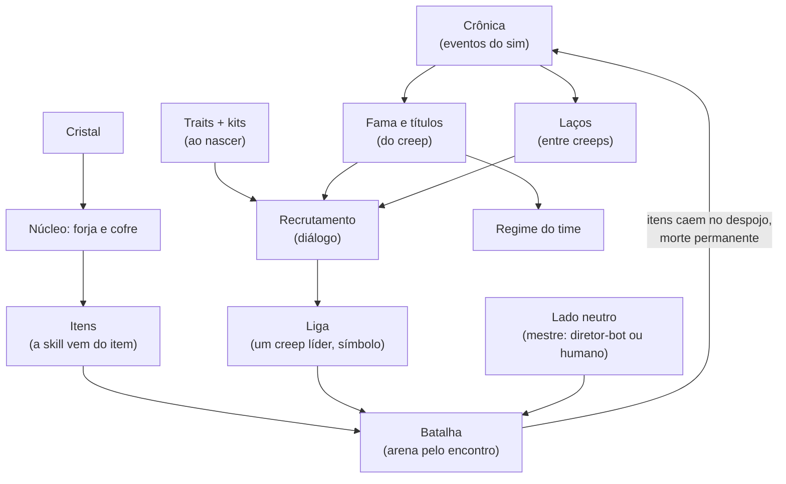
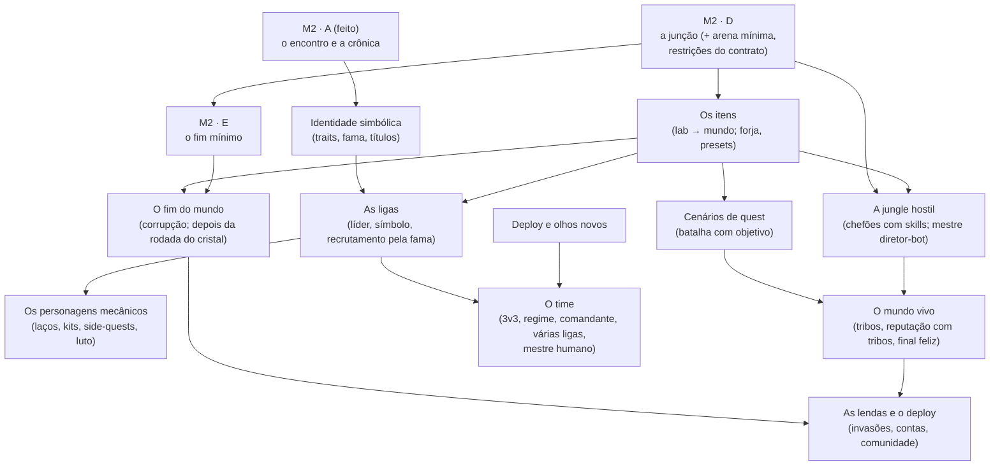

# Consolidado: as ideias e o planejamento depois do M2

> **Status:** consolidação do agente (2026-11-20), pedida pelo dono. **Respondido pelo dono no mesmo dia, na rodada
> interativa (§0).** Antes da rodada: Junta a
> [proposta do ROADMAP](2026-11-20-roadmap-depois-do-m2.md) e as quatro levas de ideias do dia, registra a 5ª leva
> e faz a análise fria pedida: expectativa × realidade, benefícios × trade-offs e uma recomendação por ideia. **As
> perguntas foram refeitas aqui** (§7), em quatro grupos, só com o que é decisão do dono. As perguntas numeradas das
> levas ficam como histórico.

| Leva | Arquivo | O quê |
|---|---|---|
| 1ª | [roadmap-depois-do-m2](2026-11-20-roadmap-depois-do-m2.md) | O formato do ROADMAP, a fatia C, o próximo marco; o comandante, os anúncios, o som, a IA que aprende |
| 2ª | [mestre-ligas-arena](2026-11-20-mestre-ligas-arena.md) | O mestre da mesa, as ligas, a arena pelo encontro |
| 3ª | [itens-reputacao-governanca](2026-11-20-itens-reputacao-governanca.md) | O teto da liga, a reputação e o Núcleo, a skill que vem do item, o regime do time |
| 4ª | [recrutamento-lacos-traits](2026-11-20-recrutamento-lacos-traits.md) | O recrutamento por diálogo, os laços, os traits com kits de crônica |
| 5ª | este arquivo, §2 | A liga por creep líder e o símbolo, os itens iguais para todos, os títulos, a instância de quest, o laboratório |

## 0. Respostas do dono (rodada interativa, 2026-11-20)

Quatro grupos, num formulário por grupo, com o contexto de cada um no chat antes. **O dono aceitou as recomendações
em 15 das 16 perguntas; na 13, escolheu o híbrido.** As decisões foram para o [ROADMAP](../ROADMAP.md) (reescrito no
formato de banco por tema) e para os GDD 02, 03, 04, 05, 06, 07 e 08.

| # | Pergunta | Resposta |
|---|---|---|
| 1 | O formato do ROADMAP | **O banco por tema:** o marco atual, o próximo e o banco sem número |
| 2 | A fatia C | **Sai do M2** para o tema "Comunicação e automação" |
| 3 | O próximo marco | **Os itens** (candidato, confirmado no checkpoint do M2), com a identidade simbólica em paralelo, se o dono quiser |
| 4 | A instância de quest | **Uma batalha com objetivo**, no mesmo pacote, com um modo de cenário no laboratório, depois dos itens |
| 5 | A arena na D | **O mínimo:** escolhida entre as três do laboratório pelo terreno; o snapshot leva o recorte |
| 6 | A direção vira posição | **Nos três casos:** começo, entrada no meio e fuga |
| 7 | O mandato do mestre | **Neutro, sem mexer no placar** |
| 8 | A cadeira do mestre | **Um diretor-bot sempre, com a cadeira aberta a um humano;** na D, o lado neutro aceita um controlador |
| 9 | O controle da liga | **Piloto de grupo:** o líder pelo humano, os seguidores na formação pelos gambits, até 3 ordens |
| 10 | O recrutamento | **Diálogo, quase sempre pela fama;** a side-quest para os traits raros |
| 11 | O símbolo da liga | **Só identidade, por ora;** o estandarte com os itens |
| 12 | Laços e luto | **Simbólicos primeiro;** o efeito mecânico quando o playtest pedir |
| 13 | A progressão | **Híbrido:** o DNA dá uma skill natural, os itens dão as outras, e o level do creep continua, com peso menor (revê o decidido do GDD 02) |
| 14 | O Núcleo | **A forja e o cofre** |
| 15 | Os títulos | **Conquistados e disputados** |
| 16 | O regime do time | **Direção registrada;** qual vem primeiro, quando houver times de humanos |

**Consequências que o agente registrou:**

- **O híbrido traz de volta o teto da liga pelo level do líder** (a ideia original do dono na 3ª leva).
- **A fatia D herda:** a arena mínima pelo encontro, a direção nos três casos, e as três restrições de contrato (o lado
  neutro com um controlador, a posição no mundo e o recorte no snapshot, o inventário e a pilha prontos para itens).
- **O resto da §3 ao §6 abaixo é a análise que levou às perguntas.** Onde ela recomenda "o poder no item", vale o
  híbrido.

## 1. O retrato [agente]

Somadas, as ideias descrevem um jogo maior que o MVP: o mundo de economia (RTS) e a batalha em grade (MOBA-lite), com
um **RPG de grupo** por cima (ligas, itens, personagens) e uma **camada social** (regime, mestre, diplomacia). Elas
se encaixam num desenho só:

**A tese que amarra tudo** (3ª leva): **o poder fica no item** (físico, perigoso, pode ser perdido), e **a identidade
fica no creep** (nome, trait, fama, títulos, laços). A crônica é a matéria-prima da identidade, e quase tudo nela é
uma leitura de eventos que o `sim` já emite.

## 2. A 5ª leva [dono e agente]

### 2.1 A liga é de um creep líder, não de um jogador; e tem símbolo

**[dono]** A liga não precisa ser uma por jogador: faz mais sentido ser uma por creep que virou líder ao ser dominado.
Se o jogador soltar o creep, ele continua atuando como líder pelos gambits. Cada liga tem um símbolo (bandeira,
tatuagem ou algo assim) que a diferencia e dá identidade visual, para identificar os membros de uma liga específica,
inclusive de inimigos e de tribos neutras. "Faz sentido?"

**[agente]** Faz, e resolve a pergunta 8 da 2ª leva (a liga sem humano) do jeito que eu recomendava. Consequências:

- **Um jogador pode ter várias ligas ao longo da partida:** domina um líder, recruta, solta, domina outro. O teto
  vem da economia (cada seguidor sai da coleta) e do teto de cada liga.
- **A liga sobrevive ao líder?** Proposta: o **símbolo é da liga, não do líder**. Se o líder morre, a liga fica sem
  líder, e os membros voltam às regras de antes. Quem dominar um membro pode assumir a liga e o símbolo. A crônica
  conta ("a Liga do Triângulo Partido tem um novo líder").
- **O símbolo na geometria (pilar 6):** uma marca pequena dentro da forma do creep (um ponto, uma barra, um anel, um
  ângulo), de um catálogo curto e bem distinto, para ser legível no zoom afastado. A cor continua sendo do time; o
  símbolo é da liga. O inimigo só reconhece a liga quando a vê (o fog vale), e o time inimigo passa a lembrar das
  ligas ("a liga do anel de novo").
- **O símbolo e o estandarte:** o símbolo pode ser só identidade, ou virar um **estandarte**, um item que o líder
  carrega, que cai e pode ser roubado (3ª leva, §1). A recomendação fria é começar pelo símbolo como identidade e
  deixar o estandarte para quando houver itens (§7, grupo 3).

### 2.2 Itens: o mesmo efeito para todos, com simbioses; presets e dicas

**[dono]** Cada item faz o mesmo efeito para todos, e alguns criam efeitos simbióticos com DNAs específicos. Presets
de itens e evoluções para os bots e na interface, para o jogador casual, de acordo com o creep dominado (como no Dota
2, que tem até presets da comunidade e ranking). Começar simples: oferecer os itens com uma nota de dicas para
escolher, do jeito mais amigável e menos denso possível.

**[agente]** Isso **decide a pergunta 16** (o item e o DNA) contra a minha recomendação, e com razão na análise fria:
um efeito por item e algumas simbioses é muito mais barato de balancear e de ensinar do que três efeitos por item.

- **A simbiose é a exceção que dá sabor:** ex.: um gancho puxa o inimigo para qualquer DNA, mas no quadrado ele
  ainda o atordoa. Poucas simbioses, cada uma com um porquê na forma.
- **O preset do bot é a dica do humano:** o bot precisa de presets de itens de qualquer jeito, para equipar os
  próprios creeps. A mesma fonte vira a sugestão da interface ("para um ● batedor: o gancho; ele foge melhor"). Uma
  fonte, dois usos, e o texto é uma linha.
- **Presets da comunidade e ranking** pedem contas e um servidor público: ficam com o deploy entre mundos (o control
  plane, tema "As lendas e o deploy").

### 2.3 Títulos

**[dono]** Completar quests, vencer batalhas e o desenvolvimento natural das crônicas individuais geram títulos. No
começo, só simbólicos, usados na crônica ("O Rei Batedor, Fulano"). Talvez dinâmicos; aberto a ideias melhores.

**[agente]** É a ideia de **melhor sabor por custo** da lista: regras sobre os feitos que a crônica já registra, e o
texto no cliente. Dois tipos:

- **Conquistados** (permanentes): por um feito único ("Matador do Chefão do Rio", "Sobrevivente do Vau").
- **Disputados** (dinâmicos): o melhor do mundo num feito agora ("O Rei Batedor" é quem mais explorou). Passam para
  quem superar, e a crônica conta a troca ("Fulano perdeu o título de Rei Batedor para Sicrano"). Cria rivalidade, e
  a perda de um título também é história.
- **O risco é a inflação:** se todo creep tem título, nenhum vale. Os disputados são um por feito no mundo; os
  conquistados pedem feitos raros. As lendas levam os títulos para o próximo mundo.

### 2.4 A instância de quest e o laboratório de cenários

**[dono]** Uma "instância de quest" criada a partir do mundo, como a de combate, mas voltada a cenários (kits) de
quest que se adaptam ao mundo gerado e às zonas e arenas. Com gameplay próprio, e um laboratório de experimentos
para os kits de quest.

**[agente]** A análise fria está na §3 (linha da instância de quest). Em resumo: **um motor novo de quest é o
item mais caro da lista** (a fatia B levou 8 fases só para a batalha). O caminho barato é que **o cenário seja uma
batalha com objetivo** em vez de aniquilação: escoltar alguém até a saída, segurar uma área por um tempo, recuperar
um item no meio da arena, sobreviver a ondas. É o mesmo pacote de batalha, com a arena pelo encontro (2ª leva) e um
**modo de cenário no laboratório que já existe**. Isso dá ao mestre (2ª leva) algo para lançar quando o mundo está
parado.

### 2.5 O laboratório e a análise fria

**[dono]** O laboratório vai ajudar muito no balanceamento e no playtest humano quando entrarem os itens e as skills,
mas as ideias precisam ser analisadas com calma e friamente.

**[agente]** Concordo, com um limite: **o laboratório responde "é divertido de jogar?" e "o bot quebra?", mas não
responde "o sistema social funciona?"**. Itens, skills, ligas contra o bot e cenários se testam lá. O regime, o mestre
humano, várias ligas por time e o comandante do time só se testam com várias pessoas.

## 3. Expectativa × realidade [agente]

| Ideia | O que se espera | O que custa de verdade | A favor | Contra | Recomendação |
|---|---|---|---|---|---|
| **Arena pelo encontro** | A batalha representa o lugar e a aproximação | O mínimo é barato (escolher entre as 3 arenas do laboratório pelo terreno; nascer pela direção). O gerador é médio. Ser fiel ao rio e à estrada pede regras novas | O pilar 1 chega à batalha: a aproximação no mundo decide a posição. Dá sentido ao nome do M2 | A arena gerada pode ser injusta no espelho e perde a familiaridade das 3 arenas conhecidas | **O mínimo na D**; o gerador no banco |
| **Mestre da mesa** | O mundo nunca fica parado; chefões nas mãos de um humano | O diretor-bot é a curva dos errantes crescida (barato). A cadeira humana pede uma pessoa a mais, uma visão "deus" no cliente, permissões, regras contra conluio, e só se testa com 3 pessoas ou mais | Pilar 4; uma ferramenta de playtest para o dono | O mestre decidindo o vencedor (*kingmaking*); um mestre humano entediado | **Restrição no ADR do lado neutro na D** (custo quase zero); o diretor-bot na jungle hostil; a cadeira humana quando houver olhos novos |
| **Ligas** | Batalhas maiores e mais humanas; escolta | Seguir em formação custa no tick do mundo; 10 × 10 × 10 passa dos limites de hoje (4 lados, 5 por lado) e tem custo de auto-resolve a medir; 30 creeps na tela pesam na leitura | Pilar 3 em escala; uso para o recurso que sobra; identidade pelo símbolo | **Com 10 seguidores pelos gambits, a micro do humano pesa menos na batalha** (pilar 1, "a batalha, na micro"); ataque básico em massa pode virar bagunça | Piloto de grupo com até 3 ordens; liga por creep líder (dono). **Melhor depois dos itens**, que dão o que fazer a cada membro |
| **Recrutamento por diálogo** | Cada recruta é uma história | Conteúdo (kits), checagem das side-quests por eventos, a tela de diálogo. **No 20º recruta, persuadir um por um vira tarefa** | Momento de jogo; usa a fama | Atrito para o casual; repetição | **Diálogo, mas a maioria aceita pela fama**; a side-quest fica para os traits raros |
| **Laços, buffs e luto** | Camaradagem que nasce sozinha | Estado por par (limitado), regras de buff a balancear, e o "por que meu creep fugiu?" (luto) a explicar | Pilar 3; a morte permanente dói | Mais uma camada de números invisíveis, que se soma a itens e traits | **Simbólico primeiro:** o laço na ficha e na crônica; o efeito mecânico só depois do playtest |
| **Traits com kits** | Personagens únicos por seed | **O gargalo é o conteúdo:** 6 a 8 traits ficam repetitivos num mundo com centenas de creeps; a combinação trait × origem × side-quest ajuda | Barato no `sim` (ids e parâmetros); só depende do encontro | Escrita contínua | **Cedo e pequeno**; a escrita cresce com um LLM offline |
| **Títulos** | "O Rei Batedor, Fulano" | Barato: regras sobre os feitos, o texto no cliente | Muito sabor por pouco custo; liga a crônica e as lendas | Inflação de títulos | **Cedo, simbólicos**, conquistados e disputados |
| **Fama** | Pesa na diplomacia, no recrutamento e no regime | Barata (leitura da crônica), mas o peso de cada feito pede balanceamento | É a base dos títulos e do recrutamento | **Bola de neve:** quem vence ganha fama, recruta mais e vence mais | Simples, que cai com derrotas e com o tempo |
| **Itens com skills** | Progressão perigosa e simples, à Dota; o cristal ganha papel | **O maior sistema da lista:** catálogo, cada skill é uma regra de combate nova que a IA de gambits precisa aprender a usar ("toda regra nova precisa da sua IA"), a forja, a interface de escolha. Revisa o decidido do GDD 02 | Um catálogo só para skill, item e progressão; pilar 2 (o poder se rouba); sumidouro; o papel do cristal | **Bola de neve:** quem vence pega os itens de quem perdeu. Pede durabilidade e despojo disputado | **Candidato a próximo marco**, primeiro no laboratório (como o combate), depois no mundo |
| **Presets e dicas** | O casual escolhe sem ler | O preset do bot já é necessário; mostrar uma linha de dica é barato. Comunidade e ranking pedem contas | Uma fonte para o bot e o humano | — | **Com os itens**; a comunidade, com o deploy |
| **Regime do time** | Governança interessante | **Só se testa com vários humanos por time**, e hoje o dono joga sozinho | Pilar 5; o time escolhe a burocracia | Decidir agora é decidir sem o playtest | **Registrar como direção** e escolher o primeiro regime quando houver times de humanos |
| **Instância de quest** | Quests com gameplay próprio, adaptadas ao mundo | Um motor e um laboratório novos, com IA para cada cenário, e conteúdo pesado. A fatia B levou 8 fases | Variedade; algo para os momentos parados (o mestre) | Divide o jogo em "masmorras", longe dos verbos do mundo | **O cenário é uma batalha com objetivo**, num modo do laboratório que já existe, depois dos itens |
| **Comandante do time, várias ligas por time** | Tática coletiva | Pede times de humanos | Pilar 5 | Não dá para testar sozinho | Com o tema "O time", depois do deploy |

**Três lições de conjunto:**

1. **O gargalo é conteúdo e playtest, não engenharia.** Itens, traits, kits, títulos e cenários são catálogos: cada
   um pede escrita e balanceamento. E as rodadas de design e os playtests são do dono, um de cada vez.
2. **Simbólico antes de mecânico.** O dono já propôs isso para os títulos. Vale para laços, traits e símbolos: primeiro
   na ficha e na crônica, que custam pouco e mostram se o jogador se importa; o efeito mecânico entra quando o playtest
   pedir.
3. **Quase tudo premia quem vence** (itens, fama, títulos, laços, recrutamento). A pergunta do M2 é "a batalha muda o
   rumo do mundo **sem dominar o jogo**?", e essas camadas puxam para o "dominar". Cada uma precisa da sua perda: a
   durabilidade, a morte permanente, a fama que cai, o título disputado.

## 4. O que só se testa com mais gente [agente]

| Dá para o dono testar sozinho (contra o bot, no laboratório) | Pede outros humanos |
|---|---|
| Arena pelo encontro, itens e skills, presets, uma liga contra o bot, traits, títulos, fama, laços na crônica, cenários de quest, o mestre como diretor-bot | O regime do time, o mestre humano, várias ligas por time, o comandante do time, os presets da comunidade |

É o critério mais forte para a ordem: **o que o dono pode testar sozinho vem antes**, porque o deploy e os olhos
novos esperam a junção e a diversão.

## 5. O planejamento revisto [agente]

**O formato** continua o da 1ª leva: o ROADMAP mostra os marcos concluídos, o atual e o próximo (com uma pergunta), e
o resto vira um banco de ideias por tema, sem número. A novidade é a ordem do banco como **grafo de dependências**,
para o dono escolher o próximo marco vendo o que cada tema destrava.

**O M2 fecha com a D e a E:**

- **D — A junção**, com três restrições baratas que as ideias pedem, sem construir nenhuma: o lado neutro aceita um
  controlador (o mestre); o snapshot leva a posição de cada creep no mundo e o recorte do terreno; o inventário e a
  pilha da arena não supõem que só existem matéria e cristal (os itens). E, se o dono quiser, a arena mínima (escolhida
  pelo terreno, nascimento pela direção).
- **E — Cerco, reparo e o fim mínimo**, como está.
- **A C** (chat, console, macros) vai para o banco, a não ser que o dono a queira no M2.

**O próximo marco** (recomendação): **Os itens**, com a pergunta "**Um item que se ganha e se perde dá motivo para
lutar e para voltar ao jogo?**". Ele entra pelo laboratório (os itens e as skills na batalha, contra o bot), depois no
mundo (a forja no Núcleo, o cristal, o despojo, os presets do bot como dica). Por quê:

- é o pré-requisito para balancear o combate (decidido: "não se balanceia combate cru antes de skills, nível e
  stats");
- dá ao cristal o papel que falta e um motivo para emboscar;
- muda o que um creep é, e as ligas (o estandarte, o que cada membro faz) se desenham melhor depois dele;
- o dono testa sozinho.

**Em paralelo e barato** (uma fatia pequena, se o dono quiser): **a identidade simbólica**, com traits na voz da
crônica, fama e títulos. Só depende do encontro, não mexe no combate e mostra cedo se o jogador se importa com os
personagens.

**As alternativas para o próximo marco:** as ligas (batalhas maiores logo depois da junção), ou o fim do mundo (o
clímax da partida, que depende da rodada do cristal e da E).

### Os temas do banco, consolidados

| Tema | O que entra | Pede humanos? |
|---|---|---|
| **Os itens** | A skill vem do item (o mesmo efeito para todos, algumas simbioses com DNAs), a forja e o cofre no Núcleo, o cristal como ingrediente, a durabilidade, os presets do bot como dica, o laboratório de itens, o golpe crítico como propriedade de item | Não |
| **Os personagens** | Traits com kits de crônica, fama, títulos (conquistados e disputados), laços, side-quests pessoais, luto e vingança, renomear | Não |
| **As ligas** | Liga por creep líder, que continua pelos gambits quando solto; símbolo; formação pelo DNA; até 3 ordens; recrutamento por diálogo; o teto que cresce; o estandarte (com os itens); 10 × 10 × 10 | Não (uma liga contra o bot) |
| **A batalha** | A arena gerada pelo recorte e o tamanho por faixa, a IA que aprende, regras novas (livre), acampamentos e torres | Não |
| **Cenários de quest** | A batalha com objetivo (escoltar, segurar, recuperar, sobreviver), o modo de cenário no laboratório | Não |
| **A jungle hostil** | Chefões, buffs e artefato, árvores, a curva dos errantes por ato, o mestre como diretor-bot | Não |
| **O fim do mundo** | Corrupção, ponto sem volta, vitória pírrica, crônica do fim, registro das lendas | Não |
| **O mundo vivo** | Tribos, diplomacia e reputação com as tribos, o final feliz, construção ampla | Não |
| **Comunicação e automação** | Chat, console, macros (a fatia C), piloto scriptável | Em parte (o chat) |
| **A apresentação** | Som, anúncios de abate e de fuga, a tela de fim e o replay além do mínimo | Não |
| **O time** | 3v3, impostos, regime (democracia ou meritocracia), o comandante do time, várias ligas por time, genética, o mestre humano | **Sim** |
| **As lendas e o deploy** | Invasões, contas, o control plane, presets da comunidade e ranking, deploy de testes, olhos novos | **Sim** |

## 6. O que o agente decide ou propõe sem perguntar [agente]

São propostas, a validar em playtest ou na spec de cada tema. O dono pode vetar qualquer uma:

- **Itens e DNA:** o mesmo efeito para todos, com poucas simbioses (decidido pelo dono na 5ª leva; fecha a pergunta 16).
- **A liga sem humano:** o líder solto continua pelos gambits (decidido pelo dono na 5ª leva; fecha a pergunta 8).
- **A liga sem líder:** se o líder morre, os membros voltam às próprias regras, e a liga e o símbolo ficam para quem
  assumir (fecha a pergunta 9).
- **O teto da liga** começa em 1 seguidor e cresce. A fonte (o level, a fama ou o estandarte) se decide com os itens
  (pergunta 12).
- **A reputação em duas camadas:** a fama do creep e a relação do time com cada tribo (pergunta 13).
- **A side-quest pelo piloto** quando o jogador sai (pilar 4; pergunta 19).
- **De onde vêm os laços,** quantos níveis e quantos cada creep guarda (perguntas 20 e 23): detalhes que o playtest
  ajusta.
- **O texto da crônica, dos traits e dos títulos fica no cliente;** o `sim` guarda ids e parâmetros.
- **Sem *streaming* de arena;** o gerador mora na camada da junção, não no pacote de batalha.
- **O símbolo da liga** é uma marca geométrica dentro da forma, num catálogo curto, e respeita o fog.

## 7. As perguntas para o dono

Dezesseis perguntas em quatro grupos, só com decisões de design ou de plano. Entre parênteses, as perguntas antigas
que cada uma substitui.

**Grupo 1: o plano**

1. O formato do ROADMAP: o marco atual, o próximo e o banco por tema (1)
2. A fatia C sai do M2 ou fica (2)
3. O próximo marco (3)
4. A instância de quest: um cenário de batalha com objetivo, ou um sistema próprio (5ª leva)

**Grupo 2: a D e o mestre**

5. Quanto da arena entra na D (11)
6. A direção no mundo vira posição na arena: no começo, na entrada e na fuga (10)
7. O mandato do mestre: neutro sem mexer no placar, pesar contra quem lidera, livre, ou antagonista (4 e 5)
8. A cadeira do mestre: um diretor-bot sempre, com a cadeira aberta a um humano, ou só humano (6)

**Grupo 3: as ligas e os personagens**

9. A liga como piloto de grupo, com até 3 ordens, ou o controle de RTS (7)
10. O recrutamento: diálogo com a maioria aceitando pela fama, side-quest para cada um, automático, ou clique (18)
11. O símbolo: só identidade, ou já um estandarte físico (5ª leva)
12. Laços e luto: simbólicos primeiro, já mecânicos, ou só crônica para sempre (21 e 22)

**Grupo 4: itens, Núcleo, títulos e regime**

13. A revisão da progressão: o poder no item e a identidade no creep, o híbrido, ou manter o decidido (15)
14. A utilidade nova do Núcleo (14)
15. Os títulos: conquistados e disputados, ou só um dos tipos (5ª leva)
16. O regime do time: registrar a direção e decidir quando houver times de humanos, ou já escolher o primeiro (17)
