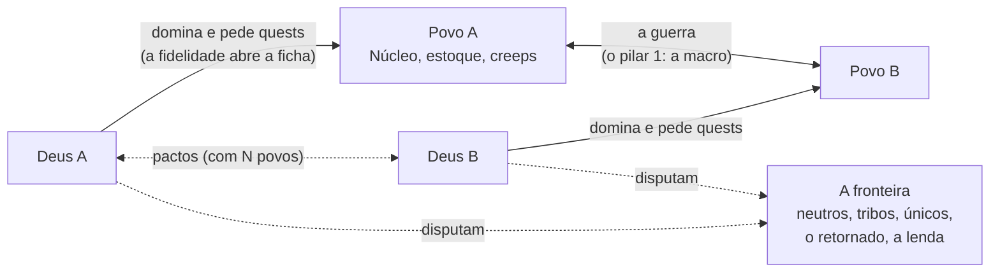

# A estrutura: "seu time", quantos deuses por povo, quantos povos

> **Status:** análise do agente (2026-11-20), pedida pelo dono, seguida das perguntas da **rodada 5** (§10). **Nada
> aqui está decidido** até o OK do dono. Continua o [consolidado](2026-11-20-consolidado-depois-do-m2.md): a leitura D
> (§11.3, "os times podem nascer do jogo?") e "seu time" e a saga da simetria (§13.8), com a pergunta 40 reaberta.
> **Guarda de escopo:** nada desta análise muda a fatia D, a fatia E ou Os itens (conferido na §7).

## 1. O pedido [dono]

Uma rodada funda sobre **a estrutura do jogo, não só a pele**. As decisões estruturais (dois times fixos, times de 3
jogadores, um Núcleo por time, "o jogador domina qualquer creep do time") vieram de antes de existirem o `sim`, o
mundo, a batalha e o laboratório, e o paradigma mudou com os deuses, a fidelidade, os únicos, as lendas e o arco do
mundo. Reavaliar se elas ainda se justificam, **a começar por: faz sentido mais de um jogador por time?** De onde veio
cada decisão, se o motivo ainda vale, as alternativas (inclusive nenhum time fixo, um jogador por lado, deuses que
disputam os mesmos creeps) e o que cada uma ganha e perde em diversão, saga, justiça e custo no que já está construído.

## 2. As quatro decisões estruturais: de onde vieram [agente]

| Decisão | Quando e onde | O motivo de então | O que mudou depois | O motivo ainda vale? |
|---|---|---|---|---|
| **Dois times fixos, espelhados** | M0 (2026-11-13): a "fundação" no GDD 01; M1, spec D6 ("2 times"); o mapa nasce com `cores: [Cell, Cell]` e o espelho (`map.ts`) | A herança do MOBA (duas bases, um rio, as lanes); a justiça pelo espelho; o menor mundo que testa o ciclo da riqueza | As lanes viraram construídas; a batalha aceita de 2 a 4 lados; errantes, tribos, a lenda e o retornado criaram **lados que não são times**; a simetria virou o enredo ("a simetria começou a ser questionada") | **A justiça pelo espelho vale, e mais do que antes**, porque agora é o enredo. "Dois" é só o número mais barato de espelhar |
| **Times de 3 jogadores** | M0: GDD 01, Decidido ("começa com times de 3 jogadores e pode crescer"); M1, spec D6 (0 a 3 humanos por time, o parâmetro `teams.maxHumans`) | O jogo em equipe do MOBA; o **pilar 5** (votar pede mais de um humano); cobrir as ausências num mundo de dias; jogar com amigos | O jogador virou **um deus individual**: recurso próprio, influência, karma, kit, ambição e crônica própria; a fidelidade é por par (creep, deus). O dono joga sozinho, e "O time" é o único tema do banco que **só se testa com humanos** | **Em parte.** Jogar com amigos e cobrir as ausências valem. O pilar 5 como votação interna só vale com vários humanos no time, justamente o que não se testa |
| **Um Núcleo por time** | M0 (vitória = destruir a base), M1 | O alvo da vitória; o ponto de entrega do pilar 2; a produção | Ganhou a forja e o cofre (rodada 1), o HP e o cerco (fatia E), os sem-Núcleo que continuam (rodada 3) | **Vale inteiro.** É a âncora do pilar 2: qualquer alternativa precisa de um lugar para onde a riqueza vai |
| **O jogador domina qualquer creep do time** | M0: GDD 02 ("herói = creep aliado dominado"; solto, fica "elegível para outro do time"); M1, D-1 e D10 (qualquer jogador edita as regras de qualquer creep do time) | O pilar 3 e a simplicidade: o domínio só troca quem emite os comandos (ADR-0002) | A fidelidade por deus, a ficha velada, a influência para os famosos, os únicos que se disfarçam | **O pilar 3 vale. "Do time" é que ficou ambíguo:** com mais de um deus no time, de quem é o creep? |

**A observação de conjunto:** as quatro decisões vêm da moldura "MOBA de times + RTS de base". As rodadas 2 a 4
mudaram uma coisa só nessa moldura, mas uma coisa grande: **o jogador deixou de ser um membro do time e virou um
indivíduo com interesses próprios.** Hoje, tudo o que foi decidido para o deus é **por jogador**, e tudo o que existe
no código é **por time**. A pergunta "faz sentido mais de um jogador por time?" é a costura entre os dois.

## 3. O que o código já faz [agente]

Leitura do código, sem testes nem scripts.

| Peça | Onde | É por time ou por jogador? |
|---|---|---|
| **O time** | `Team { id, core, stock, upgrades, production, repeat }` (`world.ts`); o id é o índice; os times nascem de `layout.cores` | Por time |
| **O jogador** | `Player { id, team, bot, lastDominateTick }` (`domination.ts`) | Sem estado próprio além do cooldown do domínio. **Tudo o que o deus terá** (recurso, influência, karma, kit, fidelidades) **é estado novo**, em qualquer alternativa |
| **O limite de humanos** | `teams.maxHumans` = 3 (`params/default.json`), conferido em `joinRefusal`; os bots não contam | Por time, num parâmetro |
| **O mapa** | `cores: [Cell, Cell]`, `mirrorCell`; a zona do Núcleo contada "da borda do próprio time"; os desempates do piloto "no referencial do time" (GDD 07) | **Fixo em dois** |
| **Visão, memória, eventos, estatísticas, bots** | `view(state, team)`, `TeamMemory[]`, a audiência dos eventos por time (ADR-0007), `botsFor` (um bot por time) | Por time, **genéricos em N** |
| **A rede** | Um stream por time ([spec M1.5 rede](../specs/m1.5-rede/spec.md) D2, [ADR-0006](../adr/0006-sync-do-mundo.md)): "os jogadores do mesmo time veem a mesma coisa" | Por time |
| **Os comandos do time** | `produce`, `buyUpgrade`; `setRules` e `applyPreset` em qualquer creep do time; `dominate` de qualquer creep livre do time (`teamCreepRefusal`) | Qualquer jogador do time manda em tudo do time |
| **A batalha** | Lados de 0 a 3 (`limits.maxSides`), sem nenhuma noção de time nem de jogador (`packages/battle`) | Nenhum dos dois: quem é cada lado é decisão da junção |
| **Fora do `sim`** | O lobby (`TEAMS = [0, 1]`), as cores Azul e Laranja, o replay, o soak, o harness (`TEAMS = 2`) | **Fixo em dois** |

**O custo de cada mudança no que está construído:**

| Mudança | Custo |
|---|---|
| **Um jogador por lado** | **Um parâmetro** (`maxHumans` = 1). Nada mais |
| **Mais lados** (3 ou 4) | **Médio:** o gerador do mapa (simetria por rotação no lugar do espelho), o referencial do time no piloto, a zona do Núcleo, o lobby, as cores, o replay, o harness. O resto do `sim` já é por time, e a batalha já aceita 4 lados |
| **O povo convertido no começo** (o Núcleo continua) | **Médio:** a população inicial nasce neutra, e um verbo de conversão (que o tema "Os deuses" traz de qualquer jeito); muda o começo do ciclo do M1 |
| **Sem Núcleo no começo** | **Alto:** de quem é a riqueza, onde o creep nasce, o que o fog mostra, qual é a vitória |
| **Deuses fora dos povos** | **Muito alto:** a visão vira por jogador, a economia fica sem dono humano, o estrategista vira o dono do povo |

**O custo escondido de mais de um deus por time.** A ficha velada (rodada 4, pergunta 41) abre a camada pessoal pela
fidelidade, que é por par (creep, deus). **Dois deuses do mesmo time veem fichas diferentes do mesmo creep**, e o
mesmo vale para o recurso, a influência, a conduta e as quests de cada deus, se forem privados. O stream por time
deixa de bastar: precisa de uma camada por jogador por cima da do time. Não é caro (a camada é pequena), mas é uma
revisão do ADR-0006 e o fim de "os jogadores do mesmo time veem a mesma coisa". **Com um deus por povo, a visão do
time é a visão do deus, e nada muda.**

## 4. Três perguntas em vez de uma [agente]

"Seu time" junta três escolhas independentes. Para separar as ideias, esta análise chama de **povo** o que hoje é o
time: o Núcleo, o estoque e os creeps que nascem dele. É um termo de análise, não do glossário.

| Eixo | As opções | Hoje |
|---|---|---|
| **1. Quantos deuses por povo** | (a) **um**; (b) **até três**, que dividem os creeps (o panteão); (c) **nenhum dono**: os povos são dos creeps, e os deuses, de fora, disputam qualquer creep | (b) |
| **2. Quantos povos** | (a) **dois**, espelhados; (b) **N** (3 ou 4), com simetria por rotação | (a) |
| **3. Como o povo nasce** | (a) **dado no Núcleo**; (b) **convertido** de uma primeira geração neutra, espelhada em volta de cada Núcleo; (c) **sem Núcleo**, de uma população espalhada pelo mapa | (a) |

Há uma quarta opção antiga para o eixo 3, ainda em Proposta no GDD 01: o **draft de fundação** (cada time monta a
população inicial com um orçamento igual). Ela resolve a justiça do começo, mas não traz a saga da conversão.

## 5. As alternativas [agente]

Seis combinações que valem a pena olhar. As outras são variações delas.

| # | Alternativa | Eixos | Diversão | Saga | Justiça | Custo | O dono testa sozinho? |
|---|---|---|---|---|---|---|---|
| 1 | **O panteão** (hoje) | 1b · 2a · 3a | Co-op e intriga entre deuses do mesmo povo; o risco de o time rachar | Os deuses disputam os creeps do próprio time | Espelho; mas quantos humanos cada povo tem pode ser desigual | O que existe, mais uma camada por jogador na visão | **Não** (só a metade de um deus) |
| 2 | **O duelo de deuses** | 1a · 2a · 3a | Cada povo tem a cara do seu deus; o domínio fica simples; o mundo de duas pessoas é pequeno | Os deuses disputam o que não é de ninguém | Espelho perfeito | **Zero** | **Sim** |
| 3 | **Os deuses e os pactos** | 1a · 2b · 3a | Diplomacia entre humanos, co-op pela aliança; o risco do "dois contra um" | A melhor para "deuses que se entretêm" | Rotação; o 3 é difícil num mapa quadrado | Médio, mais um sistema de pactos | Em parte |
| 4 | **O povo convertido** | 1a · 2a ou 2b · 3b | O primeiro minuto tem uma escolha: quem eu chamo primeiro? | A convocação (leitura B) vira mecânica | Espelhando a primeira geração | Médio | **Sim** |
| 5 | **Sem time no começo** (a leitura D pura) | 1a · 2a · 3c | O começo mais confuso, e o mais difícil de ensinar | A saga pura | Depende de espelhar tudo em volta de um ponto que nem existe | Alto | Sim |
| 6 | **Os deuses fora dos povos** (os patrocinadores) | 1c · qualquer · 3a | Outro jogo: o jogador para de fazer a macro | A mais fiel às "constelações e encarnações" | Simétrica por construção | Muito alto | Sim |

### 5.1 O panteão (hoje)

- **Ganha:** jogar com amigos no mesmo povo; um cobre a ausência do outro; a intriga entre os deuses do mesmo povo
  (quem leva a fidelidade de um creep famoso, de quem é o crédito de um feito).
- **Perde:**
  - **O time racha.** A rodada 4 já precisou dizer que "a ambição não decide a guerra" (pergunta 45) para segurar
    isso. A intriga interna é divertida entre amigos e frustrante entre estranhos.
  - **"Por que o meu creep não me obedece, se é do meu time?"** É a pergunta 40 reaberta, e ela não tem resposta
    simples com mais de um deus.
  - **As decisões dos deuses brigam entre si.** O cruel "fecha portas" (pergunta 21): as tribos ficam hostis a ele,
    mas o tributo vai para o tesouro do time (19). Com um cruel e um benevolente no mesmo povo, a tribo é hostil a um
    e amiga do outro, e o povo comercia com ela por quem? A meritocracia pela influência dos deuses (27) também só
    existe com vários deuses no povo.
  - **A justiça:** um mundo de 3 × 3 precisa de seis pessoas, e, com menos, um povo tem mais humanos que o outro. Os
    bots preenchem, mas um bot não é um humano.
- **Custo:** o que existe, mais a camada por jogador na visão (§3) e a governança (votação, representantes), que só
  se testa com humanos.

### 5.2 O duelo de deuses

- **Ganha:**
  - **Cada povo é a cara do seu deus:** o karma, o kit e a ambição do deus são o povo inteiro, e a crônica conta uma
    história só por lado.
  - **O domínio volta a ser simples:** os creeps do seu povo são seus, e a fidelidade diz o quanto cada um se abre (a
    ficha, as quests); os famosos pedem influência (decidido).
  - **"Os deuses disputam os creeps" acontece na fronteira:** os neutros, as tribos, os únicos, o retornado e a lenda
    são de ninguém, e é por eles que os deuses brigam. Isso já está decidido (pergunta 39: só os neutros e os únicos
    mudam de lado).
  - **Tudo se testa sozinho,** contra o deus-bot, que precisa existir de qualquer jeito.
- **Perde:**
  - **Um mundo persistente de duas pessoas é pequeno,** e não tem co-op.
  - **O ausente não tem quem o cubra:** valem o piloto, o "repetir" da produção e o kit do guardião; ou um deus-bot
    que assume o povo, se o jogador deixar (§8, pergunta 54).
  - **O ativo e o casual se enfrentam de frente.** O kit do guardião deixa de ser "um no time de três" e vira "um
    povo inteiro de guardião contra um de campeão". O equilíbrio entre os kits fica mais difícil. Não é um problema
    novo (um 3 × 3 de casuais contra um de ativos tem o mesmo), mas fica mais visível.
  - **O pilar 5 perde a forma original** (votação dentro do time).
- **Custo:** zero no código. Simplifica o desenho dos deuses: o estado do deus continua por jogador, mas jogador e povo
  andam juntos.

### 5.3 Os deuses e os pactos

É o duelo com mais povos: 3 ou 4 deuses, cada um com o seu povo, num mapa com simetria por rotação, e **alianças entre
deuses com regras**.

- **Ganha:**
  - **A diplomacia entre humanos,** que é o coração dos jogos persistentes de navegador: pactos, traições, a crônica
    que lembra quem quebrou a palavra. **O co-op vem pela aliança**, sem dividir creeps.
  - **A saga cabe inteira:** um panteão de deuses rivais que se entretêm, pactuam e se traem, com a conduta pesando em
    quem confia em você. E "salvar o mundo, inclusive os inimigos" ganha corpo com mais de um inimigo.
  - **O pilar 5 ganha uma forma nova:** as decisões coletivas entre deuses (o pacto, a guerra, a paz, a partilha da
    lenda) têm regras.
- **Perde:**
  - **O "dois contra um" e o kingmaking:** o mais fraco é caçado, e quem está perdendo decide quem ganha. Os jogos de
    diplomacia convivem com isso, mas pede regras (a vitória conjunta, o custo de quebrar um pacto).
  - **A vitória pelo Núcleo** precisa ser repensada: o último de pé? A aliança?
  - **O mapa:** num quadrado, 4 povos rodam bem (os quatro cantos); 3 pedem um mapa radial.
- **Custo:** médio no construído (o gerador e o que é "dois" fora do `sim`), mais um sistema de pactos. A batalha com
  3 e 4 lados já existe.
- **O dono testa sozinho:** contra 2 ou 3 deuses-bot, sim; a diplomacia entre humanos, não. Pactos com bots pedem uma
  IA de diplomacia, que é difícil.

### 5.4 O povo convertido

O Núcleo continua no lugar, mas a primeira geração nasce **neutra e confusa**, em volta de cada Núcleo, e o deus
precisa chamá-la.

- **Ganha:** o primeiro minuto tem uma escolha (quem eu chamo primeiro?), e o primeiro fiel nasce cedo, que é a meta
  do ato I (decidida: "converteu pelo menos 1 fiel"). A convocação da leitura B (§11.3 do consolidado) vira uma
  mecânica, não só um texto.
- **Perde:** o ciclo da riqueza (o que o M1 provou) começa mais tarde. Ensinar às cegas fica mais difícil. E as
  primeiras conversões precisam ser quase garantidas, senão volta a dúvida do dono ("o começo pode ser
  excepcionalmente difícil").
- **A justiça:** **espelhar a primeira geração por povo** (os mesmos DNAs, traits e temperamentos, à mesma distância
  do Núcleo) resolve a dúvida do dono. Os únicos e o retornado ficam fora do espelho (nascem neutros, no centro ou em
  pares), como a lenda.
- **Um meio-termo:** parte da população nasce dada, e parte nasce neutra em volta. O ciclo começa no minuto 1, e a
  conversão também.

### 5.5 Sem time no começo

A população espalhada pelo mapa, sem Núcleo, e os povos nascem das conversões.

- **Ganha:** a imagem mais pura da saga (os creeps caem no mundo, e os deuses disputam quem os pegar).
- **Perde:** a âncora do pilar 2 (para onde vai a riqueza antes do primeiro Núcleo?), a vitória, o fog (o time vê o
  quê, se não tem nada?), o ensino às cegas. A justiça depende de espelhar tudo em volta de um ponto que ainda não
  existe.
- **A leitura fria:** a alternativa 4 pega a maior parte da saga com o Núcleo no lugar, pela metade do custo.

### 5.6 Os deuses fora dos povos

Os povos são dos creeps e jogados pelos estrategistas (bots); os deuses, em qualquer número, patrocinam qualquer creep
de qualquer povo pela fidelidade, e vence quem cumpre a própria ambição.

- **Ganha:** a disputa pelos mesmos creeps no centro do jogo; simétrico por construção (todos os deuses veem o mesmo
  mundo); qualquer número de jogadores por mundo.
- **Perde:** **o jogador deixa de fazer a macro** (produzir, construir, distribuir as regras): o pilar 1 sai das mãos
  dele, e a metade RTS do jogo, a que o M1 provou, vira paisagem. É outro jogo. E contradiz a pergunta 45 (a ambição
  não decide a guerra).
- **A leitura fria:** não como estrutura. A parte boa (disputar os mesmos creeps) já existe na fronteira: os neutros,
  as tribos, os únicos, o retornado e a lenda.

## 6. Os primeiros minutos às cegas [agente]

Rascunhos, só para comparar o que um jogador que nunca leu o repositório vê.

- **O panteão:** "Três deuses despertam sobre o Azul." O jogador vê os creeps do povo, que os outros dois deuses também
  veem. Domina um, e a ficha diz "Taro não te conhece" enquanto o deus aliado vê a ficha inteira. A primeira dúvida
  dele é com o aliado, não com o inimigo.
- **O duelo (ou os pactos):** "Um novo deus desperta sobre o Azul." Os creeps trabalham, confusos; a ficha de cada um
  está quase fechada. O jogador dá a primeira quest a um coletor ("traga 5 de matéria"), e a crônica diz "Taro ouve
  uma voz": é o primeiro fiel. Do outro lado do rio, outro deus faz o mesmo. Nos pactos, uma mensagem chega de um
  terceiro deus: "aliança contra o Laranja?".
- **O povo convertido:** "O Núcleo se acende. Doze formas desorientadas vagam em volta dele." O jogador sussurra para a
  primeira (barato, os confusos ouvem), ela entra no Núcleo e começa a coletar. Em cinco minutos, ele tem um povo
  pequeno, escolhido por ele, e sabe que do outro lado do rio havia as mesmas doze formas.

## 7. O que cada caminho faz com o que já foi decidido [agente]

| Decidido | O panteão (hoje) | Um deus por povo (alternativas 2 e 3) | O povo convertido (4) |
|---|---|---|---|
| **39:** fidelidade por deus; não muda o time | Vale; dentro do povo, os deuses competem | Vale; a fidelidade é entre o povo e o seu deus, e os outros deuses só disputam a fronteira | Vale; a conversão é a primeira fidelidade |
| **40:** a fidelidade e o domínio (em análise) | Sem resposta simples: de qual deus é o creep? | **Resolve-se:** o domínio dos seus creeps é garantido; a fidelidade abre a ficha e as quests; os famosos pedem influência | Igual: o convertido é do seu povo |
| **41:** a ficha velada | Uma camada por jogador na visão (revisão do ADR-0006) | A visão do time é a do deus; nada muda | Igual |
| **45:** a ambição não decide a guerra | Necessária, para o time não rachar | Fica mais leve: a ambição e a guerra são do mesmo deus | Igual |
| **27:** a meritocracia pela influência dos deuses | Faz sentido | **Sem objeto** dentro do povo (um deus só); vale entre deuses aliados, nos pactos | Igual |
| **21 e 19:** o cruel fecha portas; o tributo no tesouro do time | Brigam com deuses de conduta oposta no mesmo povo | Encaixam: a porta fecha para o povo do cruel | Igual |
| **Os kits** ("um time com um guardião não pode perder por isso") | Vale como escrito | Vira "um povo de guardião não pode perder para um de campeão": mais difícil de medir | Igual |
| **D10 e D-1** (qualquer jogador manda em qualquer creep do time) | Precisa de regra entre os deuses | Trivial | Igual |
| **ADR-0006** (um stream por time) | Precisa de camada por jogador | Intacto | Intacto |
| **O pilar 5** | Como escrito | Precisa ser relido (§8) | Igual |
| **As ligas, o mestre neutro, a lenda no centro** | Valem | Valem; com N povos, o centro continua justo por rotação | Valem |
| **M2 (D e E) e Os itens** | Nada muda | Nada muda | Nada muda |

**Por que a D, a E e Os itens não mudam:** a batalha só conhece lados, e a junção decide quem é cada lado; a vitória
pelo Núcleo da E vale com dois povos de qualquer jeito; os itens são do creep e da forja do Núcleo. Nenhuma delas lê
quantos jogadores um time tem.

## 8. A leitura fria e a recomendação [agente]

1. **Um deus por povo como a unidade de design** (eixo 1a). É a recomendação mais forte da rodada, por quatro
   motivos:
   - **tudo o que foi decidido para o deus é individual**, e com um deus por povo nada disso briga com o time: as
     perguntas 21, 27, 40 e 45 deixam de ter conflito;
   - **a visão do time é a visão do deus:** a ficha velada não pede uma revisão do ADR-0006;
   - **"os deuses disputam os creeps" acontece onde a saga precisa:** na fronteira (neutros, tribos, únicos, o
     retornado, a lenda), não dentro do povo;
   - **o dono testa tudo sozinho,** e **custa um parâmetro**.

   **O preço, dito com franqueza:** perde-se o co-op no mesmo povo e a cobertura das ausências; o ativo e o casual se
   enfrentam de frente; o pilar 5 perde a forma original. Os três têm remédio (os dois itens abaixo e a pergunta
   54), mas não somem.
2. **O co-op vem dos pactos, com N povos como direção** (eixo 2b, depois). **Dois povos** até a junção e Os itens;
   **N povos (3 ou 4) quando houver humanos para testar**, no lugar do 3v3 do tema "O time". O panteão (vários deuses
   num povo) fica como uma variante possível desse tema, não como a base.
3. **O povo nasce dado no Núcleo, confuso** (eixo 3a). A saga da confusão já mora na fidelidade, que começa baixa
   (decidido). **O povo convertido** (eixo 3b), espelhado, é o melhor candidato a experimento: mede-se com os bots na
   spec do tema "Os deuses" (o tempo até o primeiro fiel, a diferença entre os povos por seed), sem decidir agora.
4. **O pilar 5 relido:** "decisões coletivas têm regras" vale **entre os deuses** (os pactos, as alianças, a partilha
   do que se conquista junto), e a votação dentro do povo fica para o panteão, se ele voltar. A alternativa é **os
   creeps se governarem** (a meritocracia pela fama dos creeps, a primeira descrição do dono na rodada 1, e a pergunta
   aberta do GDD 04: "quem é o bot? os próprios creeps?"), com o deus persuadindo o conselho. Ela casa bem com a
   fidelidade, mas é um sistema a mais.
5. **O povo sem o deus online** (pilar 4): por padrão, **valem o piloto e o "repetir" que o jogador deixou**, como o
   pilar diz. O jogador pode escolher **deixar um deus-bot regente**, com o perfil do kit dele, que produz e redistribui
   as regras enquanto ele está fora; a crônica marca o que foi decisão do regente. O deus-bot existe de qualquer jeito
   (para os povos sem jogador).

## 9. O que o agente decide ou propõe sem perguntar [agente]

São propostas; o dono pode vetar qualquer uma.

- **Nada muda no M2 (D e E) nem em Os itens.** O parâmetro `teams.maxHumans` continua 3 no código até uma spec
  mudá-lo; ele já aceita 1.
- **"Povo" é termo desta análise,** não do glossário; o nome fica com a moldura da saga.
- **Se o dono escolher um deus por povo:** o GDD 01 ("começa com times de 3 jogadores") passa a revisto; o tema "O
  time" do ROADMAP vira **"Os pactos"** (N povos, alianças entre deuses, o mapa por rotação, a vitória com aliados), e
  o panteão (vários deuses num povo, votação, representantes, o comandante do time) fica como ideia dentro dele; o GDD
  04 muda de foco para as decisões entre deuses.
- **Se um dia o povo for convertido:** a primeira geração se espelha por povo; os únicos, o retornado e a lenda ficam
  fora do espelho.
- **O mapa por rotação** só entra com os pactos; até lá, o gerador continua no espelho de dois.

## 10. As perguntas da rodada 5

Numeradas depois das 48 da rodada 4; a 40 volta para a mesa. Dois grupos: o segundo depende das respostas do primeiro.

| # | Grupo | Pergunta | Recomendação do agente | Alternativas |
|---|---|---|---|---|
| 49 | A estrutura | **Quantos deuses por povo** | **Um deus por povo** como a unidade de design | Até três, dividindo os creeps (hoje); deuses fora dos povos |
| 50 | A estrutura | **Como se joga junto** | **Pelos pactos** entre deuses de povos diferentes | O panteão (vários deuses num povo); os dois; nenhum por ora |
| 51 | A estrutura | **Quantos povos** | **Dois agora; N (3 ou 4) quando houver humanos** | Sempre dois; N já no próximo tema |
| 52 | A estrutura | **Como o povo nasce** | **Dado no Núcleo, confuso;** o povo convertido como experimento do tema "Os deuses" | Convertido de uma primeira geração neutra espelhada; metade dada, metade convertida; sem Núcleo |
| 40 | As consequências | **A fidelidade e o domínio** (reaberta) | (depende da 49) | — |
| 53 | As consequências | **O pilar 5** | (depende da 49 e da 50) | — |
| 54 | As consequências | **O povo sem o deus online** | **O piloto que o jogador deixou, por padrão; um deus-bot regente, se ele quiser** | Sempre o deus-bot; só o piloto |
