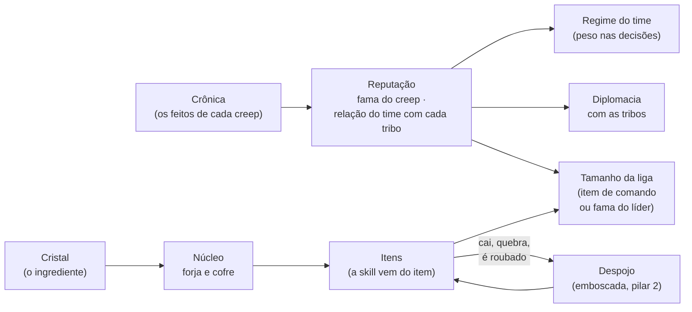

# Brainstorm: itens, reputação e governança

> **Status:** ideias do dono (2026-11-20, 3ª leva) com a análise do agente. **Nada aprovado, e nada disso entra no
> M2**: "não quero complicar o MVP, por isso estamos nessa fase de brainstorm e revisão dos planos e roadmap". Segue
> a [2ª leva](2026-11-20-mestre-ligas-arena.md) e a [proposta do ROADMAP](2026-11-20-roadmap-depois-do-m2.md). As
> perguntas continuam a numeração: **12 a 17**.

> **Consolidado** (2026-11-20): este arquivo é o registro da leva; a análise de conjunto, o planejamento revisto e
> **as perguntas atuais** estão no [consolidado](2026-11-20-consolidado-depois-do-m2.md). As perguntas numeradas abaixo ficam como histórico.

## O pedido [dono]

1. **O tamanho da liga pelo level do comandante:** ex.: no level 1 cabe só 1 creep além do comandante; no level 10,
   cabem 10. "Ou ideias do tipo."
2. **Reputação:** com diálogo com neutros e quests, um conceito de reputação que pesa nas diplomacias. E **uma
   utilidade nova para o Núcleo** de cada time.
3. **O crafting como a peça que une skill, item e progressão.** Em vez de skills naturais, o creep usa a skill do
   item que carrega. O item pode ser vendido, guardado, dropado, e alguns evoluem, como no DotA e no LoL, mas
   simplificado. O desafio é desenhar cada item e skill pensando em como cada DNA o usa e como ele faz parte da
   progressão do creep. "Dependendo de como desenharmos, a progressão de level não precisa estar associada ao creep,
   e sim ao item. E fica mais perigoso, porque o item pode dropar, quebrar, ser roubado."
4. **A governança como regime:** cada time constitui uma **democracia** (a mais customizável, porém burocrática, e
   exige um representante) ou uma **meritocracia**, um modelo hierárquico pela reputação de cada creep, que pesa nas
   decisões (menos burocrática, mais autoritária).

## Como as quatro se ligam [agente]

As quatro ideias formam um sistema só, e a ligação passa por duas coisas que já existem: **a crônica** (os eventos do
`sim`, que já registram cada feito) e **o despojo** (a pilha no chão, que já guarda o que cai de quem morre).

**A leitura de conjunto:** o **poder fica no item** (perigoso, físico, pode ser perdido), e a **identidade fica no
creep** (a fama, o nome, o temperamento). É isso que mantém o pilar 3 ("qualquer creep pode ser um herói") e as
lendas, mesmo com o poder saindo do level.

---

## 1. O tamanho da liga [agente]

- **Um teto que cresce é bom**, por três motivos: limita a população armada (a pergunta aberta do limitador, no
  [GDD 02](../gdd/02-creeps-e-dominio.md)); ensina a liga aos poucos (no começo, uma dupla); e faz a morte de um
  líder experiente doer.
- **De onde vem o teto depende da pergunta 15** (o level fica no creep ou vai para o item):
  - **o level do líder**, como o dono propôs, se o level continuar no creep;
  - **um item de comando**, o *estandarte* (nome provisório), se o poder for para os itens: o tamanho da liga é o
    do estandarte que o líder carrega. Perder o estandarte numa batalha desfaz a liga, e o estandarte vai para o
    despojo, onde o inimigo pode pegá-lo. É a versão mais física (pilar 2);
  - **a fama do líder** (a reputação, §2), se o teto for uma questão de quem os outros seguem.
- **Vocabulário** (proposta do agente): **comandante** é o creep que lidera uma liga, como o dono usou aqui. A
  tática do time inteiro (o comandante da ideia de hoje cedo, [GDD 06](../gdd/06-batalhas.md)) fica com quem o regime
  do time põe no topo (§4). Assim, o termo não tem dois sentidos.

## 2. Reputação e o Núcleo [agente]

### O que já existe

- **A relação por creep** (ideia do dono, 2026-11-15, [GDD 05](../gdd/05-tribos-e-diplomacia.md)): a afinidade do
  creep que interage pesa na conversa com a tribo, além da relação do time. Pergunta aberta: "como a relação com uma
  tribo sobe ou desce?".
- **A ficha das lendas** (GDD 02, proposta): os feitos tirados da crônica.
- **Os temperamentos** (M2.5): a voz do creep na crônica.

### Como poderia ser

- **A reputação é uma leitura da crônica, não um contador à parte.** Cada feito já é um evento (lutou, matou,
  fugiu, pagou a extorsão, extorquiu, poupou, completou uma quest). A reputação é a soma ponderada desses eventos,
  calculada no `sim`. Nada de inventar dados novos, e a crônica explica cada ponto ("ganhou fama ao derrotar o chefão
  do rio").
- **Duas camadas:**
  - **a fama do creep** (com o mundo inteiro): sobe e **cai** (fugir, pagar extorsão). É o que pesa no regime (§4)
    e, talvez, no tamanho da liga (§1);
  - **a relação do time com cada tribo** (a diplomacia que o GDD 05 já tem): sobe com quests e comércio, cai com
    ataques. **Extorquir derruba a relação com as tribos**: o salteador dá lucro e fecha portas, o que dá peso moral
    à identidade editorial do encontro.
- **Cuidado com a bola de neve:** a fama não pode só crescer, senão o creep mais antigo manda para sempre. Ela cai com
  as derrotas e se apaga devagar com o tempo.

### Uma utilidade nova para o Núcleo

O dono não disse qual imaginou (pergunta 14). As candidatas que o resto do brainstorm pede:

- **A forja:** os itens (§3) se fazem e evoluem no Núcleo, com material carregado até lá (pilar 2). Dá ao cristal o
  papel que falta (GDD 03) e ao Núcleo um motivo para ser visitado além de entregar carga.
- **O cofre:** um item guardado no Núcleo não se perde quando o creep morre; um item carregado, sim. O "guardado" do
  dono vira uma decisão: levar o item para a luta (e arriscar) ou deixá-lo seguro.
- **A sede do regime:** o lugar onde as decisões do time (§4) se registram, e onde o representante ou o creep mais
  famoso precisa estar para decidir algo grande (ex.: declarar guerra a uma tribo).

## 3. Itens: a skill vem do item [agente]

### O que pesa

1. **Revisa o que está decidido.** O GDD 02 tem em `Decidido` o level, os stats e a evolução por creep, "3 skills base
   + 1 ultimate desbloqueada por level-up" (do conceito inicial) e o inventário que cresce com o level. O GDD 06 tem
   "quem vence: o level, os stats, as skills e a micro". Levar a progressão para o item muda esses itens, e só o dono
   pode abrir essa revisão (pergunta 15).
2. **Encaixa no que já estava a caminho.** O brainstorm M2–M3 (§5 e §6) já dizia que "a lição do Swordcraft é que o
   kit vem da arma", e a camada de forja trazia três coisas que o jogo procura: **a durabilidade como sumidouro**, **o
   cristal como ingrediente** e **desarmar sem matar** (uma saída para a morte permanente). O dono juntou essas peças.
3. **Liga a progressão à emboscada (pilar 2).** Hoje o que se rouba é carga. Com itens, rouba-se poder: emboscar o
   creep que carrega o item evoluído vale mais que emboscar um coletor. E o creep armado leva o poder consigo para
   onde for, inclusive para o perigo.
4. **Liga a progressão ao fim do mundo.** Se os itens custam cristal, a forja puxa a mineração, e a mineração puxa a
   corrupção (a tragédia dos comuns do GDD 03). Ficar forte acelera o apocalipse.
5. **Simplifica o conteúdo.** Um sistema de skills por DNA mais um sistema de itens são dois catálogos. Com a skill
   vindo do item, é um catálogo só.

### O desafio que o dono nomeou: o item e o DNA

**Proposta: o mesmo item, um efeito por DNA.** O item é o verbo; a forma decide como o verbo sai (pilar 6). Exemplos,
só para mostrar o formato:

| Item | ■ quadrado (tank melee) | ▲ triângulo (médio alcance) | ● círculo (ranged) |
|---|---|---|---|
| Escudo | Bloqueia a frente e segura a linha | Protege o aliado ao lado | Reflete um projétil |
| Gancho | Puxa o inimigo para si | Puxa a si mesmo até uma pedra | Prende o inimigo onde está |
| Estandarte (§1) | Liga maior | Liga média | Liga menor, mas mais rápida |

Com N itens, saem 3N skills, e trocar o item de mão entre DNAs muda o papel: o desenho de cada item já considera os
três usos. **Alternativas:** item restrito por DNA (mais simples, menos combinações); ou o item faz o mesmo para todos
(o DNA só muda os stats).

### Como a progressão se divide

- **O item evolui pelo uso** (a evolução pelo uso, proposta do agente de 2026-11-15, só que no item). Ele tem
  durabilidade e pode quebrar.
- **O creep guarda a identidade:** o nome, o temperamento, a fama (§2) e, talvez, uma **maestria** pequena no tipo de
  item que mais usou. A lenda que sobrevive ao fim do mundo leva a fama, a ficha e os itens que carregava.
- **O mínimo para começar** (quando houver marco): um slot de item na mão, que dá uma skill; o item ocupa a
  carga (o creep armado carrega menos riqueza, pilar 2); o despojo, que já guarda o artefato, guarda o item. Vender
  depende do comércio e da moeda, que ainda são perguntas abertas no GDD 03 (M3).

### Onde cabe

O tema **"A progressão"** do banco passa a se chamar **"Itens, forja e progressão"** e absorve a camada de forja do
tema "A batalha". É candidato a próximo marco: dá motivo para lutar (o item cai) e um papel ao cristal. O golpe
crítico (pergunta aberta do GDD 06) pode ser propriedade de um item.

## 4. Governança: o regime do time [agente]

### O que pesa

- **Serve ao pilar 5** (decisões coletivas têm regras) e ataca de frente a pergunta do M3 de hoje: "a governança gera
  decisões interessantes, ou só burocracia?". Com o regime, **o próprio time escolhe quanta burocracia quer**.
- **Revisa um pouco o decidido.** O GDD 04 tem em `Decidido` que as decisões coletivas passam por **votação**, com
  níveis de autoridade. A hierarquia por fama ainda tem regras, mas não é votação.
- **Responde a uma pergunta aberta do GDD 04:** em "bots podem decidir", quem é o bot? Na meritocracia, a resposta
  seria: os creeps, com peso pela fama. Uma variante (proposta do agente): **quem domina o creep mais famoso fala pelo
  time**. Isso liga o domínio à governança e cria uma disputa interna por esse creep.
- **Responde ao comandante:** quem define a tática do time é quem o regime põe no topo (o representante eleito, ou o
  mais famoso).

| Regime | Como decide | A favor | Contra |
|---|---|---|---|
| **Democracia** | Votação com prazo, níveis de autoridade e um representante eleito (o GDD 04 de hoje) | Customizável, justa entre jogadores | Burocrática; precisa de humanos para votar e de quórum num mundo assíncrono |
| **Meritocracia** | Hierarquia pela fama dos creeps; o topo decide sem votação, dentro de limites | Rápida, funciona com jogadores ausentes e com bots | Autoritária; a fama pode ficar concentrada (a bola de neve, §2) |

### Onde cabe

**Tema "O time"**, com as ligas e o comandante. Para não complicar: **começar com um regime só** e deixar a escolha
para depois.

## O que muda no M2 e na D

**Nada.** Uma porta a não fechar na D: o snapshot da batalha já leva "inventários" (ADR-0001), e a pilha da arena
não deve supor que só existem matéria e cristal. Não é trabalho novo, só uma restrição de nome e formato.

## Perguntas para o dono

(Continuam as perguntas [1 a 3 do ROADMAP](2026-11-20-roadmap-depois-do-m2.md#perguntas-para-o-dono) e
[4 a 11 da 2ª leva](2026-11-20-mestre-ligas-arena.md#perguntas-para-o-dono).)

12. **O tamanho da liga tem um teto que cresce?** Recomendo **sim**, a partir de 1 seguidor. De onde ele vem se decide
    com a pergunta 15: o level do líder, um item de comando (o estandarte, que se perde e se rouba) ou a fama do líder.
13. **A reputação tem duas camadas?** Recomendo **sim**: a fama de cada creep, lida dos feitos da crônica, que sobe e
    cai; e a relação do time com cada tribo, que é a diplomacia. *Alternativas:* só a do time; só a do creep.
14. **Qual utilidade nova você imaginou para o Núcleo?** Se ainda não tem uma, recomendo **forja e cofre**: os itens
    se fazem e evoluem lá, e o item guardado lá não se perde. *Outra candidata:* a sede do regime do time.
15. **Abrimos a revisão do que está decidido sobre a progressão?** Hoje, o creep tem level, stats e 3 skills + 1
    ultimate. Recomendo **explorar "o poder no item, a identidade no creep"**: a skill vem do item, o item evolui pelo
    uso e pode quebrar, cair ou ser roubado, e o creep guarda a fama, o nome e uma maestria pequena. *Alternativas:*
    o híbrido (o DNA dá uma skill natural e o item dá as outras); ou manter o decidido, com o item só modificando.
16. **Item e DNA:** recomendo **o mesmo item com um efeito por DNA** (o item é o verbo; a forma decide como ele sai).
    *Alternativas:* item restrito por DNA; ou o mesmo efeito para todos.
17. **O regime do time:** registramos como direção do tema "O time" que cada time escolhe o regime? Recomendo **sim,
    começando por um só: a meritocracia pela fama**, que é menos burocrática e funciona com ausentes e bots; a
    democracia vem depois. *Alternativas:* começar pela democracia (o decidido de hoje); ou um regime fixo para
    todos.
