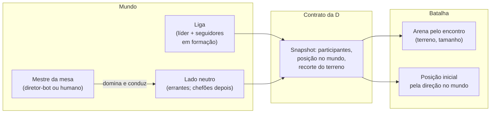

# Brainstorm: o mestre da mesa, as ligas e a arena pelo encontro

> **Status:** ideias do dono (2026-11-20) com a análise do agente. **Nada aprovado.** Entram junto da
> [proposta do ROADMAP depois do M2](2026-11-20-roadmap-depois-do-m2.md), que mostra onde elas moram no banco de
> ideias. As perguntas estão no fim, numeradas **a partir de 4**, para a rodada interativa seguir uma lista só (1 a 3
> são as do ROADMAP).

> **Consolidado** (2026-11-20): este arquivo é o registro da leva; a análise de conjunto, o planejamento revisto e
> **as perguntas atuais** estão no [consolidado](2026-11-20-consolidado-depois-do-m2.md). As perguntas numeradas abaixo ficam como histórico.

## O pedido [dono]

Depois da F7 do laboratório, com a proposta do ROADMAP aberta, o dono trouxe três ideias para o brainstorm:

1. **O mestre da mesa** ("deus", o "rei da mesa" dos RPGs de mesa): um jogador com a responsabilidade de manter a
   partida equilibrada e divertida para os dois times, e de criar oportunidades de interação quando o jogo parecer
   lento para quem está ativo. Ele pode **dominar creeps neutros e usar as habilidades deles**, um gameplay único
   desse papel, que cria batalhas mais intensas e humanas.
2. **Domínio e seleção, de novo: as ligas.** No meio para o fim da partida, com recurso para mais 10 creeps, o
   jogador domina um **creep líder** e escolhe um ou mais companheiros para segui-lo. Não uma tropa única que anda
   junto (Mount & Blade), mas um **grupo, uma "liga"**: num time com vários jogadores, cada um forma a sua (ex.: 3v3
   com 10 creeps por liga), com divisão de responsabilidades, comportamento e **formação** (ex.: os quadrados na
   frente do líder), como nos RTSs clássicos. A dúvida do dono: como encaixar isso na interface sem poluir nem criar
   densidade para o jogador casual.
3. **A arena pelo encontro.** Uma ideia do começo do GDD: o terreno da arena é gerado proceduralmente e representa a
   área do mapa onde o encontro aconteceu. A **posição inicial das tropas** na arena (no começo e durante a batalha)
   corresponde à **direção relativa** dos creeps no mundo no momento do encontro. A arena tenta representar aquele
   espaço e acomodar de 1 × 1 a 10 × 10 × 10 (talvez com versões menores geradas até o limite, carregadas conforme a
   batalha pede: um 1 × 1 não precisa de um mapa grande, que cresce quando entram outros creeps). "Se for
   overengineer, pode esperar."

## Como as três se ligam [agente]

As três se encontram no **contrato da fatia D** (o que o mundo entrega à batalha e o que ela devolve). O mestre
comanda o lado neutro, que a D cria com os errantes. As ligas trazem para a arena uma formação que já existe no mundo.
A arena pelo encontro lê o recorte do terreno e a posição de cada creep, que o
[ADR-0001](../adr/0001-mundo-e-batalha-separados.md) já prevê ("um recorte do terreno").

**A consequência prática:** nenhuma das três precisa ser construída na D. Mas a D pode deixar o contrato pronto para
elas: o snapshot leva a posição de cada creep e o recorte do terreno, e o ADR do lado neutro aceita que alguém além
do piloto comande os neutros. Isso custa pouco agora e evita reabrir o ADR depois. É o que as perguntas 6 e 11
decidem.

---

## 1. O mestre da mesa

### O que já existe [agente]

- **O lado neutro nasce na D** com os errantes, e o ADR dele já lista quatro consumidores como restrições
  (errantes, chefões, tribos, invasores; [GDD 05](../gdd/05-tribos-e-diplomacia.md)). O mestre seria um quinto: **um
  controlador do lado neutro**.
- **A curva dos errantes por ato** do fim do mundo já é um "diretor" simples: decide quando a jungle fica mais
  perigosa. Os invasores do M5 são jogadores que entram equilibrados, um por time: uma versão **antagonista** do
  mesmo papel.
- **A dificuldade do bot configurável** e a **IA que aprende** ([GDD 06](../gdd/06-batalhas.md)) são o mesmo botão
  visto de outro lado: quão forte a jungle joga.
- **Tudo é comando** ([ADR-0002](../adr/0002-tudo-e-comando.md)): um mestre humano e um mestre bot emitiriam os
  mesmos comandos, como o jogador e o piloto já fazem.

### O que pesa [agente]

1. **Serve ao pilar 4** (o mundo não espera você): o risco de um mundo de dias é o tédio de quem está online numa
   hora em que nada acontece. O mestre ataca exatamente isso.
2. **Ameaça o pilar 1** se "equilibrar" virar socorrer quem está perdendo: o time que ganhou na macro sente que o
   mestre roubou a vitória (o problema do "casco azul"). O mandato mais seguro é a **interação** (perigo e
   oportunidade para quem está ativo), não o placar.
3. **A cadeira precisa de alguém.** Um papel que exige um jogador a mais por mundo é difícil de encher, e o jogo não
   exige humanos online (não-objetivos). Se o mestre existe primeiro como **diretor-bot**, a cadeira humana vira um
   bônus: o mundo funciona sem ela, e um humano a ocupa quando quiser. Nos playtests locais, o próprio dono pode
   sentar nela: é uma ferramenta de playtest (forçar encontros, testar um chefão).
4. **O mestre também precisa se divertir.** A parte divertida dele é a que o dono descreveu: dominar um neutro e
   lutar com ele. Um chefão nas mãos de um humano é uma batalha diferente de um chefão pelos gambits.
5. **Conflito de interesse:** um mestre amigo de um time vaza informação ou favorece. Num mundo de amigos é
   aceitável; num mundo público, pede regras (o mestre não fala com os times fora da crônica, por exemplo).

### Como poderia ser [agente]

- **Um orçamento físico, o fôlego da jungle** (nome provisório; pilar 2: o poder do mestre existe em algum lugar). Ele
  cresce quando os jogadores ativos ficam muito tempo sem encontro e com os atos do fim do mundo, e as ferramentas do
  mestre o gastam. Assim, "o jogo parece lento" vira regra: quanto mais parado, mais o mestre pode fazer. O
  diretor-bot gasta o mesmo orçamento pelas próprias regras.
- **As ferramentas**, todas no mundo e visíveis, nenhuma criando riqueza do nada:
  - **dominar um neutro** (um errante no começo; um chefão quando existir) e lutar com ele, com as habilidades dele
    quando existirem skills;
  - **conduzir uma onda de errantes** para uma região, saindo da jungle, não aparecendo no meio do mapa;
  - **acordar um chefão** mais cedo (com a jungle hostil);
  - **uma oportunidade:** ex.: uma caravana neutra com carga que atravessa o mapa entre os dois times, disputável
    pelos dois, ou um depósito que uma tribo revela (com as tribos).
- **A visão:** o mestre vê o mapa inteiro (é o "deus"), mas os neutros que ele domina enxergam como qualquer creep
  (a luta continua justa).
- **A crônica dá voz a ele** ("a jungle se agita a leste"), sem nome de jogador.

### Onde cabe [agente]

**Tema "A jungle hostil"** do banco, porque as ferramentas do mestre são os neutros (errantes, chefões) e as
habilidades deles vêm com a progressão. O antagonista (os invasores) continua em "As lendas". Na D, só uma
restrição no ADR do lado neutro, se o dono aprovar (pergunta 6): os neutros aceitam um controlador, como um time.
**Construir o mestre aumentaria o escopo do M2**: não entra antes de o dono escolher o marco.

---

## 2. As ligas

### O que já existe [agente]

- **1 domínio ativo por jogador** ([GDD 02](../gdd/02-creeps-e-dominio.md)); os outros creeps seguem o piloto
  automático, por creep. A seleção no mundo é de **um creep** por vez (a "seleção por área" do M1.5 é a área de
  clique, não um retângulo de seleção).
- **Pergunta aberta no [GDD 07](../gdd/07-piloto-automatico.md):** "onde fica o piloto automático: por creep, por
  grupo de creeps, ou por jogador?". A liga é a resposta "por grupo".
- **O comandante** (ideia do dono de hoje cedo, [GDD 06](../gdd/06-batalhas.md)): a tática do time nas batalhas em
  grupo. **A liga e o comandante são a mesma família:** cada jogador lidera uma liga; o comandante dá a tática do
  time por cima das ligas.
- **Na batalha**, cada creep não dominado já segue uma lista de gambits, com a ação "proteger aliado", e cada humano
  controla só o creep que domina (proposta do GDD 06).
- **A escolta** já é um verbo das quests ([brainstorm M2–M3](2026-11-15-m2-m3.md) §3): a liga é a escolta feita
  pelo jogador.

### A ideia central [agente]

**A liga é um piloto automático de grupo, não um modo de controle novo.** O domínio continua sendo um só: o jogador
controla o líder, e os seguidores obedecem a uma regra nova, **seguir o líder**, que os põe numa vaga da formação.
Isso preserva o domínio (pilar 3), não pede micro de RTS para cada unidade, e resolve o casual pelo padrão: **a
formação sai do DNA** (pilar 6, a forma é o papel), sem configurar nada:

| | | |
|---|---|---|
| ■ | ■ | ■ |
| ▲ | líder | ▲ |
| ● | ● | ● |

(a frente é a direção para onde o líder anda: os quadrados seguram a linha, os triângulos cobrem os flancos, os
círculos atiram de trás.)

**O custo é econômico** (pilares 1 e 2): quem segue o líder não coleta nem carrega. Formar uma liga de 10 é tirar 10
creeps da economia; é a decisão de macro que o dono descreveu ("já tenho recurso sobrando").

### A interface em três camadas [agente]

A densidade fica escondida até o jogador pedir:

1. **Casual (sem configurar):** dominando um creep, clicar num aliado dá a ação **"seguir-me"** (no cursor, como as
   ações de hoje); arrastar uma área em volta de vários aliados dá **"formar liga"**. A formação é a do DNA. No mapa,
   a liga aparece como uma cor ou um traço fino ligando cada seguidor ao líder. Sair da liga é o mesmo clique.
   **Revisto na 4ª leva** ([recrutamento, laços e traits](2026-11-20-recrutamento-lacos-traits.md) §1): o dono propôs que entrar na liga
   seja um **recrutamento por diálogo**, dominando o líder; o clique ficaria só para chamar de volta quem já é da
   liga (pergunta 18).
2. **Ordens de liga na batalha:** no máximo **três**, por tecla, como as ordens do Mount & Blade em escala pequena:
   **comigo** (voltar à formação em volta do líder), **segurem** (manter a posição) e **no meu alvo** (atacar o alvo
   do líder). Fora delas, os seguidores lutam pelos próprios gambits.
3. **Avançado (um painel que só abre quando pedido):** editar a formação numa grade pequena, dar um papel (um preset
   de gambits) a cada membro e formar subgrupos (ex.: "os círculos protegem o portador").

Num time com vários jogadores, cada liga tem a cor do seu líder, e o comandante (tema "O time") vê todas.

### O que pesa [agente]

- **No mundo, os creeps não colidem** (pergunta aberta do GDD 02, "vários creeps na mesma célula"). A formação dá a
  cada seguidor uma célula própria, o que resolve parte do problema, só para as ligas.
- **Custo do tick:** seguir com um caminho calculado por seguidor a cada tick é caro. O caminho barato é seguir o
  rastro do líder com atraso, e só recalcular quando a vaga fica longe (decisão de implementação, para a spec).
- **O tamanho da batalha:** três ligas de 10 de cada lado chegam a 30 × 30 numa luta. O laboratório aceita hoje até 4
  lados e 5 creeps por lado, com a meta de custo medida no 3 × 3. Os 10 × 10 × 10 do dono parecem o teto natural
  (uma liga por lado); os números são provisórios e se medem no `geo battle sweep`.
- **O teto da liga cresce** (ideia do dono, 3ª leva): ex.: no level 1, 1 seguidor; no level 10, 10. De onde vem o
  teto (o level do líder, um item de comando, a fama) está no
  [brainstorm de itens, reputação e governança](2026-11-20-itens-reputacao-governanca.md) §1.

### Onde cabe [agente]

**Tema "O time"**, junto do comandante. Mas **a liga de um jogador só depende da junção**: não precisa de 3v3 nem de
votação. É a candidata mais forte a **próximo marco** depois do M2, porque deixa as batalhas no mundo maiores e mais
humanas e testa o pilar 3 em escala. A pergunta dele seria: **"Liderar um grupo deixa a batalha mais humana sem pesar
para o jogador casual?"** **Aumenta o escopo do M2**: não entra antes de o dono escolher o marco.

---

## 3. A arena pelo encontro

### O que já existe [agente]

- **O terreno de batalha pelo entorno** (ideia do dono, 2026-11-15, sem marco; [GDD 06](../gdd/06-batalhas.md) e
  [01](../gdd/01-mundo.md)): batalhas perto do rio, de pedras, de estradas e de estruturas, cada uma com o seu terreno.
  A ideia de hoje acrescenta a **posição pela direção** e o **tamanho pelos participantes**.
- **O laboratório já tem a arena como texto** (spec do laboratório, D3): chão, pedra e o anel de saída, em três
  arenas fixas, que já são três tipos de terreno do mundo: **o campo aberto, o campo com pedras e o corredor (o
  gargalo de um vau)**. Cada lado nasce numa zona a 1/4 da borda; quem entra no meio nasce na zona do seu lado (D11).
- **O ADR-0001** já diz que o mundo entrega "um recorte do terreno" à batalha.

### Como poderia ser [agente]

- **Um gerador, não um motor novo.** Uma função pura transforma o recorte do mundo (as células em volta do
  encontro) numa arena em texto, no formato que o pacote de batalha já lê. O pacote de batalha não muda. A arena
  gerada vai no log da batalha, como hoje: o replay e o `verify` continuam valendo sem regerar nada.
- **A escala:** cada célula do mundo vira um bloco de células da arena (o tamanho do bloco é provisório). O que cada
  coisa do mundo vira:

  | No mundo | Na arena | Quando |
  |---|---|---|
  | Chão da jungle | Chão | Já dá |
  | Pedra | Pedra (bloqueia o movimento e o projétil, como hoje) | Já dá |
  | Vau | O gargalo (como a arena "corredor") | Já dá |
  | Rio | Água: bloqueia o movimento, não o projétil | Regra nova: depois da junção |
  | Estrada | Chão, talvez mais rápido | Regra nova: depois |
  | Árvores (M2.5) | Cobertura | Com as árvores |
  | Núcleo, torres | Estruturas, com o acampamento ([01](../gdd/01-mundo.md), em incubação) | Com o cerco ou o acampamento |

- **A posição pela direção:** cada lado nasce na zona da borda que corresponde à direção de onde estava no mundo
  (quem estava ao norte nasce ao norte), com a distância mínima de hoje (a zona a 1/4 da borda; nascer colado à saída
  deixava fugir em 2,6 s). **Quem entra no meio** entra pela borda da direção de onde vem. Com uma liga, a posição de
  cada membro no mundo traz a formação para dentro da arena.
- **A saída também tem direção** (proposta do agente): quem foge pela borda volta ao mundo do lado correspondente do
  encontro. Fugir para a borda que dá para o próprio Núcleo vira uma decisão, e **a emboscada que vem do lado de casa
  da vítima corta a fuga** (o nome do M2).
- **O espelho:** o mapa é espelhado, e o gerador tem de dar arenas equivalentes para os dois times no mesmo terreno
  espelhado (a lição do desempate no referencial do time, no fog).

### O tamanho: o que custa de verdade [agente]

Carregar um mapa grande **não é o custo**: uma arena de 63 × 39 tem 2 500 células em texto, nada para a memória e
para a rede. O que custa é **jogar** num espaço do tamanho errado: um 1 × 1 numa arena enorme vira perseguição, e o
relógio de inatividade acaba com a luta; um 10 × 10 numa arena pequena não tem onde se mexer. Então:

- **Recomendado: um tamanho escolhido na abertura**, por faixa de participantes (pequena, média, grande), contando
  quem está perto e pode entrar. Simples e sem regra nova.
- **Alternativa: a bolha que cresce.** O gerador produz o recorte inteiro de uma vez; a área jogável começa pequena e
  o anel de saída se afasta quando entra gente. É a ideia do dono sem o "carregar por partes"; muda a regra da borda
  no meio da luta. Fica como segundo passo, se as faixas não bastarem.
- **Fora:** gerar e carregar pedaços sob demanda (*streaming*). Resolve um problema que o jogo não tem.

### Onde cabe [agente]

**Tema "A batalha"** do banco, a parte gerada e o tamanho por faixa. Mas uma versão mínima cabe na D sem regra nova
de combate (pergunta 11): **a arena é escolhida entre as três do laboratório pelo terreno do encontro** (perto de um
vau, o corredor; perto de pedras, as pedras; senão, o aberto), **e cada lado nasce pela direção no mundo**. O
contrato já leva o recorte, e o gerador entra depois sem mexer no ADR. **Mesmo a versão mínima aumenta um pouco o
escopo da D**: o dono decide.

---

## Decisões do agente (para o dono vetar, se quiser)

- **Sem *streaming* de arena.** O tamanho é jogabilidade, não memória (§3).
- **A arena gerada vai no log da batalha**, e o pacote de batalha continua lendo arena em texto: o gerador mora na
  camada da junção, não no `@geometrix/battle`.
- **O mestre usa os mesmos comandos** dos jogadores e do piloto (ADR-0002), e o diretor-bot é o piloto do lado
  neutro.
- **O 10 × 10 × 10 entra no `geo battle sweep`** quando as ligas tiverem marco, com uma meta de custo própria; os
  limites de hoje (4 lados, 5 por lado) ficam até lá.

## Perguntas para o dono

(Continuam a numeração das [perguntas do ROADMAP](2026-11-20-roadmap-depois-do-m2.md#perguntas-para-o-dono), 1 a 3.)

**O mestre da mesa**

4. **De que lado o mestre está?** Recomendo **neutro**: o trabalho dele é a partida ser divertida para os dois times,
   não vencer. *Alternativa:* um antagonista com objetivo próprio (aí ele é o invasor do M5, que já existe).
5. **"Equilibrar" inclui ajudar quem está perdendo?** Recomendo **não**: ele cria perigo e oportunidade para quem
   está ativo, igual para os dois, e não mexe no placar, para não roubar a vitória da macro (pilar 1).
   *Alternativas:* pesar contra quem está na frente, mas por uma regra visível (ex.: as ondas vão mais para o
   líder); ou a critério do humano, como o mestre de RPG.
6. **Quem senta na cadeira?** Recomendo **um diretor-bot sempre presente** (a curva dos errantes cresce até ele), com
   a cadeira aberta a um humano quando houver um. Na D, isso seria só uma restrição no ADR do lado neutro (os neutros
   aceitam um controlador). *Alternativa:* só humano, um jogador a mais por mundo.

**As ligas**

7. **A liga é um piloto automático de grupo?** Recomendo **sim**: você controla o líder; os seguidores ficam na
   formação do DNA e lutam pelos próprios gambits, com até três ordens de liga na batalha. *Alternativa:* o controle
   de RTS clássico, selecionar e mandar ordem a cada membro ou subgrupo.
8. **Uma liga pode ter um líder sem humano?** Recomendo **sim**: um creep livre, pelo piloto, lidera; você forma a
   escolta, sai do jogo, e ela continua (pilar 4). O domínio só põe um humano no lugar do líder.
9. **Quando o líder morre ou é liberado?** Recomendo: **cada membro volta às regras que tinha antes**, e a liga fica
   guardada para ser chamada de novo num clique. *Alternativas:* o membro mais forte assume como líder; ou todos
   voltam ao Núcleo.

**A arena pelo encontro**

10. **A direção no mundo vira posição na arena**, para quem começa, para quem entra no meio e para quem foge (sair
    pela borda norte volta ao mundo ao norte do encontro)? Recomendo **sim nas três**, com a distância mínima de hoje.
11. **Quanto disso entra na D?** Recomendo **o mínimo:** a arena escolhida entre as três do laboratório pelo terreno
    do encontro, o nascimento pela direção e o contrato já levando o recorte; a arena gerada e o tamanho por faixa
    ficam no banco. *Alternativas:* já gerar a arena na D; ou nada disso na D (arena fixa, zonas como no laboratório).
