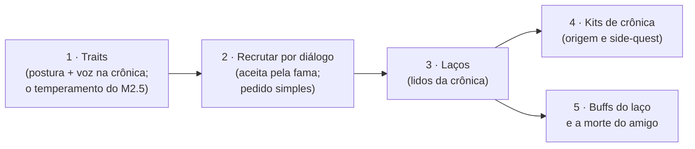

# Brainstorm: recrutamento, laços e traits com crônica

> **Status:** ideias do dono (2026-11-20, 4ª leva) com a análise do agente. **Nada aprovado, e nada disso entra no
> M2.** "Tudo isso é ideia que quero desenvolver com você." Segue a
> [3ª leva](2026-11-20-itens-reputacao-governanca.md) (itens, reputação, governança), a
> [2ª](2026-11-20-mestre-ligas-arena.md) (o mestre, as ligas, a arena) e a
> [proposta do ROADMAP](2026-11-20-roadmap-depois-do-m2.md). As perguntas continuam a numeração: **18 a 23**.

> **Consolidado** (2026-11-20): este arquivo é o registro da leva; a análise de conjunto, o planejamento revisto e
> **as perguntas atuais** estão no [consolidado](2026-11-20-consolidado-depois-do-m2.md). As perguntas numeradas abaixo ficam como histórico.

## O pedido [dono]

1. **Repensar como a liga se forma:** o jogador domina um creep líder para **dialogar e persuadir** cada aliado que
   quer acrescentar. Pode ser **automático pela reputação**, ou exigir uma **side-quest** ou algo parecido. A liga
   passa a ter o lado do comando (comandante e time) e o lado das **relações pessoais**, que alimentam a crônica e o
   desenvolvimento dos personagens.
2. **Laços:** creeps com um relacionamento minimamente "íntimo" (a camaradagem de amigos que dividiram muitas
   experiências) geram **buffs para a liga e o líder**, com efeito no mundo, no combate ou nos dois.
3. **A reputação facilita:** líderes com reputação alta recrutam com mais facilidade (ex.: sem side-quest).
4. **Traits com uma crônica por trás:** um **catálogo de presets de traits e kits de crônica** que definem a
   side-quest daquele personagem, escolhidos quando ele é gerado no mundo, de forma determinística pela seed.

## A leitura geral [agente]

**É a ideia que mais serve ao pilar 3** ("qualquer creep pode ser um herói"). Hoje o creep é um corpo com DNA e
nome; com traits, laços e uma história própria, ele vira **personagem**. Somado à morte permanente, isso dá peso a
cada perda e gera a crônica que o jogador quer contar aos amigos.

**Quase tudo já tem onde se apoiar:**

| Peça nova | Onde se apoia |
|---|---|
| Diálogo de recrutamento | O diálogo do encontro (fatia A): abordar, uma ação, a resposta da outra parte |
| Reputação no recrutamento | A fama do creep ([3ª leva](2026-11-20-itens-reputacao-governanca.md) §2), lida da crônica |
| Laços | Os eventos da crônica: quem lutou do mesmo lado, quem sobreviveu junto, quem protegeu quem |
| Side-quest pessoal | As quests nos verbos do mundo (carregar, explorar, construir, lutar, escoltar; [brainstorm M2–M3](2026-11-15-m2-m3.md) §3) |
| Traits | O temperamento ao nascer (proposta do M2.5: a postura no encontro e a voz na crônica) |
| Kits de crônica | O texto fora do `sim` (brainstorm M2–M3 §2): o `sim` guarda ids e parâmetros, o cliente escreve a frase |

**O que já foi descartado continua descartado:** recrutar o creep **inimigo** (subornar para mudar de lado),
"forte demais com morte permanente" (brainstorm M2–M3 §2). O recrutamento aqui é só entre aliados.

---

## 1. Recrutar por diálogo [agente]

**Como poderia ser:** dominando o líder, o jogador aborda um aliado e pede que ele entre na liga. A resposta vem do
trait do aliado, da **fama** do líder e do **laço** entre os dois:

| Desfecho | Quando | O que acontece |
|---|---|---|
| **Aceita** | A fama do líder ou o laço com ele bastam para a exigência do trait | Entra na liga na hora |
| **Pede algo** | Falta pouco | Um pedido simples nos verbos do mundo (ex.: "traga 20 cristais para o Núcleo") ou a **side-quest pessoal** do kit (§3) |
| **Recusa** | Falta muito, ou o trait não segue esse tipo de líder | Não entra agora; a crônica conta por quê ("não sigo quem fugiu do vau") |

- **O casual:** o primeiro recrutamento tem de ser fácil (o catálogo de traits inclui os que seguem qualquer um, e o
  teto começa em 1 seguidor, pergunta 12). O diálogo é uma tela só, como o do encontro.
- **Quem recruta:** o domínio é a porta (como o dono propôs), mas o bot do time também domina e recruta. Uma vez
  formada, a liga funciona sem humano (pergunta 8).
- **A side-quest e o pilar 4:** quem cumpre a side-quest é o líder (ou a liga). Se o jogador sair, o piloto pode
  seguir com ela por uma regra temporária ("cumprir o pedido de X"), para o recrutamento não exigir ficar online
  (pergunta 19).
- **O que muda na 2ª leva:** a camada casual das ligas era um clique ("seguir-me"). Com o recrutamento, entrar na liga
  vira um momento de jogo, e o clique fica só para chamar de volta quem já é da liga (pergunta 18).

## 2. Laços e camaradagem [agente]

**O laço é uma leitura da crônica, como a fama.** Ele cresce com experiências divididas, todas já eventos ou perto de
ser:

- lutaram do mesmo lado numa batalha **e os dois saíram vivos**;
- um protegeu o outro (o gambit "proteger aliado" agiu);
- ficaram juntos na mesma liga por um tempo;
- cumpriram uma quest juntos.

**Poucos níveis**, para ser legível: *conhecidos → companheiros → irmãos de armas* (nomes provisórios). O
"minimamente íntimo" do dono é o nível de companheiros para cima.

**O custo de estado:** laços entre todos os pares crescem com o quadrado da população. **Cada creep guarda poucos
laços** (os mais fortes, ex.: 3, provisório), num array ordenado por id, como o resto do estado.

**Os buffs** (proposta do agente): pequenos e de **coordenação**, não de dano puro, na linha do "buff logístico" da
jungle hostil. Exemplos, só para mostrar o formato:

| Onde | Buff do laço |
|---|---|
| Combate | O amigo reage mais rápido para proteger o outro (o tempo de reação da IA, que já é um parâmetro, cai para esse par) |
| Combate | Não foge enquanto o amigo ainda luta |
| Mundo | Recuperam HP mais rápido quando estão juntos |
| Liga | Um líder com muitos companheiros na liga ganha +1 no teto, ou a formação se refaz mais rápido |

**A morte de um amigo** é onde o laço mais rende, por causa da morte permanente. O trait decide a reação:

- **fúria:** um buff curto na batalha em que o amigo caiu;
- **luto:** sai da liga por um tempo;
- **vingança:** ganha uma side-quest contra quem matou, gerada pelo próprio evento da morte. Uma quest que nasce da
  crônica.

## 3. Traits com kits de crônica [agente]

**Um trait é um preset do catálogo**, e cada preset junta, num lugar só:

| Parte | Exemplo (o "leal") |
|---|---|
| Postura no encontro | Luta quando atacado, não paga extorsão de quem feriu um amigo |
| Exigência de recrutamento | Baixa: segue qualquer líder do time que nunca fugiu de uma batalha |
| Como forma laços | Rápido com quem luta ao lado dele |
| Reação à morte de um amigo | Vingança |
| Voz na crônica | Frases curtas, sobre o time |
| **Kit de crônica** | Uma origem ("nasceu no dia em que o Laranja tomou o vau") e um **modelo de side-quest** ("quer ver o Núcleo inimigo com os próprios olhos": explorar até ver o Núcleo inimigo) |

**Determinístico pela seed, com um detalhe:** a população inicial nasce na criação do mundo, mas os creeps seguintes
nascem durante a partida, quando o Núcleo os produz. Os dois casos são determinísticos: o trait e o kit saem do
`state.rng` no nascimento, e os **parâmetros do kit** (a célula a explorar, o DNA a vencer, a quantidade a entregar)
saem do estado do mundo naquele tick. A origem pode citar um evento real da crônica, o mais recente e marcante.
Mesmo seed e mesmos comandos, mesmos personagens.

**O texto fica no cliente** (brainstorm M2–M3 §2): o `sim` guarda o id do trait, o id do kit e os parâmetros
resolvidos; o catálogo de frases mora fora da simulação, muda sem trocar o `SIM_VERSION` e o dono escreve sem mexer
em código. Um LLM pode ajudar a **escrever** o catálogo offline, nunca em tempo de jogo.

**Os modelos de side-quest** usam só os verbos do mundo e se conferem pelos eventos que já existem:

| Verbo | Modelo |
|---|---|
| Explorar | Ver uma célula ou o Núcleo inimigo |
| Carregar | Entregar N cristais no Núcleo |
| Lutar | Vencer uma batalha contra um DNA; sobreviver a uma batalha em desvantagem |
| Escoltar | Acompanhar um creep do time até um lugar |
| Vingar | Derrotar o creep que matou um amigo (nasce do evento da morte, §2) |

**O tamanho do catálogo:** começar pequeno (6 a 8 traits, provisório) e crescer como conteúdo. É trabalho de
escrita, não de engenharia.

---

## A ordem em camadas [agente]

Para não complicar o MVP, cada camada se joga sozinha, e a seguinte só entra se a anterior provar diversão:

**Os traits não dependem do combate** (o brainstorm do fim do mundo já notava isso nos temperamentos): só do encontro,
que já existe. As camadas 2 em diante dependem das ligas, que dependem da junção.

## Onde cabe [agente]

Um **tema novo no banco: "Os personagens"**: traits com kits de crônica, laços, side-quests pessoais, a fama e
renomear. Ele tira do tema "Itens, forja e progressão" a parte de identidade (temperamentos, renomear, a fama). É a
metade "a identidade no creep" da 3ª leva, enquanto os itens são a metade "o poder no item". O recrutamento mora nas
ligas (tema "O time"), mas depende deste tema. **Aumenta o escopo do M2**: nada entra antes de o dono escolher o
marco.

## Perguntas para o dono

(Continuam as perguntas [1 a 3](2026-11-20-roadmap-depois-do-m2.md#perguntas-para-o-dono),
[4 a 11](2026-11-20-mestre-ligas-arena.md#perguntas-para-o-dono) e
[12 a 17](2026-11-20-itens-reputacao-governanca.md#perguntas-para-o-dono).)

18. **Formar a liga é recrutar por diálogo?** Recomendo **sim**, dominando o líder, com três desfechos: aceita (a fama
    ou o laço bastam), pede algo (um pedido simples ou a side-quest do kit) ou recusa. O clique fica só para chamar de
    volta quem já é da liga. *Alternativas:* o clique simples para todo mundo, com o diálogo opcional dando um bônus;
    ou só o automático pela fama, sem diálogo.
19. **Quem cumpre a side-quest de recrutamento?** Recomendo **o líder ou a liga, pelo piloto se o jogador sair**
    (pilar 4). *Alternativa:* só com um humano dominando o líder.
20. **De onde vêm os laços?** Recomendo **da crônica**: lutar do mesmo lado e sobreviver, proteger, ficar na mesma
    liga, cumprir uma quest juntos. Poucos níveis, e cada creep guarda só os laços mais fortes. *Alternativa:* só o
    tempo na mesma liga.
21. **Que tipo de buff o laço dá?** Recomendo **pequenos e de coordenação** (o amigo protege mais rápido, não foge
    enquanto o outro luta, recuperam HP juntos), não dano puro. *Alternativas:* buffs de stats; ou nenhum buff, só a
    crônica.
22. **E quando um amigo morre?** Recomendo que **o trait decida**: fúria (um buff curto), luto (sai da liga por um
    tempo) ou vingança (uma side-quest contra quem matou). *Alternativa:* sem efeito mecânico, só a crônica.
23. **Os traits com kits de crônica:** recomendo **um catálogo pequeno** (6 a 8 presets), em que cada trait junta a
    postura, a exigência de recrutamento, a reação à morte de um amigo, a voz e um kit (origem + modelo de
    side-quest), sorteado no nascimento pelo `state.rng`, com os parâmetros tirados do mundo naquele instante e o
    texto no cliente. *Alternativas:* traits só mecânicos, sem kit; ou histórias escritas à mão só para creeps únicos
    (os das tribos).
