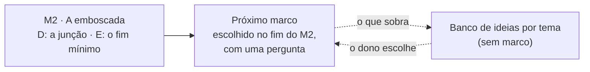

# Proposta: o planejamento macro depois do M2

> **Status:** proposta do agente (2026-11-20), **a aprovar pelo dono antes da spec da fatia D**. Nada aqui muda o
> [ROADMAP](../ROADMAP.md) nem o GDD até o OK. As perguntas estão no fim, numeradas.

## O pedido [dono]

No checkpoint do laboratório (2026-11-20, grupo 8): "tem muita coisa com marco". O dono pediu para reorganizar o
planejamento macro depois do M2, e que o agente analise e proponha onde cada ideia nova cabe (o comandante, os
anúncios, o som), perguntando só o que o repositório não responde.

## O que está marcado hoje [agente]

| Marco | O que já tem destino nele | Pergunta |
|---|---|---|
| **M2 — A emboscada** (em andamento) | A ✅, B ✅; faltam **C** (chat, console, macros), **D** (a junção, com os errantes) e **E** (cerco, reparo, vitória pelo Núcleo, o fim mínimo); as rodadas de design do cristal e da E | A batalha muda o rumo do mundo sem dominar o jogo? |
| **M2.5 — A jungle hostil e o fim do mundo** | A corrupção do cristal esgotado, o ponto sem volta, a vitória pírrica, a crônica do fim, o registro das lendas; chefões com buff e artefato; level, XP, evolução e skills; temperamentos; a 3ª ação do encontro por DNA; árvores destrutíveis; renomear creeps; o golpe crítico (pergunta aberta) | O fim do mundo dá à partida um clímax que o jogador quer rever? |
| **M3 — O time** | 3v3, impostos, votação com níveis de autoridade, genética; o comandante (candidato) | A governança gera decisões interessantes, ou só burocracia? |
| **M4 — O mundo vivo** | Tribos e diplomacia, o final feliz secreto, piloto automático scriptável, construção ampla, macros no servidor | — |
| **M5 — As lendas** | Invasões entre mundos, deploy com contas entre mundos (o control plane em Go) | — |
| **Sem marco** | Som, anúncios de abate, IA que aprende, terreno de batalha pelo entorno, acampamentos e torres, deploy de testes e olhos novos, a predição no jogo | — |

## O que pesa [agente]

1. **Marcos longe demais com destino fixo.** O M2.5 junta dois temas grandes (o fim do mundo e a jungle hostil com a
   progressão) e já previa se dividir em M2.5a e M2.5b. O M4 e o M5 não têm pergunta. Cada GDD carrega a etiqueta de
   marco de cada ideia (o `README` do GDD tem uma coluna só para isso), e cada mudança de plano mexe em vários
   arquivos.
2. **O que cada marco aprende muda o seguinte.** O laboratório mudou a ordem de várias coisas (o deploy e a predição
   esperam a junção; nenhuma regra nova de combate antes dela). Fixar hoje o M3, o M4 e o M5 é planejar sem os
   playtests que decidem.
3. **O M2 ainda é grande.** A fatia C (chat, console, macros) não responde à pergunta do M2 (a batalha muda o rumo
   do mundo?): ela é sobre comunicação e automação.
4. **Ideias soltas sem lugar para morar.** O som, os anúncios e a IA que aprende ficam espalhados no GDD 06 como
   "sem marco", sem um lugar onde o dono veja todas de uma vez.

## A proposta (recomendada): horizonte curto e um banco de ideias por tema [agente]

- **O ROADMAP mostra só três coisas:** os marcos concluídos; o marco atual, com as fatias que faltam; e **o próximo
  marco**, com a pergunta dele. O resto vira um **banco de ideias por tema**, sem número e sem ordem.
- **Uma ideia só ganha marco quando o dono escolhe o próximo marco**, no fim do atual (no checkpoint), com o que os
  playtests ensinaram. A escolha puxa do banco o que responde à pergunta.
- **O GDD troca a etiqueta de marco pelo tema** ("banco: a jungle hostil" no lugar de "M2.5"); o que já é do M2
  continua M2. Os nomes que o dono deu continuam como nomes de tema (A jungle hostil, O fim do mundo, O time, O
  mundo vivo, As lendas).
- **O M2 fecha com a D e a E** (a junção e o fim mínimo), que respondem à pergunta dele. **A C sai do M2** para o
  banco (tema "Comunicação e automação"), a não ser que o dono a queira antes (pergunta 2).

**Os temas do banco**, com o que já existe no GDD e no brainstorm:

| Tema | O que entra | Onde está hoje |
|---|---|---|
| O fim do mundo | Corrupção do cristal esgotado, ponto sem volta, vitória pírrica, crônica do fim, registro das lendas | M2.5 |
| A jungle hostil | Chefões, buffs e artefato, árvores destrutíveis, a curva dos errantes por ato | M2.5 |
| A progressão | Level, XP, evolução pelo uso, skills, temperamentos, 3ª ação por DNA, renomear, golpe crítico | M2.5 |
| O time | 3v3, impostos, votação, genética, **o comandante** | M3 |
| O mundo vivo | Tribos, diplomacia, o final feliz secreto, construção ampla | M4 |
| Comunicação e automação | Chat, console, macros de cliente (a fatia C), piloto scriptável e macros no servidor | M2 C e M4 |
| A batalha | **IA que aprende**, terreno de batalha pelo entorno, acampamentos e torres, regras novas de combate (livre, forja) | sem marco |
| A apresentação | **Som**, **anúncios de abate e de fuga**, a tela de fim e o replay com marcadores além do mínimo, "mostrar aos amigos" | sem marco |
| As lendas e o deploy | Invasões entre mundos, contas, o control plane em Go, o deploy de testes, olhos novos | M5 e sem marco |

## Onde cabem as ideias do checkpoint [agente]

| Ideia | Onde | Por quê |
|---|---|---|
| **O comandante** (tática do time nas batalhas em grupo) | Tema "O time" | Precisa de autoridade dentro do time (quem define a tática), que é o assunto do M3 de hoje; e de batalhas em grupo no mundo, que só existem depois da junção |
| **Anúncios de abate e de fuga** | Tema "A apresentação" | Só fazem sentido com espectadores de batalhas maiores; o sinal simples de morte e de fuga já está no laboratório (F7) e vai para a junção com a tela de batalha |
| **Som** | Tema "A apresentação" | Sistema novo (o jogo não tem som nenhum); junto dos anúncios, que são em boa parte som |
| **IA que aprende** | Tema "A batalha" | O exploit do ● nas esquinas pede variar o trajeto; a busca offline por gambits usa o auto-resolve, que já existe. Vira candidata quando a junção puser bots em batalha no mundo |
| **A predição e o deploy** | Na D, como já decidido (C10) | O ADR-0009 (lab) e o ADR-0008 item 9 voltam à mesa na spec da D, com o resultado do grupo 7 do PLAYTEST |

## Perguntas para o dono

1. **O formato:** o ROADMAP com o marco atual, o próximo e um banco de ideias por tema (sem número), no lugar do M2.5
   ao M5 fixos? Com o OK, o agente reescreve o ROADMAP, troca as etiquetas de marco do GDD pelos temas e atualiza o
   `README` do GDD, num commit `docs`.
2. **A fatia C** (chat, console, macros) sai do M2 para o banco, ou continua no M2 (em paralelo à D, como hoje)?
3. **O próximo marco** só se escolhe no fim do M2, ou o dono já quer um candidato agora? (O agente sugeriria o fim
   do mundo, que tem pergunta pronta e dá à partida um objetivo; a progressão é a outra candidata, porque dá motivo
   para lutar.)
