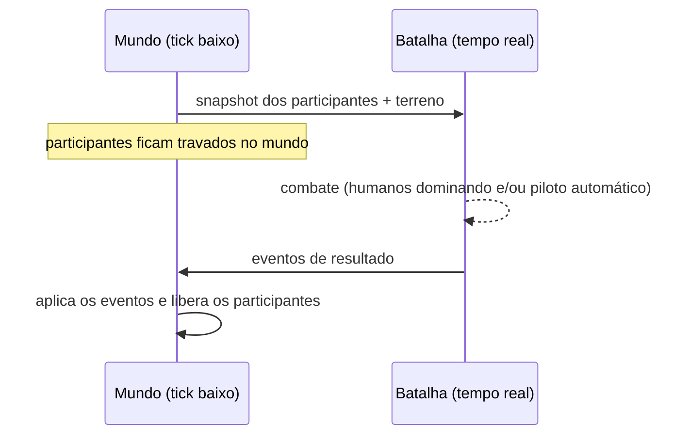

# 06 — Batalhas em tempo real

## Decidido
- O **world state** e o **battle state** são conceitos separados.
- A batalha é uma **instância dedicada** de combate em tempo real, no estilo MOBA. Ela não sincroniza em tempo
  real com o mundo e emite para ele só os eventos que importam.
- Batalhas ganham confrontos, não a guerra (pilar 1).

## Proposta
Ver [ADR-0001](../adr/0001-mundo-e-batalha-separados.md).
- **Entrada:** quando uma batalha começa, o mundo congela os participantes (creeps, inventários, um recorte do
  terreno) e os entrega à instância.
- **Saída:** ao terminar, a batalha devolve um **resultado em forma de eventos** (mortes, XP, saques,
  transferências de recursos, estruturas destruídas). O mundo aplica esses eventos.
- **Sem humanos:** se nenhum jogador estiver presente, a batalha roda sem interface e em velocidade acelerada, com
  a **mesma simulação**, decidida pelo piloto automático (auto-resolve). Humanos que chegam no meio podem dominar
  um creep e assumir.

## Perguntas abertas
- O que dispara uma batalha: contato entre unidades hostis, ataque declarado, invasão de território?
- Qual é o tamanho da "bolha" da batalha? Reforços que chegam depois entram nela?
- Duração máxima de uma batalha e como ela termina (aniquilação, recuo, tempo).
- Quanto tempo do mundo passa durante uma batalha?
- Perdas na batalha são permanentes no mundo (morte, itens perdidos)?
