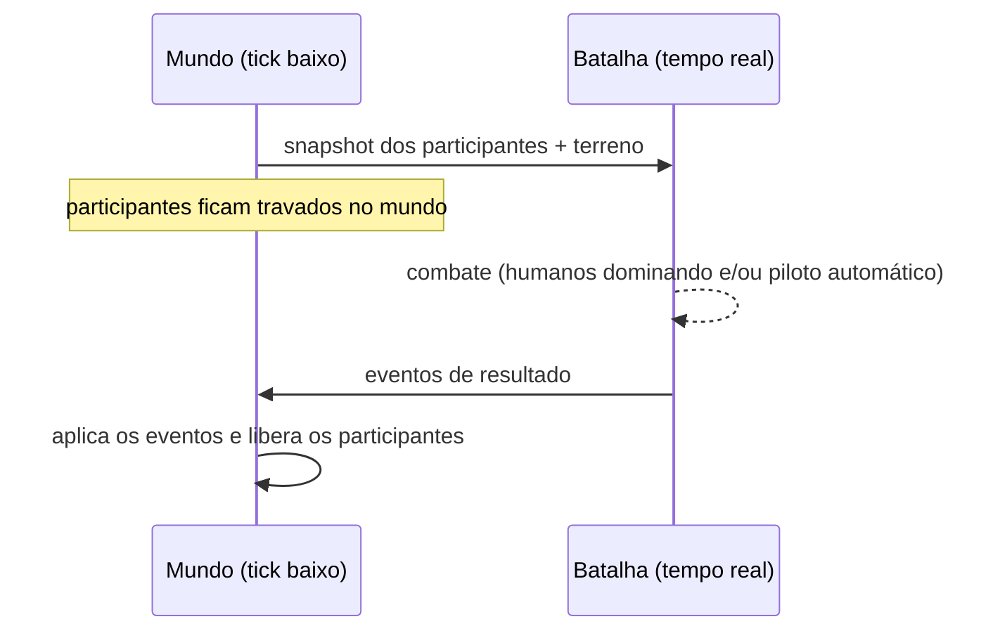

# 06 — Batalhas em tempo real

## Decidido
- O **world state** e o **battle state** são conceitos separados.
- A batalha é uma **instância dedicada** de combate em tempo real, no estilo MOBA. Ela não sincroniza em tempo
  real com o mundo e emite para ele só os eventos que importam.
- Batalhas ganham confrontos, não a guerra (pilar 1).
- **Rodada de design do M2** (dono, 2026-11-15; registro no
  [brainstorm M2–M3](../brainstorm/2026-11-15-m2-m3.md)):
  - **O encontro dispara a batalha.** Quando creeps de lados adversários se encontram, abre uma abordagem com
    diálogo: o agressor escolhe a primeira ação, e a vítima reage se a ação não abrir batalha na hora. O Mount &
    Blade inspira essa conversa (até o checkpoint da F5 do laboratório, só ela; ver abaixo). **No M2:** o agressor ataca ou extorque; a vítima paga, recusa
    (batalha) ou foge. A 3ª ação por DNA fica para o M2.5.
  - **Lados, não grupos.** O encontro é no mínimo 1×1 e pode ter mais de dois lados (times, tribos, monstros). Dá
    para entrar numa batalha já começada (ex.: roubar o buff do chefão que o inimigo enfrenta, ou defender a tribo
    atacada). Entra no M2.
  - **Quem vence:** o level, os stats, as skills e a micro de quem joga, humano ou bot. O DNA e a carga não decidem
    sozinhos. No M2, só os stats base por DNA ([02](02-creeps-e-dominio.md)).
  - **Combate experimental e configurável:** regras de combate diferentes atrás do contrato do
    [ADR-0001](../adr/0001-mundo-e-batalha-separados.md), sem uma bloquear a outra. O M2 toca **em paralelo** o
    encontro no mundo e um **laboratório de batalha** local, e junta os dois depois. Até a junção, a luta do encontro
    se resolve por um **sorteio descartável**, que ninguém balanceia.
  - **Salvo-conduto depois de pagar a extorsão:** a vítima fica imune só a novas abordagens do time que extorquiu,
    por um tempo ou até chegar à zona do próprio Núcleo (spec do encontro, D9), e perde a proteção se abordar
    alguém. O mesmo agressor não
    extorque o mesmo creep de novo por um tempo.
  - **Fuga: largar a bolsa e correr.** A vítima larga parte da carga, ou toda, num despojo no chão
    ([03](03-economia-e-logistica.md)) e fica mais rápida; o agressor escolhe entre catar ou perseguir.
  - **As perdas valem no mundo:** a morte é permanente ([02](02-creeps-e-dominio.md)), e o HP de creeps e
    construções persiste depois da batalha ([01](01-mundo.md), [02](02-creeps-e-dominio.md)).
  - **Spec do M2, fatia A, o encontro** (dono, 2026-11-15; [spec M2 do encontro](../specs/m2-encontro/spec.md)). Detalhes e números provisórios na
    spec:
    - **abordar** (D5): a intenção (atacar ou extorquir) vai na ordem de abordar, que põe o creep em perseguição
      até o alvo ficar perto o bastante para o diálogo (raio do encontro: 1 célula, provisório). Se o alvo sai da
      visão do time, a perseguição termina;
    - **o diálogo** (D6): mesmo o ataque abre com um diálogo, em que o agressor declara a agressão; a vítima luta
      ou tenta fugir. Na extorsão, ela paga, recusa ou tenta fugir. **O creep livre reage na hora, pelo piloto; o
      dominado tem uma janela** em segundos de mundo (60 s, provisório), e sem resposta valem as regras dele. Na
      fatia A, só 1 × 1, e um creep está num encontro por vez;
    - **o sorteio** (D7): rodadas a cada N segundos de mundo; a chance de acertar de cada lado é proporcional a (HP
      atual ÷ HP máximo) × um peso por DNA (igual de início); o golpe tira uma fração do HP máximo de quem apanha.
      Termina quando um morre ou foge;
    - **a fuga** (D10): fugir não deve ser fácil dentro do combate (um quadrado carregado até o talo, sozinho,
      longe da estrada ou cruzando o vau quase nunca escapa). **Cada regra de combate que for experimentada terá a
      própria mecânica de fuga.** No sorteio: a chance de escapar é a velocidade de quem foge ÷ a soma das duas
      velocidades (DNA, carga, terreno); quem falha não larga nada e luta; quem escapa larga de 50% a 100% da bolsa
      e corre para o Núcleo, mais rápido por um tempo;
    - **encontro mútuo** (D12): escolhe primeiro quem está fora do rio e dos vaus, depois quem tem menos carga
      relativa; o empate, pelo `state.rng`, nunca pelo id;
    - **salvo-conduto** (D9): termina pelo tempo **ou ao entrar na zona do próprio Núcleo**, no lugar de "até a
      própria rede de estradas" (a estrada pronta é neutra e não guarda quem a construiu).
  - **Spec do M2, fatia B, o laboratório de batalha** (dono, 2026-11-15;
    [spec M2 do laboratório](../specs/m2-laboratorio/spec.md)). A **primeira regra é a grade**; detalhes e números
    provisórios na spec:
    - **ataque direcional** (D4): o creep olha para uma de 4 direções; o quadrado bate na célula da frente; o
      círculo e o triângulo disparam um projétil que anda célula a célula e acerta o primeiro inimigo, e dá para
      desviar. Sem fogo amigo. Uma célula, um creep: o quadrado bloqueia a passagem (D5). No mesmo instante, o golpe
      sai antes do passo, e o projétil anda depois dos creeps (plan do laboratório, P3);
    - **fuga pela borda** (D7): a arena é a bolha; quem fica na saída por um instante sem levar golpe sai da
      batalha. A carga freia o creep; ele pode largar a bolsa numa pilha, e qualquer um cata (D8);
    - **o fim** (D9): **sem relógio de duração**. Um relógio de inatividade **da batalha inteira** zera quando
      qualquer um dá ou leva dano; quando estoura, todos fogem ao mesmo tempo, sem vencedor (até o checkpoint da F5,
      era um relógio por creep, e quem estourava fugia sozinho). A batalha acaba quando sobra no máximo um lado na
      arena;
    - **lados** (D10, D11): de 2 a 4, hostis entre si; dá para entrar no meio da luta, sem diálogo;
    - **IA de gambits** (D14, D15): lista ordenada condição → ação por creep, com presets por DNA, editável no
      laboratório; é o adversário do laboratório e o auto-resolve.
  - **Checkpoint da F3 do laboratório** (dono, 2026-11-17, depois de ver replays da IA;
    [tasks do laboratório](../specs/m2-laboratorio/tasks.md)):
    - **não se balanceia combate cru** (só o ataque básico) antes de skills, nível e stats. O laboratório serve
      para experimentar e validar as regras de combate candidatas, cada uma evoluindo conforme entram as mecânicas
      em comum. O quadrado vencer o triângulo que não o *kita* é justo; lutas curtas estão boas;
    - **arenas maiores e zonas de nascimento:** a arena da grade fica 2× maior (provisório), e cada lado nasce numa
      zona a meio caminho entre a borda e o centro, longe da saída, parecido com o Mount & Blade, sem a mesma escala;
    - **a borda sob fogo:** um golpe zerar a contagem da fuga não é problema, desde que a **dificuldade do bot seja
      configurável** (no laboratório, a reação de cada participante da IA).
  - **A contagem no começo da batalha** (dono, 2026-11-17, depois de jogar o laboratório): a batalha começa com uma
    **contagem de 3 s** (provisório), em que todos ficam parados: podem virar, mas não andar nem atacar, e a IA
    também. É **regra da batalha**: vale no laboratório, no mundo e no auto-resolve. Dá ao humano tempo de se
    preparar antes da luta. **No fim da contagem, vale só o que está apertado naquele instante** (dono, 2026-11-20,
    no checkpoint da F5): a direção segurada já anda, o ataque segurado já ataca, largar ou catar segurado já age; o
    que foi apertado e solto durante a contagem não fica guardado (apertar sem querer não derruba a bolsa).
  - **Checkpoint da F5 do laboratório** (dono, 2026-11-18, na sessão livre;
    [tasks do laboratório](../specs/m2-laboratorio/tasks.md)):
    - **o primeiro passo é imediato:** parado, o creep anda já no tick seguinte ao comando, e depois segue no ritmo
      do DNA. Cada toque anda uma célula, e a velocidade média não muda. Antes, o creep parado esperava o tempo de
      uma célula inteira (200 a 333 ms) antes do primeiro passo, e um toque mais curto que isso se perdia: tocar a
      tecla várias vezes não movia o creep, e parar e voltar a andar parecia lento;
    - **a inatividade é da batalha, não de cada creep:** 15 s (provisório) sem nenhum dano em ninguém, todos fogem
      ao mesmo tempo, sem vencedor. Ideia do dono: com um relógio por creep, quem não acertava nem era acertado
      fugia no meio de uma luta que estava acontecendo (no 3 × 3 e no 1 × 1 × 1). No 1 × 1, as duas regras dão o
      mesmo resultado.
  - **Checkpoint da F5 do laboratório, 2ª parte** (dono, 2026-11-19 e 20, na retomada depois da F6;
    [tasks do laboratório](../specs/m2-laboratorio/tasks.md)):
    - **a regra de grade é divertida:** "gostei bastante do resultado que alcançamos para o combate", sobretudo
      depois dos sinais de ataque, golpe e erro na tela;
    - **nenhuma regra nova antes da junção:** nem a livre nem a forja. "Vamos juntar o que tem": a grade é boa o
      bastante para ver como o combate influencia uma partida real (e simulada);
    - **o Mount & Blade inspira de várias formas, não só a conversa** (corrige a rodada de 2026-11-15): dá para
      aproveitar as ideias dele, também no combate, e adaptá-las ao geometrix, sem comparar nem copiar a escala das
      batalhas dele;
    - **o deploy espera a junção:** a latência aceitável e a predição no cliente se decidem depois de colado o ciclo
      inteiro (o mundo abre a instância, o canal fica aberto para reforços e terceiros, o resultado volta ao mundo).
      A predição no cliente pode entrar ([ROADMAP](../ROADMAP.md)).
  - **Chefão disputado** (M2.5): quando dois lados ferem o mesmo chefão, leva o buff ou o item quem dá o último
    golpe ([05](05-tribos-e-diplomacia.md)).

## Proposta
Ver [ADR-0001](../adr/0001-mundo-e-batalha-separados.md).
- **Entrada:** quando uma batalha começa, o mundo congela os participantes (creeps, inventários, um recorte do
  terreno) e os entrega à instância.
- **Saída:** ao terminar, a batalha devolve um **resultado em forma de eventos** (mortes, XP, saques,
  transferências de recursos, estruturas destruídas). O mundo aplica esses eventos.
- **Sem humanos:** se nenhum jogador estiver presente, a batalha roda sem interface e em velocidade acelerada, com
  a **mesma simulação**, decidida pelo piloto automático (auto-resolve). Humanos que chegam no meio podem dominar
  um creep e assumir.

- **Som da batalha** (pedido do dono, 2026-11-18, no checkpoint da F5, **sem marco**): um sinal sonoro para o
  disparo e o golpe, além do sinal visual que o laboratório ganha na F6. O jogo ainda não tem som nenhum: é um
  sistema novo, que só entra com um marco escolhido pelo dono.
- **O comandante: a tática do time** (ideia do dono, 2026-11-20, no checkpoint da F5; **candidato ao M3, O time**,
  pela análise do agente: o M3 já trata do 3v3 e da autoridade dentro do time). Nas batalhas em grupo (3 × 3), um
  papel de estrategista ou comandante, como no combate do Mount & Blade: mesmo dominando um creep só, ele orquestra
  o time pela arena (emboscadas, o terreno a favor, de acordo com os recursos militares do time), e quem entra no
  meio da luta já entra seguindo a tática que o comandante do time definiu. Hoje cada creep tem só a própria lista
  de gambits; a tática seria do time. Aumenta o escopo do M2: não entra antes de o dono aprovar o marco.
- **Anúncios de abate e de fuga** (ideia do dono, 2026-11-19, no checkpoint da F5; **sem prioridade**, junto do som):
  ao estilo do DotA e do LoL ("double kill", "rampage"), para quem assiste. O sinal visual simples de morte e de
  fuga é da tela do laboratório (F7), não daqui.
- **IA que aprende** (ideia do dono, 2026-11-17, **sem marco**): o bot começa burro e vai ficando mais esperto, até
  um "modo pesadelo". Um caminho concreto (agente): uma busca offline por listas de gambits que vençam a melhor
  lista anterior, com o auto-resolve (centenas de lutas por segundo), gerando níveis de bot. Aumenta o escopo do
  M2: só entra com um marco escolhido pelo dono.

### Brainstorm de 2026-11-15 (não aprovado)
Detalhes e análise no [brainstorm M2–M3](../brainstorm/2026-11-15-m2-m3.md) §2 e §6.
- **Candidatas de combate** (agente): grade (jogos de ação do BYOND, a primeira), livre (MOBA-lite), a camada de
  forja (Summon Night: Swordcraft Story: armas físicas, durabilidade, vencer quebrando a arma) e o tático só com
  gambits, que é o próprio auto-resolve. O laboratório mede a latência aceitável de cada uma com latência simulada.
- **Contrato com entrada no meio da luta** (agente): com lados e participantes que chegam depois, a instância deixa
  de receber o snapshot uma vez só; o mundo continua a alimentá-la. Pede um ADR (`Proposed`) na spec do M2.
- **Batalha curta** (agente): 1 a 2 min; cada humano controla só o creep que domina.
- **Diálogo só na abertura** (agente): quem entra no meio da luta não passa pela conversa; a crônica registra a
  entrada ([08](08-cronica-chat-e-console.md)).
- **Terreno de batalha pelo entorno** (ideia do dono, 2026-11-15, sem marco): batalhas perto do rio, de árvores,
  pedras, estradas e estruturas têm o próprio terreno, com obstáculos, paredes e torres. Junto com os acampamentos
  em [01](01-mundo.md) (ideias em incubação).

## Perguntas abertas
- Qual é o raio da "bolha" da batalha? Até que distância alguém pode entrar no meio da luta? (Que reforços e
  terceiros entram já está decidido; o raio do encontro na fatia A, também.) Fatia D.
- Quanto tempo do mundo passa durante uma batalha?
- **Golpe crítico?** (dono, 2026-11-18, no checkpoint da F5, ao pedir o sinal de acerto e de erro): um golpe que às
  vezes tira mais dano. Seria uma regra de combate, com os stats e as skills do M2.5; não entra no M2.
