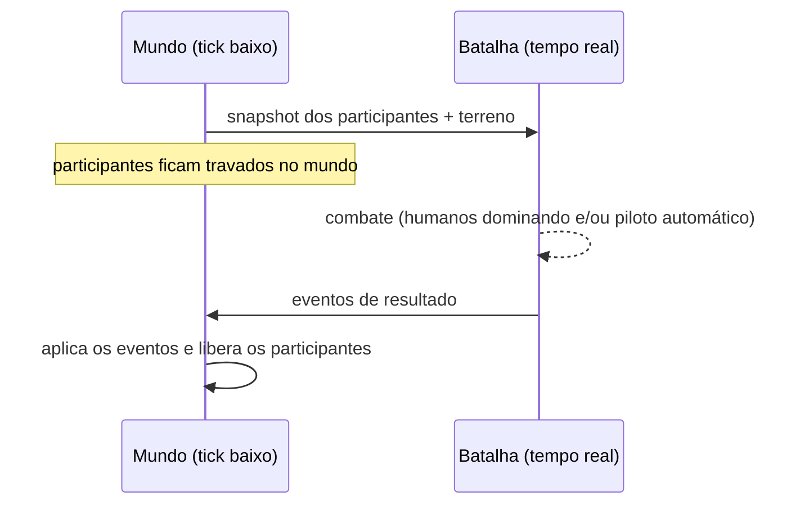

# 06 — Batalhas em tempo real

## Decidido
- O **world state** e o **battle state** são conceitos separados.
- A batalha é uma **instância dedicada** de combate em tempo real, no estilo MOBA. Ela não sincroniza em tempo
  real com o mundo e emite para ele só os eventos que importam.
- Batalhas ganham confrontos, não a guerra (pilar 1).

## Proposta
Ver [ADR-0001](../adr/0001-mundo-e-batalha-separados.md).
- **Entrada:** quando uma batalha começa, o mundo congela os participantes (creeps, inventários, um recorte do
  terreno) e os entrega à instância.
- **Saída:** ao terminar, a batalha devolve um **resultado em forma de eventos** (mortes, XP, saques,
  transferências de recursos, estruturas destruídas). O mundo aplica esses eventos.
- **Sem humanos:** se nenhum jogador estiver presente, a batalha roda sem interface e em velocidade acelerada, com
  a **mesma simulação**, decidida pelo piloto automático (auto-resolve). Humanos que chegam no meio podem dominar
  um creep e assumir.

### Brainstorm de 2026-11-15 (não aprovado)
Detalhes e análise no [brainstorm M2–M3](../brainstorm/2026-11-15-m2-m3.md) §2 e §6.
- **O encontro dispara a batalha** (ideia do dono): quando creeps de times adversários se encontram, abre um
  diálogo no estilo Mount & Blade. O agressor escolhe (atacar, extorquir, ou uma 3ª ação pelo DNA), a vítima reage
  (pagar, recusar, fugir), e o texto vai para a crônica da partida. Quase sempre sem humano: quem decide é a postura
  do piloto automático ([07](07-piloto-automatico.md)).
- **Combate configurável** (ideia do dono): experimentar regras de combate diferentes atrás do contrato do
  [ADR-0001](../adr/0001-mundo-e-batalha-separados.md), sem uma bloquear a outra. O agente propõe um laboratório de
  batalha local, com latência simulada, para medir a diversão e a latência aceitável sem deploy. Candidatas: grade
  (jogos de ação do BYOND), livre (MOBA-lite), a camada de forja (Summon Night: Swordcraft Story) e o tático só com
  gambits, que é o próprio auto-resolve.
- **Lados, não grupos** (dono): o encontro é no mínimo 1×1 e pode ter mais de dois lados (times, tribos, monstros),
  com entrada no meio da luta (ex.: roubar o buff do chefão que o inimigo enfrenta, ou defender a tribo atacada).
  O agente nota que o contrato do ADR-0001 passa a aceitar lados e participantes novos durante a batalha.
- **Quem vence** (dono): o level, os stats, as skills e a micro de quem joga, humano ou bot, e não o DNA ou a carga
  sozinhos. O Mount & Blade inspira só a conversa antes da luta, não o combate.
- **Batalha curta** (agente): 1 a 2 min; cada humano controla só o creep que domina.

## Perguntas abertas
- O que dispara uma batalha: contato entre unidades hostis, ataque declarado, invasão de território? *(Candidato
  no brainstorm de 2026-11-15: o encontro com abordagem.)*
- Qual é o tamanho da "bolha" da batalha? Reforços que chegam depois entram nela?
- Duração máxima de uma batalha e como ela termina (aniquilação, recuo, tempo).
- Quanto tempo do mundo passa durante uma batalha?
- Perdas na batalha são permanentes no mundo (morte, itens perdidos)?
