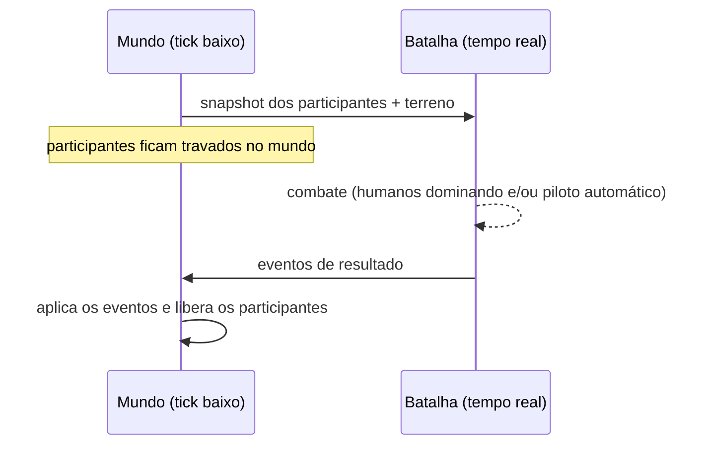

# 06 — Batalhas em tempo real

## Decidido
- O **world state** e o **battle state** são conceitos separados.
- A batalha é uma **instância dedicada** de combate em tempo real, no estilo MOBA. Ela não sincroniza em tempo
  real com o mundo e emite para ele só os eventos que importam.
- Batalhas ganham confrontos, não a guerra (pilar 1).
- **Rodada de design do M2** (dono, 2026-11-15; registro no
  [brainstorm M2–M3](../brainstorm/2026-11-15-m2-m3.md)):
  - **O encontro dispara a batalha.** Quando creeps de lados adversários se encontram, abre uma abordagem com
    diálogo: o agressor escolhe a primeira ação, e a vítima reage se a ação não abrir batalha na hora. O Mount &
    Blade inspira só essa conversa, não o combate. **No M2:** o agressor ataca ou extorque; a vítima paga, recusa
    (batalha) ou foge. A 3ª ação por DNA fica para o M2.5.
  - **Lados, não grupos.** O encontro é no mínimo 1×1 e pode ter mais de dois lados (times, tribos, monstros). Dá
    para entrar numa batalha já começada (ex.: roubar o buff do chefão que o inimigo enfrenta, ou defender a tribo
    atacada). Entra no M2.
  - **Quem vence:** o level, os stats, as skills e a micro de quem joga, humano ou bot. O DNA e a carga não decidem
    sozinhos. No M2, só os stats base por DNA ([02](02-creeps-e-dominio.md)).
  - **Combate experimental e configurável:** regras de combate diferentes atrás do contrato do
    [ADR-0001](../adr/0001-mundo-e-batalha-separados.md), sem uma bloquear a outra. O M2 toca **em paralelo** o
    encontro no mundo e um **laboratório de batalha** local, e junta os dois depois. Até a junção, a luta do encontro
    se resolve por um **sorteio descartável**, que ninguém balanceia.
  - **Salvo-conduto depois de pagar a extorsão:** a vítima fica imune só a novas abordagens do time que extorquiu,
    por um tempo ou até chegar à zona do próprio Núcleo (spec do encontro, D9), e perde a proteção se abordar
    alguém. O mesmo agressor não
    extorque o mesmo creep de novo por um tempo.
  - **Fuga: largar a bolsa e correr.** A vítima larga parte da carga, ou toda, num despojo no chão
    ([03](03-economia-e-logistica.md)) e fica mais rápida; o agressor escolhe entre catar ou perseguir.
  - **As perdas valem no mundo:** a morte é permanente ([02](02-creeps-e-dominio.md)), e o HP de creeps e
    construções persiste depois da batalha ([01](01-mundo.md), [02](02-creeps-e-dominio.md)).
  - **Spec do M2, fatia A, o encontro** (dono, 2026-11-15; [spec M2 do encontro](../specs/m2-encontro/spec.md)). Detalhes e números provisórios na
    spec:
    - **abordar** (D5): a intenção (atacar ou extorquir) vai na ordem de abordar, que põe o creep em perseguição
      até o alvo ficar perto o bastante para o diálogo (raio do encontro: 1 célula, provisório). Se o alvo sai da
      visão do time, a perseguição termina;
    - **o diálogo** (D6): mesmo o ataque abre com um diálogo, em que o agressor declara a agressão; a vítima luta
      ou tenta fugir. Na extorsão, ela paga, recusa ou tenta fugir. **O creep livre reage na hora, pelo piloto; o
      dominado tem uma janela** em segundos de mundo (60 s, provisório), e sem resposta valem as regras dele. Na
      fatia A, só 1 × 1, e um creep está num encontro por vez;
    - **o sorteio** (D7): rodadas a cada N segundos de mundo; a chance de acertar de cada lado é proporcional a (HP
      atual ÷ HP máximo) × um peso por DNA (igual de início); o golpe tira uma fração do HP máximo de quem apanha.
      Termina quando um morre ou foge;
    - **a fuga** (D10): fugir não deve ser fácil dentro do combate (um quadrado carregado até o talo, sozinho,
      longe da estrada ou cruzando o vau quase nunca escapa). **Cada regra de combate que for experimentada terá a
      própria mecânica de fuga.** No sorteio: a chance de escapar é a velocidade de quem foge ÷ a soma das duas
      velocidades (DNA, carga, terreno); quem falha não larga nada e luta; quem escapa larga de 50% a 100% da bolsa
      e corre para o Núcleo, mais rápido por um tempo;
    - **encontro mútuo** (D12): escolhe primeiro quem está fora do rio e dos vaus, depois quem tem menos carga
      relativa; o empate, pelo `state.rng`, nunca pelo id;
    - **salvo-conduto** (D9): termina pelo tempo **ou ao entrar na zona do próprio Núcleo**, no lugar de "até a
      própria rede de estradas" (a estrada pronta é neutra e não guarda quem a construiu).
  - **Chefão disputado** (M2.5): quando dois lados ferem o mesmo chefão, leva o buff ou o item quem dá o último
    golpe ([05](05-tribos-e-diplomacia.md)).

## Proposta
Ver [ADR-0001](../adr/0001-mundo-e-batalha-separados.md).
- **Entrada:** quando uma batalha começa, o mundo congela os participantes (creeps, inventários, um recorte do
  terreno) e os entrega à instância.
- **Saída:** ao terminar, a batalha devolve um **resultado em forma de eventos** (mortes, XP, saques,
  transferências de recursos, estruturas destruídas). O mundo aplica esses eventos.
- **Sem humanos:** se nenhum jogador estiver presente, a batalha roda sem interface e em velocidade acelerada, com
  a **mesma simulação**, decidida pelo piloto automático (auto-resolve). Humanos que chegam no meio podem dominar
  um creep e assumir.

### Brainstorm de 2026-11-15 (não aprovado)
Detalhes e análise no [brainstorm M2–M3](../brainstorm/2026-11-15-m2-m3.md) §2 e §6.
- **Candidatas de combate** (agente): grade (jogos de ação do BYOND, a primeira), livre (MOBA-lite), a camada de
  forja (Summon Night: Swordcraft Story: armas físicas, durabilidade, vencer quebrando a arma) e o tático só com
  gambits, que é o próprio auto-resolve. O laboratório mede a latência aceitável de cada uma com latência simulada.
- **Contrato com entrada no meio da luta** (agente): com lados e participantes que chegam depois, a instância deixa
  de receber o snapshot uma vez só; o mundo continua a alimentá-la. Pede um ADR (`Proposed`) na spec do M2.
- **Batalha curta** (agente): 1 a 2 min; cada humano controla só o creep que domina.
- **Diálogo só na abertura** (agente): quem entra no meio da luta não passa pela conversa; a crônica registra a
  entrada ([08](08-cronica-chat-e-console.md)).
- **Terreno de batalha pelo entorno** (ideia do dono, 2026-11-15, sem marco): batalhas perto do rio, de árvores,
  pedras, estradas e estruturas têm o próprio terreno, com obstáculos, paredes e torres. Junto com os acampamentos
  em [01](01-mundo.md) (ideias em incubação).

## Perguntas abertas
- Qual é o raio da "bolha" da batalha? Até que distância alguém pode entrar no meio da luta? (Que reforços e
  terceiros entram já está decidido; o raio do encontro na fatia A, também.) Fatia D.
- Duração máxima de uma batalha e como ela termina (aniquilação, recuo, tempo).
- Quanto tempo do mundo passa durante uma batalha?
