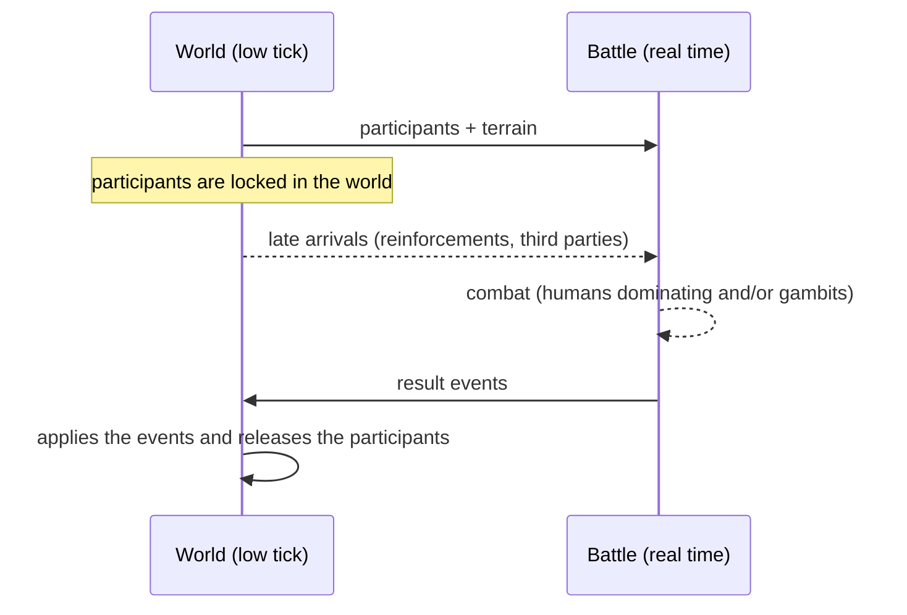

# 06 — Real-time battles

## Decided
- The **world state** and the **battle state** are separate concepts
  ([ADR-0001](../adr/0001-world-and-battle-as-separate-simulations.md)).
- A battle is a **dedicated instance** of real-time combat, MOBA-style. It does not sync in real time with the world
  and emits to it only the events that matter.
- Battles win clashes, not the war (pillar 1).
- **M2 design round** (owner, 2026-11-15):
  - **The encounter triggers the battle.** When creeps of opposing sides meet, an approach opens with a dialogue: the
    aggressor picks the first action, and the victim reacts if the action does not open a battle at once. The
    aggressor attacks or extorts; the victim pays, refuses (battle) or flees.
  - **Sides, not groups.** An encounter is at least 1×1 and can have more than two sides (teams, wanderers). One can
    join a battle already started.
  - **Who wins:** stats and the micro of whoever plays, human or bot. DNA and load do not decide alone. In M2, only
    base stats per DNA ([02](02-creeps-and-domination.md)).
  - **Experimental, configurable combat:** different combat rules behind the ADR-0001 contract, without one blocking
    another. M2 builds the encounter in the world and a local **battle lab** in parallel, and joins them later. Until
    the junction, the encounter's fight is decided by a **throwaway roll** nobody balances.
  - **Safe-conduct after paying extortion:** the victim is immune only to new approaches by the extorting team, for a
    while or until it reaches its own core's zone (encounter spec, D9), and loses it if it approaches someone.
  - **Fleeing: drop the purse and run.** The victim drops part or all of its load as spoils
    ([03](03-economy-and-logistics.md)) and gets faster; the aggressor chooses between picking up and chasing.
  - **Losses count in the world:** death is permanent, and HP persists after the battle.
- **M2 slice A, the encounter** (owner, 2026-11-15; [encounter spec](../specs/m2-encounter/spec.md), with the
  provisional numbers): approaching with the intent in the order (D5); a dialogue even for an attack, with a 60 s window
  for a dominated creep (D6); the throwaway roll (D7); fleeing by relative speed, dropping 50–100% of the purse (D10);
  mutual encounters (D12); the safe-conduct ending by time or at one's own core zone (D9). **Each combat rule tried has
  its own escape mechanic.**
- **M2 slice B, the battle lab** (owner, 2026-11-15; [lab spec](../specs/m2-battle-lab/spec.md)). **The first rule
  is the grid:**
  - **directional attack** (D4): the creep faces one of 4 directions; the square hits the cell in front; the circle
    and the triangle shoot a projectile that moves cell by cell and hits the first enemy, and can be dodged. No
    friendly fire. One cell, one creep: the square blocks the way (D5). In the same tick, the hit goes out before the
    step, and the projectile moves after the creeps (lab plan, P3);
  - **escape by the border** (D7): the arena is the bubble; whoever stays on the exit ring for a moment without being
    hit leaves the battle. Load slows the creep; it can drop the purse as a pile anyone can pick up (D8);
  - **the end** (D9): **no duration clock**. A **battle-wide** inactivity clock resets when anyone deals or takes
    damage; when it runs out, everyone flees at once, with no winner. The battle ends when at most one side is left;
  - **sides** (D10, D11): 2 to 4, hostile to each other; one can join mid-fight, with no dialogue;
  - **gambits AI** (D14, D15): an ordered condition → action list per creep, with presets per DNA, editable in the
    lab; it is the lab's opponent and the auto-resolve.
- **Lab F3 checkpoint** (owner, 2026-11-17): **raw combat is not balanced** (basic attacks only) before skills, levels
  and stats; the lab is for trying and validating candidate rules. Arenas 2× larger, with spawn zones halfway between
  the border and the center, away from the exit. A hit resetting the escape count is fine, as long as **the bot's
  difficulty is configurable** (in the lab, each AI participant's reaction).
- **The starting countdown** (owner, 2026-11-17): a battle starts with a **3 s countdown** (provisional) in which
  everyone may turn but not move or attack, the AI included. It is a battle rule: it applies in the lab, the world and
  auto-resolve. **At the end of the countdown, only what is held at that instant counts** (2026-11-20): what was
  pressed and released during it is discarded.
- **Lab F5 checkpoint** (owner, 2026-11-18): **the first step is immediate** (a standing creep moves on the tick after
  the command, then at its DNA's pace); **inactivity is the battle's, not each creep's** (15 s with no damage to
  anyone, provisional).
- **Lab F5 checkpoint, part 2** (owner, 2026-11-19 and 20):
  - **the grid rule is fun:** "I really liked the result we reached for combat", above all after the attack, hit and
    miss signs on screen;
  - **no new combat rule before the junction:** "let's join what we have"; the grid is good enough to see how combat
    affects a real (and simulated) match;
  - **deploy and prediction wait for the junction:** acceptable latency and client prediction are decided after the
    whole cycle is joined (the world opens the instance, the channel stays open for reinforcements and third parties,
    the result returns to the world). Client prediction may come in;
  - **movement is tried before becoming a rule:** the lab compares four ways of drawing movement (PLAYTEST group 7).
- **M2 slice D, the junction: design round** (owner, 2026-11-24; [junction spec](../specs/m2-junction/spec.md)):
  - **the roll leaves:** an attack always opens the battle; on extortion, the victim pays or refuses, and refusing
    opens the battle. **Fleeing is only in the arena** (the border, dropping the purse); a free creep whose reaction
    rule says flee enters with the carrier gambits;
  - **world time:** the world keeps its pace (its ×N); a battle with a human playing runs in real time, and its
    participants stay locked in the world while it lasts;
  - **auto-resolve on the world clock:** with no human, 1 battle second = 1 world second, so reinforcements and a
    human taking over have time to arrive;
  - **only who chooses joins:** a creep that approaches a participant to attack, inside the bubble, enters on its
    team's side or on a new side; an ally helps by approaching the enemy;
  - **the arena from the terrain, enlarged:** the world cells around the encounter become blocks of the arena, at the
    lab's size; rock stays rock, river, ford and road become floor; spawn zones as in the lab;
  - **the loot:** at the end, the winning side's survivors collect up to their free capacity, cristal first, and the
    rest becomes spoils in the world (slice A's rule);
  - **the battle screen opens by itself** when the creep you dominate enters a battle, in place of the map, with a
    button back to the map; teammates get a button to watch;
  - **taking over mid-fight:** a player may dominate a creep of their team that is already in a battle; it leaves its
    gambits for the human, and the battle switches to real time.
- **M2 slice D, the junction spec** (owner, 2026-11-24, approving the agent's proposals in
  [the spec](../specs/m2-junction/spec.md); numbers provisional):
  - **the bubble is the arena's window:** 9 × 5 world cells around the battle's cell, each a 5 × 5 block of arena;
    a creep with an attack approach on a participant that enters it joins; a full side (5) makes the joiner wait at
    the edge; extorting a participant is refused (D5, D6);
  - **leaving mid-fight:** a participant that dies or escapes leaves the battle in the world on the same tick; an
    escapee comes back on the world cell under the border it left by, with slice A's run home; its order ends (D7);
  - **the end:** survivors come back on the world cell under their arena cell; an end by inactivity is an escape for
    everyone, without the speed bonus, and its piles become spoils (D8);
  - **real time while a human plays on the screen:** watching does not change the pace; a disconnected human counts as
    off the screen; on the map, a dominated creep in a battle plays by its gambits (D11, D13);
  - **the battle in the world view:** through the fog, its cell, the bubble, the participants "in battle" and their
    sides; a sign on the map to watch it (D16);
  - **the movement drawing:** the four lab options in the network panel, from the lab's default, until PLAYTEST group
    7; prediction waits for P (D19).

- **The opening countdown for humans** (owner, R and E-min design round, 2026-11-25; slice R): a battle opens
  **paused for a few real seconds** (5 s, provisional, in the params) when some team in it has a human connected, with
  an alert on the map, the countdown and an "Entrar" button that dominates the creep and opens the battle screen. With
  no human connected (bots only, the sweeps) it does not wait. Why: at checkpoint C2 a wanderer attacked one of the
  owner's triangles, and the battle, on the world clock, ended before the owner could watch or join it from the map.
  The owner asked for a minimum reaction time of about 5 s, configurable; the agent's pause won over a minimum
  duration, since a creep can die in the first seconds, and over 5 real-time seconds with damage already flowing.
- **DNA kits in battle** (owner, R and E-min design round, 2026-11-25; slice K): a dodge for every DNA, the square's
  charged strike and charge, the triangle's frontal guard and the circle's fan ([02](02-creeps-and-domination.md)).
  The grid stays. Tried in the lab first, behind params; the gambits learn them, so auto-resolve uses them; what is
  not fun in the lab does not reach the world (agent, approved).
- **The kits' details** (owner, slice K's spec round, 2026-11-25; [kits spec](../specs/m2-kits/spec.md) D3–D8;
  details in [02](02-creeps-and-domination.md)): **Space is every DNA's kit key** (a tap attacks, a hold fills the
  DNA's bar); the charge's collision **carries the bar** built while running; the charge is limited and comes back
  with the attack's cooldown; **the dodge is a double tap** of a direction, a 2-cell dash, **untouchable**, with
  priority over the bar; **the load acts as in walking**; the wanderers get the circle's kit in slice K, and their
  own DNA and kit get their own design round ([05](05-tribes-and-diplomacy.md)).
- **The kits spec** (owner, 2026-11-25, approving the agent's proposals in [the spec](../specs/m2-kits/spec.md)
  D1, D9–D13; numbers provisional):
  - **behind params:** each kit has an on/off switch per DNA; with every kit off the battle plays the grid as before;
    the lab switches them per battle, and only what passes the lab checkpoint (K1) is on in the world;
  - **▲ the guard:** while Space is held past a tap, the triangle does not move, turn or attack, and blocks the
    projectiles that come at its face (the fan's too), not melee hits; the guard lasts while the bar fills and drops
    when it is full; releasing Space fires the basic shot; a short cooldown after it drops; a blocked shot does not
    reset the inactivity clock;
  - **● the fan:** the circle may walk while its bar fills; releasing fires three projectiles in parallel lanes (the
    cell in front and the two front diagonals), with a range that grows with the bar; the fan's long cooldown also
    restarts the basic attack's; while it cools down, a hold is just the basic shot;
  - **the countdown:** no kit acts during it; at its end a held Space starts the bar, and a dodge sent during it is
    discarded;
  - **the micro-stun stops movement only** (walking, the dodge, the charge); a new stun keeps the longer remaining
    time, never the sum;
  - **breaking the guard:** a square's strike with at least half the bar drops it; a weaker strike only hits.
- **A sign for hostile actions** (owner, slice R's spec review, 2026-11-25; slice R): a creep that heads for another
  to attack or to extort shows a **red sign** on the map (a sword's silhouette, or similar), so the target's team sees
  the threat coming and the bots' strategist can react to it by its difficulty ([07](07-autopilot.md)).
- **Pausing a battle** (owner, slice R's spec review, 2026-11-25; slice R): a human in a battle can **pause it with
  P**, after a **3-second countdown**; **any human** resumes it with P, after another 3-second countdown.
- **Tactical formations in battle** (owner, slice R's spec review, 2026-11-25; slice G, with its own design round):
  formation commands, presets and rules in the arena, in the style of Mount & Blade, for humans and for the battle
  bots (the gambits). The pause above lets a human give them.
- **Slice R's battle details** (agent, approved with the [R spec](../specs/m2-rebalance/spec.md) D6, D7, D25, D28, 2026-11-25):
  - **the opening pause** holds the battle on both clocks while the world keeps its pace; only an opening pauses, not
    a join; with no human connected it never pauses; **"Entrar"** dominates the team's participant of lowest id that
    no other player dominates, or opens the screen to watch;
  - **the hostile sign:** a sword for an attack, a purse for an extortion, both red, over a creep or wanderer that is
    chasing its target; every team that sees the aggressor sees the sign, and the target's team a red line to its
    creep. Another team's creep in sight now shows its hostile intent (fog spec D7 revised);
  - **the humans' pause:** only a human who controls a participant pauses or resumes; watchers cannot; P during a
    countdown does nothing; no limit on pauses in R; a paused battle with no human in control on its screen resumes
    after 3 s on the world clock. Both pauses are one state of the junction host, outside the battle.
- **Squads in battle** (owner, slice G's design round, 2026-11-25; slice G; the squads in
  [02](02-creeps-and-domination.md)):
  - **the squad decides who commands a participant:** among the players active in the battle, the **squad's leader
    has priority** over its creeps. When two players of a team each embody a creep in the same battle and their
    followers come in, each player commands their own squad. **No loan** (owner, G's spec review, 2026-11-25): with
    the leader not playing in that battle, its squad's creeps play their gambits under the last command, and no other
    player plays them;
  - **the human plays the embodied creep** (WASD, Space); **Shift+N** plays the squad's participant N; N and Tab
    select (owner, G's spec review, 2026-11-25: Tab no longer moves the embodiment, as the lab's Tab does);
  - **tactical commands through Z** (owner, G's spec review; the design round had them on the bare number keys): Z
    then **1 form on me, 2 hold position, 3 attack freely, 4 fall back** (flee by the border), 0 cancels, to the
    selected participants of the squad or, with none, all but the one played. The pause (slice R) gives time to think; **the battle bots use
    the same commands**. **Attack freely is the default** before any key (owner, G's spec review, 2026-11-25), so a
    battle where nobody commands plays as before;
  - **the embodied creep's glow and its player's name** show in the arena too.

## Proposal
See [ADR-0001](../adr/0001-world-and-battle-as-separate-simulations.md). The world side of the contract is
[ADR-0010](../adr/0010-world-side-of-the-battle-contract.md) (`Accepted`): battle instances next to the world, run by
a junction host; the world log keeps only the results.
- **Short battles** (agent): 1 to 2 minutes; each human controls only the creep they dominate.
- **Dialogue only at the opening** (agent): whoever joins mid-fight skips the conversation; the chronicle records the
  entry ([08](08-chronicle-chat-and-console.md)).
- **The battle bot and the load** (owner, slice R's spec review, 2026-11-25; "a proposal only, to experiment"; slice
  G, in the lab): attacked while loaded, a battle bot drops the load to fight or to flee more nimbly, or holds it if an
  ally is coming to protect it. It may need the world to tell the battle who is coming (world → battle).
  **Placement** (agent, slice G's design round, 2026-11-25): it stays in G, **in the lab only, behind a param**, and is
  the first thing cut if G runs long; slice R's encounter reactions (D27) already decide in the world whether to keep
  or drop the load, so G only adds the battle's side (the world telling the battle that help is coming).
- **Slice G's battle details** (agent, slice G's design round, 2026-11-25; to approve in G's spec): a squad that opens
  or joins a battle is born **in its formation**, on the side each DNA engages from (revising where a joiner is born,
  junction D6).

## Parked (the owner's ideas, no milestone)
- **Battle sound and kill announcements** (2026-11-18 and 19): a sound for the shot and the hit; "double kill" style
  announcements for spectators. No priority.
- **The commander** (2026-11-20): in group battles, a player who sets the team's tactics in the arena, and whoever
  joins mid-fight follows them.
- **A learning AI** (2026-11-17): the bot starts dumb and gets smarter, up to a "nightmare mode". Agent's path: an
  offline search for gambit lists that beat the previous best, using auto-resolve. Lab finding: the ● still picks the
  same corridors, and a human learns the route.
- **Battle terrain from the surroundings** (2026-11-15): battles near the river, trees, rocks, roads and structures get
  their own terrain, with obstacles, walls and towers.
- **Other combat rules** (2026-11-15): free movement (MOBA-lite), a forge layer (physical weapons with durability).
  None before the junction (C9).

## Open questions
- How movement is drawn in the game (the four lab options). After PLAYTEST group 7.
- **Critical hits?** (owner, 2026-11-18): a hit that sometimes deals more damage. With stats and skills; not in M2.
