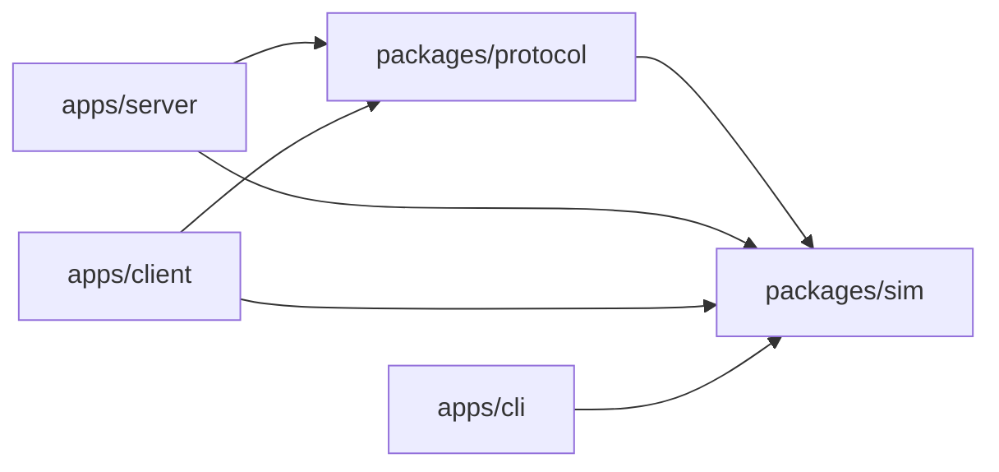
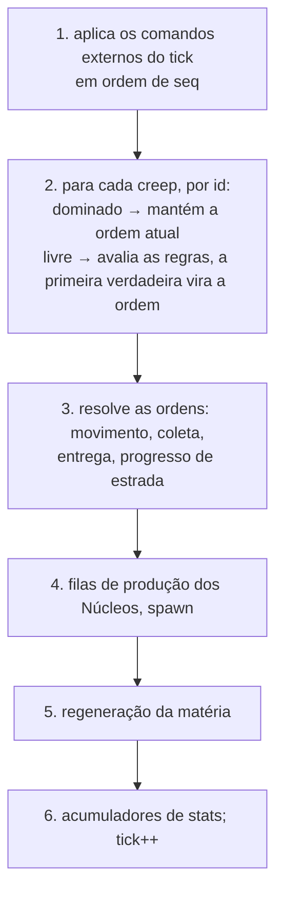

# Plan M1 — O ciclo da riqueza

**Status:** Aprovado (2026-11-13) · **Data:** 2026-11-13
**Spec:** [spec.md](spec.md) · **ADRs:** [0001](../../adr/0001-mundo-e-batalha-separados.md) ·
[0002](../../adr/0002-tudo-e-comando.md) · [0003](../../adr/0003-stack-typescript-node.md) ·
[0004](../../adr/0004-persistencia-sqlite-log-de-comandos.md) · [0005](../../adr/0005-deploy-mvp-vps-websocket.md)

Este documento descreve **como** construir a spec. As decisões P1–P6 (seção 12) foram aprovadas pelo dono junto
com o plano.

## 1. Estrutura do repositório

Monorepo com **npm workspaces** (sem ferramenta extra):

```
packages/
  sim/          simulação pura: estado, comandos, tick, piloto automático, mapa, RNG, pathfinding, métricas
  protocol/     mensagens cliente↔servidor e validação estrutural (zod)
apps/
  server/       Node: HTTP, WebSocket, hospedagem de mundos, loop de tick, persistência
  client/       Vite + Preact: mapa SVG, painéis, replay
  cli/          simulação sem interface, varreduras, verificação de determinismo, relatórios
params/
  default.json  parâmetros de balanceamento (os chutes da spec §6)
infra/
  docker/       Dockerfile, compose.yml, Caddyfile, litestream.yml
```

Dependências entre pacotes:



O `sim` não depende de nada. É a peça que um dia pode virar a "engine" extraível.

## 2. Toolchain

| Item | Escolha |
|---|---|
| Runtime | Node na linha LTS ativa no bootstrap, fixada em `.nvmrc` e `engines` |
| Linguagem | TypeScript `strict`, `erasableSyntaxOnly`, ESM. O Node roda `.ts` direto |
| Testes | Vitest |
| Lint/format | ESLint (flat config, typescript-eslint) + Prettier |
| Cliente | Vite + **Preact** + `@preact/signals` (P1) |
| Validação de rede | zod (só em `protocol`) |
| SQLite | `better-sqlite3` (P2) |
| WebSocket | `ws` |

### Determinismo garantido por ferramenta, não por disciplina
- `packages/sim/tsconfig.json` usa `lib: ["ES2023"]`, **sem DOM** e com `types: []`, **sem `@types/node`**.
  Qualquer uso de `window`, `setTimeout`, `process` ou `Buffer` na simulação **não compila**.
- ESLint no `sim`:
  - `no-restricted-properties` proíbe `Math.random`, `Math.sin/cos/tan/exp/log/pow/sqrt` e companhia;
  - `no-restricted-globals` proíbe `Date`, `performance`, `crypto`, `Intl`;
  - `no-restricted-syntax` proíbe `for…in` e números de ponto flutuante literais.

## 3. Modelo de estado (`packages/sim`)

```ts
type WorldState = {
  simVersion: number; tick: number; rng: RngState;   // RNG xoshiro128** com Math.imul (determinístico)
  map: { w: number; h: number; terrain: number[]; road: number[] };  // índice = y*w + x
  teams: Team[];          // ordenados por id
  creeps: Creep[];        // ordenados por id; ids crescentes, nunca reaproveitados
  deposits: Deposit[];
  roadJobs: RoadJob[];
  nextId: number;
  stats: TeamStats[];     // acumuladores para métricas (tempo por atividade, viagens)
};
```

- **Unidades inteiras.** Posições em células. O movimento usa *pontos de movimento*: o creep acumula
  `velocidade_base × modificador ‰ / 1000` por tick e avança uma célula ao juntar `CELL_COST` pontos (60 000).
  Com isso, "2 células/min" vira 2 000 pontos por tick (1 tick = 1 s). Os modificadores de terreno e de carga
  ficam em **por mil** (estrada 2000‰, travessia 500‰, carregado 800‰).
- **Terreno:** jungle, rio (intransponível), travessia, rocha (intransponível). A estrada é uma camada separada.
- **Iteração** sempre em arrays ordenados por id. Nada de `Set` ou `Map` no estado.
- `serialize(state)` produz JSON canônico (ordem de chaves fixa). O hash é calculado fora do `sim`, com
  `node:crypto` (sha256) no servidor e na CLI.

## 4. Comandos (contrato do ADR-0002)

Os comandos **externos** são os únicos que entram no log:

| Comando | Quem pode | Observação |
|---|---|---|
| `dominate {creepId}` | jogador do time | Libera o domínio anterior (D-2). Recusa se outro jogador já domina (D-3). |
| `release {}` | jogador que domina | Também é emitido **pelo adaptador do servidor** em caso de desconexão ou de inatividade em tempo real, e entra no log como qualquer outro. Assim o timeout não quebra o determinismo. |
| `order {creepId, order}` | só quem domina o creep | `order` ∈ `moveTo{x,y}` · `gather{depositId}` · `deliver` · `buildRoad{x,y}` · `stop` |
| `setRules {creepId, rules}` · `applyPreset {creepId, preset}` | qualquer jogador do time | Responde à pergunta aberta da spec: dá para editar regras sem dominar (P4) |
| `produce {dna, repeat}` · `stopRepeat {}` · `buyUpgrade {id}` | qualquer jogador do time | `stopRepeat` desarma o "repetir" (P5) sem pedir outro creep; acrescentado com o OK do dono em 2026-11-13 |

- `validate(state, cmd, playerId) → ok | motivo`: a validação **semântica** fica no `sim`. A validação
  **estrutural** (formato, tipos) fica no `protocol`, com zod.
- O piloto automático produz `order`s internos pelo mesmo caminho de validação, mas eles não vão para o log.

## 5. Pipeline do tick (ordem fixa)



- **`step` muta o estado in place** (aprovado pelo dono em 2026-11-13). Copiar o estado a cada tick não cabe no
  orçamento de 3 dias em menos de 10 min. A regra do ADR-0003 continua valendo no que importa: sem I/O, sem relógio,
  sem aleatoriedade externa. Quem precisa do estado anterior guarda uma cópia com `serialize`.
- **Pathfinding:** A* em 4 direções, com custo por terreno e estrada. Desempate pelo índice da célula, para ser
  determinístico. O caminho fica em cache no creep e só é recalculado quando o alvo muda ou quando uma estrada nova
  é concluída. O custo da estrada deve fazer as rotas convergirem para elas.
- **Regras do piloto automático:** um interpretador de uma lista `condição → ação` com o vocabulário fechado da
  spec (P-2). Os presets são dados em `sim/presets.ts`.
- **Construção de estrada:** a ordem `buildRoad` para um ponto distante vira uma sequência de segmentos, sempre
  partindo do segmento mais próximo já conectado.

## 6. Geração de mapa
1. O RNG com seed gera a **metade superior**: obstáculos de rocha agrupados, posição do Núcleo, depósitos de
   matéria perto do Núcleo e 3 depósitos de cristal.
2. A **metade inferior** é a metade superior rotacionada 180° (simetria de ponto). É justo para os dois times.
3. O rio ocupa as 2 linhas centrais, com 3 travessias espelhadas e 2 depósitos de cristal disputados perto delas.
4. Validação: existe caminho Núcleo→Núcleo e Núcleo→cada depósito. Se não existir, a geração roda de novo com
   `seed+1`, de forma determinística.

## 7. Servidor (`apps/server`)

| Módulo | Responsabilidade |
|---|---|
| `http.ts` | `node:http`; `POST /api/worlds`, `POST /api/worlds/:id/join` (nome + time → token); arquivos estáticos do cliente |
| `ws.ts` | Autentica pelo token; recebe comandos; envia o estado |
| `world-host.ts` | Um por mundo: estado em memória, loop de tick, fila de comandos, broadcast |
| `persistence.ts` | SQLite: log, snapshots, métricas, recuperação |

- **Loop de tick:** `setTimeout` corrigindo a deriva, com intervalo `1000 / multiplicador` ms. Se o servidor
  atrasar, roda até K ticks de recuperação de uma vez.
- **Entrada de comando:** chega pelo WebSocket → zod → `validate` → recebe tick-alvo (o próximo) e `seq` → é
  gravado no log (uma transação por tick) → entra na fila. O cliente recebe `ack` ou `reject{motivo}`.
- **Broadcast:** o mapa estático vai uma vez, no `welcome`. Depois vai o **estado dinâmico completo**
  (creeps, estoques, depósitos, estradas novas) após cada tick, **limitado a no máximo 5 envios por segundo** em
  tempo real. São ~3–5 KB por mensagem. Deltas só se a medição mostrar necessidade (P3).
- **Configuração do servidor** (não é balanceamento, não vai para os parâmetros do `sim`): timeout de domínio de
  5 min reais e carência de reconexão de 15 s reais (spec §5, detalhes do F6), porta, caminho do SQLite,
  `snapshot_every`.
- **Bots:** um bot por time, opcional na criação do mundo. O estrategista sai do `apps/cli` para o `sim`, para o
  servidor e a CLI usarem o mesmo código; os comandos dele passam pelo mesmo caminho dos humanos.
- **Sessão do jogador:** token aleatório (o hash vai para o SQLite; o cliente guarda no `localStorage`).
  Reconexão automática com o mesmo token.

### Esquema SQLite

```sql
worlds    (id, seed, params_json, sim_version, multiplier, status, created_at)
players   (id, world_id, team_id, name, token_hash)
commands  (world_id, tick, seq, player_id, payload_json, PRIMARY KEY (world_id, tick, seq))
snapshots (world_id, tick, state_json, state_hash, PRIMARY KEY (world_id, tick))
metrics   (world_id, tick, team_id, sample_json)
```

- Snapshot a cada `snapshot_every` ticks (padrão: 300, ou seja 5 min de mundo) e num shutdown limpo (SIGTERM).
- Recuperação = último snapshot + comandos com `tick > snapshot.tick`, reaplicados.

## 8. Cliente (`apps/client`)
- **Mapa** em SVG via JSX do Preact. O pan e o zoom manipulam o `viewBox`. O mapa estático (terreno, rio, rochas)
  é desenhado uma vez numa camada; estradas, depósitos e creeps ficam numa camada dinâmica.
- **Creeps** são formas por DNA (■ `<rect>`, ● `<circle>`, ▲ `<polygon>`), com a cor do time, um anel de carga e um
  halo quando alguém os domina.
- **Interpolação:** com `requestAnimationFrame`, a posição é interpolada entre os dois últimos estados recebidos.
- **Painéis:**
  - inspetor do creep: DNA, carga, regras, quem domina, botão "dominar/liberar";
  - Núcleo: estoque, produção, upgrade, população;
  - editor de regras: lista ordenada, adicionar, remover, reordenar, aplicar preset.
- **Controle direto** (com domínio): clique no mapa = `moveTo`; clique num depósito = `gather`; clique no Núcleo =
  `deliver`; modo estrada = `buildRoad`.
- **Modo replay:** carrega um arquivo de replay (snapshot inicial + comandos) e **roda o `sim` no navegador**, com
  play, pausa e velocidade. Isso também prova que o `sim` roda igual no navegador (testar no Safari = JSC).

## 9. CLI (`apps/cli`)

| Comando | Saída |
|---|---|
| `geo sim --seed 42 --params params/default.json --days 3 [--strategist balanced]` | `runs/<id>/`: métricas (CSV + JSON; o SQLite chega no F6), replay, `report.md` |
| `geo sweep --set creep.cost.materia=30,40,50 --seeds 1-5` | tabela comparativa em `report.md` |
| `geo verify --seed 42 --ticks 50000` | determinismo: roda 2×; snapshot → restore → continua; replay a partir do log. Os três hashes têm de ser iguais |
| `geo report runs/<id>` | `report.md` legível por humanos **e por IA**, para discutir balanceamento com o Claude |

- **Estrategista bot** (só no harness): uma política de time que emite os mesmos comandos externos (`produce`,
  `buyUpgrade`, `applyPreset`) que um humano emitiria. Sem ele, um time só de bots nunca produz creeps.
- **Métricas:** `sampleMetrics(state)` é uma função pura, amostrada a cada 60 ticks (1 min de mundo) e calculada
  a partir dos acumuladores de `stats`. Cobre a lista da spec §7.

### Detalhes do harness decididos pelo dono no F5 (2026-11-13)

- **Estrategista `balanced`** (provisório até o checkpoint do F5): um jogador bot por time, com `join` no tick 0.
  Age a cada 60 ticks (1 min de mundo) e decide só pelo estado, sem memória própria (o snapshot → restore e o
  replay continuam fiéis).
  - *Produção:* com o Núcleo livre, produz o DNA com menos creeps no time (empate: ■ ▲ ●), sem "repetir", até o
    teto.
  - *Upgrade:* compra o de capacidade assim que o estoque permitir.
  - *Papéis:* ⅓ dos creeps (arredondado para cima) coleta cristal enquanto houver cristal no mapa; 1 constrói
    estrada; o resto coleta matéria. Sem cristal, os coletores de cristal passam para matéria. Troca de papel o
    creep de menor id.
  - *Estradas:* o alvo é o depósito não vazio mais perto do Núcleo (Manhattan) ainda sem estrada e com segmento
    construível; ligado esse, o próximo.
- **Saída do `geo sim`:** métricas em CSV + JSON no F5. O SQLite das métricas entra no F6, com o módulo de
  persistência, para a CLI não puxar o `better-sqlite3` (módulo nativo) antes da hora.
- **Orçamento no CI:** 6 h de mundo bot×bot em no máximo **60 s** de relógio (o alvo de 3 dias em 10 min dá 50 s;
  a folga é para máquinas de CI mais lentas).

## 10. Testes

| Tipo | O quê |
|---|---|
| Unitários (`sim`) | movimento com pontos, A* e desempate, coleta e capacidade, entrega, regeneração, produção, teto de população, upgrade, estrada, regras de domínio D-1..D-4, interpretador de regras |
| Propriedade | mapa simétrico e conectado para 500 seeds |
| Determinismo (CI) | `geo verify` com 3 seeds |
| Orçamento de performance | CI: 6 h de mundo bot×bot, em no máximo 60 s. Manual: 3 dias em menos de 10 min (spec §7) |
| Integração (`server`) | join → ws → comando → broadcast; matar e reiniciar o processo → o mundo continua com o mesmo hash |
| Cliente | smoke manual no M1. Playwright só se for necessário |

## 11. Deploy

Adiado para antes do playtest do M2 (dono, 2026-11-14; spec §8). O desenho abaixo continua valendo.

- `infra/docker/`:
  - `Dockerfile`: multi-stage; build do cliente; runtime Node.
  - `compose.yml`: app + Caddy + Litestream.
  - `Caddyfile` e `litestream.yml`.
- GitHub Actions:
  - **CI:** typecheck, lint, testes, `geo verify`, orçamento de 6 h.
  - **Deploy manual** (`workflow_dispatch`): imagem para o GHCR, depois SSH com `docker compose pull && up -d`.
- `docs/PLAYTEST.md`: como expor a máquina de dev por túnel, o protocolo e o questionário.

## 12. Decisões aprovadas

Aprovadas pelo dono em 2026-11-13, junto com o plano. A coluna "Alternativa" fica como registro do que foi
descartado.

| # | Decisão | Escolha | Alternativa descartada |
|---|---|---|---|
| P1 | Biblioteca de UI do cliente | **Preact + signals** (~5 KB, JSX que a IA domina bem, SVG declarativo) | DOM e SVG puros, sem biblioteca: zero dependências, mais código manual nos painéis |
| P2 | Driver SQLite | **better-sqlite3**: maduro e síncrono; é módulo nativo, mas tem binários prontos | `node:sqlite`: zero dependências, API ainda amadurecendo |
| P3 | Estado na rede | **Estado dinâmico completo**, limitado a 5 envios por segundo | Deltas desde o início (mais código, sem necessidade comprovada) |
| P4 | Editar regras sem dominar | **Sim**, qualquer jogador do time edita as regras de qualquer creep do time | Só o jogador que domina o creep |
| P5 | **Lacuna na spec:** produção e upgrade quando os humanos estão offline | M1: os humanos podem marcar uma produção como **"repetir"**; o estrategista bot fica só no harness. **Revisto em 2026-11-14:** um mundo do servidor pode ter um bot por time, opcional (spec §5, detalhes do F6) | Um "piloto automático de time" para humanos já no M1 (mais escopo) |
| P6 | Movimento | **4 direções** (mais simples, desempate trivial) | 8 direções (rotas mais naturais, A* um pouco mais complexo) |

## 13. Ordem de implementação

A ordem é **harness primeiro**: depois da F5 já dá para fazer a primeira passada de balanceamento **sem nenhuma
interface**. Detalhes em [tasks.md](tasks.md).

| Fase | Entrega | Checkpoint |
|---|---|---|
| F0 | Bootstrap do repo, toolchain, CI | `npm test` verde |
| F1 | Núcleo do `sim`: estado, RNG, parâmetros, mapa, serialize, tick vazio | `geo verify` verde |
| F2 | Movimento, terreno, estradas, A* | |
| F3 | Economia: coleta, entrega, produção, upgrade, construção de estrada | |
| F4 | Piloto automático, presets, domínio | |
| F5 | Métricas, CLI, estrategista bot | **Primeiro mundo de 3 dias bot×bot + `report.md`** |
| F6 | Servidor: HTTP, WebSocket, loop de tick, persistência, recuperação | |
| F7 | Cliente: mapa, painéis, controle direto, interpolação | **Sessão do dono** (interface e legibilidade) |
| F8 | Replay no navegador; comando de multi-cliente local | |
| ~~F9~~ | Deploy e playtest comprimido: **saem do M1** (dono, 2026-11-14) e viram a primeira etapa antes do playtest do M2. O §11 continua valendo | |
