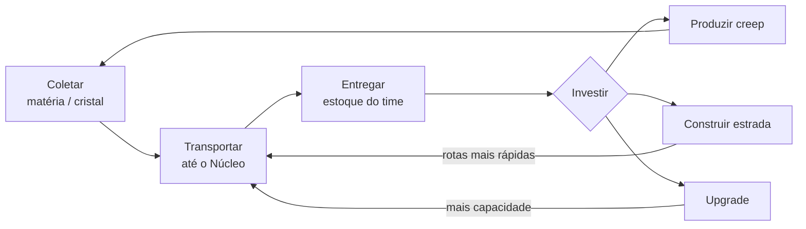

# Spec M1 — O ciclo da riqueza

**Status:** Aprovada (direção geral, 2026-11-13) · **Data:** 2026-11-13 · **Marco:** M1 ([ROADMAP](../../ROADMAP.md))
**GDD relacionado:** [01](../../gdd/01-mundo.md) · [02](../../gdd/02-creeps-e-dominio.md) ·
[03](../../gdd/03-economia-e-logistica.md) · [07](../../gdd/07-piloto-automatico.md)

## 1. Hipótese

> Coletar, transportar e investir recursos num mundo persistente gera **decisões interessantes** mesmo sem combate,
> e um mundo de "3 dias" pode ser simulado e observado de forma controlada.

O M1 **não** precisa ser divertido como produto final. Ele precisa responder:
1. O ciclo econômico gera decisões não triviais: rotas, estradas, escolha de DNA, regras de piloto automático?
2. Dominar um creep acrescenta algo que o piloto automático sozinho não dá?
3. O harness (simulação sem interface, bots, multiplicador de tempo, métricas, replay) funciona bem o bastante para
   balancear o jogo com dados?

## 2. O ciclo

## 3. Decisões de escopo que esta spec assume

Os padrões abaixo foram **aceitos pelo dono** em 2026-11-13 (aprovação da direção geral). Revisitar se os
playtests indicarem.

| # | Decisão | Padrão proposto | Por quê |
|---|---|---|---|
| D1 | Vitória no M1 | **Nenhuma.** O mundo termina por tempo; a "prosperidade" é só métrica | Sem combate, não há como destruir a base. Uma corrida artificial distorceria o que queremos medir. |
| D2 | Custo de dominar | Livre, sem cooldown e sem limite de distância (os parâmetros existem, com valor 0) | Primeiro descobrir se dominar é útil; depois, se precisa de custo. |
| D3 | O que o DNA muda no M1 | Só traços econômicos: ■ quadrado carrega muito e é lento; ● círculo é rápido e carrega pouco; ▲ triângulo fica no meio-termo | Dá peso à escolha de DNA já no M1, sem combate. |
| D4 | Uso dos recursos | Matéria: estradas e produção de creeps. Cristal: produção de creeps e o upgrade de capacidade | Os dois recursos precisam importar. |
| D5 | Fog of war | Não existe (mapa todo visível) | Simplicidade. Fog entra com as batalhas, se fizer falta. |
| D6 | Times | 2 times. Cada um com 0 a 3 humanos; um time sem humanos roda só com piloto automático | Permite testar humano × bot e bot × bot. |
| D7 | Moeda, impostos, tesouro | Fora. O estoque entregue no Núcleo é do time | A dúvida sobre moeda fica para o M3. |
| D8 | Inventário individual | O creep carrega a carga até entregar; não existe gasto individual | O inventário individual só ganha sentido com itens (M3+). |
| D9 | Forma do mapa | Grid de células, movimento em 4 direções. Aprovado com o [plan](plan.md) (§3, P6) em 2026-11-13 | Mais simples para estradas, determinismo e SVG. |
| D10 | Regras sem domínio | Qualquer jogador do time edita as regras de qualquer creep do time; o controle direto exige domínio. Aprovado com o [plan](plan.md) (P4) em 2026-11-13 | Resolvia uma pergunta aberta desta spec. |

## 4. Escopo

### Dentro
- Mapa pequeno gerado por **seed**, espelhado em relação a um rio horizontal, com 2 ou 3 travessias.
  - Matéria: perto de cada Núcleo, renovável.
  - Cristal: esgotável. Parte dos depósitos fica no lado de cada time, parte é disputada, perto do rio e do centro.
  - Terreno de jungle é lento; estrada é rápida.
- Um **Núcleo** por time, que guarda o estoque e produz creeps.
- **Creeps** dos 3 DNAs, com capacidade de carga, velocidade e inventário.
- **Produção** de creeps no Núcleo (custa matéria + cristal; tem tempo de produção; teto de população).
- **Estradas** construídas por creeps, segmento a segmento, gastando matéria.
- **1 upgrade** de time: +capacidade de carga (custa cristal).
- **Piloto automático declarativo** por creep, mais presets prontos.
- **Dominar e liberar**, com controle direto (mover, coletar, entregar, construir).
- **Multiplayer:** vários navegadores conectados ao mesmo mundo, vendo as mudanças a cada tick.
- **Persistência:** o mundo sobrevive a um restart do servidor sem perder estado.
- **Harness** (seção 7).

### Fora
Combate, batalhas, morte, monstros, tribos, governança, impostos, moeda, energia, level/XP/skills, reprodução,
scripts de piloto automático, login real (só nome de convidado), matchmaking, integração com o control plane, som,
mobile.

## 5. Comportamento

Formato: *Quando [gatilho], o sistema deve [resposta].*

### Mundo
- **M-1** Quando um mundo é criado com uma seed e um arquivo de parâmetros, o sistema deve gerar sempre o mesmo
  mapa, espelhado para os dois times.
- **M-2** O mundo deve avançar em ticks fixos. A duração de um tick no relógio real é `tick_real = tick_base /
  multiplicador`.
- **M-3** Quando o servidor reinicia, o mundo deve voltar ao último estado persistido e continuar dali. A perda
  máxima é de alguns ticks.
- **M-4** Quando o tempo do mundo atinge a duração configurada, o mundo deve encerrar e gerar o relatório final de
  métricas.

### Recursos e logística
- **R-1** Quando um creep coleta, o sistema deve transferir recurso do depósito para o inventário do creep até o
  limite da capacidade dele (DNA × upgrade).
- **R-2** Depósitos de matéria regeneram ao longo do tempo; depósitos de cristal não.
- **R-3** Quando um creep carregado chega ao Núcleo do próprio time e entrega, o sistema deve mover a carga para o
  estoque do time.
- **R-4** A velocidade de um creep deve depender do DNA, do terreno (jungle × estrada × travessia do rio) e da
  carga (*proposta: carregado anda mais devagar*).

### Investimento
- **I-1** Quando um jogador pede para produzir um creep de um DNA, havendo estoque e espaço no teto de população, o
  sistema deve debitar o custo e criar o creep no Núcleo depois do tempo de produção.
- **I-2** Quando um creep constrói um segmento de estrada adjacente a uma estrada existente ou ao Núcleo, o sistema
  deve debitar matéria do estoque do time e criar o segmento depois de um tempo de construção.
- **I-3** Quando o upgrade de capacidade é comprado, todos os creeps do time devem passar a ter a capacidade nova.

### Domínio
- **D-1** Quando um jogador domina um creep livre do próprio time, o creep deve passar a executar só os comandos
  desse jogador.
- **D-2** Quando um jogador tenta dominar um segundo creep, o sistema deve liberar o primeiro antes (no máximo 1
  domínio ativo).
- **D-3** Quando um jogador tenta dominar um creep já dominado por outro, o sistema deve recusar.
- **D-4** Quando o domínio termina (o jogador libera, desconecta ou fica inativo por `timeout_dominio`), o creep deve
  voltar ao piloto automático configurado.

### Piloto automático
- **P-1** Cada creep tem uma lista ordenada de regras `condição → ação`. A cada tick em que não está dominado, ele
  executa a ação da primeira regra cuja condição é verdadeira.
- **P-2** O vocabulário inicial é fechado:
  - **Condições:** inventário cheio / vazio; recurso X visível num raio R; estoque do time de X < N; sempre.
  - **Ações:** coletar X no depósito mais próximo; entregar no Núcleo; construir estrada até o ponto P; ir até o
    ponto P; ficar parado.
- **P-3** Presets prontos: *coletor de matéria*, *coletor de cristal*, *construtor de estrada*.
- **P-4** Piloto automático e humano emitem os mesmos comandos ([ADR-0002](../../adr/0002-tudo-e-comando.md)). O
  servidor valida todos do mesmo jeito.

### Cliente
- **C-1** Mapa estratégico em SVG com pan e zoom, mostrando terreno, rio, depósitos, estradas, Núcleos e creeps
  (forma = DNA, cor = time, indicador de carga).
- **C-2** Selecionar um creep mostra DNA, inventário, regras de piloto automático e quem o domina.
- **C-3** Painel do Núcleo: estoque, produção de creeps, upgrade, população.
- **C-4** Editor das regras de piloto automático (lista ordenada; aplicar um preset).

## 6. Parâmetros iniciais (chutes, para serem quebrados)

Todos ficam num arquivo de parâmetros versionado, nunca no código.

| Parâmetro | Chute inicial |
|---|---|
| Duração do mundo | 3 dias de tempo de mundo |
| Tick base | 1 s de tempo de mundo |
| Mapa | 64 × 64 células; rio na linha central; 3 travessias |
| População inicial | 6 creeps (2 de cada DNA) |
| Teto de população | 30 |
| Estoque inicial do time | 0 matéria · 0 cristal (decidido pelo dono em 2026-11-13) |
| Capacidade de carga ■ / ▲ / ● | 30 / 20 / 10 |
| Velocidade em células por minuto ■ / ▲ / ● | 2 / 3 / 5 |
| Multiplicador de velocidade | estrada ×2 · jungle ×1 · travessia ×0,5 · carregado ×0,8 |
| Depósito de matéria | 500 unidades; regenera 1 por minuto |
| Depósito de cristal | 300 unidades, esgotável; 3 por lado + 2 no centro |
| Custo de um creep | 40 matéria + 10 cristal; 10 min para produzir |
| Custo de um segmento de estrada | 5 matéria; 2 min para construir |
| Upgrade de capacidade | 150 cristal; +50% de capacidade |
| `timeout_dominio` | 5 min sem input |

## 7. Harness exigido pelo M1

| Peça | Critério |
|---|---|
| **Simulação sem interface** | Uma CLI roda um mundo a partir de seed + parâmetros + multiplicador, com bots, e gera métricas e o log de replay. |
| **Determinismo** | Mesma seed + parâmetros + log de comandos ⇒ mesmo hash do estado final. Isso é um teste automatizado no CI. |
| **Multiplicador de tempo** | Um mundo de 3 dias com 2 times de bots roda sem interface em **menos de 10 minutos** numa máquina de dev. |
| **Replay** | O log pode ser aberto no cliente para assistir, com avanço rápido. |
| **Varredura de parâmetros** | Rodar N simulações variando um parâmetro e comparar as métricas lado a lado. |
| **Multi-cliente local** | Um comando sobe o servidor e abre K clientes para testes manuais. |

### Métricas registradas (por time, em séries temporais)
- Estoque de matéria e cristal; vazão entregue por hora; valor em trânsito.
- Creeps por DNA; tempo de produção ocioso do Núcleo.
- Distribuição do tempo dos creeps: coletando / carregando / andando vazio / parado.
- Tempo e distância médios por viagem; comprimento total de estradas.
- Quando cada depósito de cristal se esgota; disputa (dois times no mesmo depósito).
- Humanos: tempo dominando, comandos por minuto, edições de regras de piloto automático, presets usados.

## 8. Protocolo de teste

1. **Varreduras bot × bot** (sem interface): calibrar os parâmetros até a economia não travar nem explodir em 3
   dias de mundo.
2. **Playtest comprimido** (2 a 4 humanos, cerca de 2 h, multiplicador ×36, ou seja 3 dias → 2 h). Depois, um
   questionário curto: que decisões você tomou? o que ficou chato? quando você dominou um creep, e por quê?
3. **Teste em tempo real de 24 h**, com o multiplicador baixo: como é voltar para um mundo que andou sem você?

### Sinais para avançar ao M2 (não são metas rígidas)
- Os humanos editam regras e constroem estradas por escolha, não só por tutorial.
- A mistura de DNA varia entre times e entre partidas.
- Os depósitos disputados de cristal concentram tráfego dos dois times. É o ponto onde o M2 vai colocar a emboscada.
- Os jogadores conseguem explicar por que dominaram um creep.

## 9. Pré-requisitos antes do `plan.md`

ADRs a propor e aprovar:
- **Stack** ([ADR-0003](../../adr/0003-stack-typescript-node.md)): recomendação de TypeScript em Node ou Bun, com a simulação compartilhada entre servidor e cliente.
- **Persistência do mundo** ([ADR-0004](../../adr/0004-persistencia-sqlite-log-de-comandos.md)): recomendação de snapshot periódico + log de comandos, em SQLite no M1.
- **Transporte e deploy** ([ADR-0005](../../adr/0005-deploy-mvp-vps-websocket.md)): recomendação de WebSocket.

## 10. Perguntas abertas
Nenhuma no momento.
