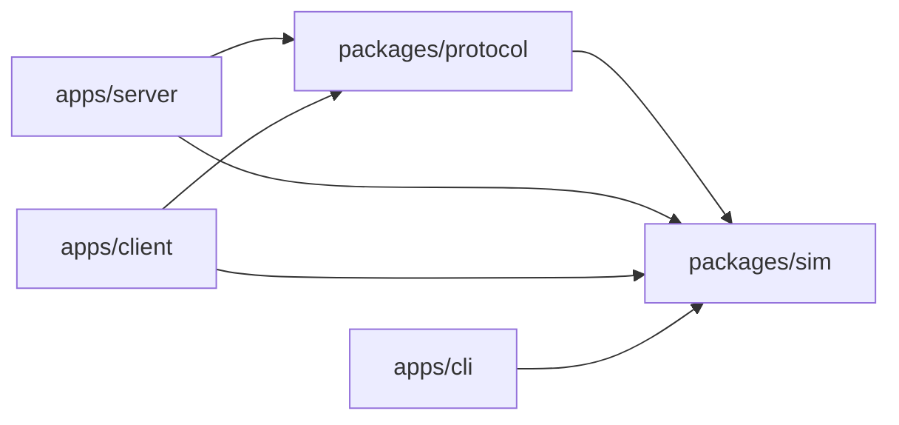
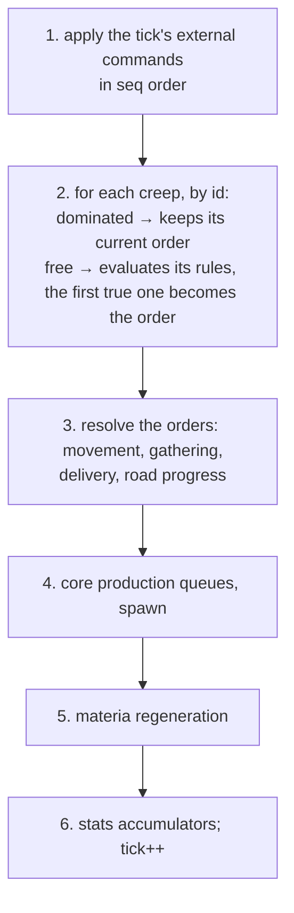

# M1 plan — The wealth cycle

**Status:** Approved (2026-11-13) · **Date:** 2026-11-13
**Spec:** [spec.md](spec.md) · **ADRs:** [0001](../../adr/0001-world-and-battle-as-separate-simulations.md) ·
[0002](../../adr/0002-every-action-is-a-command.md) · [0003](../../adr/0003-typescript-node-pure-integer-simulation.md) ·
[0004](../../adr/0004-persistence-sqlite-command-log.md) · [0005](../../adr/0005-mvp-deploy-vps-websocket.md)

This document describes **how** to build the spec. Decisions P1–P6 (section 12) were approved by the owner together
with the plan.

## 1. Repository layout

A monorepo with **npm workspaces** (no extra tooling):

```
packages/
  sim/          pure simulation: state, commands, tick, autopilot, map, RNG, pathfinding, metrics
  battle/       the battle simulation (M2 slice B, ADR-0008)
  protocol/     client↔server messages and structural validation (zod)
apps/
  server/       Node: HTTP, WebSocket, world hosting, tick loop, persistence
  client/       Vite + Preact: SVG map, panels, replay; the battle lab (src/lab)
  cli/          headless simulation, sweeps, determinism check, reports
params/
  default.json  balancing parameters (the spec §6 guesses)
```

Package dependencies:



The `sim` depends on nothing. It is the piece that might one day become an extractable "engine".

## 2. Toolchain

| Item | Choice |
|---|---|
| Runtime | Node on the active LTS line at bootstrap, pinned in `.nvmrc` and `engines` |
| Language | TypeScript `strict`, `erasableSyntaxOnly`, ESM. Node runs `.ts` directly |
| Tests | Vitest |
| Lint/format | ESLint (flat config, typescript-eslint) + Prettier |
| Client | Vite + **Preact** + `@preact/signals` (P1) |
| Network validation | zod (only in `protocol`) |
| SQLite | `better-sqlite3` (P2) |
| WebSocket | `ws` |

### Determinism enforced by tooling, not discipline
- `packages/sim/tsconfig.json` uses `lib: ["ES2023"]`, **no DOM** and `types: []`, **no `@types/node`**. Any use of
  `window`, `setTimeout`, `process` or `Buffer` in the simulation **does not compile**.
- ESLint in the `sim`:
  - `no-restricted-properties` forbids `Math.random`, `Math.sin/cos/tan/exp/log/pow/sqrt` and friends;
  - `no-restricted-globals` forbids `Date`, `performance`, `crypto`, `Intl`;
  - `no-restricted-syntax` forbids `for…in` and floating-point number literals.

## 3. State model (`packages/sim`)

```ts
type WorldState = {
  simVersion: number; tick: number; rng: RngState;   // xoshiro128** RNG with Math.imul (deterministic)
  map: { w: number; h: number; terrain: number[]; road: number[] };  // index = y*w + x
  teams: Team[];          // ordered by id
  creeps: Creep[];        // ordered by id; increasing ids, never reused
  deposits: Deposit[];
  roadJobs: RoadJob[];
  nextId: number;
  stats: TeamStats[];     // accumulators for metrics (time per activity, trips)
};
```

- **Integer units.** Positions in cells. Movement uses *movement points*: the creep accumulates
  `base_speed × modifier ‰ / 1000` per tick and advances one cell on reaching `CELL_COST` points (60,000). So "2
  cells/min" becomes 2,000 points per tick (1 tick = 1 s). Terrain and load modifiers are in **per mille** (road
  2000‰, crossing 500‰, loaded 800‰).
- **Terrain:** jungle, river (impassable), crossing, rock (impassable). The road is a separate layer.
- **Iteration** always over arrays ordered by id. No `Set` or `Map` in the state.
- `serialize(state)` produces canonical JSON (fixed key order). The hash is computed outside the `sim`, with
  `node:crypto` (sha256) on the server and in the CLI.

## 4. Commands (the ADR-0002 contract)

The **external** commands are the only ones that go into the log:

| Command | Who may | Note |
|---|---|---|
| `dominate {creepId}` | a player of the team | Releases the previous domination (D-2). Refused if another player already dominates (D-3). |
| `release {}` | the dominating player | Also emitted **by the server adapter** on disconnect or real-time idleness, and logged like any other. So the timeout does not break determinism. |
| `order {creepId, order}` | only whoever dominates the creep | `order` ∈ `moveTo{x,y}` · `gather{depositId}` · `deliver` · `buildRoad{x,y}` · `stop` |
| `setRules {creepId, rules}` · `applyPreset {creepId, preset}` | any player of the team | Answers the spec's open question: rules can be edited without dominating (P4) |
| `produce {dna, repeat}` · `stopRepeat {}` · `buyUpgrade {id}` | any player of the team | `stopRepeat` disarms "repeat" (P5) without requesting another creep; added with the owner's OK on 2026-11-13 |

- `validate(state, cmd, playerId) → ok | reason`: **semantic** validation lives in the `sim`. **Structural**
  validation (shape, types) lives in `protocol`, with zod.
- The autopilot produces internal `order`s through the same validation path, but they do not go into the log.

## 5. Tick pipeline (fixed order)



- **`step` mutates the state in place** (approved by the owner on 2026-11-13). Copying the state every tick does not
  fit the budget of 3 days in under 10 min. The ADR-0003 rule still holds where it matters: no I/O, no clock, no
  external randomness. Whoever needs the previous state keeps a copy with `serialize`.
- **Pathfinding:** 4-direction A*, with cost per terrain and road. Ties broken by cell index, to be deterministic. The
  path is cached on the creep and only recomputed when the target changes or a new road is finished. The road cost
  should make routes converge on roads.
- **Autopilot rules:** an interpreter of a `condition → action` list with the spec's closed vocabulary (P-2). The
  presets are data in `sim/presets.ts`.
- **Road building:** a `buildRoad` order to a distant point becomes a sequence of segments, always starting from the
  nearest already-connected segment.

## 6. Map generation
1. The seeded RNG generates the **top half**: clustered rock obstacles, the core position, materia deposits near the
   core and 3 cristal deposits.
2. The **bottom half** is the top half rotated 180° (point symmetry). It is fair to both teams.
3. The river takes the 2 center rows, with 3 mirrored crossings and 2 contested cristal deposits near them.
4. Validation: there is a core→core path and a core→each deposit path. If not, generation runs again with `seed+1`,
   deterministically.

## 7. Server (`apps/server`)

| Module | Responsibility |
|---|---|
| `http.ts` | `node:http`; `POST /api/worlds`, `POST /api/worlds/:id/join` (name + team → token); the client's static files |
| `ws.ts` | Authenticates by token; receives commands; sends the state |
| `world-host.ts` | One per world: in-memory state, tick loop, command queue, broadcast |
| `persistence.ts` | SQLite: log, snapshots, metrics, recovery |

- **Tick loop:** `setTimeout` correcting drift, with a `1000 / multiplier` ms interval. If the server falls behind,
  it runs up to K catch-up ticks at once.
- **Command intake:** arrives over WebSocket → zod → `validate` → gets a target tick (the next one) and a `seq` → is
  written to the log (one transaction per tick) → enters the queue. The client receives `ack` or `reject{reason}`.
- **Broadcast:** the static map goes once, in the `welcome`. Then the **full dynamic state** (creeps, stocks,
  deposits, new roads) after each tick, **capped at 5 sends per second** in real time. ~3–5 KB per message. Deltas
  only if measurement shows the need (P3).
  **Measured in F6:** 6.7 KB with 12 creeps, 13.7 KB with 28 and 26.9 KB with 60. The owner (2026-11-14) kept the
  full state for M1, which runs locally. **Superseded by ADR-0006** (M1.5 network).
- **Server configuration** (not balancing, not in the `sim` params): domination timeout of 5 real minutes and a
  reconnection grace of 15 real seconds (spec §5, F6 details), port, SQLite path, `snapshot_every`.
- **Bots:** one bot per team, optional at world creation. The strategist moves from `apps/cli` into the `sim`, so the
  server and the CLI use the same code; its commands go through the same path as the humans'.
- **Player session:** a random token (its hash goes to SQLite; the client keeps it in `localStorage`). Automatic
  reconnection with the same token.

### SQLite schema

```sql
worlds    (id, seed, params_json, sim_version, multiplier, status, created_at)
players   (id, world_id, team_id, name, token_hash)
commands  (world_id, tick, seq, player_id, payload_json, PRIMARY KEY (world_id, tick, seq))
snapshots (world_id, tick, state_json, state_hash, PRIMARY KEY (world_id, tick))
metrics   (world_id, tick, team_id, sample_json)
```

- A snapshot every `snapshot_every` ticks (default: 300, i.e. 5 world minutes) and on a clean shutdown (SIGTERM).
- Recovery = the last snapshot + the commands with `tick > snapshot.tick`, replayed.

## 8. Client (`apps/client`)
- **Map** in SVG via Preact JSX. Pan and zoom manipulate the `viewBox`. The static map (terrain, river, rocks) is
  drawn once in a layer; roads, deposits and creeps live in a dynamic layer.
- **Creeps** are shapes per DNA (■ `<rect>`, ● `<circle>`, ▲ `<polygon>`), in the team color, with a load ring and a
  halo when someone dominates them.
- **Interpolation:** with `requestAnimationFrame`, the position is interpolated between the last two states
  received.
- **Panels:**
  - creep inspector: DNA, load, rules, who dominates, a "dominate/release" button;
  - core: stock, production, upgrade, population;
  - rules editor: an ordered list, add, remove, reorder, apply a preset.
- **Direct control** (with domination): click on the map = `moveTo`; click on a deposit = `gather`; click on the core
  = `deliver`; road mode = `buildRoad`.
- **Replay mode:** loads a replay file (initial snapshot + commands) and **runs the `sim` in the browser**, with play,
  pause and speed. That also proves the `sim` runs the same in the browser (test on Safari = JSC).

### F8 details decided by the owner (2026-11-14)

- **Replay source:** the `replay.json` from `geo sim`, opened from the lobby ("Watch replay", file picker), and
  `GET /api/worlds/:id/replay`, which exports a server world (initial snapshot + the SQLite log).
- **Controls:** play, pause and speeds ×1, ×60, ×600, ×3600 and max (world seconds per real second). A timeline with
  a jump to any point: the client keeps an in-memory snapshot every world hour and, to go back, restores the nearest
  one and re-simulates.
- **Hash at the end:** on the last tick the client computes the hash (SHA-256 via Web Crypto) and shows ✓/✗ against
  the `finalHash`.
- **Safari/JSC:** one run of the replay in Playwright's WebKit (the JSC engine), scratchpad only, with the result
  recorded. A permanent check with Bun only if a divergence shows up.
- **`npm run dev:multi -- --clients K`:** starts the server with the client build, creates a world (`--seed`,
  `--mult`, default ×36), joins K players alternating Blue and Orange ("Player 1…K") and opens K tabs in the default
  browser (on WSL, `cmd.exe /c start`; without a browser, it prints the URLs). Each tab gets
  `?world=…&slot=N#token=…`; the client stores the token in `localStorage` and cleans the URL. Development only.

### F9 details decided by the owner (2026-11-14)

- **Soak test (`npm run soak`)** instead of the 24 h world (spec §8 item 3): a whole bot × bot world through the
  server's real loop (default ×360), `kill -9` at random moments (default 5) with restarts, one clean SIGTERM, and at
  the end the exported replay rebuilt in Node and in the browser with the server's hash. Records process memory,
  SQLite size and loop delay.
- **Road × rock:** the road becomes light, warm earth (sand `#b8a07a`, border `#8a7552`); rock becomes darker
  (`#2f3238`) with a light edge at the top and left (`#5c616c`), reading as a raised block.
- **Creep name on the map:** below the shape, in a light tone of the team color, on every creep that stands alone
  (not in a stack) and takes ~22 px or more on screen; zoomed out, it disappears.
- **In-game font** (names, `+N`, road cost): Chakra Petch (OFL), one woff2 weight inside the repo, no CDN. The rest of
  the interface stays in the system font.
- **Feedback with short animations:** in road mode, the cell under the mouse shows the cost (red if the stock falls
  short); on paying, `−N` rises from the core; the job shows the time left. Full load: the ring becomes complete and
  thick, with a short glow on filling. Delivery: `+N` in the resource color rises from the core and the stock flashes
  in the panel.

## 9. CLI (`apps/cli`)

| Command | Output |
|---|---|
| `geo sim --seed 42 --params params/default.json --days 3 [--strategist balanced]` | `runs/<id>/`: metrics (CSV + JSON), replay, `report.md` |
| `geo sweep --set creep.cost.materia=30,40,50 --seeds 1-5` | a comparison table in `report.md` |
| `geo verify --seed 42 --ticks 50000` | determinism: runs 2×; snapshot → restore → continue; replay from the log. The three hashes must match |
| `geo report runs/<id>` | a `report.md` readable by humans **and by AI**, to discuss balancing with Claude |

- **Bot strategist** (harness only at first): a team policy that emits the same external commands (`produce`,
  `buyUpgrade`, `applyPreset`) a human would. Without it, a bots-only team never produces creeps.
- **Metrics:** `sampleMetrics(state)` is a pure function, sampled every 60 ticks (1 world minute) and computed from
  the `stats` accumulators. It covers the spec §7 list.

### Harness details decided by the owner in F5 (2026-11-13)

- **`balanced` strategist** (provisional until the F5 checkpoint): one bot player per team, with a `join` at tick 0.
  It acts every 60 ticks (1 world minute) and decides from the state alone, with no memory of its own (snapshot →
  restore and replay stay faithful).
  - *Production:* with the core free, produces the DNA with the fewest creeps on the team (tie: ■ ▲ ●), without
    "repeat", up to the cap.
  - *Upgrade:* buys the capacity upgrade as soon as the stock allows.
  - *Roles:* ⅓ of the creeps (rounded up) gather cristal while there is cristal on the map; 1 builds roads; the rest
    gather materia. Without cristal, the cristal gatherers switch to materia. Roles switch on the lowest-id creep.
  - *Roads:* the target is the non-empty deposit closest to the core (Manhattan) still without a road and with a
    buildable segment; once that one is linked, the next.
- **`geo sim` output:** metrics in CSV + JSON in F5. The SQLite metrics come in F6, with the persistence module, so the
  CLI does not pull in `better-sqlite3` (a native module) too early.
- **CI budget:** 6 world hours of bot × bot in at most **60 s** of wall clock (the 3-days-in-10-min target gives 50 s;
  the margin is for slower CI machines).

## 10. Tests

| Type | What |
|---|---|
| Unit (`sim`) | movement with points, A* and tie-breaking, gathering and capacity, delivery, regeneration, production, population cap, upgrade, roads, domination rules D-1..D-4, rules interpreter |
| Property | a symmetric, connected map for 500 seeds |
| Determinism (CI) | `geo verify` with 3 seeds |
| Performance budget | CI: 6 world hours of bot × bot in at most 60 s. Manual: 3 days in under 10 min (spec §7) |
| Integration (`server`) | join → ws → command → broadcast; kill and restart the process → the world continues with the same hash |
| Client | a manual smoke test in M1. Playwright only if needed |

## 11. Deploy

Postponed (owner, 2026-11-14; spec §8). The design below still holds; for the first playtests with friends, the dev
machine plus a free tunnel is enough (ADR-0005).

- `infra/docker/`:
  - `Dockerfile`: multi-stage; client build; Node runtime.
  - `compose.yml`: app + Caddy + Litestream.
  - `Caddyfile` and `litestream.yml`.
- GitHub Actions:
  - **CI:** typecheck, lint, tests, `geo verify`, the 6 h budget.
  - **Manual deploy** (`workflow_dispatch`): image to GHCR, then SSH with `docker compose pull && up -d`.
- `docs/PLAYTEST.md`: how to expose the dev machine through a tunnel, the protocol and the questionnaire.

## 12. Approved decisions

Approved by the owner on 2026-11-13, together with the plan. The "Alternative" column records what was discarded.

| # | Decision | Choice | Discarded alternative |
|---|---|---|---|
| P1 | Client UI library | **Preact + signals** (~5 KB, JSX the AI handles well, declarative SVG) | Plain DOM and SVG, no library: zero dependencies, more manual code in the panels |
| P2 | SQLite driver | **better-sqlite3**: mature and synchronous; a native module, but with prebuilt binaries | `node:sqlite`: zero dependencies, API still maturing |
| P3 | State on the wire | **Full dynamic state**, capped at 5 sends per second (**superseded by ADR-0006**) | Deltas from the start (more code, no proven need) |
| P4 | Editing rules without dominating | **Yes**, any player of the team edits the rules of any creep of the team | Only the player who dominates the creep |
| P5 | **Gap in the spec:** production and upgrades while the humans are offline | M1: humans can mark a production as **"repeat"**; the bot strategist stays in the harness. **Revised on 2026-11-14:** a server world can have one optional bot per team (spec §5, F6 details) | A "team autopilot" for humans already in M1 (more scope) |
| P6 | Movement | **4 directions** (simpler, trivial tie-breaking) | 8 directions (more natural routes, slightly more complex A*) |

## 13. Implementation order

The order is **harness first**: after F5 the first balancing pass is possible **without any interface**. Details in
[tasks.md](tasks.md).

| Phase | Delivery | Checkpoint |
|---|---|---|
| F0 | Repo bootstrap, toolchain, CI | `npm test` green |
| F1 | `sim` core: state, RNG, parameters, map, serialize, empty tick | `geo verify` green |
| F2 | Movement, terrain, roads, A* | |
| F3 | Economy: gathering, delivery, production, upgrade, road building | |
| F4 | Autopilot, presets, domination | |
| F5 | Metrics, CLI, bot strategist | **First 3-day bot × bot world + `report.md`** |
| F6 | Server: HTTP, WebSocket, tick loop, persistence, recovery | |
| F7 | Client: map, panels, direct control, interpolation | **The owner's session** (interface and readability) |
| F8 | Replay in the browser; local multi-client command | |
| F9 | Readability and playtest: compressed soak test (`npm run soak`), map readability and visual feedback tweaks, local playtest script (owner, 2026-11-14) | **Human readability and mechanics playtest** |
| — | Deploy and fun playtest: **left M1** (owner, 2026-11-14). §11 still holds | |
