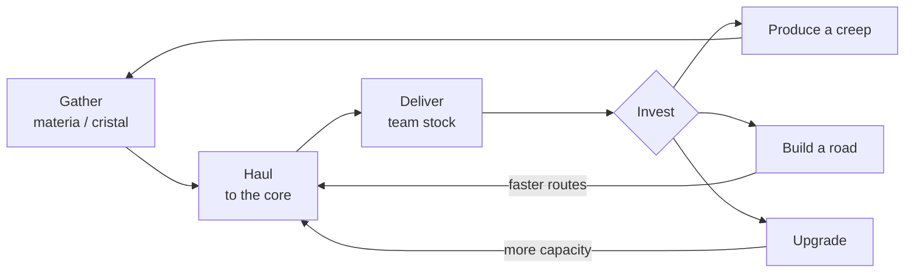

# M1 spec — The wealth cycle

**Status:** Done (2026-11-14) · **Date:** 2026-11-13 · **Milestone:** M1 ([ROADMAP](../../ROADMAP.md))
**Related GDD:** [01](../../gdd/01-world.md) · [02](../../gdd/02-creeps-and-domination.md) ·
[03](../../gdd/03-economy-and-logistics.md) · [07](../../gdd/07-autopilot.md)

## 1. Hypothesis

> Gathering, hauling and investing resources in a persistent world produces **interesting decisions** even without
> combat, and a "3-day" world can be simulated and observed in a controlled way.

M1 does **not** need to be fun as a final product. It needs to answer:
1. Does the economic cycle produce non-trivial decisions: routes, roads, DNA choice, autopilot rules?
2. Does dominating a creep add something the autopilot alone does not?
3. Does the harness (headless simulation, bots, time multiplier, metrics, replay) work well enough to balance the
   game with data?

## 2. The cycle

## 3. Scope decisions this spec assumes

The defaults below were **accepted by the owner** on 2026-11-13 (approval of the general direction). Revisit if the
playtests point that way.

| # | Decision | Default | Why |
|---|---|---|---|
| D1 | Victory in M1 | **None.** The world ends on time; "prosperity" is only a metric | Without combat there is no way to destroy the base. An artificial race would distort what we want to measure. |
| D2 | Cost of dominating | Free, no cooldown, no distance limit (the parameters exist, set to 0) | First find out whether dominating is useful; then whether it needs a cost. |
| D3 | What DNA changes in M1 | Economic traits only: ■ square carries a lot and is slow; ● circle is fast and carries little; ▲ triangle sits in between | Gives weight to the DNA choice in M1, without combat. **Revised on 2026-11-14:** the owner decided the DNAs are equivalent in economic impact (GDD 02); the choice only starts to matter from M2. |
| D4 | Use of resources | Materia: roads and creep production. Cristal: creep production and the capacity upgrade | Both resources must matter. |
| D5 | Fog of war | None (the whole map visible) | Simplicity. Fog comes with battles, if it is missed. **Superseded by M1.5 fog.** |
| D6 | Teams | 2 teams, each with 0 to 3 humans; a team with no humans runs on autopilot only | Allows testing human × bot and bot × bot. |
| D7 | Currency, taxes, treasury | Out. The stock delivered to the core belongs to the team | The currency question is left for later. |
| D8 | Individual inventory | The creep carries its load until it delivers; no individual spending | Individual inventory only makes sense with items. |
| D9 | Map shape | A grid of cells, 4-direction movement. Approved with the [plan](plan.md) (§3, P6) on 2026-11-13 | Simpler for roads, determinism and SVG. |
| D10 | Rules without domination | Any player of the team edits the rules of any creep of the team; direct control requires domination. Approved with the [plan](plan.md) (P4) on 2026-11-13 | Resolved an open question of this spec. |

## 4. Scope

### In
- A small map generated from a **seed**, mirrored across a horizontal river, with 2 or 3 crossings.
  - Materia: near each core, renewable.
  - Cristal: depletable. Some deposits are on each team's side, some are contested, near the river and the center.
  - Jungle terrain is slow; roads are fast.
- One **core** per team, which holds the stock and produces creeps.
- **Creeps** of the 3 DNAs, with carrying capacity, speed and inventory.
- **Production** of creeps at the core (costs materia + cristal; has a production time; a population cap).
- **Roads** built by creeps, segment by segment, spending materia.
- **1 team upgrade:** +carrying capacity (costs cristal).
- A **declarative autopilot** per creep, plus ready-made presets.
- **Dominate and release**, with direct control (move, gather, deliver, build).
- **Multiplayer:** several browsers connected to the same world, seeing the changes every tick.
- **Persistence:** the world survives a server restart without losing state.
- The **harness** (section 7).

### Out
Combat, battles, death, monsters, tribes, governance, taxes, currency, energy, level/XP/skills, reproduction,
autopilot scripts, real login (guest names only), matchmaking, control plane integration, sound, mobile.

## 5. Behavior

Format: *When [trigger], the system shall [response].*

### World
- **M-1** When a world is created with a seed and a parameters file, the system shall always generate the same map,
  mirrored for both teams.
- **M-2** The world shall advance in fixed ticks. A tick's real-clock duration is `real_tick = base_tick /
  multiplier`.
- **M-3** When the server restarts, the world shall return to the last persisted state and continue from there. At
  most a few ticks are lost.
- **M-4** When world time reaches the configured duration, the world shall end and produce the final metrics report.

### Resources and logistics
- **R-1** When a creep gathers, the system shall move resource from the deposit to the creep's inventory up to its
  capacity (DNA × upgrade).
- **R-2** Materia deposits regenerate over time; cristal deposits do not.
- **R-3** When a loaded creep reaches its own team's core and delivers, the system shall move the load to the team's
  stock.
- **R-4** A creep's speed shall depend on its DNA, the terrain (jungle × road × river crossing) and its load
  (*proposal: loaded is slower*).

### Investment
- **I-1** When a player asks to produce a creep of a DNA, with enough stock and room under the population cap, the
  system shall debit the cost and create the creep at the core after the production time.
- **I-2** When a creep builds a road segment adjacent to an existing road or to the core, the system shall debit
  materia from the team's stock and create the segment after a build time.
- **I-3** When the capacity upgrade is bought, all of the team's creeps shall get the new capacity.

#### Economy details decided by the owner in F3 (2026-11-13)

- **Gathering:** the creep goes to the deposit's cell and gathers `rate` units per second until full or until the
  deposit is empty; then it stops. The rate is the same for every DNA and both resources. Capacity counts materia +
  cristal together (they can mix). Several creeps on one deposit each gather, lowest id first.
- **Delivery:** instant on reaching its own core's cell; the whole load goes to the stock and the creep stops.
- **Deposits:** materia regenerates up to its initial value. Depleted cristal stays on the map at 0.
- **Production:** one creep at a time per core, no queue; a request while the core is busy is refused. The cost is
  debited on start. The population cap counts live creeps + the one in production. The creep is born at the core,
  stopped. **"Repeat"** (P5): when done, it restarts the same DNA; without stock or room under the cap, it stays
  armed and retries every tick. Disarming is the `stopRepeat` command (plan §4).
- **Road building:** segment = 1 cell. `buildRoad{x,y}` follows the cheapest path from its own core to P; the next
  segment is the first cell without a road on that path. The creep goes to the cell; the materia is debited on
  start; it stays there for the build time and moves to the next segment until P has a road. Without materia in the
  stock, the order stops. If the builder leaves, the job pauses (already paid) and whoever comes back continues. One
  builder per job: a second creep on the same cell does not speed it up.
- **Roads are neutral:** both teams walk on them. The I-2 connection rule holds for any road or one's own core.
  Building is not allowed on a crossing (it stays slow, a bottleneck for M2) nor on a core's cell.
  Consequence accepted by the owner: since every segment touches the network, **in M1 no road crosses the river**;
  a `buildRoad` to the other bank builds up to the crossing and stops.

### Domination
- **D-1** When a player dominates a free creep of their own team, the creep shall execute only that player's
  commands.
- **D-2** When a player tries to dominate a second creep, the system shall release the first one before (at most 1
  active domination).
- **D-3** When a player tries to dominate a creep already dominated by someone else, the system shall refuse.
- **D-4** When the domination ends (the player releases, disconnects or stays idle for `domination_timeout`), the
  creep shall go back to its configured autopilot.

### Autopilot
- **P-1** Each creep has an ordered list of `condition → action` rules. On every tick it is not dominated, it runs the
  action of the first rule whose condition is true.
- **P-2** The initial vocabulary is closed:
  - **Conditions:** inventory full / empty; resource X visible within radius R; team stock of X < N; always.
  - **Actions:** gather X at the nearest deposit; deliver at the core; build a road to point P; go to point P; stay
    put.
- **P-3** Ready-made presets: *materia gatherer*, *cristal gatherer*, *road builder*.
- **P-4** The autopilot and the human emit the same commands ([ADR-0002](../../adr/0002-every-action-is-a-command.md)).
  The server validates all of them the same way.

#### Autopilot and domination details decided by the owner in F4 (2026-11-13)

- **Evaluation (P-1):** every tick, on a free creep, the first rule whose condition is true **and** whose action is
  possible becomes the order. An impossible action (e.g. gathering cristal with no cristal on the map) falls through
  to the next rule. The same action as the current order restarts nothing. If no rule applies, the creep keeps its
  current order. Rule limit per creep: a parameter (10, provisional).
- **Birth rules:** the initial and the produced creeps are born with the *materia gatherer* preset.
- **Vocabulary (P-2):** "nearest" and "radius R" use the Manhattan distance from the creep, count only deposits with
  amount > 0, and ties go to the lowest id. "Full" = load ≥ capacity; "empty" = load 0.
- **Gathering with deposits at zero** (owner, 2026-11-14, before F7): the creep picks the nearest non-empty deposit
  and keeps it until full, without switching targets on the way. If the deposit runs dry, it waits there for
  regeneration; if it is depleted cristal (no regeneration), it picks another one, and without another the action is
  impossible.
- **Presets (P-3):**
  - *Materia gatherer:* full → deliver; always → gather materia; always → deliver (the last one delivers the leftover
    when there is no deposit).
  - *Cristal gatherer:* the same, with cristal.
  - *Road builder* (the `applyPreset` carries point P): full → deliver; always → build a road to P; always → gather
    materia; always → deliver. Without materia in the stock or with the road done, building is impossible and it
    gathers materia.
- **Domination:** the dominated creep keeps its current order and only changes it with an `order` from whoever
  dominates it; when the order ends, it stays put. On release, it goes back to its rules on the next tick. The D2
  parameters (all 0 in M1) work like this: the cost comes out of the team stock on dominating (without stock,
  refused); the cooldown is per player, counted from the last accepted domination; the maximum distance is
  Manhattan, from the team's core to the creep (0 = no limit).

#### Server details decided by the owner in F6 (2026-11-14)

- **`domination_timeout` in real time:** 5 real minutes without input release the creep, at any multiplier. The
  idleness is the human's, not the world's; the value comes from the `sim` params and becomes a server setting.
- **Disconnect (D-4) with a grace period:** if the player reconnects with the same token within 15 real seconds, they
  keep the domination. The `release` only enters the log when the grace period expires.
- **Bots on the server:** when creating a world, each team can have an optional `balanced` bot, for the soak test
  (formerly the 24 h world) and for the owner's session. It joins as a player and emits normal commands, which go to
  the log (ADR-0002).
- **Humans per team (D6):** 3, enforced by the `sim` with the `teams.maxHumans` parameter; the 4th human `join` on a
  team is refused. Bots do not count.

### Client
- **C-1** A strategic SVG map with pan and zoom, showing terrain, river, deposits, roads, cores and creeps (shape =
  DNA, color = team, a load indicator).
- **C-2** Selecting a creep shows its DNA, inventory, autopilot rules and who dominates it.
- **C-3** Core panel: stock, creep production, upgrade, population.
- **C-4** An editor for the autopilot rules (an ordered list; apply a preset).

#### Client details decided by the owner in F7 (2026-11-14)

- **Orders with the right button** (the RTS/MOBA convention): left always selects and inspects; right gives the order
  to the creep the player dominates: on the map, `moveTo`; on a deposit, `gather`; on one's own core, `deliver`. In
  road mode, the right click becomes `buildRoad`.
- **Dark look:** graphite background, discreet dark-green jungle, blue river, gray rocks; teams in blue and orange
  (distinguishable with color blindness); materia and cristal with their own colors; shapes with a light outline.

## 6. Initial parameters (guesses, made to be broken)

All of them live in a versioned parameters file, never in code.

| Parameter | Initial guess |
|---|---|
| World duration | 3 days of world time |
| Base tick | 1 s of world time |
| Map | 64 × 64 cells; river on the center line; 3 crossings |
| Initial population | 6 creeps (2 of each DNA) |
| Population cap | 30 |
| Initial team stock | 0 materia · 0 cristal (decided by the owner on 2026-11-13) |
| Carrying capacity ■ / ▲ / ● | 30 / 20 / 10 |
| Speed in cells per minute ■ / ▲ / ● | 2 / 3 / 5 |
| Speed multiplier | road ×2 · jungle ×1 · crossing ×0.5 · loaded ×0.8 |
| Materia deposit | 500 units; regenerates 8 per minute; 6 per side, 3 to 20 cells from the core (balance pass 1, 2026-11-14; before: 1 per minute, 3 per side, up to 8 cells) |
| Cristal deposit | 300 units, depletable; 3 per side + 2 in the center |
| Gathering rate | 1 unit per second, the same for every DNA (decided by the owner on 2026-11-13) |
| Cost of a creep | 3,000 materia + 10 cristal; 10 min to produce (balance pass 1; before: 40 materia) |
| Cost of a road segment | 150 materia; 2 min to build (balance pass 1; before: 5) |
| Capacity upgrade | 150 cristal; +50% capacity |
| `domination_timeout` | 5 min without input, in real time (owner, 2026-11-14) |

## 7. Harness required by M1

| Piece | Criterion |
|---|---|
| **Headless simulation** | A CLI runs a world from seed + parameters + multiplier, with bots, and produces metrics and the replay log. |
| **Determinism** | Same seed + parameters + command log ⇒ same final state hash. An automated test in CI. |
| **Time multiplier** | A 3-day world with 2 bot teams runs headless in **under 10 minutes** on a dev machine. |
| **Replay** | The log can be opened in the client to watch, with fast-forward. |
| **Parameter sweep** | Run N simulations varying a parameter and compare the metrics side by side. |
| **Local multi-client** | One command starts the server and opens K clients for manual tests. |

### Recorded metrics (per team, as time series)
- Materia and cristal stock; delivered throughput per hour; value in transit.
- Creeps per DNA; idle production time at the core.
- How creeps spend their time: gathering / hauling / walking empty / idle.
- Average time and distance per trip; total road length.
- When each cristal deposit is depleted; contention (two teams on the same deposit).
- Humans: time dominating, commands per minute, autopilot rule edits, presets used.

## 8. Test protocol

1. **Bot × bot sweeps** (headless): calibrate the parameters until the economy neither stalls nor explodes in 3 world
   days. First pass: [balance.md](balance.md).
2. **The owner's session** (F7 checkpoint): interface, map readability, rules editor, domination and local
   multi-client. Not a fun playtest.
3. **Compressed soak test** (`npm run soak`, instead of the 24 h world): a whole bot × bot world (3 world days)
   through the server's real loop, with a high multiplier, forced crashes (`kill -9`) and restarts in the middle, a
   clean shutdown, and at the end the exported replay rebuilt in Node and in the browser with the same hash as the
   server. Records process memory, SQLite size and loop delay: persistence, recovery and stability.
4. **Human readability and mechanics playtest** (F9): people playing on the local server, to refine what the player
   sees and understands (roads × obstacles, costs, load, deliveries, names) and collect the next improvements. Not a
   fun playtest.

**Revised by the owner on 2026-11-14.** The fun playtest and the deploy left M1: without combat there is nothing to
win, and the DNAs are equivalent on purpose, so a fun playtest now would measure what the game does not intend to
be. They move to after combat ([ROADMAP](../../ROADMAP.md)).

**Revised again on 2026-11-14 (end of F8):** 24 real hours of economy without combat test nothing the clock adds:
persistence, recovery and stability depend on ticks, crashes and process hours. The 24 h world became the compressed
soak test (item 3), and M1 gained a **readability and human playtest** round (item 4, F9) before M2, without deploy.

### Criteria to move on to M2
- Bot × bot with no degenerate state in 3 world days (neither stalling nor exploding; see [balance.md](balance.md)).
- Determinism (`geo verify`) and recovery after restart green.
- The compressed soak test ends without crashing and with the same hash on the server, in Node and in the browser.
- The owner's session approves the readability, and the F9 readability playtest was done, with the next improvements
  recorded.

## 9. Prerequisites before the `plan.md`

ADRs to propose and approve:
- **Stack** ([ADR-0003](../../adr/0003-typescript-node-pure-integer-simulation.md)).
- **World persistence** ([ADR-0004](../../adr/0004-persistence-sqlite-command-log.md)).
- **Transport and deploy** ([ADR-0005](../../adr/0005-mvp-deploy-vps-websocket.md)).

## 10. Open questions
None at the moment.
