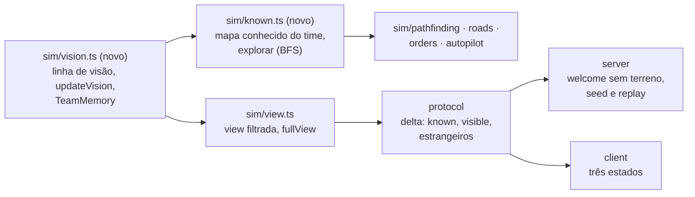
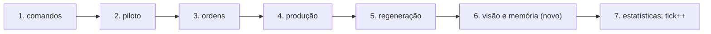

# Plan M1.5 — Fog of war

**Status:** Aprovado (2026-11-14) · **Data:** 2026-11-14
**Spec:** [spec.md](spec.md) · **ADRs:** [0006](../../adr/0006-sync-do-mundo.md) (sync do mundo) ·
[0002](../../adr/0002-tudo-e-comando.md) (vocabulário de comandos) · [0003](../../adr/0003-stack-typescript-node.md)
(determinismo) · [0004](../../adr/0004-persistencia-sqlite-log-de-comandos.md) (snapshot e log)

Este documento descreve **como** construir a spec. As decisões `N1`–`N10` (seção 10) foram aprovadas pelo dono junto
com o plano.

## 1. O que o código faz hoje e o que muda

| Onde | Hoje | Com o fog |
|---|---|---|
| `view.ts` | Devolve tudo, dos dois times | Filtra pelo que o time vê e lembra (§4) |
| `pathfinding.ts` | A* no mapa real; cache por creep invalidado pelo `state.roadRevision` global | A* no **mapa conhecido** do time; cache invalidado pela memória do time (§5) |
| `roads.ts` / `orders.ts` | `nextSegment` e `canBuildRoad` leem o mapa real | Leem o mapa conhecido do time (spec D5) |
| `autopilot.ts` | `nearestDeposit` e `resourceInRange` leem `state.deposits`; `moveTo` checa o terreno real | Leem a memória do time (spec A-1); ação, condição e ordem novas (§6) |
| `domination.ts` / `commands.ts` | `notYourTeam` para creep inimigo; `invalidOrder` para depósito inexistente | Creep ou depósito fora do que o time conhece recebe a recusa de inexistente (spec D6, §7) |
| `strategist.ts` | Visão + mapa estático completo | Só a visão, que traz o terreno conhecido (spec B-1) |
| `protocol` | `welcome` com o terreno inteiro e `cores` (os dois Núcleos); `WorldSummary.seed` | Sem terreno, sem `cores`; seed `null` em mundo vivo (§8) |
| `apps/server/src/http.ts` | Replay de qualquer mundo | Só de mundo encerrado (spec D10) |
| Cliente | Desenha o mapa estático uma vez; lê `state.teams[i]` de todos | Três estados; time e creeps estrangeiros com menos campos (§9) |

Dois vazamentos que o código tinha e a spec não listava: o `welcome` manda `cores` (a posição do Núcleo inimigo),
e a recusa `notYourTeam` revela que existe um creep inimigo com aquele id. Os dois entram nas fases abaixo.

## 2. Onde fica cada coisa



| Módulo | Responsabilidade |
|---|---|
| `params.ts`, `params/default.json`, `test/params.json` | `vision: { core: 8, dna: { circle: 6, triangle: 4, square: 3 } }` (spec §6), no `schema` |
| `packages/sim/src/vision.ts` (novo) | `TeamMemory`, `createMemory`, `updateVision(state)` (estágio novo do tick), `sees(...)` (linha de visão) |
| `packages/sim/src/known.ts` (novo) | O mapa conhecido do time como `GameMap` (para A*, estradas e validação) e a escolha do alvo de explorar |
| `packages/sim/src/view.ts` | `view(state, team)` filtrada; `fullView(state)` para o replay (N7) |
| `packages/sim/src/{pathfinding,roads,orders,autopilot,presets,commands,domination}.ts` | Pelo que o time sabe; explorar; recusas sem vazamento |
| `packages/sim/src/strategist.ts` | Só a visão |
| `packages/sim/src/stats.ts` | Métricas novas (§11) |
| `packages/protocol/src/{delta,index}.ts` | Coleções novas no delta; `welcome`; `PROTOCOL_VERSION` 3 |
| `apps/server/src/{http,world-host}.ts` | Seed escondida, replay só de mundo encerrado, `welcome` novo |
| `apps/client/src/map/*`, `panels/*` | Três estados, estrangeiros, cursor e traçado pelo que o time sabe, regras novas |
| `apps/cli/src/{report,sweep}.ts` | Métricas de exploração e de início de partida no relatório |

## 3. Memória do time e visão (`vision.ts`)

### Estado

Um campo novo no `WorldState`, `memory: TeamMemory[]`, indexado pelo id do time. Só dados JSON (convenções do
`CLAUDE.md`): bitmaps como `number[]` de 0 e 1, uma posição por célula (`y * width + x`).

```ts
type TeamMemory = {
  team: number;
  /** 1 onde o time já viu a célula (spec V-2). */
  explored: number[];
  /** 1 onde a célula está visível no fim do último tick (spec V-1). */
  visible: number[];
  /** Terreno conhecido; célula nunca vista guardada como jungle (spec P-1). */
  terrain: Terrain[];
  /** Estradas conhecidas (spec V-4); as do próprio time entram ao serem concluídas. */
  road: number[];
  /** +1 a cada estrada que o time passa a conhecer: invalida caminhos (§5). */
  roadRevision: number;
  /** +1 a cada célula intransitável (pedra, rio) que o time descobre (§5). */
  blockRevision: number;
  /** Cópias dos depósitos já vistos, por id, com o último valor (spec V-3). */
  deposits: Deposit[];
  /** Cópias das obras de outros times já vistas, por id (spec V-5); as próprias vêm do estado. */
  roadJobs: RoadJob[];
  /** Núcleos de outros times já vistos (spec V-6), por id do time. */
  cores: { team: number; x: number; y: number }[];
};
```

`terrain` e `road` juntos formam um `GameMap` (`known.ts`), o mapa em que o time pensa: A*, `nextSegment`,
`canBuildRoad` e a validação de `moveTo` usam esse mapa sem mudar de assinatura. O `state.roadRevision` global sai.

Tamanho: 4 bitmaps de 4 096 células por time; o snapshot cresce ~65 KB em JSON (2 times). O hash do estado inclui a memória.

### Pipeline do tick

O `updateVision` entra como estágio 6, depois da regeneração e antes das estatísticas (spec D2), e roda também no
fim do `createWorld`, para a visão do tick 0 existir.



`updateVision`, por time:
1. Zera `visible`; para o Núcleo e cada creep do time, marca as células do losango de raio `r` (params) que a linha
   de visão alcança (N2).
2. Para cada célula que ficou visível: `explored = 1`; copia o terreno real para `terrain` (se é pedra ou rio pela
   primeira vez, `blockRevision++`); copia a estrada real para `road` (se é nova, `roadRevision++`).
3. Depósitos em células visíveis: atualiza ou cria a cópia em `deposits`. Obras de outros times: cria ou atualiza a
   cópia nas visíveis, e apaga a cópia cuja célula está visível e não tem mais a obra. Núcleo de outro time visível
   → entra em `cores`.
4. Estrada concluída pelo próprio time entra em `road` na hora (em `completeRoadJob`), com `roadRevision++`: o
   próprio creep está em cima dela, mas assim o caminho não depende da ordem dos estágios.

### Linha de visão (N2)

Uma célula `t` é vista de `o` quando `manhattan(o, t) ≤ r` e nenhuma célula **entre** as duas, na linha de
Bresenham de `o` a `t`, é pedra. A própria `t` pode ser pedra (spec D1).

- **Só inteiros:** Bresenham clássico, com erro acumulado inteiro.
- **Equivalência entre os times:** a linha é traçada no referencial do time, como os caminhos (`isRotatedSide`):
  no lado girado, o tracer gira as coordenadas 180°, traça e desgira. Assim o que o time 1 vê é o espelho exato do
  que o time 0 vê na posição espelhada. Um teste confere isso num mapa simétrico.
- **Custo estimado:** raio 6 ≈ 85 células × até 6 passos; 30 creeps por time e 2 times ≈ 30 mil passos por tick,
  bem dentro do orçamento (o soak ×360 dá ~2,7 ms por tick). Se o critério "tick ≤ 2×" (spec §7) apertar, a
  otimização óbvia é pular o recálculo dos creeps que não mudaram de célula; ela não entra antes da medição.

## 4. A visão (`view.ts`)

```ts
type ForeignCreepView = Pick<Creep, "id" | "team" | "dna" | "x" | "y" | "cargo">;
type ForeignTeam = { id: number; core: Cell | null };      // null até o Núcleo ser visto
type ForeignPlayer = Omit<Player, "lastDominateTick">;

type TeamView = {
  tick: number;
  team: number;
  teams: (Team | ForeignTeam)[];          // o próprio inteiro, os outros como ForeignTeam; por id
  creeps: (CreepView | ForeignCreepView)[]; // os próprios + os estrangeiros visíveis; por id
  deposits: Deposit[];                    // a memória (spec V-3)
  roads: number[];                        // memory.road, índices crescentes
  roadJobs: RoadJob[];                    // os próprios (estado) + os lembrados; por id
  players: (Player | ForeignPlayer)[];
  known: number[];                        // por célula: -1 nunca vista, senão o Terrain (N6)
  visible: number[];                      // índices visíveis, crescentes
};
```

- Os tipos `Team | ForeignTeam` e `CreepView | ForeignCreepView` se distinguem pelo time (`team === view.team`).
  O `sim` exporta guardas (`isOwnCreep`, `isOwnTeam`) para o cliente e o estrategista.
- **`fullView(state)`** (N7): a visão onisciente, no mesmo formato (`team: -1`, `known` = terreno real, `visible` =
  todas as células, tudo inteiro). O replay usa essa; o cliente desenha as duas com o mesmo código.
- A visão continua sendo cópia rasa e função pura do estado (spec V-9).

## 5. Caminho pelo que o time sabe

- **`pathTo`** usa o mapa conhecido do time do creep. O movimento (pontos por tick) continua lendo o mapa real: a
  velocidade é física, o caminho é o que o creep acha.
- **Cache** (N3): o `PathCache` guarda `roadRevision` e `blockRevision` da memória. Mudou o `roadRevision` →
  recalcula (como hoje). Mudou só o `blockRevision` → percorre as células que faltam e recalcula só se alguma virou
  intransitável no mapa conhecido; se não, atualiza a revisão guardada. No começo da partida o time descobre pedra
  quase todo tick; recalcular todos os caminhos a cada descoberta custaria ~60 A* por tick.
- **Spec P-2** sai de graça: a célula vizinha nunca é escondida pela linha de visão (não há célula entre as duas),
  então a próxima célula do caminho já é conhecida quando o creep vai entrar nela.
- **Estradas** (spec D5): `nextSegment` e `canBuildRoad` recebem o mapa conhecido. Quando o creep chega ao segmento,
  a célula está visível e o mapa conhecido é igual ao real: ninguém paga por estrada que já existe.

## 6. Explorar

- **Ordem nova** `explore {x, y}` (N5): anda como `moveTo`; termina (`halt`) quando a célula-alvo fica explorada ou
  o caminho some. Ser uma ordem própria permite (a) ao piloto manter o alvo enquanto ele não foi explorado, como o
  `committedDeposit`, e (b) aos outros creeps do time excluírem esse alvo (spec D4).
- **Ação nova** `explore` (sem campos). Mantém o alvo da ordem `explore` atual se ele ainda não foi explorado; senão
  escolhe um novo. Impossível quando não há alvo (spec A-3).
- **Escolha do alvo** (N4): busca em largura no mapa conhecido do time a partir do creep (célula nunca vista conta
  como passável), na ordem de vizinhos do referencial do time; o alvo é a primeira célula nunca vista alcançada que
  nenhum outro creep do time tem como alvo de `explore`. Roda só quando o creep precisa de alvo novo, não todo tick.
- **Condição nova** `resourceUnknown {resource}`: verdadeira quando a memória do time não tem nenhum depósito do
  recurso com quantidade > 0 ou que regenera.
- **Presets** (spec A-4): coletor = `cargoFull → deliver`, `always → gather`, `resourceUnknown → explore`,
  `always → deliver`. Batedor (`scout`) = `always → explore`, `always → deliver`.

O vocabulário de comandos (`setRules`, `applyPreset`, a ordem de quem domina) ganha tipos novos: muda o contrato do
ADR-0002, com `BREAKING CHANGE` no commit e `PROTOCOL_VERSION` 3.

## 7. Comandos sem vazamento (spec D6)

- `order`, `setRules`, `applyPreset`, `dominate` sobre um creep que não é do time → `unknownCreep` (sai o
  `notYourTeam`).
- `order {gather, depositId}` com depósito fora da memória do time → a mesma recusa de id inexistente
  (`invalidOrder`).
- `moveTo`, `explore` e `buildRoad` validam o destino no mapa conhecido: célula nunca vista é aceita; célula
  conhecida como intransitável é recusada, como hoje.

## 8. Rede e servidor

- **Delta** (`protocol/delta.ts`): `known` como lista de pares `[índice, terreno]` das células exploradas desde o
  último envio (a memória só cresce); `visible` como `{add, remove}`. As coleções com id já removem entidades, o que
  cobre o creep inimigo que sai da visão e a obra lembrada que some. `roads` continua só crescendo (a memória não
  esquece estrada), então o `diffView` mantém o erro se uma estrada sumir.
- **Estimativa de banda:** ~3 entradas de célula por creep em movimento, ~60 trocas de célula visível por segundo
  a ×1 ≈ 300 B/s a mais; dentro de 2 KB/s. O `geo net` mede.
- **`welcome`:** `map` só com `width` e `height`; sai `cores`. A visão traz `known`.
- **`WorldSummary.seed`:** `number | null`, `null` enquanto o mundo não acabou (N9). O campo de seed na criação do
  mundo, no lobby, continua: é ferramenta de desenvolvimento, e quem cria o mundo sabe a seed. No deploy (M2), a
  criação de mundos deixa de ser pública; fica anotado no dashboard.
- **Replay:** `GET /api/worlds/:id/replay` de mundo vivo → `409 {error: "worldRunning"}`.
- **`PROTOCOL_VERSION` 3** (visão nova e vocabulário novo).

## 9. Cliente

- **Três estados** (spec C-1): uma camada de névoa por cima do mapa, desenhada a partir de `known` e `visible`:
  negro onde `known = -1`, véu esmaecido onde é conhecida e não visível, nada onde é visível. Depósitos e obras
  lembrados aparecem sob o véu, com o último valor. O terreno sai de `known` e não mais do mapa estático.
- **Estrangeiros** (spec C-2): creep inimigo desenhado só com forma, cor e carga; o inspetor mostra DNA e carga, sem
  regras, ordem ou atividade. Núcleo inimigo só depois de visto, sem produção nem estoque.
- **Cursor e traçado** (spec C-3): `road-plan.ts` monta o mapa a partir de `known` (como o `sim`); sobre célula
  nunca vista, o cursor não mostra custo.
- **Regras** (spec C-4): o editor ganha a ação "explorar", a condição "não conhece depósito de X" e o preset
  batedor.
- **Replay** (spec C-5): usa `fullView`, sem névoa.

## 10. Decisões aprovadas

Aprovadas pelo dono em 2026-11-14, junto com o plano. A coluna "Alternativa" fica como registro do que foi
descartado. N4 ajustou a D4 da spec (distância em passos, não Manhattan).

| # | Decisão | Escolha | Alternativa descartada |
|---|---|---|---|
| N1 | Formato da memória | `state.memory: TeamMemory[]` com bitmaps `number[]` (§3) | Listas de índices: menor no snapshot, mas o A* e a visão leem por célula |
| N2 | Algoritmo da linha de visão | Bresenham inteiro, traçado no referencial do time (§3) | Shadowcasting simétrico: mais permissivo e simétrico entre quem vê e quem é visto, mas bem mais código, com frações |
| N3 | Cache de caminhos | Revisões da memória; descoberta de pedra só recalcula o caminho que passa por ela (§5) | Recalcular todos a cada descoberta: simples, mas ~60 A* por tick no começo da partida |
| N4 | Distância do "explorar" | **Busca em largura no mapa conhecido** (passos, não Manhattan): a spec D4 diz Manhattan, mas a BFS só escolhe alvo alcançável. Com Manhattan, uma bolsa nunca vista cercada de pedra conhecida vira alvo inalcançável, e o creep tenta de novo a cada tick | Manhattan, como na spec, excluindo células cercadas por intransitáveis conhecidas (não pega bolsas de mais de uma célula) |
| N5 | Explorar como ordem própria | Ordem `explore {x, y}`, ação `explore`, condição `resourceUnknown`, preset `scout` (§6) | Reaproveitar `moveTo`: o piloto não distingue exploração de movimento e não mantém o alvo |
| N6 | Visão de terreno e visibilidade na rede | O servidor manda `known` e `visible` (§4, §8) | O cliente recalcula `visible` com a mesma função: menos banda, mas a linha de visão depende de pedras que o time pode não ter visto, então nem sempre dá o mesmo resultado |
| N7 | Replay | `fullView`, onisciente (§4) | Replay pela visão de um time: fora do escopo (spec §4) |
| N8 | Estrategista | Usa os presets com exploração e não ganha lógica de batedor; o critério de início de partida (spec §7) mede se basta. Se reprovar, o dono decide no checkpoint da F2 | Já começar com um batedor (o círculo) por time |
| N9 | Seed na criação do mundo | O lobby mantém o campo; a lista e o `welcome` escondem a seed de mundo vivo (§8) | Tirar o campo: a seed sempre aleatória e escondida, inclusive de quem cria |
| N10 | Estágio da visão | Estágio 6 do tick, e no `createWorld` (§3) | Calcular a visão na hora de montar a `view`: a memória precisa ser atualizada todo tick de qualquer jeito |

**Checkpoint da F2 (dono, 2026-11-14).** Números em `docs/dashboard/current-status.md` ("Medições da F2 do fog").

- **N8 bastou**, com uma adaptação: o estrategista mantém a fatia de cristal enquanto o time conhece cristal com
  sobra **ou** ainda alcança célula nunca vista (os coletores de cristal exploram pelo preset). Ao pé da letra,
  ninguém explorava e os bots nunca produziam. O dono manteve a regra.
- **Início de partida** ✅ (1ª matéria em 2–7 min nas seeds 1–20). **Economia** (3 dias, seed 42: matéria −13% a
  −20%) aceita.
- **Custo do tick** 2,2× (alvo ≤ 2×): o dono deixou a decisão com o agente, que aceitou. O orçamento absoluto (3
  dias em menos de 10 min) está longe (~9,5 s) e o excesso vem quase todo de caminhos mais longos (jogo, não
  overhead). A F3 (`geo net`) e a F5 (soak) medem de novo; candidatos se apertar: a busca de célula nunca vista do
  estrategista e o `canonicalJson` do `roleOf`.
- **Os times divergem depois de ~15 h** no seed 42 (depósito disputado: o creep de id menor coleta primeiro, regra
  do M1). Aceito; a rever numa rodada de rebalanceamento (pergunta aberta no [GDD 03](../../gdd/03-economia-e-logistica.md)).

**Checkpoint da F5: alvo de explorar (dono, 2026-11-14).** Num vídeo do dono, um círculo com o preset batedor
varria a borda do escuro de lado, descendo uma linha de visão por vez: o alvo (a célula nunca vista mais próxima, a
~7 passos) é visto depois de 1 passo, e o desempate pelo menor índice escolhe sempre a linha de cima. Medido com um
batedor sozinho (seeds 42, 7 e 649, células conhecidas pelo time em 60 min): círculo 840–1 217 hoje, 1 648–1 681
com a ordem acabando ao chegar ao alvo, **2 193–2 659 desempatando pelo ganho**, 2 088–2 769 com os dois;
quadrado 316–351, 498–532, 773–918, 769–882. **Decisão:** desempate pelo ganho, a contagem de células nunca vistas
no losango de raio igual à visão do DNA em volta do alvo (sem linha de visão: é uma estimativa); a ordem continua
acabando quando o alvo é visto. `SIM_VERSION` 4.

## 11. Harness e testes

| Tipo | O quê |
|---|---|
| `sim` | Linha de visão em mapas de texto (atrás da pedra não; a pedra sim; rio não bloqueia; espelho igual nos dois times); memória (último valor, obra esquecida, estrada nunca some, Núcleo lembrado); visão sem vazamento (mundo montado à mão, campos de D7); caminho no escuro (recalcula ao descobrir pedra; não recalcula se a pedra está fora do caminho); estrada no escuro; explorar (alvo mais próximo, sem repetir alvo, bolsa cercada ignorada); presets; recusas iguais para inexistente e desconhecido |
| `sim` | Hashes travados novos (mundo inicial, bot × bot de 6 h do seed 42), `SIM_VERSION` 3 |
| `protocol` | Delta com `known` e `visible`; creep inimigo entrando e saindo; obra lembrada esquecida; propriedade de 6 h × seeds 1, 42 e 649 |
| `server` | `welcome` sem terreno e sem `cores`; seed `null` em mundo vivo; replay de mundo vivo → 409 |
| `client` | Camada de névoa a partir de `known`/`visible`; estrangeiro sem regras no inspetor; traçado pelo mapa conhecido |

**Métricas novas** (`stats.ts`, no `report.md` do `geo sim` e no `geo sweep`): tick da 1ª entrega de cada recurso
por time; células exploradas por time nas amostras; tick em que o time viu o Núcleo inimigo; creeps com ordem
`explore` nas amostras. O critério de início de partida roda com o `geo sweep` existente nas seeds 1–20 (6 h), com
um `--set` de valor único (ex.: `vision.core=8`); o `report.md` do sweep ganha as colunas novas.

**Custo do tick** (spec §7): o `meta` do `geo sim` já tem o tempo de parede; a comparação é o `geo sim --days 3` do
seed 42 antes (em `main`) e depois.

## 12. Ordem de implementação

| Fase | Branch | Entrega | Checkpoint |
|---|---|---|---|
| F0 | `m1.5/fog-spec` | Rodada de design, spec e plan | **Plan aprovado** |
| F1 | `m1.5/fog-f1-vision` | Params de visão; `TeamMemory` e `updateVision` (linha de visão); `view` filtrada e `fullView`; teste de vazamento; `SIM_VERSION` 3 e hashes novos. O piloto e o caminho ainda leem o estado real | |
| F2 | `m1.5/fog-f2-knowledge` | Mapa conhecido; caminho e estradas pelo que o time sabe; piloto pela memória; explorar e presets; recusas; estrategista só com a visão; métricas novas | **Início de partida e economia** (seeds 1–20, 3 dias do seed 42, custo do tick) |
| F3 | `m1.5/fog-f3-network` | Delta com `known`/`visible` e estrangeiros; `welcome`; seed e replay no servidor; `PROTOCOL_VERSION` 3; propriedade; `geo net` | **`geo net`** contra os alvos da rede |
| F4 | `m1.5/fog-f4-client` | Três estados; estrangeiros; cursor e traçado; regras novas; replay com `fullView` | |
| F5 | `m1.5/fog-f5-playtest` | Soak; perguntas de névoa no `PLAYTEST.md`; sessão de legibilidade | **Fecha o M1.5** (spec §8) |
