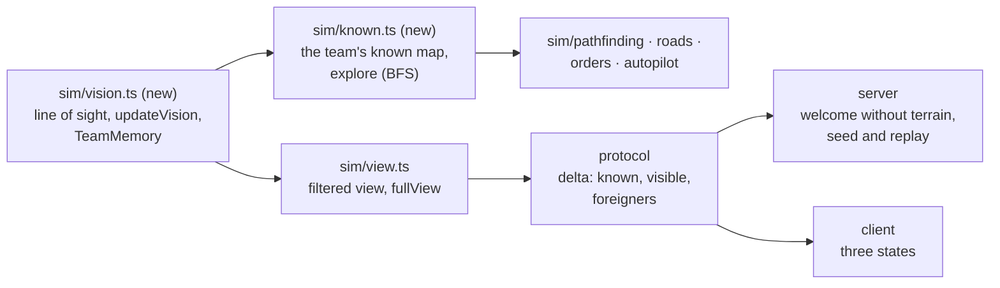
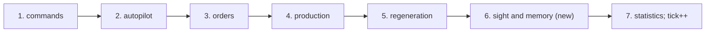

# M1.5 plan — Fog of war

**Status:** Approved (2026-11-14) · **Date:** 2026-11-14
**Spec:** [spec.md](spec.md) · **ADRs:** [0006](../../adr/0006-world-sync.md) (world sync) ·
[0002](../../adr/0002-every-action-is-a-command.md) (command vocabulary) ·
[0003](../../adr/0003-typescript-node-pure-integer-simulation.md) (determinism) ·
[0004](../../adr/0004-persistence-sqlite-command-log.md) (snapshot and log)

This document describes **how** to build the spec. Decisions `N1`–`N10` (section 10) were approved by the owner
together with the plan.

## 1. What the code does today and what changes

| Where | Today | With fog |
|---|---|---|
| `view.ts` | Returns everything, of both teams | Filters by what the team sees and remembers (§4) |
| `pathfinding.ts` | A* on the real map; per-creep cache invalidated by the global `state.roadRevision` | A* on the team's **known map**; cache invalidated by the team memory (§5) |
| `roads.ts` / `orders.ts` | `nextSegment` and `canBuildRoad` read the real map | Read the team's known map (spec D5) |
| `autopilot.ts` | `nearestDeposit` and `resourceInRange` read `state.deposits`; `moveTo` checks the real terrain | Read the team memory (spec A-1); a new action, condition and order (§6) |
| `domination.ts` / `commands.ts` | `notYourTeam` for an enemy creep; `invalidOrder` for a nonexistent deposit | A creep or deposit outside what the team knows gets the nonexistent refusal (spec D6, §7) |
| `strategist.ts` | View + the full static map | Only the view, which carries the known terrain (spec B-1) |
| `protocol` | `welcome` with the whole terrain and `cores` (both cores); `WorldSummary.seed` | No terrain, no `cores`; seed `null` on a live world (§8) |
| `apps/server/src/http.ts` | Replay of any world | Only of a finished world (spec D10) |
| Client | Draws the static map once; reads `state.teams[i]` of everyone | Three states; foreign team and creeps with fewer fields (§9) |

Two leaks the code had that the spec did not list: the `welcome` sends `cores` (the enemy core position), and the
`notYourTeam` refusal reveals that an enemy creep with that id exists. Both are handled in the phases below.

## 2. Where each thing lives



| Module | Responsibility |
|---|---|
| `params.ts`, `params/default.json`, `test/params.json` | `vision: { core: 8, dna: { circle: 6, triangle: 4, square: 3 } }` (spec §6), in the `schema` |
| `packages/sim/src/vision.ts` (new) | `TeamMemory`, `createMemory`, `updateVision(state)` (a new tick stage), `sees(...)` (line of sight) |
| `packages/sim/src/known.ts` (new) | The team's known map as a `GameMap` (for A*, roads and validation) and the choice of the explore target |
| `packages/sim/src/view.ts` | Filtered `view(state, team)`; `fullView(state)` for the replay (N7) |
| `packages/sim/src/{pathfinding,roads,orders,autopilot,presets,commands,domination}.ts` | By what the team knows; explore; refusals without leaks |
| `packages/sim/src/strategist.ts` | Only the view |
| `packages/sim/src/stats.ts` | New metrics (§11) |
| `packages/protocol/src/{delta,index}.ts` | New collections in the delta; `welcome`; `PROTOCOL_VERSION` 3 |
| `apps/server/src/{http,world-host}.ts` | Hidden seed, replay only of finished worlds, new `welcome` |
| `apps/client/src/map/*`, `panels/*` | Three states, foreigners, cursor and route by what the team knows, new rules |
| `apps/cli/src/{report,sweep}.ts` | Exploration and match-start metrics in the report |

## 3. Team memory and sight (`vision.ts`)

### State

A new `WorldState` field, `memory: TeamMemory[]`, indexed by team id. JSON data only (`CLAUDE.md` conventions):
bitmaps as `number[]` of 0 and 1, one position per cell (`y * width + x`).

```ts
type TeamMemory = {
  team: number;
  /** 1 where the team has seen the cell (spec V-2). */
  explored: number[];
  /** 1 where the cell is visible at the end of the last tick (spec V-1). */
  visible: number[];
  /** Known terrain; a never-seen cell stored as jungle (spec P-1). */
  terrain: Terrain[];
  /** Known roads (spec V-4); the team's own enter when finished. */
  road: number[];
  /** +1 for each road the team comes to know: invalidates paths (§5). */
  roadRevision: number;
  /** +1 for each impassable cell (rock, river) the team discovers (§5). */
  blockRevision: number;
  /** Copies of the deposits already seen, by id, with the last value (spec V-3). */
  deposits: Deposit[];
  /** Copies of other teams' road jobs already seen, by id (spec V-5); the team's own come from the state. */
  roadJobs: RoadJob[];
  /** Other teams' cores already seen (spec V-6), by team id. */
  cores: { team: number; x: number; y: number }[];
};
```

`terrain` and `road` together form a `GameMap` (`known.ts`), the map the team thinks with: A*, `nextSegment`,
`canBuildRoad` and the `moveTo` validation use that map without changing signature. The global `state.roadRevision`
goes away.

Size: 4 bitmaps of 4,096 cells per team; the snapshot grows ~65 KB in JSON (2 teams). The state hash includes the
memory.

### Tick pipeline

`updateVision` enters as stage 6, after regeneration and before the statistics (spec D2), and also runs at the end of
`createWorld`, so that the tick 0 view exists.



`updateVision`, per team:
1. Clears `visible`; for the core and each team creep, marks the cells of the radius-`r` diamond (params) that the
   line of sight reaches (N2).
2. For each cell that became visible: `explored = 1`; copies the real terrain into `terrain` (if it is rock or river
   for the first time, `blockRevision++`); copies the real road into `road` (if new, `roadRevision++`).
3. Deposits on visible cells: update or create the copy in `deposits`. Other teams' road jobs: create or update the
   copy on visible cells, and delete the copy whose cell is visible and no longer has the job. Another team's core
   visible → enters `cores`.
4. A road finished by the team itself enters `road` at once (in `completeRoadJob`), with `roadRevision++`: the creep
   stands on it anyway, but this way the path does not depend on the stage order.

### Line of sight (N2)

A cell `t` is seen from `o` when `manhattan(o, t) ≤ r` and no cell **between** the two, on the Bresenham line from `o`
to `t`, is rock. `t` itself may be rock (spec D1).

- **Integers only:** classic Bresenham, with an integer accumulated error.
- **Equivalence between teams:** the line is traced in the team's frame, as paths are (`isRotatedSide`): on the
  rotated side, the tracer rotates the coordinates 180°, traces and rotates back. So what team 1 sees is the exact
  mirror of what team 0 sees from the mirrored position. A test checks this on a symmetric map.
- **Estimated cost:** radius 6 ≈ 85 cells × up to 6 steps; 30 creeps per team and 2 teams ≈ 30 k steps per tick,
  well within budget. If the "tick ≤ 2×" criterion (spec §7) gets tight, the obvious optimization is to skip
  recomputing creeps that did not change cell; it does not go in before measuring.

## 4. The view (`view.ts`)

```ts
type ForeignCreepView = Pick<Creep, "id" | "team" | "dna" | "x" | "y" | "cargo">;
type ForeignTeam = { id: number; core: Cell | null };      // null until the core is seen
type ForeignPlayer = Omit<Player, "lastDominateTick">;

type TeamView = {
  tick: number;
  team: number;
  teams: (Team | ForeignTeam)[];          // its own whole, the others as ForeignTeam; by id
  creeps: (CreepView | ForeignCreepView)[]; // its own + the visible foreigners; by id
  deposits: Deposit[];                    // the memory (spec V-3)
  roads: number[];                        // memory.road, increasing indices
  roadJobs: RoadJob[];                    // its own (state) + the remembered; by id
  players: (Player | ForeignPlayer)[];
  known: number[];                        // per cell: -1 never seen, otherwise the Terrain (N6)
  visible: number[];                      // visible indices, increasing
};
```

- `Team | ForeignTeam` and `CreepView | ForeignCreepView` are told apart by team (`team === view.team`). The `sim`
  exports guards (`isOwnCreep`, `isOwnTeam`) for the client and the strategist.
- **`fullView(state)`** (N7): the omniscient view, in the same format (`team: -1`, `known` = the real terrain,
  `visible` = every cell, everything whole). The replay uses it; the client draws both with the same code.
- The view stays a shallow copy and a pure function of the state (spec V-9).

## 5. Paths by what the team knows

- **`pathTo`** uses the known map of the creep's team. Movement (points per tick) still reads the real map: speed is
  physical, the path is what the creep believes.
- **Cache** (N3): the `PathCache` keeps the memory's `roadRevision` and `blockRevision`. `roadRevision` changed →
  recompute (as today). Only `blockRevision` changed → walk the remaining cells and recompute only if one became
  impassable on the known map; otherwise update the stored revision. At the start of the match the team discovers
  rock almost every tick; recomputing every path on each discovery would cost ~60 A* per tick.
- **Spec P-2** comes for free: the neighboring cell is never hidden by line of sight (there is no cell between them),
  so the next cell of the path is already known when the creep is about to enter it.
- **Roads** (spec D5): `nextSegment` and `canBuildRoad` receive the known map. When the creep reaches the segment, the
  cell is visible and the known map equals the real one: nobody pays for a road that already exists.

## 6. Explore

- **New order** `explore {x, y}` (N5): walks like `moveTo`; ends (`halt`) when the target cell is explored or the path
  disappears. Being its own order lets (a) the autopilot keep the target while it has not been explored, like
  `committedDeposit`, and (b) the other team creeps exclude that target (spec D4).
- **New action** `explore` (no fields). Keeps the target of the current `explore` order if it is not yet explored;
  otherwise picks a new one. Impossible when there is no target (spec A-3).
- **Target choice** (N4): a breadth-first search on the team's known map from the creep (a never-seen cell counts as
  passable), in the team frame's neighbor order; the target is the first never-seen cell reached that no other team
  creep has as an `explore` target. It runs only when the creep needs a new target, not every tick.
- **New condition** `resourceUnknown {resource}`: true when the team memory has no deposit of the resource with
  amount > 0 or that regenerates.
- **Presets** (spec A-4): gatherer = `cargoFull → deliver`, `always → gather`, `resourceUnknown → explore`,
  `always → deliver`. Scout (`scout`) = `always → explore`, `always → deliver`.

The command vocabulary (`setRules`, `applyPreset`, the dominating player's order) gains new types: it changes the
ADR-0002 contract, with `BREAKING CHANGE` in the commit and `PROTOCOL_VERSION` 3.

## 7. Commands without leaks (spec D6)

- `order`, `setRules`, `applyPreset`, `dominate` on a creep that is not the team's → `unknownCreep` (`notYourTeam`
  goes away).
- `order {gather, depositId}` with a deposit outside the team memory → the same nonexistent-id refusal
  (`invalidOrder`).
- `moveTo`, `explore` and `buildRoad` validate the destination on the known map: a never-seen cell is accepted; a cell
  known to be impassable is refused, as today.

## 8. Network and server

- **Delta** (`protocol/delta.ts`): `known` as a list of `[index, terrain]` pairs of the cells explored since the last
  send (memory only grows); `visible` as `{add, remove}`. The id collections already remove entities, which covers the
  enemy creep leaving sight and the remembered job disappearing. `roads` still only grows (memory never forgets a
  road), so `diffView` keeps the error if a road disappears.
- **Bandwidth estimate:** ~3 cell entries per moving creep, ~60 visible-cell changes per second at ×1 ≈ 300 B/s more;
  within 2 KB/s. `geo net` measures it.
- **`welcome`:** `map` only with `width` and `height`; `cores` goes away. The view carries `known`.
- **`WorldSummary.seed`:** `number | null`, `null` while the world has not ended (N9). The seed field at world
  creation, in the lobby, stays: it is a development tool, and whoever creates the world knows the seed. Once worlds
  are hosted for other people, world creation stops being public.
- **Replay:** `GET /api/worlds/:id/replay` of a live world → `409 {error: "worldRunning"}`.
- **`PROTOCOL_VERSION` 3** (new view and new vocabulary).

## 9. Client

- **Three states** (spec C-1): a fog layer over the map, drawn from `known` and `visible`: black where `known = -1`, a
  dimmed veil where it is known and not visible, nothing where it is visible. Remembered deposits and jobs appear
  under the veil, with the last value. The terrain comes from `known`, no longer from the static map.
- **Foreigners** (spec C-2): an enemy creep drawn only with shape, color and load; the inspector shows DNA and load,
  with no rules, order or activity. The enemy core only once seen, with no production or stock.
- **Cursor and route** (spec C-3): `road-plan.ts` builds the map from `known` (like the `sim`); over a never-seen
  cell, the cursor shows no cost.
- **Rules** (spec C-4): the editor gains the "explore" action, the "knows no deposit of X" condition and the scout
  preset.
- **Replay** (spec C-5): uses `fullView`, with no fog.

## 10. Approved decisions

Approved by the owner on 2026-11-14, together with the plan. The "Alternative" column records what was discarded. N4
adjusted spec D4 (distance in steps, not Manhattan).

| # | Decision | Choice | Discarded alternative |
|---|---|---|---|
| N1 | Memory format | `state.memory: TeamMemory[]` with `number[]` bitmaps (§3) | Index lists: smaller in the snapshot, but A* and sight read per cell |
| N2 | Line of sight algorithm | Integer Bresenham, traced in the team's frame (§3) | Symmetric shadowcasting: more permissive and symmetric between seer and seen, but much more code, with fractions |
| N3 | Path cache | Memory revisions; discovering a rock only recomputes the path through it (§5) | Recompute all on each discovery: simple, but ~60 A* per tick at the start of the match |
| N4 | "Explore" distance | **Breadth-first search on the known map** (steps, not Manhattan): spec D4 says Manhattan, but BFS only picks reachable targets. With Manhattan, a never-seen pocket surrounded by known rock becomes an unreachable target, and the creep retries every tick | Manhattan, as in the spec, excluding cells surrounded by known impassables (misses pockets larger than one cell) |
| N5 | Explore as its own order | Order `explore {x, y}`, action `explore`, condition `resourceUnknown`, preset `scout` (§6) | Reuse `moveTo`: the autopilot cannot tell exploring from moving and does not keep the target |
| N6 | Terrain sight and visibility on the wire | The server sends `known` and `visible` (§4, §8) | The client recomputes `visible` with the same function: less bandwidth, but line of sight depends on rocks the team may not have seen, so it does not always give the same result |
| N7 | Replay | `fullView`, omniscient (§4) | Replay from one team's view: out of scope (spec §4) |
| N8 | Strategist | Uses the presets with exploration and gains no scout logic; the match-start criterion (spec §7) measures whether that suffices. If it fails, the owner decides at the F2 checkpoint | Start with a scout (the circle) per team |
| N9 | Seed at world creation | The lobby keeps the field; the list and the `welcome` hide a live world's seed (§8) | Remove the field: the seed always random and hidden, even from the creator |
| N10 | Sight stage | Tick stage 6, and in `createWorld` (§3) | Compute sight when building the `view`: memory has to be updated every tick anyway |

**F2 checkpoint (owner, 2026-11-14).**

- **N8 sufficed**, with one adaptation: the strategist keeps the cristal share while the team knows cristal with a
  surplus **or** can still reach a never-seen cell (the cristal gatherers explore through the preset). Taken
  literally, nobody explored and the bots never produced. The owner kept the rule.
- **Match start** ✅ (first materia in 2–7 min on seeds 1–20). **Economy** (3 days, seed 42: materia −13% to −20%)
  accepted.
- **Tick cost** 2.2× (target ≤ 2×): the owner left the decision to the agent, who accepted it. The absolute budget (3
  days in under 10 min) is far away (~9.5 s), and the excess comes almost entirely from longer paths (gameplay, not
  overhead).
- **The teams diverge after ~15 h** on seed 42 (contested deposit: the lower-id creep gathers first, an M1 rule).
  Accepted; to revisit in a rebalancing round (open question in [GDD 03](../../gdd/03-economy-and-logistics.md)).

**F5 checkpoint: the explore target (owner, 2026-11-14).** In a video by the owner, a circle with the scout preset
swept the edge of the dark sideways, one line of sight at a time: the target (the nearest never-seen cell, ~7 steps
away) is seen after 1 step, and the lowest-index tie-break always picks the top row. Measured with a lone scout
(seeds 42, 7 and 649, cells known by the team in 60 min): circle 840–1,217 before, 1,648–1,681 with the order ending
on reaching the target, **2,193–2,659 breaking ties by gain**, 2,088–2,769 with both. **Decision:** tie-break by gain,
the count of never-seen cells in the diamond of radius equal to the DNA's sight around the target (no line of sight:
it is an estimate); the order still ends when the target is seen. `SIM_VERSION` 4.

**F6 checkpoint, which closes M1.5 (owner, 2026-11-14).** The owner played the F6 branch: the gatherers became more
productive, circulating between deposits, and area clicking improved selection a lot. **M1.5 hypothesis:** in session
2 the owner said fog and exploration play the expected role, and in this one closed the milestone. Accepted the
agent's recommendations:

- **Cristal:** 1 unit every 5 s stays provisional; depletion (9.7 h of 72) is left for later, with the role of
  cristal in [GDD 03](../../gdd/03-economy-and-logistics.md).
- **F4 and F6 interpretations** stay as they are: creep names by id, a veil with 0.55 opacity, a 20 px minimum click
  area, the cursor icons, and those of E1/E2.
- **A humans-only world does not explore without an order** (rule D3): kept; to watch in playtests with new people.
- **Snapshot size** (55 → 117 MB in a 3-day world): to revisit before hosting long worlds (compacted memory, with the
  next `SIM_VERSION`).
- **Tick cost:** ~1.35× F5's (~3× pre-fog; 13 s for 3 days), accepted.

## 11. Harness and tests

| Type | What |
|---|---|
| `sim` | Line of sight on text maps (not behind the rock; the rock yes; the river does not block; the same mirror for both teams); memory (last value, forgotten job, roads never disappear, core remembered); a view without leaks (hand-built world, D7 fields); paths in the dark (recompute on discovering rock; do not recompute if the rock is off the path); roads in the dark; explore (nearest target, no repeated target, surrounded pocket ignored); presets; identical refusals for nonexistent and unknown |
| `sim` | New locked hashes (initial world, 6 h bot × bot on seed 42), `SIM_VERSION` 3 |
| `protocol` | Delta with `known` and `visible`; an enemy creep entering and leaving; a remembered job forgotten; property 6 h × seeds 1, 42 and 649 |
| `server` | `welcome` without terrain and `cores`; seed `null` on a live world; replay of a live world → 409 |
| `client` | Fog layer from `known`/`visible`; a foreigner without rules in the inspector; route by the known map |

**New metrics** (`stats.ts`, in the `geo sim` `report.md` and in `geo sweep`): tick of the first delivery of each
resource per team; cells explored per team in the samples; tick at which the team saw the enemy core; creeps with an
`explore` order in the samples. The match-start criterion runs with the existing `geo sweep` on seeds 1–20 (6 h), with
a single-value `--set` (e.g. `vision.core=8`); the sweep's `report.md` gains the new columns.

**Tick cost** (spec §7): the `geo sim` `meta` already has the wall time; the comparison is `geo sim --days 3` of seed
42 before and after.

## 12. Implementation order

| Phase | Branch | Delivery | Checkpoint |
|---|---|---|---|
| F0 | `m1.5/fog-spec` | Design round, spec and plan | **Plan approved** |
| F1 | `m1.5/fog-f1-vision` | Sight params; `TeamMemory` and `updateVision` (line of sight); filtered `view` and `fullView`; leak test; `SIM_VERSION` 3 and new hashes. The autopilot and paths still read the real state | |
| F2 | `m1.5/fog-f2-knowledge` | Known map; paths and roads by what the team knows; autopilot by memory; explore and presets; refusals; strategist with the view only; new metrics | **Match start and economy** (seeds 1–20, 3 days of seed 42, tick cost) |
| F3 | `m1.5/fog-f3-network` | Delta with `known`/`visible` and foreigners; `welcome`; seed and replay on the server; `PROTOCOL_VERSION` 3; property; `geo net` | **`geo net`** against the network targets |
| F4 | `m1.5/fog-f4-client` | Three states; foreigners; cursor and route; new rules; replay with `fullView` | |
| F5 | `m1.5/fog-f5-playtest` | Soak; fog questions in `PLAYTEST.md`; readability session | The owner's session 2: findings become F6 |
| F6 | `m1.5/fog-f6-tuning` | Playtest adjustments (spec §11, §13 below) | **Closes M1.5** (spec §8) |

## 13. F6 — Playtest adjustments

- **E1, travel time** (`pathfinding.ts`, `nearestTargets`): an A* from the creep on the team's known map, with the
  usual `stepCost` and the Manhattan heuristic to the nearest candidate × the road step (it never overestimates, so the
  costs are exact), stopping at the first candidate deposit reached (or at a maximum cost). In the implementation, a
  plain Dijkstra cost ~60% more CPU on the 3-day world. The cost becomes seconds by the unloaded DNA speed:
  `Σ stepCost × 60 / (cellsPerMinute × 1000)`. Ties between deposits at the same distance: the lowest id, as today.
  `resourceInRange` stays in Manhattan (the condition's radius is in cells).
- **E1, wait or go** (`autopilot.ts`, in `committedDeposit`): only with the materia deposit empty and the creep on it.
  Wait = the regenerations still needed for the materia to cover the creep's free load **and that of the team's
  lower-id creeps gathering there** (they gather earlier in the tick), times `regen.everySeconds`. Candidates: the
  other materia deposits in memory with at least the creep's free load. The search stops as soon as the cost exceeds
  the wait, which keeps it small. The creep weighs this once per regeneration interval, **at the middle second, the
  same for everyone**: a phase by creep id split the mirrored teams (the mirrored creep has another id) by 0.5–1.3 h.
  `SIM_VERSION` 5.
- **E2, rate per resource** (`params.ts`, `economy.ts`): `gather` becomes `{ materia: { units, everySeconds },
  cristal: { units, everySeconds } }`; gathering happens on world seconds that are multiples of `everySeconds` (like
  regeneration), with no new state field. Consistency: `everySeconds` a multiple of `tickSeconds`.
- **E3, selection** (`map/pick.ts`, `map/layout.ts`): click radius = the larger of the marker's and a minimum in
  pixels converted by the view's scale. A single creep under the click, or the click within half the radius of the
  nearest: select. Several: open the list with all of them.
- **E4, cursor** (`map/cursor.ts` new, `map-view.tsx`): the cursor type comes from a pure function over the mode, the
  dominated creep and what is under the pointer (`orderAt`, `pickAt`); each type is an SVG data URI in the CSS
  `cursor`. With a dominated creep, the right-click order wins; over a creep, select.
