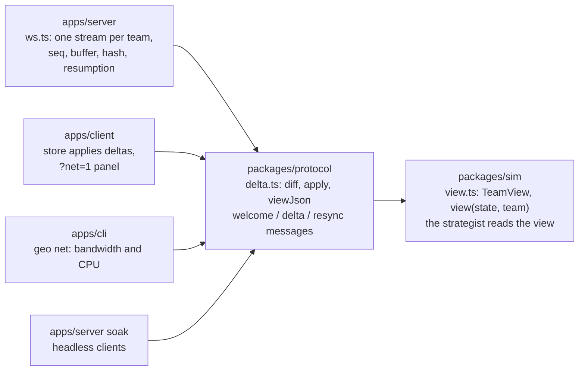

# M1.5 plan — Network: deltas of each team's view

**Status:** Approved (2026-11-14) · **Date:** 2026-11-14
**Spec:** [spec.md](spec.md) · **ADRs:** [0006](../../adr/0006-world-sync.md) (world sync) ·
[0002](../../adr/0002-every-action-is-a-command.md) · [0003](../../adr/0003-typescript-node-pure-integer-simulation.md) ·
[0004](../../adr/0004-persistence-sqlite-command-log.md)

This document describes **how** to build the spec. Decisions `R1`–`R7` (section 9) were approved by the owner
together with the plan.

## 1. Spike result (spec D7)

Done on 2026-11-14, outside the repository (scratchpad), with seed 42, `default.json`, a bot × bot world at 48 h (60
creeps), 5,000 ticks measured. Times per tick, summing **both teams**; bytes per delta of one team.

| Approach | CPU, median | CPU, p95 | Bytes per delta | Note |
|---|---|---|---|---|
| Today: `JSON.stringify` of the full state | ~120 µs | — | 26,500 | One string per world, shared |
| View with a deep copy + generic diff (the ADR's measurement) | ~820 µs | — | ~400 | The deep copy dominates |
| **Hand-written diff, straight from the state** | **8.7 µs** | 21.9 µs | **257** | Includes the delta's `JSON.stringify` |
| **View with a shallow copy + hand-written diff** | **41 µs** | 63.7 µs | **257** | This slice's format (§3): ready for fog to filter |
| Colyseus schema 5.0.48 (mirror + `encode`, 1 encode, no `StateView`) | 20 µs | 55 µs | 58 (binary) | Correct; with one view per team, one more encode per view |

Conclusions:
- **CPU stops being a problem.** The spec's target is 250 µs per world per send; this slice's format sits at ~41 µs,
  ~3× **cheaper** than today's send. The ADR's estimate (~0.8 ms) came from the deep copy.
- **A `sim` detail the spike revealed:** the autopilot assigns, every tick, a new order object equal to the previous
  one on every free creep. Comparing the order by reference would send every creep in every delta (3.1 KB). The
  order is compared **by value** (1 to 3 fields). Rules, in contrast, are always replaced whole (`setRules`,
  presets) and never mutated in place, so they can be compared by reference.
- **Colyseus** works and produces 4× fewer bytes (binary), but: mirroring the state into its classes **is already a
  hand-written diff** (every field has to be assigned every tick); binary is harder to debug; the library moves fast;
  and its ESM build is ~120 KB gzip unminified, against 38 KB for the whole client today. At 257 bytes per delta, the
  bandwidth difference does not matter: the spec's ceiling is 2 KB/s. R1: **hand-written diff, in JSON**. With no
  library, there is no amendment to ADR-0006.

## 2. Where each thing lives



| Module | Responsibility |
|---|---|
| `packages/sim/src/view.ts` (new) | `TeamView` and `view(state, team)`: what a team sees. A game rule, hence in the `sim` (ADR-0006, rule 1) |
| `packages/sim/src/strategist.ts` | Receives the team view (R3) |
| `packages/protocol/src/delta.ts` (new) | `Sent` (the record of what was already sent), `diffView(sent, view) → Delta`, `applyDelta(view, delta) → view`, `viewJson(view)` (canonical JSON for the hash) |
| `packages/protocol/src/index.ts` | New messages (§4); `DynamicState` and `toDynamicState` give way to `TeamView` and `view` |
| `apps/server/src/ws.ts` | The `Broadcaster` gets one stream per team (§5) |
| `apps/client/src/{connection,store}.ts` | Resumption, applying deltas, resync, protocol version (§6) |
| `apps/client/src/net-panel.tsx` (new) | Network panel with `?net=1` (spec D8) |
| `apps/cli/src/net.ts` (new) | `geo net`: bandwidth and CPU over a whole world (§7) |
| `apps/server/src/soak.ts` | Headless WebSocket clients (§7) |

## 3. The view (`packages/sim/src/view.ts`)

```ts
type CreepView = Omit<Creep, "path" | "movePoints" | "trip">;
type TeamView = {
  tick: number;
  team: number;                 // whose view it is
  teams: Team[];
  creeps: CreepView[];          // by id, as in the state
  deposits: Deposit[];
  roads: number[];              // cell indices with a road, increasing
  roadJobs: RoadJob[];
  players: Player[];
};
```

- **Shallow copy:** the view is built on every send with new top-level objects, but shares nested objects with the
  state (`cargo`, `order`, `rules`, `stock`…). Whoever keeps a view for later (the server record, the client) cannot
  rely on those objects: `step` mutates the state in place. That is why `Sent` copies values (§5) and the client only
  receives JSON.
- **Without fog** (D1), every team sees everything. The fog slice changes only this function.
- Exported from the `sim`'s `index.ts`, like every public module.

## 4. Messages (`packages/protocol`)

```ts
const PROTOCOL_VERSION = 2;  // M1 is 1

// Server → client
type WelcomeMessage = { type: "welcome"; protocol: number; seq: number; view: TeamView;
                        /* the rest of the M1 welcome: worldId, playerId, team, status, multiplier, params, map, cores */ };
type DeltaMessage = { type: "delta"; seq: number; tick: number; delta: Delta;
                      status?: WorldStatus;  // only when it changes
                      hash?: string };       // every N ticks: SHA-256 of viewJson(the view after the delta)

// Client → server
type ResyncMessage = { type: "resync"; reason: "seqGap" | "hashMismatch"; seq: number };
```

- **The `Delta`**, per collection with ids (`creeps`, `deposits`, `teams`, `roadJobs`, `players`): `upsert` (new
  entities whole, or `{id, ...changed fields}`) and `remove` (ids). `roads`: only the new indices (in M1 roads never
  disappear; if they do in the future, it gains `remove`). Collections with no change are omitted.
- **Comparison** in `diffView`: primitives with `===`; `cargo` and `order` field by field (the order is recreated
  every tick with the same value, §1); `rules` by reference (R4); `teams`, `roadJobs` and `players` field by field.
- **A delta goes out even with no change at all** (`{seq, tick, delta: {}}`): the tick advances and the client needs
  it for interpolation and the timeline.
- **Commands** (`command`, `ack`, `reject`) do not change (spec S-7).

## 5. Server (`apps/server/src/ws.ts`)

Today's `Broadcaster` (one per world, at most 5 sends/s) keeps, **per team**:

| State | What for |
|---|---|
| `sent: Sent` | What the team has received: copied values (position, load, order fields…) and the rules reference |
| `seq` | The team stream's sequence |
| `lastView` | The last view sent, serialized (`viewJson`), for the `welcome` (spec S-1) and resyncs |
| `buffer` | The serialized deltas of the last 30 real seconds (setting `deltaBufferMs`) |

On every send, for each team with at least one socket: `view` → `diffView(sent, view)` → `seq + 1` → serialize once
→ send to the team's sockets → keep in the buffer and in `lastView`. Teams without sockets also advance `sent` and
`seq`, so the next connection starts from a correct base. Every `viewHashEveryTicks` (60), the delta carries the
hash.

- **Connection** (R5): `/ws?token=…&stream=…&seq=…`. The `stream` is the id the `welcome` carried, new for each
  server process (owner, 2026-11-14, at the F5 checkpoint): without it, after a restart an old `seq` could fall into
  the new buffer and the client would apply deltas over the wrong base. Without `seq`, from another `stream`, or with
  a `seq` not in the buffer, the server sends the `welcome` with `lastView` and its `seq`. With a `seq` in the buffer,
  it sends the following deltas, in order, with no `welcome`. Resumption only applies to a reconnection of the same
  page, which already has the static map and the parameters; on opening the page, the client sends no `seq` (§6).
- **Server restart:** the buffer and `sent` live in memory and are lost; every client receives a `welcome` (spec
  S-5).
- **Resync** (spec S-6): answers with a `welcome` and writes a line
  `resync world=… team=… player=… tick=… seq=… reason=…` to the server log.
- **New settings** (`config.ts`): `viewHashEveryTicks: 60`, `deltaBufferMs: 30 000` (the spec §6 guesses).

## 6. Client

- **`store.ts`:** keeps the current and the previous view (the M1 interpolation stays the same). `applyDelta` creates
  new objects only for what changed and shares the rest: components that did not change do not re-render.
- **`connection.ts`:** keeps the last applied `seq`. On reconnecting **in the same page**, sends `seq` in the
  WebSocket URL; on opening the page, it does not.
- **Sequence:** a `seq` other than `current + 1` → sends `resync {reason: "seqGap"}` and ignores deltas until the
  `welcome`.
- **Hash:** when the delta carries a `hash`, the client computes the SHA-256 (Web Crypto, async) of `viewJson` of the
  view at that `seq` and compares. Different → `resync {reason: "hashMismatch"}`. The result is counted in the panel.
- **Protocol version** (spec D6): a `welcome.protocol` different from the client's → a short warning and
  `location.reload()`.
- **`?net=1` panel** (spec D8): a screen corner, small text: bytes/s received (10 s average), `seq`, deltas received,
  resumptions, `welcome`s by cause, hashes checked and divergent.

## 7. Harness

- **Property test** (`packages/protocol/test/`): a bot × bot world; on every tick and for both teams,
  `applyDelta(previousView, diffView(sent, newView))` equals `newView`, with the views compared as canonical JSON
  (copies, never the state's objects, so an in-place mutation bug does not go unnoticed). In CI: 6 world hours on
  seeds 1, 42 and 649 (R6).
- **`geo net --seed 42 --days 3`** (R6): runs the bot × bot world and, on every tick, builds the views and deltas like
  the server. Measures bytes per delta and CPU (`view`, `diffView`, `JSON.stringify` and the amortized hash; median
  and p95), checks the property above and writes `runs/<id>/net.md`. It answers the first two spec §7 criteria, and
  runs the 3-day property at the checkpoint.
- **Soak with clients** (`apps/server/src/soak.ts`): 2 headless WebSocket clients per team (Node's `ws`), using the
  same `applyDelta` and the same hash check as the browser, connected for the whole soak and reconnecting on every
  `kill -9`. The `summary.md` gains a section per client (spec §7). At the end, each client's view is compared with
  the server's.
- **Behavior lock** (spec D4): before touching the strategist, F1 adds a test with the hash of a 6 h bot × bot world
  on seed 42 (~0.5 s), which locks the strategist's decisions. The 3 days (`10662729…`) are checked with `geo sim`
  at the F2 checkpoint. `SIM_VERSION` stays 2.

## 8. Tests

| Type | What |
|---|---|
| `sim` | `view`: removed fields, order by id, increasing roads, purity (2 calls = same result) |
| `sim` | Strategist: 6 h bot × bot hash locked before the change and unchanged after |
| `protocol` | `diffView`/`applyDelta` on small cases (new creep, removed, changed field, equal order recreated, rules replaced, new road, nothing changed); property (§7) |
| `server` | One stream per team; increasing `seq`; `welcome` with `lastView`; resumption from the buffer; `seq` out of the buffer → `welcome`; resync; hash every N ticks; restart → `welcome` |
| `client` | `applyDelta` in the store with sharing; `seqGap` → resync; different hash → resync; protocol version; `seq` only on reconnect |
| Soak | Section 7 |

## 9. Approved decisions

Approved by the owner on 2026-11-14, together with the plan. The "Alternative" column records what was discarded.

| # | Decision | Choice | Discarded alternative |
|---|---|---|---|
| R1 | Library or by hand (spec D7) | **Hand-written diff, in JSON** (§1) | Colyseus schema: 4× smaller binary, but a state mirror, a dependency and harder debugging |
| R2 | Where the diff lives | **`protocol`** (server, client, CLI and soak use it); the `view` lives in the `sim` | Diff in the `sim`: would mix networking with game rules |
| R3 | What the strategist receives | **The team view + the map** (static terrain and a road layer built from `view.roads`) + the parameters. The functions it uses (`nextSegment`, `roadTarget`, `productionRefusal`) accept structural types, like M1 F7's `ProductionView` | Passing the `WorldState` and trusting discipline: breaks ADR-0006 rule 2 once fog arrives |
| R4 | Rules by reference | **Yes**, and it becomes a `sim` convention in `CLAUDE.md`: "rules are replaced whole, never mutated". The property test with copies catches a violation | Comparing rules by value every tick: ~200 bytes of JSON per creep per send, just to confirm nothing changed |
| R5 | How the client reports the `seq` | **In the WebSocket URL** (`&stream=…&seq=…`; the stream id came in F3, approved by the owner on 2026-11-14), only when reconnecting in the same page | A message after connecting: the server would have to wait before sending the first state |
| R6 | Measurement and property | A new **`geo net`** in the CLI (3 days, report) + a 6 h × 3 seeds property in CI | Tests only, no command: the bandwidth and CPU measurement would sit outside the harness |
| R7 | Teams with no connected client | **Compute the delta anyway** (41 µs per world for both teams), so the base is always right | Skip and send a `welcome` to whoever connects: less CPU, one more path to test |

## 10. Implementation order

| Phase | Delivery | Checkpoint |
|---|---|---|
| F0 | Spike (done, §1), spec and plan | **Plan approved** |
| F1 | 6 h hash lock; view in the `sim`; strategist reading the view, with the hash unchanged | |
| F2 | `delta.ts` in `protocol`, property test in CI, `geo net` | **`geo net` report** (bandwidth, CPU and correctness criteria) |
| F3 | Server: stream per team, `seq`, buffer, hash, resumption, resync | |
| F4 | Client: applies deltas, resumption, resync, protocol version, `?net=1` panel | |
| F5 | Soak with clients; viability report; the owner's session | **Viability** (spec §7–8): on to fog, or ADR-0006 is reopened |
