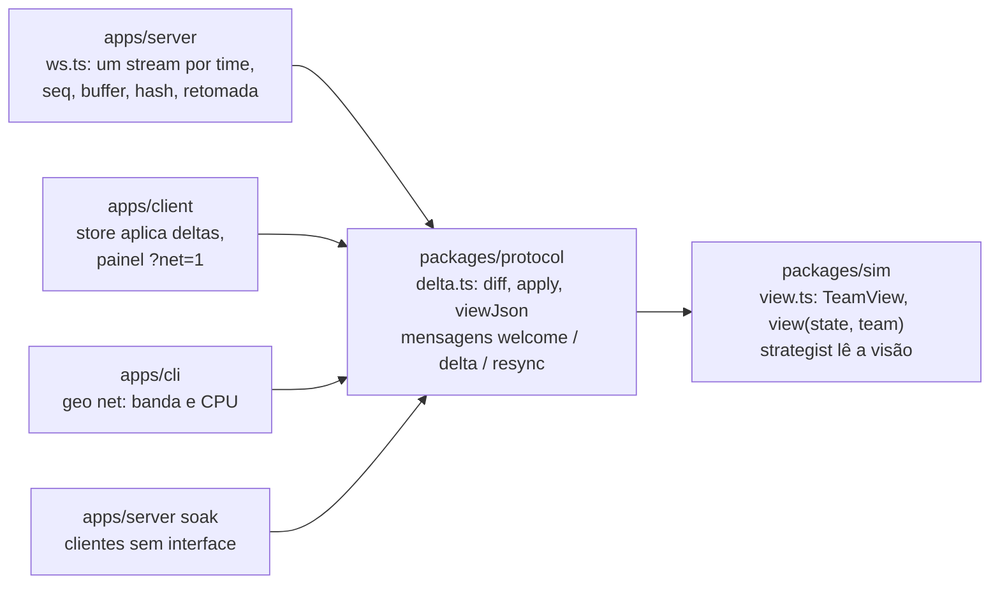

# Plan M1.5 — Rede: deltas da visão de cada time

**Status:** Aprovado (2026-11-14) · **Data:** 2026-11-14
**Spec:** [spec.md](spec.md) · **ADRs:** [0006](../../adr/0006-sync-do-mundo.md) (sync do mundo) ·
[0002](../../adr/0002-tudo-e-comando.md) · [0003](../../adr/0003-stack-typescript-node.md) ·
[0004](../../adr/0004-persistencia-sqlite-log-de-comandos.md)

Este documento descreve **como** construir a spec. As decisões `R1`–`R7` (seção 9) foram aprovadas pelo dono junto
com o plano.

## 1. Resultado do spike (spec D7)

Feito em 2026-11-14, fora do repositório (scratchpad), com seed 42, `default.json`, mundo bot × bot em 48 h (60
creeps), 5 000 ticks medidos. Tempos por tick, somando os **2 times**; bytes por delta de um time.

| Abordagem | CPU, mediana | CPU, p95 | Bytes por delta | Observação |
|---|---|---|---|---|
| Hoje: `JSON.stringify` do estado completo | ~120 µs | — | 26 500 | Uma string por mundo, compartilhada |
| Visão com cópia profunda + diff genérico (medição do ADR) | ~820 µs | — | ~400 | A cópia profunda domina |
| **Diff à mão, direto do estado** | **8,7 µs** | 21,9 µs | **257** | Já inclui o `JSON.stringify` do delta |
| **Visão com cópia rasa + diff à mão** | **41 µs** | 63,7 µs | **257** | O formato desta fatia (§3): pronto para o fog filtrar |
| Schema do Colyseus 5.0.48 (espelho + `encode`, 1 encode, sem `StateView`) | 20 µs | 55 µs | 58 (binário) | Correto; com uma visão por time, mais um encode por visão |

Conclusões:
- **A CPU deixa de ser problema.** O alvo da spec é 250 µs por mundo por envio; o formato desta fatia fica em
  ~41 µs, ~3× **mais barato** que o envio de hoje. A estimativa do ADR (~0,8 ms) era da cópia profunda.
- **Um detalhe do `sim` que o spike revelou:** o piloto automático atribui a cada tick um objeto de ordem novo,
  igual ao anterior, em todo creep livre. Comparar a ordem por referência mandaria todos os creeps em todo delta
  (3,1 KB). A ordem é comparada **por valor** (1 a 3 campos). As regras, ao contrário, são sempre substituídas
  inteiras (`setRules`, presets) e nunca mutadas no lugar, então podem ser comparadas por referência.
- **O Colyseus** funciona e gera 4× menos bytes (binário), mas: o espelho do estado nas classes dele **já é um
  diff à mão** (cada campo precisa ser atribuído a cada tick); binário é mais difícil de depurar; a biblioteca
  muda rápido (versão 5.0.48, atualizada em 2026-11-12); e o build ESM dela tem ~120 KB gzip sem minificar, contra
  38 KB do cliente inteiro hoje (o tamanho depois do tree-shaking não foi medido). Com 257 bytes por delta, a
  diferença de banda não importa: o teto da spec é 2 KB/s. Proposta R1: **diff à mão, em JSON**. Sem biblioteca,
  não há emenda ao ADR-0006 (spec §9).

## 2. Onde fica cada coisa



| Módulo | Responsabilidade |
|---|---|
| `packages/sim/src/view.ts` (novo) | `TeamView` e `view(state, team)`: o que um time enxerga. Regra de jogo, por isso no `sim` (ADR-0006, regra 1) |
| `packages/sim/src/strategist.ts` | Passa a receber a visão do time (R3) |
| `packages/protocol/src/delta.ts` (novo) | `Sent` (o registro do que já foi enviado), `diffView(sent, view) → Delta`, `applyDelta(view, delta) → view`, `viewJson(view)` (JSON canônico para o hash) |
| `packages/protocol/src/index.ts` | Mensagens novas (§4); `DynamicState` e `toDynamicState` dão lugar a `TeamView` e `view` |
| `apps/server/src/ws.ts` | O `Broadcaster` passa a ter um stream por time (§5) |
| `apps/client/src/{connection,store}.ts` | Retomada, aplicação de deltas, resync, versão do protocolo (§6) |
| `apps/client/src/net-panel.tsx` (novo) | Painel de rede com `?net=1` (spec D8) |
| `apps/cli/src/net.ts` (novo) | `geo net`: banda e CPU num mundo inteiro (§7) |
| `apps/server/src/soak.ts` | Clientes WebSocket sem interface (§7) |

## 3. A visão (`packages/sim/src/view.ts`)

```ts
type CreepView = Omit<Creep, "path" | "movePoints" | "trip">;
type TeamView = {
  tick: number;
  team: number;                 // de quem é a visão
  teams: Team[];
  creeps: CreepView[];          // por id, como no estado
  deposits: Deposit[];
  roads: number[];              // índices de célula com estrada, crescentes
  roadJobs: RoadJob[];
  players: Player[];
};
```

- **Cópia rasa:** a visão é montada a cada envio com objetos novos no primeiro nível, mas compartilha os objetos
  aninhados com o estado (`cargo`, `order`, `rules`, `stock`…). Quem guarda uma visão para depois (o registro do
  servidor, o cliente) não pode contar com esses objetos: o `step` muta o estado in place. Por isso o `Sent` copia
  valores (§5) e o cliente só recebe JSON.
- **Sem fog** (D1), todo time vê tudo. A fatia de fog muda só esta função.
- Fica no `index.ts` do `sim`, como todo módulo público.

## 4. Mensagens (`packages/protocol`)

```ts
const PROTOCOL_VERSION = 2;  // o M1 é a 1

// Servidor → cliente
type WelcomeMessage = { type: "welcome"; protocol: number; seq: number; view: TeamView;
                        /* o resto do welcome do M1: worldId, playerId, team, status, multiplier, params, map, cores */ };
type DeltaMessage = { type: "delta"; seq: number; tick: number; delta: Delta;
                      status?: WorldStatus;  // só quando muda
                      hash?: string };       // a cada N ticks: SHA-256 de viewJson(visão depois do delta)

// Cliente → servidor
type ResyncMessage = { type: "resync"; reason: "seqGap" | "hashMismatch"; seq: number };
```

- **O `Delta`**, por coleção com id (`creeps`, `deposits`, `teams`, `roadJobs`, `players`): `upsert` (entidades
  novas inteiras, ou `{id, ...campos que mudaram}`) e `remove` (ids). `roads`: só os índices novos (no M1 estrada
  não some; se sumir no futuro, ganha `remove`). Coleções sem mudança não aparecem.
- **Comparação** no `diffView`: primitivos com `===`; `cargo` e `order` campo a campo (a ordem é recriada a cada
  tick com o mesmo valor, §1); `rules` por referência (R4); `teams`, `roadJobs` e `players` campo a campo.
- **Um delta sai mesmo sem mudança nenhuma** (`{seq, tick, delta: {}}`): o tick avança e o cliente precisa dele
  para a interpolação e a linha do tempo.
- **Comandos** (`command`, `ack`, `reject`) não mudam (spec S-7).

## 5. Servidor (`apps/server/src/ws.ts`)

O `Broadcaster` de hoje (um por mundo, 5 envios/s no máximo) passa a manter, **por time**:

| Estado | Para quê |
|---|---|
| `sent: Sent` | O que o time já recebeu: valores copiados (posição, carga, campos da ordem…) e a referência das regras |
| `seq` | Sequência do stream do time |
| `lastView` | A última visão enviada, serializada (`viewJson`), para o `welcome` (spec S-1) e o resync |
| `buffer` | Os deltas serializados dos últimos 30 s reais (configuração `deltaBufferMs`) |

A cada envio, para cada time com pelo menos um socket: `view` → `diffView(sent, view)` → `seq + 1` → serializa
uma vez → manda aos sockets do time → guarda no buffer e em `lastView`. Times sem socket também avançam o `sent`
e o `seq`, para a próxima conexão partir de uma base certa. A cada `viewHashEveryTicks` (60), o delta leva o
hash.

- **Conexão** (R5): `/ws?token=…&seq=…`. Sem `seq`, ou com um `seq` que não está no buffer, o servidor manda o
  `welcome` com `lastView` e o `seq` dela. Com um `seq` no buffer, manda os deltas seguintes, em ordem, sem
  `welcome`. A retomada só vale numa reconexão da mesma página, que já tem o mapa estático e os parâmetros; ao
  abrir a página, o cliente não manda `seq` (§6).
- **Restart do servidor:** o buffer e o `sent` vivem em memória e se perdem; todo cliente recebe `welcome` (spec
  S-5).
- **Resync** (spec S-6): responde com um `welcome` e registra no log do servidor uma linha
  `resync world=… team=… player=… tick=… seq=… reason=…`.
- **Configuração nova** (`config.ts`): `viewHashEveryTicks: 60`, `deltaBufferMs: 30 000` (chutes da spec §6).

## 6. Cliente

- **`store.ts`:** guarda a visão atual e a anterior (a interpolação do M1 continua igual). `applyDelta` cria
  objetos novos só para o que mudou e compartilha o resto: os componentes que não mudaram não renderizam de novo.
- **`connection.ts`:** guarda o último `seq` aplicado. Ao reconectar **na mesma página**, manda `seq` na URL do
  WebSocket; ao abrir a página, não manda.
- **Sequência:** `seq` diferente de `atual + 1` → manda `resync {reason: "seqGap"}` e ignora deltas até o
  `welcome`.
- **Hash:** quando o delta traz `hash`, o cliente calcula o SHA-256 (Web Crypto, assíncrono) de `viewJson` da
  visão daquele `seq` e compara. Diferente → `resync {reason: "hashMismatch"}`. O resultado é contado no painel.
- **Versão do protocolo** (spec D6): `welcome.protocol` diferente da do cliente → aviso curto e `location.reload()`.
- **Painel `?net=1`** (spec D8): canto da tela, texto pequeno: bytes/s recebidos (média de 10 s), `seq`, deltas
  recebidos, retomadas, `welcome`s por causa, hashes conferidos e divergentes.

## 7. Harness

- **Teste de propriedade** (`packages/protocol/test/`): mundo bot × bot; em todo tick e para os 2 times,
  `applyDelta(visãoAnterior, diffView(sent, visãoNova))` é igual a `visãoNova`, com as visões comparadas como
  JSON canônico (cópias, nunca os objetos do estado, para um bug de mutação in place não passar despercebido). No
  CI: 6 h de mundo nos seeds 1, 42 e 649 (R6). Tempo estimado: ~21 600 ticks × ~0,1 ms por tick ≈ 2–5 s por seed.
- **`geo net --seed 42 --days 3`** (R6): roda o mundo bot × bot e, a cada tick, monta as visões e os deltas como o
  servidor. Mede bytes por delta e CPU (`view`, `diffView`, `JSON.stringify` e o hash amortizado; mediana e p95),
  confere a propriedade acima e escreve `runs/<id>/net.md`. É o que responde aos dois primeiros critérios da spec
  §7, e roda os 3 dias da propriedade no checkpoint.
- **Soak com clientes** (`apps/server/src/soak.ts`): 2 clientes WebSocket sem interface por time (`ws` do Node),
  usando o mesmo `applyDelta` e a mesma verificação de hash do navegador, conectados durante o soak inteiro e
  reconectando a cada `kill -9`. O `summary.md` ganha uma seção por cliente (spec §7). Ao final, a visão de cada
  cliente é comparada com a do servidor.
- **Trava de comportamento** (spec D4): hoje só o mundo inicial tem hash fixo em teste (`serialize.test.ts`). A F1
  acrescenta, **antes** de mexer no estrategista, um teste com o hash de um mundo bot × bot de 6 h do seed 42 (~0,5
  s), que trava as decisões do estrategista. Os 3 dias (`10662729…`) são conferidos com o `geo sim` no checkpoint
  da F2. `SIM_VERSION` continua 2.

## 8. Testes

| Tipo | O quê |
|---|---|
| `sim` | `view`: campos removidos, ordem por id, roads crescentes, pureza (2 chamadas = mesmo resultado) |
| `sim` | Estrategista: hash de 6 h bot × bot travado antes da mudança e inalterado depois |
| `protocol` | `diffView`/`applyDelta` em casos pequenos (creep novo, removido, campo alterado, ordem igual recriada, regras trocadas, estrada nova, nada mudou); propriedade (§7) |
| `server` | Um stream por time; `seq` crescente; `welcome` com `lastView`; retomada pelo buffer; `seq` fora do buffer → `welcome`; resync; hash a cada N ticks; restart → `welcome` |
| `client` | `applyDelta` no store com compartilhamento; `seqGap` → resync; hash diferente → resync; versão do protocolo; `seq` só na reconexão |
| Soak | Seção 7 |

## 9. Decisões aprovadas

Aprovadas pelo dono em 2026-11-14, junto com o plano. A coluna "Alternativa" fica como registro do que foi
descartado.

| # | Decisão | Escolha | Alternativa descartada |
|---|---|---|---|
| R1 | Biblioteca ou à mão (spec D7) | **Diff à mão, em JSON** (§1) | Schema do Colyseus: binário 4× menor, mas espelho do estado, dependência e depuração mais difíceis |
| R2 | Onde fica o diff | **`protocol`** (servidor, cliente, CLI e soak usam); a `view` fica no `sim` | Diff no `sim`: misturaria rede com regra de jogo |
| R3 | O que o estrategista recebe | **A visão do time + o mapa** (terreno estático e camada de estradas montada a partir de `view.roads`) + os parâmetros. As funções que ele usa (`nextSegment`, `roadTarget`, `productionRefusal`) passam a aceitar tipos estruturais, como o `ProductionView` do F7 | Passar o `WorldState` e confiar na disciplina: quebra a regra 2 do ADR-0006 quando o fog chegar |
| R4 | Regras por referência | **Sim**, e vira convenção do `sim` no `CLAUDE.md`: "regras são substituídas inteiras, nunca mutadas". O teste de propriedade com cópias pega uma violação | Comparar regras por valor a cada tick: ~200 bytes de JSON por creep a cada envio, só para confirmar que não mudou |
| R5 | Como o cliente informa o `seq` | **Na URL do WebSocket** (`&seq=…`), só ao reconectar na mesma página | Uma mensagem depois de conectar: o servidor teria de esperar antes de mandar o primeiro estado |
| R6 | Medição e propriedade | **`geo net`** novo na CLI (3 dias, relatório) + propriedade de 6 h × 3 seeds no CI | Só testes, sem comando: a medição de banda e CPU ficaria fora do harness |
| R7 | Times sem cliente conectado | **Calculam o delta mesmo assim** (41 µs por mundo nos 2 times), para a base estar sempre certa | Pular e mandar `welcome` a quem conectar: menos CPU, mais um caminho para testar |

## 10. Ordem de implementação

| Fase | Entrega | Checkpoint |
|---|---|---|
| F0 | Spike (feito, §1), spec e plan | **Plan aprovado** |
| F1 | Trava do hash de 6 h; visão no `sim`; estrategista lendo a visão, com o hash inalterado | |
| F2 | `delta.ts` no `protocol`, teste de propriedade no CI, `geo net` | **Relatório do `geo net`** (critérios de banda, CPU e correção) |
| F3 | Servidor: stream por time, `seq`, buffer, hash, retomada, resync | |
| F4 | Cliente: aplica deltas, retomada, resync, versão do protocolo, painel `?net=1` | |
| F5 | Soak com clientes; relatório de viabilidade; sessão do dono | **Viabilidade** (spec §7–8): segue para o fog, ou o ADR-0006 volta à mesa |
