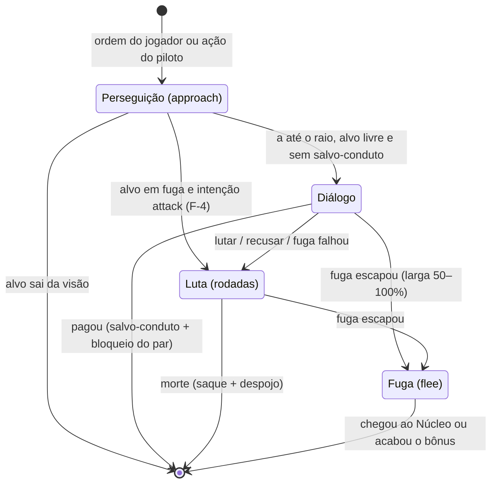

# Plan M2 — O encontro

**Status:** Aprovado (2026-11-15) · **Data:** 2026-11-15
**Spec:** [spec.md](spec.md) · **ADRs:** [0007](../../adr/0007-eventos-do-sim.md) (eventos do `sim`, `Accepted`),
[0006](../../adr/0006-sync-do-mundo.md) (deltas da visão), [0004](../../adr/0004-persistencia-sqlite-log-de-comandos.md)
(log e snapshots), [0002](../../adr/0002-tudo-e-comando.md) (vocabulário de comandos)

As decisões que precisavam do OK do dono estão marcadas **(P*n*)** e listadas na §11. **Todas aprovadas pelo dono
(2026-11-15), pela proposta.**

## 1. O que o código faz hoje e o que muda

| Hoje (M1.5, `SIM_VERSION` 5) | Na fatia A (`SIM_VERSION` 6) |
|---|---|
| O creep não tem HP nem nome; o cliente gera o nome pelo id (`apps/client/src/names.ts`, `nameAt(id)`) | `hp` e `name` no `Creep`; o nome vem de um contador de nascimentos no estado (P5) |
| Nenhum creep morre; ids só crescem | O creep morre e sai de `state.creeps`; o domínio termina (D4) |
| `step(state, commands): void` | `step` devolve os eventos do tick (ADR-0007, P9) |
| Pipeline de 7 estágios (`step.ts`) | Estágio novo de **encontros** depois das ordens, e o HP regenera junto com os depósitos (§5) |
| Ordens: `stop`, `moveTo`, `explore`, `gather`, `deliver`, `buildRoad` | Mais `approach`, `pickup` e `flee` |
| Vocabulário do piloto só de economia e exploração | Condições `enemyInSight`, `hpBelow`, `demandAtMost`; ações `approach`, `pickup`, `pay`, `fight`, `flee`; regras de reação (D13) |
| `state.rng` só no gerador de mapa | O sorteio, a fuga, a fração largada e o desempate do encontro mútuo usam o `state.rng` |
| A visão: creeps, depósitos, estradas, obras | Mais `encounters` e `spoils` (memória, como os depósitos); o creep inimigo com nome, HP e se está engajado (D18) |
| Delta e `welcome` sem crônica | O delta leva os eventos do time; o `welcome`, as últimas entradas (`PROTOCOL_VERSION` 4) |
| SQLite: mundos, jogadores, comandos, snapshots, métricas | Mais a tabela `chronicle` (derivada, ADR-0007 regra 6) |

## 2. Onde fica cada coisa

```text
packages/sim/src/
  names.ts        novo: a lista de nomes e nameAt (saem do cliente)
  hp.ts           novo: HP máximo, regeneração, dano, morte (removeCreep)
  encounter.ts    novo: o encontro (abrir, diálogo, reação, extorsão, salvo-conduto), a luta e a fuga
  spoils.ts       novo: despojo (largar, somar, catar) e o saque
  events.ts       novo: os tipos de evento, o coletor do tick, o público e eventsFor(team)
  world.ts        Creep (name, hp, engagement, safeConduct, extortBlocks), Encounter, Spoil, births
  orders.ts       ordens approach, pickup, flee; creeps engajados não resolvem ordem
  autopilot.ts    condições e ações novas; regras de reação (chamadas pelo encounter.ts)
  presets.ts      preset raider (salteador)
  rules.ts        cópia e validação do vocabulário novo
  domination.ts   orderRefusal das ordens novas; o comando react
  commands.ts     comando react
  movement.ts     bônus da fuga no movePointsPerTick; speedHere para a chance de escapar
  vision.ts       spoils na memória (como os depósitos e as obras: V-3, V-5)
  view.ts         campos novos; encounters e spoils
  step.ts         estágio de encontros; devolve os eventos
  strategist.ts   papel de salteador (D15)
  stats.ts        atividades novas (talking, fighting, fleeing)
  params.ts       hp, fight, flee, encounter, safeConduct (schema, default.json, test/params.json)
packages/protocol/src/
  index.ts        zod dos comandos e regras novos; welcome.chronicle; DeltaMessage.events; PROTOCOL_VERSION 4
  delta.ts        encounters e spoils no Delta/Sent
apps/server/src/
  persistence.ts  tabela chronicle; gravar, apagar a partir de um tick, ler as últimas N por time
  world-host.ts   guarda os eventos do tick; recuperação refaz a crônica
  stream.ts       eventos pendentes por time, no delta; crônica no welcome
apps/client/src/
  chronicle/      templates.ts (banco de frases), narrate.ts, chronicle-panel.tsx
  panels/         reaction-panel.tsx novo; inspector e rules-editor com os campos novos
  map/            barra de HP, despojo, marcas de perseguição/encontro/luta/fuga, menu do clique direito
  replay/         a crônica no replay (eventos do step)
apps/cli/src/
  harness.ts, report.ts, sweep.ts   métricas de encontro a partir dos eventos (P6)
  verify.ts       a lista de eventos entra na verificação
  net.ts          os eventos entram nos bytes
apps/server/src/soak*.ts           crônica final de cada cliente contra a do servidor
```

## 3. Estado

### Creep

```ts
type Creep = {
  // ...campos do M1.5
  name: string;            // D1, do contador state.births
  hp: number;              // em milésimos de HP (P1): 300 HP = 300_000
  engagement: number | null;            // id do Encounter em que está, ou null
  safeConduct: { team: number; untilTick: number } | null;   // D9
  extortBlocks: { aggressor: number; untilTick: number }[];  // D9, por id do agressor; podados ao vencer
};
```

- **HP em milésimos (P1).** A regeneração em ‰ do máximo por minuto e o golpe em ‰ do máximo dão inteiros sem
  arredondar e iguais para os três DNAs: a cada minuto de mundo (`elapsed % 60 === 0`), `hp += hpMax × regen‰`
  (milésimos), até `hpMax × 1000`. O cliente mostra `floor(hp / 1000)`.
- **A ordem do creep em fuga é `{ type: "flee", untilTick }`** (P4): anda para o Núcleo com o bônus, até o tick
  ou até chegar; o piloto não a troca e o jogador que domina não a cancela (`fleeing`).

### Encounter e Spoil

```ts
type Encounter = {
  id: number;                      // do nextId
  aggressor: number; victim: number;   // ids de creep
  intent: "attack" | "extort";
  stage: "dialogue" | "fight";
  demand: Stock | null;            // na extorsão (D8), calculada ao abrir
  deadlineTick: number | null;     // janela do dominado (D6); null para o livre
  reply: "pay" | "refuse" | "fight" | "flee" | null;  // resposta do jogador, aplicada no estágio
  nextRoundTick: number | null;    // na luta (D7)
  rounds: number;
} & Cell;                          // a célula da vítima ao abrir (público dos eventos)

type Spoil = { id: number; cargo: Stock } & Cell;   // D11
```

- `state.encounters` e `state.spoils`, ordenados por id (P2); `state.births`, o contador de nascimentos (P5).
- `TeamMemory.spoils`: cópias dos despojos vistos, com o último valor, esquecidas quando a célula visível não tem
  mais o despojo (como as obras, V-5 do fog). Isso responde a "lembrado sob o véu como um depósito" (spec C-2).

## 4. O encontro



**Estágio de encontros** (§5, estágio 4), em quatro passos fixos, sempre em ordem de id:

1. **Abrir.** Junta os creeps com ordem `approach` cujo alvo está a até `encounter.radius` (Manhattan), livre e
   sem salvo-conduto contra o time do agressor. Os pares mútuos (A aborda B e B aborda A) se resolvem por D12:
   fora do rio e dos vaus primeiro, depois a menor carga relativa (`carga × 1000 ÷ capacidade`), e o empate por
   `nextInt(rng, 2)`. Os pares são processados pelo menor id de creep do par; um creep já engajado neste passo sai
   dos pares seguintes. Uma extorsão sem exigência (vítima vazia ou agressor cheio) não abre: a ordem termina
   (spec E-5). Cada encontro aberto emite `encounter` e põe `engagement` nos dois.
2. **Decidir o diálogo.** Para cada encontro em `dialogue`: se a vítima é livre, reage agora (regras de reação,
   §6); se é dominada, aplica o `reply` se houver, ou as regras quando `tick >= deadlineTick`, ou espera.
3. **Rodadas.** Para cada encontro em `fight` com `nextRoundTick === tick`: avalia as reações dos dois (o agressor
   primeiro, depois a vítima: fugir abaixo de um HP, ou o `reply` do dominado). Se alguém tenta fugir, a chance é
   `nextInt(rng, vF + vO) < vF` (D10), com `v = speedHere(creep)`. Se ninguém escapou, sorteia quem acerta:
   `nextInt(rng, wA + wB) < wA`, com `w = max(1, floor(hp × peso‰ ÷ hpMax))` (D7); o golpe tira
   `hpMax × golpe‰` milésimos. Com HP 0, `kill` (§3 de `hp.ts`): saque do vencedor, despojo do resto, domínio
   encerrado, `died` e `looted`.
4. **Encerrar.** Encontro pago, fugido ou com morte sai de `state.encounters`; os sobreviventes ficam com
   `engagement = null` e a ordem `stop` (o piloto decide no tick seguinte; o jogador que domina recebe o creep
   parado).

- **`speedHere(creep)`** é o `movePointsPerTick` com a célula onde o creep está (no `state.map`, que o próprio
  time sempre vê), a carga atual e sem o bônus de fuga (P11). Um creep na célula do vau anda a 500‰.
- **A fração largada** na fuga é `nextRange(rng, flee.dropMinPermille, 1000)` por recurso, matéria e depois
  cristal, e o despojo fica na célula de quem fugiu.
- **A ordem das chamadas ao `rng`** é a dos passos acima, e dentro de cada um a ordem de id. O espelho entre os
  times deixa de ser exato a partir do primeiro sorteio (o `rng` é justo, mas não é espelhado): aceito pela spec
  (D7, D12).

## 5. Pipeline do tick

```text
1. comandos externos, em ordem de seq (react entra aqui e grava o reply)
2. piloto: creeps livres, fora de encontro e fora de fuga, avaliam as regras de ação
3. ordens: movimento (approach persegue; flee com bônus), coleta, entrega, estradas, pickup;
   creeps engajados não fazem nada
4. encontros: abrir → diálogo → rodadas → encerrar                         (novo)
5. produção (nascimento: name, hp cheio, evento born)
6. regeneração dos depósitos e do HP (fora de encontro, por minuto)
7. visão e memória (com os despojos); público dos eventos do tick         (ADR-0007, regra 3)
8. stats; tick++
```

- **A perseguição** (`approach`): o `walk` vai até a célula atual do alvo; o cache do caminho já recalcula quando
  o alvo muda de célula (`cache.target` muda). A ordem termina quando o alvo sai da visão do time (`visible` do
  fim do tick anterior) ou morre. O raio é conferido no estágio 4, depois do movimento.
- **O público** é calculado depois do estágio 7: os times dos participantes, mais os times com `visible[célula]`
  na visão nova. Um evento sem célula (não há na fatia A) seria só dos participantes.

## 6. Piloto: o vocabulário e as reações

```ts
type Condition = /* ...M1.5 */
  | { type: "enemyInSight"; radius: number; dna?: Dna[]; minCargo: number }
  | { type: "hpBelow"; permille: number }
  | { type: "demandAtMost"; permille: number };   // falsa fora da extorsão

type Action = /* ...M1.5 */
  | { type: "approach"; intent: "attack" | "extort"; radius: number; dna?: Dna[]; minCargo: number }
  | { type: "pickup" }                     // o despojo conhecido mais próximo em passos
  | { type: "pay" } | { type: "fight" } | { type: "flee" };   // ações de reação
```

- **Regra de reação = regra cuja ação é `pay`, `fight` ou `flee`.** No estágio 2 do pipeline o piloto pula essas
  regras; no estágio 4, o `encounter.ts` avalia só elas, no contexto do momento: `extorted`, `attacked` ou `round`.
  `pay` só é possível em `extorted`. A 1ª regra com condição verdadeira e ação possível decide. Sem nenhuma:
  `extorted → pay`, `attacked → flee`, `round → fight` (D13).
- **`approach`** escolhe, entre os creeps inimigos à vista (visão do time) a até `radius`, que passam no filtro
  (DNA, carga mínima) e são abordáveis (livres; sem salvo-conduto contra o time; na extorsão, exigência > 0 e o
  par não bloqueado), o mais perto em Manhattan, com o empate pelo índice da célula **no referencial do time**
  (como o `explore`). Se a ordem atual já é `approach` num alvo ainda válido, mantém o alvo (como o
  `committedDeposit`).
- **`pickup`**: o despojo da memória do time que ele alcança primeiro (`nearestTargets`, como o `quickestDeposit`);
  impossível com a carga cheia ou sem despojo conhecido.
- **Preset `raider`** (salteador, D14), com o limite de 400‰ como dado da regra:

  ```text
  hpBelow 400‰    → flee        (reação)
  always          → fight       (reação: luta quando atacado ou extorquido)
  always          → approach extort (radius 10, minCargo 10; era 1 até a F5, C11)
  always          → pickup
  cargoFull       → deliver
  always          → explore
  always          → deliver
  ```

  Os presets de coletor não mudam: sem regra de reação, valem os padrões de D13.
- **Comando `react`** (do jogador que domina): `{ type: "react", creepId, choice }`, com `choice` entre `pay`,
  `refuse`, `fight` e `flee`. É recusado (`notEngaged`, `invalidReaction`) fora de um encontro, com uma escolha que
  não cabe no momento, ou na luta com outra escolha que não `flee`. Grava o `reply`, aplicado no estágio 4.
- **Ordens do jogador** (`order`): `approach { targetId, intent }` e `pickup { spoilId }`. Alvo fora da visão do time
  ou despojo fora da memória → `unknownCreep` / `invalidOrder`, as mesmas recusas de um id inexistente (D19).
  Creep engajado ou em fuga → `engaged` / `fleeing`.

## 7. Eventos (ADR-0007)

```ts
type SimEvent = { tick: number; index: number; teams: number[] } & (
  | { type: "born"; creep: CreepRef }
  | { type: "encounter"; encounter: number; aggressor: CreepRef; victim: CreepRef;
      intent: "attack" | "extort"; demand: Stock | null; mutual: boolean }
  | { type: "reaction"; encounter: number; creep: CreepRef;
      choice: "pay" | "refuse" | "fight" | "flee"; by: "rule" | "player" | "default" }
  | { type: "paid"; encounter: number; from: CreepRef; to: CreepRef; amount: Stock }
  | { type: "fleeAttempt"; encounter: number; creep: CreepRef; escaped: boolean;
      dropped: Stock | null; spoil: number | null }
  | { type: "fightEnded"; encounter: number; winner: CreepRef; loser: CreepRef; rounds: number }
  | { type: "died"; creep: CreepRef; by: CreepRef | null }
  | { type: "looted"; by: CreepRef; from: CreepRef; taken: Stock; spoil: number | null }
  | { type: "pickedUp"; creep: CreepRef; spoil: number; taken: Stock }
) & Cell;

type CreepRef = { id: number; team: number; dna: Dna; name: string };
```

- O evento leva o nome e o DNA (`CreepRef`): o morto some do estado e a crônica precisa dele.
- `teams` (o público) é preenchido no fim do `step`; `eventsFor(events, team)` filtra e tira o `teams`.
- As rodadas que não matam ninguém não emitem evento: o mapa as mostra pelo `encounter` na visão (C-3).
- **`step` devolve `SimEvent[]` (P9).** Os estágios recebem o coletor do tick como parâmetro; nada fica no estado.

## 8. Rede e servidor

- **Visão:** `encounters` (os do próprio time inteiros; os outros só com os campos públicos: participantes,
  intenção, estágio e célula, quando a célula é visível) e `spoils` (memória). O `ForeignCreepView` ganha `name`,
  `hp` e `engagement` (D18). O `Delta` ganha `encounters?` e `spoils?` como `EntityDelta`; creeps mortos saem por
  `remove`, como os inimigos que saem da visão.
- **`DeltaMessage.events?`:** os eventos do time desde o envio anterior (um envio cobre vários ticks na velocidade
  alta), em ordem de `(tick, index)`. Entram no buffer de retomada junto com o delta.
- **`WelcomeMessage.chronicle`:** as últimas `chronicleWelcome` (100) entradas do time.
- **Tabela `chronicle`** (P7): `(world_id, team_id, tick, idx, event_json)`, chave `(world_id, team_id, tick, idx)`,
  uma linha por evento e time do público, gravada na mesma transação do tick. **Sem poda** nesta fatia (centenas de
  linhas por hora de mundo); o soak mede o tamanho.
- **Recuperação:** apaga as linhas com `tick >=` o do snapshot e reaplica o log; o `step` emite os mesmos eventos,
  que são gravados de novo. A crônica em memória (últimas 100 por time) é lida da tabela no fim.
- **`PROTOCOL_VERSION` 4.** O cliente com outra versão recarrega (como no M1.5).

## 9. Cliente

- **Nomes:** `creep.name` do estado; `names.ts` do cliente sai (os testes da lista vão para o `sim`).
- **Mapa:** barra de HP sob o creep quando não está cheio (o inimigo também); despojo como um losango pequeno com a
  cor do recurso dominante, esmaecido sob o véu; perseguição como uma linha tracejada do agressor ao alvo (só do
  próprio time); diálogo com um "!" entre os dois e o tempo restante da janela, se houver; luta com um traço
  vermelho entre os dois e as rodadas; fuga com um rastro curto. Cursor novo de "abordar" sobre um inimigo à vista.
- **Clique direito num inimigo à vista** com um creep dominado: menu "Atacar" / "Extorquir (exige N)", com a
  exigência calculada pelo `demandFor` do `sim`; "Extorquir" desabilitado com exigência 0.
- **Painel de reação** (`reaction-panel.tsx`): abre quando o creep dominado é a vítima em `dialogue`, com a
  intenção, a exigência, os botões possíveis e o tempo restante em segundos de mundo; na luta, só "Fugir" e as
  rodadas.
- **Crônica** (`chronicle/`): painel à direita, recolhível, as frases mais novas por cima, nomes clicáveis.
  `templates.ts` é dado: por tipo de evento, por DNA (a voz) e por desfecho, ~3 variantes; a variante é
  `(tick × 7919 + index) mod n`. O agente escreve o banco inicial; o dono revisa o tom no checkpoint (D17).
- **Inspetor:** HP, nome, salvo-conduto (até quando e contra quem), estado do encontro. **Editor de regras:** as
  condições, ações e o preset novos, com as reações agrupadas ("Quando abordado").
- **Replay:** o `step` devolve os eventos e a crônica do replay mostra todos (`fullView`).

## 10. Harness e testes

- **Métricas dos eventos, no harness da CLI (P6):** encontros por time como agressor e como vítima e por desfecho;
  fugas tentadas e bem-sucedidas por DNA e por terreno; mortes por time e por DNA; o que mudou de mão por extorsão,
  saque e despojo; despojos criados, catados e deixados; encontros na zona do Núcleo da vítima (D21). O HP médio e
  a população saem das amostras do `sampleMetrics`. Tudo no `report.md` do `geo sim` e do `geo sweep`, lado a lado
  com a F6 do fog.
- **`geo verify`:** além do hash do estado, o hash da lista de eventos nas 2 execuções e no snapshot → restore.
- **Testes do `sim`** em mapas de texto: cada regra de §5 da spec; o sorteio e a fuga com o `rng` fixo (sequência
  conhecida); o quadrado carregado num vau contra o círculo; o encontro mútuo nos dois lados do mapa espelhado;
  nada vaza (visão e eventos de um mundo montado à mão); morte de creep dominado.
- **Propriedade do diff** (6 h × 3 seeds no CI) com encontros, mortes e despojos; o piso de mortes por seed entra
  no teste para garantir que ele exercita a remoção.
- **Soak:** a crônica final de cada cliente igual à do servidor.

## 11. Decisões aprovadas (dono, 2026-11-15)

| # | Decisão | Aprovada (a proposta) | Alternativa descartada |
|---|---|---|---|
| P1 | Unidade do HP | Milésimos de HP no estado; regeneração uma vez por minuto de mundo | HP inteiro, com o arredondamento para baixo a cada minuto (o círculo, de 120 HP, regeneraria proporcionalmente menos) |
| P2 | Encontro no estado | Entidade `Encounter` em `state.encounters` (id do `nextId`), e o creep aponta para ela (`engagement`) | Campos só nos creeps (quem é o par, estágio, prazo): duplica o estado nos dois e complica a visão |
| P3 | Onde o encontro acontece no tick | Estágio próprio depois das ordens, antes da produção; a vítima livre reage no mesmo tick em que o encontro abre | Avaliar o encontro dentro do piloto (estágio 2): o raio seria medido antes do movimento do tick, um tick atrasado |
| P4 | Fuga como ordem travada | A ordem `flee` não é trocada pelo piloto nem cancelada pelo jogador até acabar (60 s de mundo ou chegar ao Núcleo) | O jogador que domina pode cancelar a fuga e dar outra ordem (perde o bônus) |
| P5 | Nome | Contador `state.births`; o nome é `nameAt(births)` com a regra de hoje. A lista sai do cliente e vai para o `sim`. Os nomes mudam em relação ao M1.5 (hoje eles saem do id) | Continuar pelo id: os últimos creeps de um mundo longo ganham sufixo mais cedo, porque os ids também contam depósitos, obras, encontros e despojos |
| P6 | Métricas de encontro | Calculadas no harness da CLI a partir dos eventos; o `Stats` do estado só ganha as atividades novas | Contadores no `Stats` do estado (entram no hash e no snapshot, e o servidor os grava na tabela `metrics`) |
| P7 | Crônica no servidor | Tabela `chronicle`, uma linha por evento e time, sem poda nesta fatia | Guardar só as últimas N por time (poda a cada gravação): menos disco, mas o histórico some |
| P8 | Salteadores do bot | `floor(creeps ÷ 6)`, os coletores de matéria de menor id, como os outros papéis | Escolher pelo DNA (ex.: o triângulo, meio-termo de capacidade e velocidade) |
| P9 | Assinatura do `step` | `step(state, commands): SimEvent[]` | Um coletor passado como parâmetro (`step(state, commands, events)`) |
| P10 | Reação do salteador à extorsão | Luta (a mesma regra `always → fight` serve para o ataque e para a extorsão) | Paga a extorsão e luta só quando atacado (duas regras) |
| P11 | Velocidade para a chance de fuga | A célula onde o creep está, no mapa real, com a carga atual, sem o bônus de fuga | A próxima célula do caminho para o Núcleo (pega o vau logo à frente, mas pede um A* no meio da luta) |

## 11.1 Checkpoint da F3 (dono, 2026-11-15)

Números no [dashboard](../../dashboard/current-status.md), "Registro das fases", M2 A F3.

| # | Decisão |
|---|---|
| C1 | **Salteador sem nada para explorar volta à coleta:** o estrategista só mantém salteadores enquanto o time alcança alguma célula nunca vista (do Núcleo, no mapa que conhece); depois, todos voltam a coletar matéria. Só o bot muda; o preset salteador continua igual |
| C2 | **Postura de reação dos coletores do bot, pelo DNA** (regras de reação na frente das regras do papel; o salteador mantém as dele). ■: fugir abaixo de 400‰ de HP, senão lutar (recusa a extorsão). ▲: fugir abaixo de 400‰, pagar se a exigência for até 500‰ da carga, senão fugir. ●: fugir sempre. Os coletores do jogador continuam com os padrões de D13 |
| C3 | A frequência e o peso dos encontros, com o bot da F3 (0,4–0,8 por time por hora, quase todos pagos, 0,24% da matéria), ainda não importam para a hipótese 3: o dono concorda. Medir de novo com C1 e C2 |
| C4 | Custo do tick (1,47–1,55× o da F6): decidir depois de medir com C1 |
| C5 | Interpretações da F3 mantidas: o salteador é escolhido depois dos coletores de cristal e do construtor; os desempates por id do alvo de estrada e do depósito alcançado com o mesmo custo viram desempates pela célula no referencial do time; as definições das métricas |

2ª rodada (dono, 2026-11-17), medida com C1 e C2:

| # | Decisão |
|---|---|
| C6 | **Depósito lembrado como vazio que o piloto nunca revisita** (a causa da diferença de 20–25% na matéria entregue entre os times no seed 42, 3 dias): fica para a rodada de balanceamento, fora da F3. Pergunta aberta no [GDD 07](../../gdd/07-piloto-automatico.md) |
| C7 | **Encontros só nas primeiras ~8 h** (efeito do C1): aceito por agora; observar no playtest da F6. A patrulha fica para depois |
| C8 | **O ▲ do bot paga qualquer extorsão** e foge do ataque (substitui o ▲ do C2, que quase nunca pagava: a exigência costuma ser a carga inteira). Cada DNA exercita um caminho: ■ luta, ▲ paga, ● foge |
| C9 | **Custo do tick aceito:** 3 dias do seed 42 em 12,5–12,9 s, contra 12,2–12,4 s da F6 (~1,04×) |
| C10 | Interpretação mantida: as regras de reação não distinguem o diálogo da luta, então o ▲ e o ● tentam fugir a cada rodada da luta |

3ª rodada (dono, 2026-11-17), depois da F5 (as observações estão no [dashboard](../../dashboard/current-status.md),
"Registro das fases", M2 A F5):

| # | Decisão |
|---|---|
| C11 | **Subir a carga mínima do alvo no preset salteador** (a ação `approach` de `raiderRules`, hoje `minCargo: 1`), para o bot só emboscar quem vale a pena. Vale para o preset inteiro (jogador e bot). **Número: 10** (dono, 2026-11-17, na abertura da F6), a capacidade do círculo, um terço da do quadrado; provisório. Medido no seed 42 em 3 dias contra 1, 5, 15 e 20: com 10, 23 encontros (eram 112), 48% na zona do Núcleo da vítima (eram 93%); com 20, quase nenhum. É mudança de comportamento do `sim`: `SIM_VERSION` 9 e os hashes fixos mudam. Rejeitada por agora a alternativa de bloquear o par agressor–vítima também depois de uma fuga (seria regra nova de gameplay) |

## 11.2 Checkpoint da F6 (dono, 2026-11-17)

Sessão do dono contra o bot, `dev:multi --bot` a ×6, seed 42, até 2h38 de mundo (dia 1). Os números da sessão e
dos critérios da spec §7 estão no [dashboard](../../dashboard/current-status.md), "Registro das fases", M2 A F6.

| # | Decisão |
|---|---|
| C12 | **A fatia A cumpre o papel:** o dono testou o ataque e a extorsão, e a crônica ficou boa (o tom de D17 aprovado como está). A fatia fecha |
| C13 | **Hipótese 1 (conflito e história):** sim. **Hipótese 2 (muda o que o jogador faz):** sim, mas pelo medo: depois de uma luta perdida no sorteio (Bako saiu com 26% do HP), o dono não tentou outra e revezou os círculos entre batedor e salteador. **Hipótese 3 (sem dominar o jogo):** sem dominar, mas também sem peso: o bot não emboscou o jogador em 2h38 |
| C14 | **Achados que ficam para as rodadas de design seguintes, sem mudança na fatia A:** a luta só com sorteio é arriscada demais para o retorno (o combate de verdade é da B e da D); a extorsão contra o bot é quase de graça (o ▲ do bot paga qualquer exigência, C8); a ×6, depois de explorar o mapa (~2h30), não há o que fazer além de coletar: em 2,6 h nenhum time juntou os 3 000 de matéria de um creep novo |

## 12. Ordem de implementação

Cada fase na sua branch `m2/encontro-f<n>-<slug>`, com merge `--no-ff` em `main` (skill `commit`).

| Fase | Entrega | Checkpoint |
|---|---|---|
| F0 | Spec, ADR-0007 e plan (`m2/encontro-spec`) | Plan aprovado |
| F1 | **Identidade, HP e eventos no `sim`:** nomes no `sim`, `births`, HP em milésimos e regeneração, `kill` (com o domínio), o coletor de eventos e o `born`, o público e `eventsFor`, os campos novos da visão, `SIM_VERSION` 6 e os hashes; o resto do repositório compila (o cliente lê `creep.name`) | — |
| F2 | **O encontro no `sim`:** `Encounter` e `Spoil`, ordens `approach`/`pickup`/`flee`, o estágio de encontros (abrir, diálogo, rodadas, encerrar), extorsão, salvo-conduto e bloqueio, fuga, saque e despojo, encontro mútuo, o vocabulário e as reações, o comando `react`, o preset salteador, as recusas sem vazamento, os eventos | — |
| F3 | **Bots e harness:** salteadores no estrategista; métricas dos eventos no `geo sim`/`geo sweep`; `geo verify` com os eventos | **Dono:** frequência dos encontros, economia, bola de neve e cristal, nos números, antes da interface |
| F4 | **Rede e servidor:** zod, `Delta` com `encounters`/`spoils`, eventos no delta e crônica no `welcome`, `PROTOCOL_VERSION` 4, propriedade do diff; tabela `chronicle` e a recuperação | `geo net` dentro dos alvos |
| F5 | **Cliente:** HP, nomes, despojo, marcas no mapa, menu do clique direito, painel de reação, crônica e o banco de frases, inspetor, editor de regras, replay | — |
| F6 | **Soak e playtest:** soak com a crônica; perguntas de encontro no PLAYTEST | **Dono:** sessão a ×6 contra o bot, tom da crônica; fecha a fatia A |
