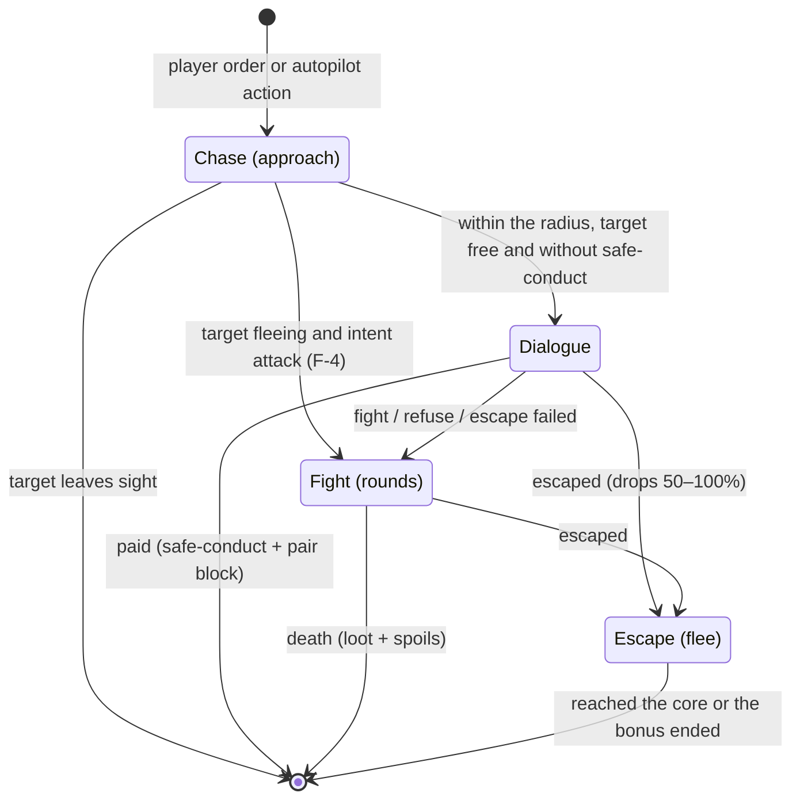

# M2 plan — The encounter

**Status:** Approved (2026-11-15) · **Date:** 2026-11-15
**Spec:** [spec.md](spec.md) · **ADRs:** [0007](../../adr/0007-sim-events.md) (`sim` events, `Accepted`),
[0006](../../adr/0006-world-sync.md) (view deltas), [0004](../../adr/0004-persistence-sqlite-command-log.md)
(log and snapshots), [0002](../../adr/0002-every-action-is-a-command.md) (command vocabulary)

The decisions that needed the owner's OK are marked **(P*n*)** and listed in §11. **All approved by the owner
(2026-11-15), as proposed.**

## 1. What the code does today and what changes

| Today (M1.5, `SIM_VERSION` 5) | In slice A (`SIM_VERSION` 6) |
|---|---|
| The creep has no HP or name; the client generates the name from the id (`nameAt(id)`) | `hp` and `name` on the `Creep`; the name comes from a birth counter in the state (P5) |
| No creep dies; ids only grow | A creep dies and leaves `state.creeps`; its domination ends (D4) |
| `step(state, commands): void` | `step` returns the tick's events (ADR-0007, P9) |
| A 7-stage pipeline (`step.ts`) | A new **encounters** stage after the orders, and HP regenerates together with the deposits (§5) |
| Orders: `stop`, `moveTo`, `explore`, `gather`, `deliver`, `buildRoad` | Plus `approach`, `pickup` and `flee` |
| An autopilot vocabulary of economy and exploration only | Conditions `enemyInSight`, `hpBelow`, `demandAtMost`; actions `approach`, `pickup`, `pay`, `fight`, `flee`; reaction rules (D13) |
| `state.rng` only in the map generator | The roll, the escape, the dropped fraction and the mutual encounter tie-break use `state.rng` |
| The view: creeps, deposits, roads, jobs | Plus `encounters` and `spoils` (memory, like deposits); the enemy creep with name, HP and whether it is engaged (D18) |
| Delta and `welcome` without a chronicle | The delta carries the team's events; the `welcome`, the latest entries (`PROTOCOL_VERSION` 4) |
| SQLite: worlds, players, commands, snapshots, metrics | Plus the `chronicle` table (derived, ADR-0007 rule 6) |

## 2. Where each thing lives

```text
packages/sim/src/
  names.ts        new: the name list and nameAt (moved out of the client)
  hp.ts           new: max HP, regeneration, damage, death (removeCreep)
  encounter.ts    new: the encounter (open, dialogue, reaction, extortion, safe-conduct), the fight and the escape
  spoils.ts       new: spoils (drop, merge, pick up) and loot
  events.ts       new: the event types, the tick collector, the audience and eventsFor(team)
  world.ts        Creep (name, hp, engagement, safeConduct, extortBlocks), Encounter, Spoil, births
  orders.ts       approach, pickup, flee orders; engaged creeps resolve no order
  autopilot.ts    new conditions and actions; reaction rules (called by encounter.ts)
  presets.ts      raider preset
  rules.ts        copy and validation of the new vocabulary
  domination.ts   orderRefusal of the new orders; the react command
  commands.ts     react command
  movement.ts     the escape bonus in movePointsPerTick; speedHere for the escape chance
  vision.ts       spoils in memory (like deposits and jobs: V-3, V-5)
  view.ts         new fields; encounters and spoils
  step.ts         encounters stage; returns the events
  strategist.ts   raider role (D15)
  stats.ts        new activities (talking, fighting, fleeing)
  params.ts       hp, fight, flee, encounter, safeConduct (schema, default.json, test/params.json)
packages/protocol/src/
  index.ts        zod for the new commands and rules; welcome.chronicle; DeltaMessage.events; PROTOCOL_VERSION 4
  delta.ts        encounters and spoils in Delta/Sent
apps/server/src/
  persistence.ts  chronicle table; write, delete from a tick, read the last N per team
  world-host.ts   keeps the tick's events; recovery rebuilds the chronicle
  stream.ts       pending events per team, in the delta; chronicle in the welcome
apps/client/src/
  chronicle/      templates.ts (sentence bank), narrate.ts, chronicle-panel.tsx
  panels/         new reaction-panel.tsx; inspector and rules-editor with the new fields
  map/            HP bar, spoils, chase/encounter/fight/escape marks, right-click menu
  replay/         the chronicle in the replay (events from step)
apps/cli/src/
  harness.ts, report.ts, sweep.ts   encounter metrics from the events (P6)
  verify.ts       the event list enters the verification
  net.ts          the events enter the bytes
apps/server/src/soak*.ts           each client's final chronicle against the server's
```

## 3. State

### Creep

```ts
type Creep = {
  // ...M1.5 fields
  name: string;            // D1, from the state.births counter
  hp: number;              // in thousandths of HP (P1): 300 HP = 300_000
  engagement: number | null;            // id of the Encounter it is in, or null
  safeConduct: { team: number; untilTick: number } | null;   // D9
  extortBlocks: { aggressor: number; untilTick: number }[];  // D9, by aggressor id; pruned when expired
};
```

- **HP in thousandths (P1).** Regeneration in ‰ of max per minute and the hit in ‰ of max give integers with no
  rounding, the same for the three DNAs: every world minute (`elapsed % 60 === 0`), `hp += hpMax × regen‰`
  (thousandths), up to `hpMax × 1000`. The client shows `floor(hp / 1000)`.
- **A fleeing creep's order is `{ type: "flee", untilTick }`** (P4): walks to the core with the bonus, until the tick
  or until it arrives; the autopilot does not replace it and the dominating player does not cancel it (`fleeing`).

### Encounter and Spoil

```ts
type Encounter = {
  id: number;                      // from nextId
  aggressor: number; victim: number;   // creep ids
  intent: "attack" | "extort";
  stage: "dialogue" | "fight";
  demand: Stock | null;            // on extortion (D8), computed on opening
  deadlineTick: number | null;     // the dominated creep's window (D6); null for a free one
  reply: "pay" | "refuse" | "fight" | "flee" | null;  // the player's answer, applied in the stage
  nextRoundTick: number | null;    // in the fight (D7)
  rounds: number;
} & Cell;                          // the victim's cell on opening (the events' audience)

type Spoil = { id: number; cargo: Stock } & Cell;   // D11
```

- `state.encounters` and `state.spoils`, ordered by id (P2); `state.births`, the birth counter (P5).
- `TeamMemory.spoils`: copies of the spoils seen, with the last value, forgotten when the visible cell no longer has
  them (like jobs, fog V-5). That answers "remembered under the veil like a deposit" (spec C-2).

## 4. The encounter



**Encounters stage** (§5, stage 4), in four fixed steps, always in id order:

1. **Open.** Gathers the creeps with an `approach` order whose target is within `encounter.radius` (Manhattan), free
   and without a safe-conduct against the aggressor's team. Mutual pairs (A approaches B and B approaches A) are
   resolved by D12: off the river and fords first, then the smaller relative load (`load × 1000 ÷ capacity`), and the
   tie by `nextInt(rng, 2)`. Pairs are processed by the pair's lowest creep id; a creep already engaged in this step
   leaves the following pairs. An extortion with no demand (empty victim or full aggressor) does not open: the order
   ends (spec E-5). Each opened encounter emits `encounter` and sets `engagement` on both.
2. **Decide the dialogue.** For each encounter in `dialogue`: if the victim is free, it reacts now (reaction rules,
   §6); if dominated, apply the `reply` if any, or the rules when `tick >= deadlineTick`, or wait.
3. **Rounds.** For each encounter in `fight` with `nextRoundTick === tick`: evaluate both reactions (the aggressor
   first, then the victim: flee below some HP, or the dominated creep's `reply`). If someone tries to flee, the chance
   is `nextInt(rng, vF + vO) < vF` (D10), with `v = speedHere(creep)`. If nobody escaped, roll who hits:
   `nextInt(rng, wA + wB) < wA`, with `w = max(1, floor(hp × weight‰ ÷ hpMax))` (D7); the hit takes `hpMax × hit‰`
   thousandths. At HP 0, `kill` (`hp.ts`): the winner's loot, spoils for the rest, domination ended, `died` and
   `looted`.
4. **Close.** A paid, fled or deadly encounter leaves `state.encounters`; the survivors get `engagement = null` and
   the `stop` order (the autopilot decides on the next tick; the dominating player gets the creep standing still).

- **`speedHere(creep)`** is `movePointsPerTick` with the creep's current cell (in `state.map`, which its own team
  always sees), the current load and no escape bonus (P11). A creep on a ford cell moves at 500‰.
- **The dropped fraction** on escape is `nextRange(rng, flee.dropMinPermille, 1000)` per resource, materia then
  cristal, and the spoils sit on the fleeing creep's cell.
- **The order of `rng` calls** is that of the steps above, and within each one id order. The mirror between teams
  stops being exact from the first roll (the `rng` is fair, but not mirrored): accepted by the spec (D7, D12).

## 5. Tick pipeline

```text
1. external commands, in seq order (react enters here and stores the reply)
2. autopilot: free creeps, out of encounters and not fleeing, evaluate the action rules
3. orders: movement (approach chases; flee with the bonus), gathering, delivery, roads, pickup;
   engaged creeps do nothing
4. encounters: open → dialogue → rounds → close                             (new)
5. production (birth: name, full hp, born event)
6. regeneration of deposits and HP (out of encounters, per minute)
7. sight and memory (with spoils); the audience of the tick's events      (ADR-0007, rule 3)
8. stats; tick++
```

- **The chase** (`approach`): `walk` goes to the target's current cell; the path cache already recomputes when the
  target changes cell (`cache.target` changes). The order ends when the target leaves the team's sight (`visible` at
  the end of the previous tick) or dies. The radius is checked in stage 4, after movement.
- **The audience** is computed after stage 7: the participants' teams, plus the teams with `visible[cell]` in the new
  view. An event with no cell (there is none in slice A) would belong only to the participants.

## 6. Autopilot: the vocabulary and the reactions

```ts
type Condition = /* ...M1.5 */
  | { type: "enemyInSight"; radius: number; dna?: Dna[]; minCargo: number }
  | { type: "hpBelow"; permille: number }
  | { type: "demandAtMost"; permille: number };   // false outside an extortion

type Action = /* ...M1.5 */
  | { type: "approach"; intent: "attack" | "extort"; radius: number; dna?: Dna[]; minCargo: number }
  | { type: "pickup" }                     // the nearest known spoils, in steps
  | { type: "pay" } | { type: "fight" } | { type: "flee" };   // reaction actions
```

- **Reaction rule = a rule whose action is `pay`, `fight` or `flee`.** In pipeline stage 2 the autopilot skips those
  rules; in stage 4, `encounter.ts` evaluates only them, in the context of the moment: `extorted`, `attacked` or
  `round`. `pay` is only possible in `extorted`. The first rule with a true condition and a possible action decides.
  With none: `extorted → pay`, `attacked → flee`, `round → fight` (D13).
- **`approach`** picks, among the enemy creeps in sight (the team view) within `radius` that pass the filter (DNA,
  minimum load) and can be approached (free; without a safe-conduct against the team; on extortion, demand > 0 and the
  pair not blocked), the nearest in Manhattan, ties by cell index **in the team's frame** (like `explore`). If the
  current order is already `approach` on a still-valid target, it keeps the target (like `committedDeposit`).
- **`pickup`**: the spoils in team memory it reaches first (`nearestTargets`, like `quickestDeposit`); impossible with
  a full load or no known spoils.
- **`raider` preset** (D14), with the 400‰ threshold as rule data:

  ```text
  hpBelow 400‰    → flee        (reaction)
  always          → fight       (reaction: fights when attacked or extorted)
  always          → approach extort (radius 10, minCargo 10; was 1 until F5, C11)
  always          → pickup
  cargoFull       → deliver
  always          → explore
  always          → deliver
  ```

  The gatherer presets do not change: with no reaction rule, the D13 defaults apply.
- **`react` command** (from the dominating player): `{ type: "react", creepId, choice }`, with `choice` among `pay`,
  `refuse`, `fight` and `flee`. Refused (`notEngaged`, `invalidReaction`) outside an encounter, with a choice that
  does not fit the moment, or in the fight with any choice other than `flee`. Stores the `reply`, applied in stage 4.
- **Player orders** (`order`): `approach { targetId, intent }` and `pickup { spoilId }`. A target out of the team's
  sight or spoils out of its memory → `unknownCreep` / `invalidOrder`, the same refusals as a nonexistent id (D19).
  An engaged or fleeing creep → `engaged` / `fleeing`.

## 7. Events (ADR-0007)

```ts
type SimEvent = { tick: number; index: number; teams: number[] } & (
  | { type: "born"; creep: CreepRef }
  | { type: "encounter"; encounter: number; aggressor: CreepRef; victim: CreepRef;
      intent: "attack" | "extort"; demand: Stock | null; mutual: boolean }
  | { type: "reaction"; encounter: number; creep: CreepRef;
      choice: "pay" | "refuse" | "fight" | "flee"; by: "rule" | "player" | "default" }
  | { type: "paid"; encounter: number; from: CreepRef; to: CreepRef; amount: Stock }
  | { type: "fleeAttempt"; encounter: number; creep: CreepRef; escaped: boolean;
      dropped: Stock | null; spoil: number | null }
  | { type: "fightEnded"; encounter: number; winner: CreepRef; loser: CreepRef; rounds: number }
  | { type: "died"; creep: CreepRef; by: CreepRef | null }
  | { type: "looted"; by: CreepRef; from: CreepRef; taken: Stock; spoil: number | null }
  | { type: "pickedUp"; creep: CreepRef; spoil: number; taken: Stock }
) & Cell;

type CreepRef = { id: number; team: number; dna: Dna; name: string };
```

- The event carries the name and the DNA (`CreepRef`): the dead leave the state and the chronicle needs them.
- `teams` (the audience) is filled at the end of `step`; `eventsFor(events, team)` filters and strips `teams`.
- Rounds that kill nobody emit no event: the map shows them through the `encounter` in the view (C-3).
- **`step` returns `SimEvent[]` (P9).** The stages receive the tick's collector as a parameter; nothing stays in the
  state.

## 8. Network and server

- **View:** `encounters` (the team's own whole; the others only with the public fields: participants, intent, stage
  and cell, when the cell is visible) and `spoils` (memory). `ForeignCreepView` gains `name`, `hp` and `engagement`
  (D18). The `Delta` gains `encounters?` and `spoils?` as `EntityDelta`; dead creeps leave by `remove`, like enemies
  leaving sight.
- **`DeltaMessage.events?`:** the team's events since the previous send (one send covers several ticks at high speed),
  in `(tick, index)` order. They enter the resumption buffer together with the delta.
- **`WelcomeMessage.chronicle`:** the team's last `chronicleWelcome` (100) entries.
- **`chronicle` table** (P7): `(world_id, team_id, tick, idx, event_json)`, key `(world_id, team_id, tick, idx)`, one
  row per event and audience team, written in the tick's transaction. **No pruning** in this slice (hundreds of rows
  per world hour); the soak measures the size.
- **Recovery:** deletes the rows with `tick >=` the snapshot's and replays the log; `step` emits the same events,
  which are written again. The in-memory chronicle (last 100 per team) is read from the table at the end.
- **`PROTOCOL_VERSION` 4.** A client with another version reloads (as in M1.5).

## 9. Client

- **Names:** `creep.name` from the state; the client's `names.ts` goes away (the list's tests move to the `sim`).
- **Map:** an HP bar under the creep when not full (the enemy too); spoils as a small diamond in the dominant
  resource's color, dimmed under the veil; the chase as a dashed line from aggressor to target (own team only); the
  dialogue as a "!" between the two with the window's time left, if any; the fight as a red stroke between the two and
  the rounds; the escape with a short trail. A new "approach" cursor over an enemy in sight.
- **Right-clicking an enemy in sight** with a dominated creep: a menu "Attack" / "Extort (demands N)", with the demand
  computed by the `sim`'s `demandFor`; "Extort" disabled with a demand of 0.
- **Reaction panel** (`reaction-panel.tsx`): opens when the dominated creep is the victim in `dialogue`, with the
  intent, the demand, the possible buttons and the time left in world seconds; in the fight, only "Flee" and the
  rounds.
- **Chronicle** (`chronicle/`): a collapsible right-hand panel, newest sentences on top, clickable names.
  `templates.ts` is data: per event type, per DNA (the voice) and per outcome, ~3 variants; the variant is
  `(tick × 7919 + index) mod n`. The agent writes the initial bank; the owner reviews the tone at the checkpoint (D17).
- **Inspector:** HP, name, safe-conduct (until when and against whom), encounter state. **Rules editor:** the new
  conditions, actions and preset, with the reactions grouped ("When approached").
- **Replay:** `step` returns the events and the replay chronicle shows all of them (`fullView`).

## 10. Harness and tests

- **Event metrics, in the CLI harness (P6):** encounters per team as aggressor and as victim and per outcome; escapes
  tried and succeeded per DNA and per terrain; deaths per team and per DNA; what changed hands by extortion, loot and
  spoils; spoils created, picked up and left; encounters in the victim's core zone (D21). Average HP and population
  come from the `sampleMetrics` samples. All in the `report.md` of `geo sim` and `geo sweep`, side by side with fog
  F6.
- **`geo verify`:** besides the state hash, the hash of the event list in the 2 runs and in snapshot → restore.
- **`sim` tests** on text maps: each spec §5 rule; the roll and escape with a fixed `rng` (known sequence); the loaded
  square on a ford against the circle; the mutual encounter on both sides of the mirrored map; nothing leaks (view and
  events of a hand-built world); death of a dominated creep.
- **Diff property** (6 h × 3 seeds in CI) with encounters, deaths and spoils; a floor of deaths per seed goes into the
  test to guarantee it exercises removal.
- **Soak:** each client's final chronicle equal to the server's.

## 11. Approved decisions (owner, 2026-11-15)

| # | Decision | Approved (the proposal) | Discarded alternative |
|---|---|---|---|
| P1 | HP unit | Thousandths of HP in the state; regeneration once per world minute | Integer HP, rounding down every minute (the circle, with 120 HP, would regenerate proportionally less) |
| P2 | Encounter in the state | An `Encounter` entity in `state.encounters` (id from `nextId`), with the creep pointing to it (`engagement`) | Fields on the creeps only (partner, stage, deadline): duplicates the state on both and complicates the view |
| P3 | Where the encounter happens in the tick | Its own stage after the orders, before production; a free victim reacts in the same tick the encounter opens | Evaluate the encounter inside the autopilot (stage 2): the radius would be measured before the tick's movement, one tick late |
| P4 | Escape as a locked order | The `flee` order is not replaced by the autopilot nor cancelled by the player until it ends (60 world seconds or reaching the core) | The dominating player can cancel the escape and give another order (loses the bonus) |
| P5 | Name | A `state.births` counter; the name is `nameAt(births)` with the existing rule. The list moves from the client to the `sim`. Names change relative to M1.5 (they came from the id) | Keep it by id: the last creeps of a long world get a suffix sooner, because ids also count deposits, jobs, encounters and spoils |
| P6 | Encounter metrics | Computed in the CLI harness from the events; the state's `Stats` only gains the new activities | Counters in the state's `Stats` (in the hash and the snapshot, and the server writes them to the `metrics` table) |
| P7 | Chronicle on the server | A `chronicle` table, one row per event and team, no pruning in this slice | Keep only the last N per team (pruning on every write): less disk, but the history is lost |
| P8 | Bot raiders | `floor(creeps ÷ 6)`, the lowest-id materia gatherers, like the other roles | Choose by DNA (e.g. the triangle, middle ground of capacity and speed) |
| P9 | `step` signature | `step(state, commands): SimEvent[]` | A collector passed as a parameter (`step(state, commands, events)`) |
| P10 | The raider's reaction to extortion | Fights (the same `always → fight` rule serves the attack and the extortion) | Pays the extortion and fights only when attacked (two rules) |
| P11 | Speed for the escape chance | The creep's current cell, on the real map, with the current load, no escape bonus | The next cell of the path to the core (catches the ford just ahead, but needs an A* mid-fight) |

## 11.1 F3 checkpoint (owner, 2026-11-15)

| # | Decision |
|---|---|
| C1 | **A raider with nothing left to explore goes back to gathering:** the strategist only keeps raiders while the team can reach some never-seen cell (from the core, on the map it knows); after that, all go back to gathering materia. Only the bot changes; the raider preset stays the same |
| C2 | **Reaction stance of the bot's gatherers, by DNA** (reaction rules ahead of the role's rules; the raider keeps its own). ■: flee below 400‰ HP, otherwise fight (refuses extortion). ▲: flee below 400‰, pay if the demand is up to 500‰ of the load, otherwise flee. ●: always flee. The player's gatherers keep the D13 defaults |
| C3 | The frequency and weight of encounters, with the F3 bot (0.4–0.8 per team per hour, almost all paid, 0.24% of materia), do not yet matter for hypothesis 3: the owner agrees. Measure again with C1 and C2 |
| C4 | Tick cost (1.47–1.55× that of F6): decide after measuring with C1 |
| C5 | F3 interpretations kept: the raider is chosen after the cristal gatherers and the builder; the id tie-breaks of the road target and of the deposit reached at the same cost become tie-breaks by cell in the team's frame; the metric definitions |

Second round (owner, 2026-11-17), measured with C1 and C2:

| # | Decision |
|---|---|
| C6 | **A deposit remembered as empty that the autopilot never revisits** (the cause of the 20–25% gap in delivered materia between teams on seed 42, 3 days): left for the balancing round. Open question in [GDD 07](../../gdd/07-autopilot.md) |
| C7 | **Encounters only in the first ~8 h** (an effect of C1): accepted for now; watch in the F6 playtest. Patrolling is left for later |
| C8 | **The bot's ▲ pays any extortion** and flees the attack (replaces C2's ▲, which almost never paid: the demand is usually the whole load). Each DNA exercises one path: ■ fights, ▲ pays, ● flees |
| C9 | **Tick cost accepted:** 3 days of seed 42 in 12.5–12.9 s, against 12.2–12.4 s for F6 (~1.04×) |
| C10 | Interpretation kept: reaction rules do not tell the dialogue from the fight, so ▲ and ● try to flee every fight round |

Third round (owner, 2026-11-17), after F5:

| # | Decision |
|---|---|
| C11 | **Raise the raider preset's minimum target load** (the `approach` action of `raiderRules`, `minCargo: 1`), so the bot only ambushes whoever is worth it. It applies to the whole preset (player and bot). **Number: 10** (owner, 2026-11-17, at the opening of F6), the circle's capacity, a third of the square's; provisional. Measured on seed 42 over 3 days against 1, 5, 15 and 20: with 10, 23 encounters (from 112), 48% in the victim's core zone (from 93%); with 20, almost none. A `sim` behavior change: `SIM_VERSION` 9 and the fixed hashes change. Rejected for now: also blocking the aggressor–victim pair after an escape (a new gameplay rule) |

## 11.2 F6 checkpoint (owner, 2026-11-17)

The owner's session against the bot, `dev:multi --bot` at ×6, seed 42, up to 2h38 of world time (day 1).

| # | Decision |
|---|---|
| C12 | **Slice A does its job:** the owner tried the attack and the extortion, and the chronicle reads well (the D17 tone approved as is). The slice closes |
| C13 | **Hypothesis 1 (conflict and story):** yes. **Hypothesis 2 (changes what the player does):** yes, but through fear: after a fight lost to the roll (Bako left with 26% HP), the owner did not try another and rotated the circles between scout and raider. **Hypothesis 3 (without dominating the game):** not dominating, but also without weight: the bot did not ambush the player in 2h38 |
| C14 | **Findings left for the next design rounds, with no change to slice A:** a roll-only fight is too risky for the return (the real combat belongs to B and D); extorting the bot is almost free (the bot's ▲ pays any demand, C8); at ×6, after exploring the map (~2h30), there is nothing to do but gather: in 2.6 h neither team gathered the 3,000 materia of a new creep |

## 12. Implementation order

Each phase on its branch `m2/encontro-f<n>-<slug>`, merged `--no-ff` into `main`.

| Phase | Delivery | Checkpoint |
|---|---|---|
| F0 | Spec, ADR-0007 and plan | Plan approved |
| F1 | **Identity, HP and events in the `sim`:** names in the `sim`, `births`, HP in thousandths and regeneration, `kill` (with domination), the event collector and `born`, the audience and `eventsFor`, the new view fields, `SIM_VERSION` 6 and the hashes | — |
| F2 | **The encounter in the `sim`:** `Encounter` and `Spoil`, `approach`/`pickup`/`flee` orders, the encounters stage (open, dialogue, rounds, close), extortion, safe-conduct and block, escape, loot and spoils, the mutual encounter, the vocabulary and reactions, the `react` command, the raider preset, refusals without leaks, the events | — |
| F3 | **Bots and harness:** raiders in the strategist; event metrics in `geo sim`/`geo sweep`; `geo verify` with the events | **Owner:** encounter frequency, economy, snowball and cristal, in the numbers, before the interface |
| F4 | **Network and server:** zod, `Delta` with `encounters`/`spoils`, events in the delta and chronicle in the `welcome`, `PROTOCOL_VERSION` 4, diff property; the `chronicle` table and recovery | `geo net` within the targets |
| F5 | **Client:** HP, names, spoils, map marks, right-click menu, reaction panel, chronicle and the sentence bank, inspector, rules editor, replay | — |
| F6 | **Soak and playtest:** soak with the chronicle; encounter questions in the PLAYTEST | **Owner:** ×6 session against the bot, chronicle tone; closes slice A |
