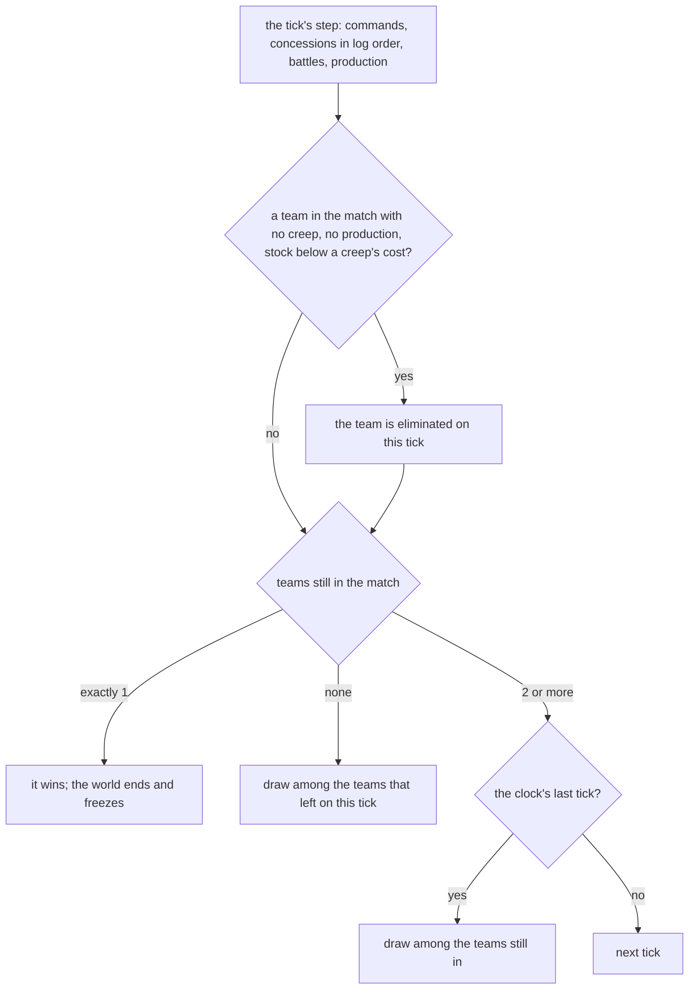

# M2 spec — The minimal end

**Status:** Draft · **Date:** 2026-11-25 · **Milestone:** M2 — The ambush ([ROADMAP](../../ROADMAP.md)), slice E-min
**Related GDD:** [01](../../gdd/01-world.md) (the minimal end before the siege, the draw at the clock),
[06](../../gdd/06-battles.md) (the battle instance), [07](../../gdd/07-autopilot.md) (the bots' strategist),
[08](../../gdd/08-chronicle-chat-and-console.md) (chronicle, replay markers) ·
**ADR:** none new expected (§9); [0002](../../adr/0002-every-action-is-a-command.md),
[0003](../../adr/0003-typescript-node-pure-integer-simulation.md),
[0004](../../adr/0004-persistence-sqlite-command-log.md), [0007](../../adr/0007-sim-events.md),
[0010](../../adr/0010-world-side-of-the-battle-contract.md)

## 1. Hypothesis

> Does the battle change the course of the world without dominating the game? (ROADMAP, M2)

At the junction's checkpoint (C2, 2026-11-25) the owner's session against the bot ended with every enemy creep dead
and no way to end the match: the world only ends when its clock runs out, and the core gets HP only in slice E, after
the friends' playtest (P). This slice gives P a match that can end, and asks:

1. **Does the match end when it feels over?** A team that can no longer come back loses, a team that wants to stop
   can, and the bot does not drag on a lost match.
2. **Is the end readable?** The end screen tells who won and how the match went, for the winner and for the loser.
3. **Can the story be found again?** The replay of an ended world shows its main moments on the timeline.
4. The end holds the game's guarantees: determinism, the replay of the log, recovery after a crash, the fog, and
   any number of teams (slice T comes after P).

## 2. What the owner already decided

A summary; the source is [GDD 01](../../gdd/01-world.md), "The minimal end" and "The minimal end before the siege".

| Topic | Decision |
|---|---|
| Elimination in fact | A team with no creep alive, nothing in production and a stock below one creep's cost can no longer come back, and loses |
| Concession | Any human of a team may concede, with a confirmation |
| The bot concedes | When it has no chance: at most 1 creep, nothing in production and a stock below one creep's cost |
| The clock | When it runs out with no core brought down, a draw among the teams still in the match (provisional) |
| The world's end | The world ends when one team remains, and freezes, read-only, with its replay |
| The end screen | The result, the duration and, per team, creeps born and lost, battles won and lost, matéria delivered and the five main events of the chronicle |
| Replay markers | Battles (start and end), deaths, births, wanderers and the end |
| N teams | The humans of an eliminated team become spectators; slices R and E-min add no new two-team assumption |
| Siege | The core's HP, building HP and repair are slice E, after P. Victory by the core stays the game's rule |

## 3. Scope decisions this spec assumes

Decisions marked **owner** come from the R and E-min design round (2026-11-25, GDD 01). The others are the **agent's
proposal** and only hold with the owner's acceptance of the spec. Those marked **(gameplay)** complete the GDD and go
into it on acceptance. The numbers are in §6 and are guesses.

| # | Decision | Default | Why |
|---|---|---|---|
| D1 | The end lives in the world **(agent)** | The `sim` decides and keeps the end in the state: each team's **standing** (in the match, eliminated, conceded, with the tick) and the world's **result** (who won, or a draw among which teams, and how it ended). **The clock's end moves from the server into the `sim` too**: today the server marks a world `ended` when its tick reaches `world.durationSeconds`, and the CLI only stops there | One source for the server, the CLI, the bots, the replay and the end screen; the replay of the log reaches the same end on its own (ADR-0003, ADR-0004) |
| D2 | Elimination in fact **(gameplay; owner, details by the agent)** | Checked at the end of each tick, after the battle results and production: a team in the match with **no creep alive** (a creep locked in a battle is alive), **nothing in production** and a stock that **cannot pay `creep.cost`** is eliminated on that tick. An armed "repeat" does not count as production (it waits for stock). Spoils on the map and loads do not count (with no creep, nobody carries them) | The owner's rule, read literally; checking after production lets a creep born on the tick save the team |
| D3 | Concession **(gameplay; owner, details by the agent)** | A new `concede` command, which any player of the team may send (a human, or the team's bot, D4). It applies on the next tick like any command, and the team leaves the match on that tick. In the client, a **"Desistir"** button in the top bar opens a confirmation dialog that says what happens ("o time perde a partida"); only the confirmation sends the command. With several humans in a team, one concedes for all (owner: "any human") | ADR-0002: conceding is an action like any other, logged and replayed |
| D4 | The bot concedes **(gameplay; owner, details by the agent)** | The balanced strategist sends `concede` when its team's view shows **at most 1 creep alive, nothing in production and a stock that cannot pay `creep.cost`**. **Only the core's stock counts**, not what the last creep carries (owner, 2026-11-25). Only in a team **with no human player**: where humans play, they decide. It decides from its view, like every strategist decision (fog spec B-1) | The C2 session: the bot kept 1 creep and no way to replace it. The threshold goes with the strategist's settings (§6) |
| D5 | Who wins, and when **(gameplay; owner, details by the agent)** | After the checks of a tick: **one team left** in the match wins, and the world ends on that tick; **no team left** (the last ones left on the same tick) is a **draw among the teams that left on that tick**; on the **clock's last tick**, a **draw among the teams still in the match**. Concessions apply in the log's order: the one that leaves a single team ends the world, and the later ones of that tick are refused (`worldEnded`). The wanderers are not a team and never count | A rule for every case, deterministic by the log's order, with no two-team assumption |
| D6 | The frozen world **(gameplay; owner, details by the agent)** | On the end tick the world stops: no tick after it, every command refused with `worldEnded` (as today at the clock), read-only. **Open battles stop where they are, with no result**: their logs stay and replay up to their last tick; nobody comes back to the map. Battle screens close. The replay can be exported from the end tick on (as today), and the lobby shows the result | The owner: "freezes, read-only, with its replay". Ending the battles by a rule would invent an outcome |
| D7 | A team out in a world that goes on **(gameplay; agent; only with 3 or more teams, slice T revises)** | Its humans become **spectators**: they keep their team's view, their commands are refused with a new `teamOut`, and their dominations are released. Its creeps (after a concession) stay on the map with the autopilot rules they had and no player; its core and stock stay, and it can produce no more. A team out never comes back into the match. **With two teams this never happens** (the world ends). Spectators of the whole world come with P's spectators | The owner asked for spectators and left "what an eliminated team does while the world goes on" to T's round (GDD 01 proposal). This is the smallest rule that runs with N teams and changes nothing with two |
| D8 | The end is public **(gameplay; agent)** | A team leaving the match (eliminated or conceded) and the world's end are events **every team receives**, through the fog: a team learns that another left the match and how, nothing else about it. The chronicle narrates them | Who is still in the match is what decides the end; hiding it would make the end come from nowhere |
| D9 | The end screen **(gameplay; owner, details by the agent)** | When the world ends, **the end screen opens by itself** in place of the map (over the battle screen too), and opens again whenever a player enters an ended world. It shows: the **result** ("Azul venceu", or "Empate entre Azul e Laranja") and **how** (elimination, concession, the bot's concession, the clock); the **duration** in world time and, on a server world, in real time; **per team**: creeps born in the match (the initial population does not count), creeps lost, battles won and lost (an end by inactivity counts as neither), matéria delivered, and when it left the match; and **the five main events of the match** (D10; for the whole match, not per team: owner, 2026-11-25), each as its chronicle sentence. Buttons: **"Ver o mapa"** (the frozen world in the team's view) and **"Ver o replay"** (the world's replay screen, D11) | The owner's list; seen by the loser too |
| D10 | The summary in the state **(agent)** | The counters (born, lost, battles won and lost) join the team stats in the state, and the **five main events** are kept in the state as they happen, by a fixed ranking (§6): in a two-team match, the loser leaving and the four largest battles, e.g. "Laranja desistiu" and "Azul venceu a batalha no vau do meio: 3 contra 2 e um errante; levou 120 de matéria". The server, the CLI, a reconnection and the replay give the same summary without reading the whole log | The end screen needs the whole match; the stats already accumulate in the state (M1) |
| D11 | Replay markers **(gameplay; owner, details by the agent)** | The replay timeline marks: **battle opened** and **battle ended**, **deaths** (team creeps and wanderers), **births** in the match, **wanderer born**, **a team leaving the match** and **the end**. Each kind has its own mark and color; a toggle per kind hides it; hovering a mark shows its chronicle sentence and clicking it jumps to that tick. The marks are ready when the replay opens, from the events of the whole replay (the plan decides how) | GDD 08 proposal, approved in the round; a 2-hour match has hundreds of births and deaths, so the toggles keep it readable |
| D12 | Written for N teams **(owner)** | No part of the slice (the standing, the end rule, the events, the summary, the end screen, the markers, the lobby, the CLI report) assumes two teams. Tests use a hand-built world of 3 teams | The owner: R and E-min add no new two-team assumption; T needs it |
| D13 | The harness **(agent)** | `geo sim` and `geo sweep` stop at the world's end like the server, and report how and when each run ended (§7). `geo verify` covers worlds that end by elimination and by concession. The soak test keeps its `kill -9` in the middle of a battle and checks the end it reaches | A bot that concedes shortens runs: the reports must say so, for R's balance pass too |
| D14 | What changes on purpose | `SIM_VERSION` (the end in the state, the clock's end in the `sim`, the new counters and events) and `PROTOCOL_VERSION` (`concede`, `teamOut`, the standing and the result in the view, the summary) as a `BREAKING CHANGE`; the fixed hashes. `BATTLE_VERSION` does not change | New gameplay: old snapshots and replays become invalid (ADR-0004) |

## 4. Scope

### In
- **`sim`:** the standing and the result in the state (D1); elimination in fact (D2); `concede` (D3); the end rule and
  the clock (D5); the frozen world (D6); a team out (D7); the events (D8); the counters and the five main events
  (D10); the team view with the standing of every team and the result.
- **Bot strategist:** conceding by D4.
- **Junction host:** stopping open battles at the world's end (D6); a team out's dominated participants back to their
  gambits (D7).
- **Protocol:** `concede`; `teamOut`; the standing, the result and the summary in the welcome and the delta.
- **Server:** the clock's end comes from the `sim` (D1); the world's end on any tick (D5, D6); the result in the
  lobby's list; the export from the end tick.
- **Client:** "Desistir" and its confirmation (D3); the end screen (D9); the frozen world read-only; a spectator of
  its team (D7); the chronicle sentences of the new events (D8); the replay markers and their toggles (D11); the
  result in the lobby.
- **Harness:** the ends in `geo sim` and `geo sweep`, `geo verify` and the soak test (D13).
- **Playtest:** E-min questions in [PLAYTEST.md](../../PLAYTEST.md).

### Out
The core's HP, building HP, siege and repair (E); victory by the core; spectators of the whole world and of other
teams' battles (P); a lobby for a new match after the end, or a rematch (P decides); what a team out does in a world
of 3 or more teams beyond D7, and the maps for it (T); the pace, the duration and the strategist's other changes (R);
a vote among a team's humans to concede; a timeout for a team with no player online; translating the UI.

## 5. Behavior

Format: *When [trigger], the system shall [response].*

### Leaving the match (`sim`)
- **L-1** At the end of each tick, after the battle results and production, a team in the match with no creep alive,
  nothing in production and a stock that cannot pay `creep.cost` shall be eliminated on that tick (D2).
- **L-2** When a player sends `concede` for a team in the match, the team shall leave the match on the tick the
  command applies (D3). A `concede` from a team already out shall be refused with `teamOut`.
- **L-3** A team out shall never return to the match. Its players' commands shall be refused with `teamOut`, and their
  dominations shall end on that tick (D7).
- **L-4** The creeps of a team out shall stay with the rules they had and no player; its core shall produce no more
  and its armed repeat shall drop (D7).

### The world's end (`sim`)
- **F-1** When, after a tick's checks, exactly one team remains in the match, it shall win and the world shall end
  on that tick (D5).
- **F-2** When no team remains, the result shall be a draw among the teams that left on that tick.
- **F-3** When the tick reaches `world.durationSeconds` with two or more teams in the match, the result shall be a
  draw among them.
- **F-4** Within a tick, concessions shall apply in the log's order; once the world has ended, every later command
  shall be refused with `worldEnded`.
- **F-5** After the end, no tick shall run; the state shall keep the result, each team's standing, the counters and
  the five main events.

### The bot (strategist)
- **B-1** The balanced strategist of a team with no human player shall send `concede` when its team's view shows at
  most 1 creep alive, nothing in production and a stock that cannot pay `creep.cost` (D4).
- **B-2** A strategist shall send nothing after its team left the match.

### Battles at the end (host)
- **X-1** When the world ends, every open battle shall stop on its current battle tick, with no result applied to the
  world; its log shall stay replayable up to that tick (D6).
- **X-2** When a team leaves a world that goes on, its participants in open battles shall go back to their gambits;
  the battles shall go on (D7).

### Events, view and chronicle
- **K-1** A team leaving the match (eliminated or conceded, with its team) and the world's end (with the result) shall
  emit structured events, in the same order on any run.
- **K-2** Every team shall receive the K-1 events, whatever it sees (D8); nothing else about a team out shall leak.
- **K-3** The team view shall carry every team's standing and, after the end, the result and the summary.

### End screen, replay and lobby (client and server)
- **S-1** When the world ends, the client shall show the end screen in place of the map or the battle screen (D9);
  entering an ended world shall open it too.
- **S-2** The end screen's numbers shall be the summary of the state (D10); "Ver o mapa" shall show the frozen world in
  the team's view and "Ver o replay" the world's replay screen.
- **S-3** The replay timeline shall show the D11 marks, with a toggle per kind, the sentence on hover and the jump on
  click; at the replay's last tick, the end screen shall be reachable as in S-2.
- **S-4** The lobby shall show each ended world's result.
- **S-5** "Desistir" shall send `concede` only after its confirmation; it shall not show for spectators or after the
  end.

### Persistence and recovery (server)
- **N-1** The world's end shall be stored in the end tick's transaction (status, snapshot); a restart shall find the
  world ended, with its result.
- **N-2** The replay exported from an ended world shall reach the same end, result, summary and hash.
- **N-3** The world's diff property test shall stay green with teams out and the end.

### The end in a flowchart

## 6. Initial parameters and rankings (guesses, made to be broken)

| Item | Guess | Where |
|---|---|---|
| The bot's concession threshold (D4) | at most 1 creep alive | the strategist's settings |
| Elimination (D2) | 0 creeps; the stock compared with `creep.cost` (no new number) | the rule |
| Main events in the summary (D10) | 5 | `sim` params |
| The ranking of main events (D10) | first, a team leaving the match; then battles ended, by participants (joins included), then by the load collected or left as spoils, then the earliest. Every other event is a mark in the replay, not a main event | the `sim`; the owner reviews at the checkpoint |
| Duration of a session match (§8) | a short params file for the owner's sessions, so the end is reached in minutes | `params/` |

## 7. Harness and acceptance criteria

The targets are guesses. When one fails, the owner decides at the checkpoint.

| Criterion | Target | How it is measured |
|---|---|---|
| How matches end | In the report: per run, how it ended (elimination, concession, the bot's concession, the clock), the world hour and the result; in sweeps, a table of these. The owner judges, with R's numbers once R merges | `geo sim` 3 days (seed 42) and `geo sweep` (seeds 1–20) |
| The C2 case | A world where the bot is left with 1 creep, nothing in production and no stock concedes on its next decision, and the human team wins | `sim` test |
| Determinism | 2 runs and snapshot → restore give the same end, result and hash, for an end by elimination, by concession and by the clock | `geo verify` in CI |
| The replay reaches the end | An exported replay of an ended world gives the server's result, summary and hash | Server test and the soak test |
| The summary is the same everywhere | The end screen's numbers match the CLI report's for the same log | Test |
| N teams | A hand-built world of 3 teams: one leaves, the world goes on with D7, then ends by F-1; nothing leaks beyond K-2 | `sim` test |
| Markers | The replay of a match of the P size (2 real hours at R's ×N) shows its marks within 10 s of opening, on the owner's machine | Measured in the owner's session |
| Recovery | A `kill -9` right after the end tick: the restart finds the world ended with its result | Server test |
| Rules | Each §5 rule with a test, on text maps | `npm run check` |

## 8. Test protocol

1. **Tests** (`sim`, `junction`, `protocol`, `server`, `client`): the §5 rules on text maps; a creep born on the tick
   saving a team; two concessions on one tick; the last creeps of both teams dying on one tick (F-2); the clock's
   draw; a team of 3 leaving while the world goes on; nothing leaks.
2. **Harness:** the §7 runs and the soak test.
3. **The owner's sessions,** with the short params file (§6), in a PLAYTEST group:
   - against the bot: kill its creeps until it concedes; then the end screen, "Ver o mapa" and "Ver o replay";
   - two tabs (`dev:multi --clients 2`): Orange concedes, through the confirmation; Blue sees the end;
   - the clock: both teams alive at the end, the draw;
   - the replay: find the match's turning point with the marks.

   Questions such as: "did the match end when it felt over?", "did the end screen tell you what happened?", "is
   'Desistir' easy to find and hard to hit by accident?", "did the marks lead you to the moments that mattered?".

## 9. Prerequisites before the `plan.md`

- The owner's acceptance of D1–D14; the gameplay ones go into the GDD (01, 07, 08).
- **No new ADR expected:** the end as world state follows ADR-0003 and ADR-0004, `concede` follows ADR-0002, and
  stopping battles at the end stays within ADR-0010. If the plan finds otherwise, it drafts one with the `adr` skill.
- **Running next to R:** both touch the strategist, the CLI reports and `world.durationSeconds`. The second to merge
  rebases on the first; R's sweeps will report the ends of D13.

## 10. Open questions

None. Answered by the owner on 2026-11-25: the bot looks only at the core's stock (D4); the five main events are the
match's, not per team (D9, D10).
