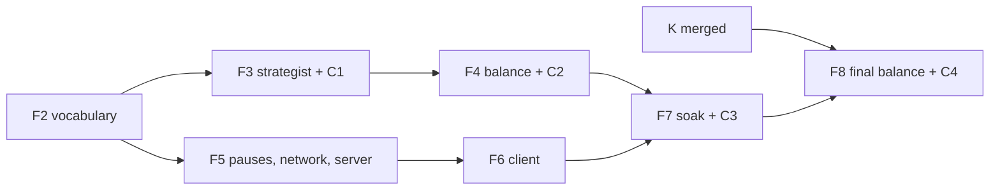

# M2 tasks — Rebalance and pace

**Status:** F0, F1 and F2 done (2026-11-25); next wave 2, F3 and F5 (see "Running the phases"). Branches `m2/rebalance-f<n>-<slug>` (skill `commit`).
**Spec:** [spec.md](spec.md) · **Plan:** [plan.md](plan.md)

## Running the phases: waves, lanes and models

The agent's recommendation at the owner's request (2026-11-25). It changes no plan decision (P1–P15); it orders the
sessions and moves two tasks (below) so that two phases can run side by side. The owner can change it at any wave.

**Inside a phase: sequential, one session.** F2's tasks all touch `orders.ts`, `autopilot.ts`, `rules.ts`,
`presets.ts`, `world.ts` and the fixed hashes; F3's the strategist; F5's the host, the server and the protocol. Agents
running in parallel inside a phase would edit the same files and each re-read the whole context, so one phase costs
more tokens with no gain. F6's tasks are the most separable (one layer each), but they share the store and the
inspector: one session too.

**Between phases** (the plan's dependencies, with the two moved tasks below):

**Moved tasks**, so F5 depends on F2 alone: `WorldHost` running the threat pass every tick for hard bots goes from
F5 to F3 (F3 writes the function and already runs it every tick in the harness; the server side is one call), and
`geo net` on the new default world goes from F5 to F7 (the new world exists only after F4). The diff property with
the new fields stays in F5.

**Lanes.** At most two implementation sessions at once, counting E-min and K: **lane A** for the deep phases (`sim`
rules, the strategist, determinism) on **Opus 5.5**, **lane B** for the well-specified ones (server, client, the
balance runs, the soak) on **Sonnet 5.5**. Haiku is not used: every phase needs the whole repository context.

| Wave | Lane A (Opus 5.5) | Lane B (Sonnet 5.5) | Starts when |
|---|---|---|---|
| 1 | **R F2** — the world vocabulary | — (nothing in R runs without F2; K F1 fits here only with room in `/usage`, see below) | now |
| 2 | **R F3** — the strategist, then C1 | **R F5** — pauses, network, server | F2 in `main` |
| 3 | free for E-min or K's deep phases | **R F4** — the balance pass, then C2; **R F6** — client, after F4 or in its waits | F3 in `main` (F4), F5 in `main` (F6) |
| 4 | — | **R F7** — soak and playtest, then C3 | F4, F5, F6 in `main` |
| 5 | — | **R F8** — the final balance pass, then C4 | K in `main`, C3 done |

**Why each model.** F2 and F3 are the hardest phases of R: new orders and actions on the deterministic pipeline, an
information-leak rule (HS-3), cycles, the load check's bounded search, the strategist's threat pass and risk. A
mistake there costs a hash rebuild and a re-sweep. F4 is mostly CPU-bound sweeps read against a fixed targets table
(the owner judges at C2); F5's state machine and F6's layers are spelled out by plan §6–§8; F7 and F8 rerun
harnesses. Sonnet does those for a fraction of Opus's usage. If a Sonnet session stalls on a judgment call, the owner
resumes the phase on Opus (the commits are per task, so nothing is lost).

**`/usage` and parallel work.** A phase costs about the same tokens run alone or next to another; running two at
once only spends them inside the same 5-hour window, and a session that hits the limit stops between task commits
(recoverable, but the phase sits half done). The agent cannot read `/usage`, so the rule is for the owner, before
opening lane B: **the current session below ~50% and the week below ~70%** (the Opus weekly share especially, since
lane A needs it); otherwise run the waves sequentially, lane A's phase first. Two sessions also share the CPU:
timing tests skew, the server tests may time out under load (`CLAUDE.local.md`), and F4's tick-cost reading must run
on a quiet machine.

**Conflicts to expect** (plan §10): E-min F1 also bumps `SIM_VERSION` and rebuilds the fixed hashes, and E-min F2
touches `strategist.ts` and the CLI reports, so E-min's sim phases go in lane A after R F2 and not next to R F3 when
avoidable; the second to merge rebases and takes the next version number. K F1–F5 live in `packages/battle` and the
lab, with no file shared with R F2–F7: K is the safe partner in lane B or A. R F4 rewrites `params/default.json`,
which R F5 also touches (`battle.hold`): a small rebase.

## F0 — Spec and plan

- [x] Design round with the owner (2026-11-25), recorded in GDD 01, 03, 05, 06 and 07
- [x] Spec approved (2026-11-25), with the owner's review (D23–D29) and slice G placed after K
- [x] **Checkpoint:** the owner approves the plan (P1–P15) (2026-11-25)

## F1 — Baseline and the pace harness

- [x] `world.multiplier` in the params schema and `params/default.json`; `params/world-72h.json` with today's numbers
      and ×6 (P1, P2)
- [x] `geo sim` and `geo sweep`: `--mult`, every time also in real minutes
- [x] `apps/cli/src/pace.ts`: the §7 metrics (crossing, the first extra creep, exploring, the wanderers, population,
      fights, the creep gap) and the targets table with pass or fail (P13)
- [x] The recovery scenario: `--shock team:count@minute`, not replayable, refused by `geo verify` (P12)
- [x] Baseline: `geo sim` and `geo sweep` (seeds 1–20, the full match) on the 72-hour world at ×6, quoted here

### F1 record

**Baseline** (`main` at `aa0edb9` plus F1's harness, which changes no world rule; `SIM_VERSION` 11;
`params/world-72h.json` read at ×6, the pace checkpoint C2 played; `runs/f1-baseline-72h`,
`runs/f1-baseline-72h-shock`, `runs/f1-baseline-sim-s42-1`/`-2`, not versioned):

- **`geo sim`, seed 42, the full 72-hour match (12 real hours at ×6):** 12.5 s and 13.3 s (two runs alone), hash
  `70582f0f…`; **tick cost 48.4 and 51.4 µs per world tick** (the §7 tick-cost target's baseline: F4 onwards compares
  with ~50 µs). 15 / 10 creeps at the end, 129,712 / 99,263 matéria delivered; the first extra creep at real minute
  175 / 152; the map 80% seen at real minute 31; 218 battles (1.8 / 1.2 per team per 10 real minutes, 6 / 4 with a
  join); the first wanderer at real minute 10, 22 born, 4 alive at once.
- **`geo sweep`, seeds 1–20, the full match** (`--set world.multiplier=6`, a value that changes no rule), the §7
  targets at ×6:

  | Criterion | Target | Measured | |
  |---|---|---|---|
  | Length (PA-1) | 115–125 real min | 720 min on every seed | ❌ |
  | Extortion window (PA-3) | ≥ 10 real s | 10 s | ✅ |
  | Crossing (▲, core to core, no roads) | 1.5–2.5 min | mean 3.6 (2.6–4.7), 0/20 | ❌ |
  | The opening (each team's first extra creep) | min 8–15 | mean 212 (142–336), 0/20 | ❌ |
  | Exploring (80% of the reachable map) | min 20–60 | mean 124 (35–214), 2/20 | ❌ |
  | First wanderer | min 4–6 | 10 on every seed | ❌ |
  | A wanderer alive after the first | ≥ 70% | 99.8% | ✅ |
  | Wanderers alive at once | ≤ 4 | 4 | ✅ |
  | Battles per team per 10 real min | reported | 1.9 (1.1–3.2); 2.1 participants per battle | — |
  | Help joins | ≥ 1 per team per 30 min | not measured before F2/F3 | — |
  | Both teams with creeps and delivering in the last 10 min | every seed | 20/20 | ✅ |
  | Creep gap at the end | median ≤ 3 | median 1.5 (0–9) | ✅ |
  | Creeps per team at the end | 10–24 | 7/20 seeds; mean 13 (3.5–30) | ❌ |
  | Population cap | not before min 90 | reached on 1 seed, at min 636 | ✅ |

  The upgrade at real minute 16 (12–26); the first matéria at real minute 1, the first cristal at 7 (4–11); the
  enemy core seen at real minute 47 (3–126); 27.9 deaths per team; 46% of the extortions paid.
- **Recovery** (`--shock 0:4@30`, seeds 1–20): team 0 back to its count within 15 real minutes on **0/20** seeds; 5
  came back, after 274–499 real minutes; 15 never did. Target ≥ 18/20.

**What the harness does now** (for F2 onwards):

- `world.multiplier` is in the params schema (`params/default.json` 6, still the 72-hour world until F4;
  `params/world-72h.json` the same numbers, kept for the 3-day hypothesis; `test/params.json` 6). The sim never reads
  it. The lobby and `dev:multi` defaulting to it are F5/F6's tasks.
- `geo sim` and `geo sweep` take `--mult` (default `world.multiplier`; a sweep defaults to each variant's, so
  `--set world.multiplier=6,8,12` compares the ×N candidates on one world). report.md gives each moment in world and
  real time; `metrics.csv` has `realMinutes`; the sweep adds a real-minutes row under each moment.
- `apps/cli/src/pace.ts`: `PaceTracker` (fed by `simulate` with the encounter tracker), `pace.json` in each run,
  the targets table at the top of report.md and per value in the sweep (`TARGETS` holds the §7 thresholds, P13),
  the pace columns in `sweep.csv`. `TeamPace.helpJoins` is null: F2/F3 fill it when the world can tell a help or a
  follow join apart. The bot's posture, the difficulty, the D27 choices and the drops are F3's metrics.
- `apps/cli/src/shock.ts`: `--shock t:n@m` on `geo sim` and `geo sweep`; `geo verify` refuses it.
- `apps/cli/src/format.ts` holds the report formatters (a refactor, so `pace.ts` and `report.ts` do not import each
  other). The server's soak rebuild test got an explicit 30 s timeout (it went past 5 s under parallel load).

**Interpretations to validate in the playtest** (harness details the plan leaves open):

1. The reachable map is every passable cell 4-connected to team 0's core; a team's explored share counts the
   reachable cells it has seen, sampled each world minute.
2. The crossing is the cheapest path's cost on the map as generated (no roads) from team 0's core to team 1's, for
   an empty triangle, by the path cost's own scale (not the per-tick movement points).
3. The first extra creep is the team's first `born` event (the starting creeps emit none).
4. "Delivering matéria at the end" is matéria delivered in the run's last 10 real minutes.
5. Battles per team are the battles the team had a side in, at the opening or by a join; "with a join" means some
   creep joined after the opening.
6. "A wanderer alive during 70% of the match after the first" counts ticks from the first birth to the end.
7. The shock lands after the tick of its real minute, once that tick's metrics are taken; "free" is outside an
   encounter and a battle; the highest HP is the absolute HP; the killed load becomes spoils; "back to its count" is
   the first tick with the team's creeps (in battle or not) at the count before the shock.
8. "Marked not replayable": a shocked run writes no `replay.json` (the client's replay would show a hash mismatch),
   and its run.json and report.md name the shock.
9. Over the seeds a target passes when it holds on every seed, except the creep gap (the median) and the recovery
   (90% of the seeds).

## F2 — The world vocabulary

- [x] `follow`: the order, the action, walking within `autopilot.followCells`, joining the target's battle, the end,
      the cycle refused (F-1..F-5)
- [x] `allyInBattle` and `joinBattle` with `minHpPermille` and the load check (H-1, H-2, H-4, F-6)
- [x] `drop`: the order and the action, the `dropped` event, the refusals; during an extortion, a refusal (DR-1..DR-3)
- [x] `buildRoad` with no cell; `roadTarget` into `roads.ts`; the road-builder preset with no target (RB-1, RB-2)
- [x] `presetRules(preset, dna)` with the help rule in every preset (H-3)
- [x] The hostile intent in the three creep views; nothing leaks (HS-1, HS-3)
- [x] The difficulty in `join` and `Player`; the junction's setup reaction from it (P8)
- [x] `SIM_VERSION` 12, the fixed hashes; the protocol and the client compile against the new types

### F2 record (2026-11-25)

Closed with `npm run check` green (2962 tests, ~115–130 s). In the code:

- `sim`: the `follow` and `drop` orders (`domination.ts` refusals `invalidTarget`, `emptyCargo`; a follow cycle is
  refused over orders and rules), `allyInBattle`/`joinBattle`/`follow`/`drop`/`buildRoad` with no cell in the
  autopilot, `deliversFirst` in `battle.ts`, `dropCargo` and the `dropped` event, `roadTarget` in `roads.ts`, the help
  rule per DNA (`presets.ts` `HELP`, `helpRule`, `withHelp`, `presetRules(preset, dna)`), `hostile` on the creep and
  wanderer views (`view.ts`), `Player.difficulty` and the `humanDifficulty` refusal, `SIM_VERSION` 12. The new
  `autopilot.followCells` and `autopilot.maxRules` params.
- `junction`: `teamReaction` in `setup.ts` (the team's first bot's difficulty, normal with none).
- `protocol`: the zod schemas for the new words and `join.difficulty`; `hostile` is a value field of the delta.
- Tests: `placeWorld` and `runUntil` in the sim's helpers; the server's `firstTeamBattle` (the fixtures found the
  battle by search instead of pinning tick 8,539); the delta property's battle floors lowered to 10/10/20 with the
  measured values; the cli's encounter floors over both fixture worlds.

**Measured.** A 3-day seed-42 `geo sim`: ~13.5 s at `cf74189` (before the road builder change), ~21 s with
`buildRoad` with no cell resolving its target every tick, ~18 s after `c0a4519` (skip it when the team can neither
pay nor resume a segment; same hashes). The profile's remaining growth is the junction's battles (`stepsFrom` ×2):
more battles, from help and the bot's hard reaction, not overhead. F3/F7 should watch the tick cost.

**Interpretations to validate in the playtest:**

1. H-4: a loaded helper that reaches its core sooner than the battle delivers first (`joinBattle` gives `deliver`),
   rather than joining with the load; `follow` toward a battle does the same (`deliversFirst`).
2. A follower whose target is in a battle walks to the battle's cell, waiting inside the window, and joins from
   there.
3. The help numbers per DNA (■ 6 cells / 400‰, ▲ 6 / 500‰, ● 8 / 500‰) live in `presets.ts` like the raider's,
   not in the params; the help rule goes after the leading reaction rules of every preset and bot role.
4. The hostile view's target is shown when the viewing team sees it (its own creep or one in sight), else null.
5. A bot joins at `hard` unless its `join` says otherwise, so today's bot worlds fight at hard (the 6 h bot world's
   hash moved).

## F3 — The strategist

- [ ] The difficulty levels in `strategistCommands` (D26, S-6); the harness's strategist option with a difficulty
- [ ] The posture per level (D17); production before the upgrade pinned by a test (D15, S-2)
- [ ] The defense of the core zone (D14, S-1)
- [ ] The raid group and the escort with `follow` (D16, S-3)
- [ ] The threat pass and the risk (D27, S-7); the harness runs it every tick like the server will
- [ ] `WorldHost`: the threat pass every tick for hard bots (moved from F5, see "Running the phases")
- [ ] Any number of teams in the new rules (D18, S-5)
- [ ] The strategist's metrics in the reports: help joins, groups, defense, payments, drops, the D27 choices
- [ ] **Checkpoint C1:** bot × bot at each difficulty and hard against easy, the 72-hour world at ×6 in real time

## F4 — The balance pass

- [ ] Speeds and map size against crossing and exploring, per ×N candidate (6, 8, 12)
- [ ] Costs and production against the opening, population and recovery
- [ ] The wanderers' curve against its targets
- [ ] The encounter windows (PA-3) and the other durations
- [ ] The 2-hour default world in `params/default.json`; the PA-1/PA-3 test; the fixed hashes
- [ ] **Checkpoint C2:** the targets' table per ×N candidate; the owner picks the candidates to play

## F5 — The pauses, network and server

- [ ] The held pace in the host (`holds`, `paceOf`), skipped by the battle clock (P11)
- [ ] `holds.ts`: the opening hold, pausing, paused, resuming, released by absence (OC-1..OC-6, BP-1..BP-4)
- [ ] `battlePause` and `battleHold`; the follow and drop orders; the hostile intent in the delta;
      `PROTOCOL_VERSION` 8
- [ ] The bot's difficulty on its player row (migration), in world creation and `dev:multi --bot-difficulty`
- [ ] The diff property with the new fields (U-4); `geo net` on today's default world still within targets

## F6 — Client

- [ ] The actors' list on a click; a wanderer selectable (D21, D23, U-3, U-5)
- [ ] The hostile layer: the signs and the line to the team's target (HS-2)
- [ ] The destination layer and the ETA in the inspector (D19, D20, U-1, U-2)
- [ ] "Seguir" in the right-click menu, "Seguir…" in the rules editor, the new rules' text (D8, D9)
- [ ] "Largar carga" in the panel and in the extortion's reply (D24)
- [ ] The road builder without a cell and its plan with the cost line (D12, D13, RB-3)
- [ ] The battle alert with "Entrar" (D6, D7, OC-3); P on the battle screen and the countdowns (D28)
- [ ] The lobby: the default ×N and the bot's difficulty

## F7 — Soak and playtest

- [ ] The soak on the new default world, with a restart during a hold
- [ ] `geo net` on the new default world (moved from F5)
- [ ] The PLAYTEST R groups (spec §8)
- [ ] **Checkpoint C3:** the owner's sessions; the hypothesis questions; the ×N chosen

## F8 — The final balance pass (after K's merge)

- [ ] The §7 sweeps again with the kits; the numbers that move
- [ ] **Checkpoint C4:** the targets with the kits; R closes
